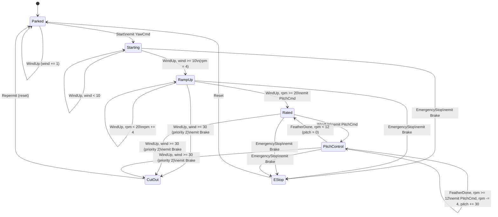

# wind_turbine_ctrl - a wind turbine controller mode machine

## What it demonstrates
- A turbine controller: parked -> starting -> ramp-up -> rated -> pitch-control -> cut-out -> emergency-stop, driven by wind-speed thresholds. The rotor speed rises in steps of 4 per gust while ramping and is capped at the rated value (20) by the pitch-response guard; once the cap is reached, further gusts move the machine into pitch control, where feathering (pitch += 30 per `FeatherDone`) sheds load until the speed is back below the re-entry band. Cut-out at wind >= 30 is IRREVERSIBLE until an explicit Repermit, and the emergency stop brakes from any active mode. RFS features: a hard overspeed invariant, threshold hysteresis with priority-ordered cut-out, and bounded-reaction + irreversibility properties.
- The automaton is drawn from real turbine control logic (rated-speed pitch regulation, cut-out with re-permission, emergency brake). Rationale: an industrial-control safety machine where the core value is a single strong invariant - the rotor never overspeeds - plus the sequencing rules around it.

## The machine


## RFS modes demonstrated
### Specification & analysis (`rfs validate`, `rfs info`)
The spec parses and validates; `rfs info` reports the 7 states, 6 events, 3 outputs,
the three variables, and the three monitored properties. Rationale: the analysis gate
that runs before any codegen/MC.

### Model checking - in-process (`rfs mc-ref`, exact)
`pass.rfs` model-checks to **PASS complete** (667 states): `never_above_rated_rpm` holds
- the pitch-response guard caps the rotor at 20 - `bounded_feather` holds (every step
into pitch control emits the feather command at once: bounded reaction), and
`cutout_irreversible` holds (from CutOut the only exit is an explicit Repermit). The
negative variant `fail.rfs` widens the pitch-response guard (`rotor_rpm < 28` instead of
`< 20`) so the rotor exceeds rated RPM while ramping - a pinned **property-violation** CE
on `never_above_rated_rpm` at step 17 (a WindUp drives rotor_rpm from 20 to 24);
`fixed.rfs` tightens the guard back and re-runs to PASS.

### Model checking - generated binaries (rust + c)
Both backends' MC binaries are generated, compiled, and run in exact mode; their reports
are **byte-identical** to each other and to mc-ref. The failing variant's CE is identical
across all three engines.

### Production code generation (rust + c)
`rfs codegen rust production` and `rfs codegen c production` both compile the FSM
warning-free - the generated-C compiler-agnosticism bar. Rationale: a threshold-hysteresis
controller with a strong overspeed invariant compiles to shippable turbine firmware in
both backends.

## Files layout
| File | Role |
|---|---|
| `pass.rfs` | the valid controller (rated-RPM cap + irreversible cut-out) |
| `fail.rfs` | pitch-response guard widened (overspeed defect) |
| `fixed.rfs` | the corrected spec (= pass.rfs) |
| `run.sh` | drives every demonstrated RFS mode |
| `captures/` | pinned outputs (text + JSON CEs) |

## Build / run / test
Prerequisite: the rfs toolchain built (`cargo build`) or `RFS_BIN` set; rustc + gcc available.
```sh
./run.sh
```

## Expected results
- `rfs validate pass.rfs` -> ok; `rfs info` lists 7 states / 6 events / 3 outputs.
- mc-ref on `pass.rfs`: `status=pass-complete states=667 transitions=1053 max_depth=96`.
- mc-ref on `fail.rfs`: exit 1, `reason=property-violation label=never_above_rated_rpm step=17`;
  the CE shows the ramp-up sequence (rpm 4 -> 8 -> 12 -> 16 -> 20) and then a WindUp that
  drives rpm to 24 - past rated. The JSON form carries the same label/step.
- mc-ref on `fixed.rfs`: PASS complete again; both generated backends agree byte-for-byte.
- Production codegen compiles clean (rust) and warning-free (c).
- What to pay attention to: the cut-out transitions carry `priority 2` so they outrank the
  ramp/rated self-loops when wind >= 30 - an overlapping-guard demonstration (the lower-
  priority transition is shadowed, not deadlocked). The analog dynamics (torque, blade
  aerodynamics) are abstracted to the discrete threshold layer per the phase plan's rule.
