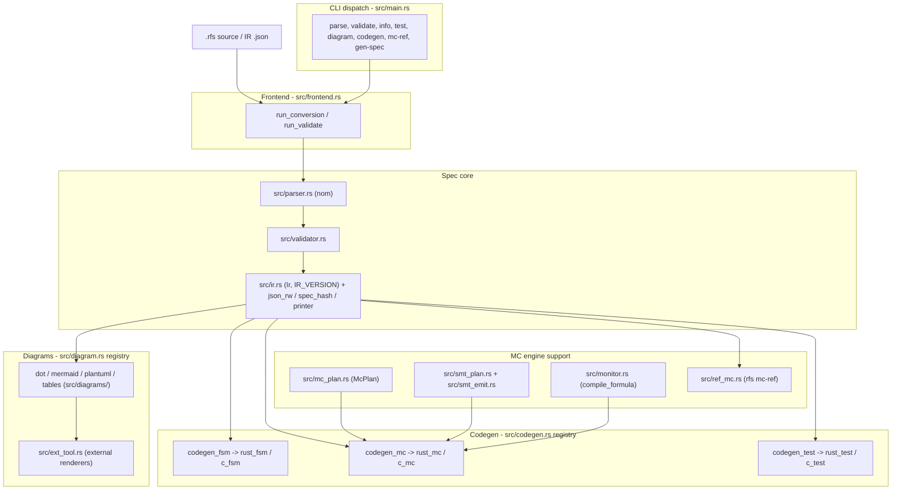

# RFS Architecture

Pipeline overview, component diagram, and functionality hierarchy of the RFS
toolchain: spec to parse to validate to IR to codegen / model checking /
diagrams.

## Pipeline overview

RFS is an in-memory pipeline: a command loads a spec, normalizes it to one
versioned IR, and derives its output from that IR alone - there is no
intermediate on-disk representation between stages.

1. **Input** - a spec arrives as RFS source text (`.rfs`) or as IR JSON
   (`.json`); `src/frontend.rs::Format` maps extensions to formats and
   `src/frontend.rs::convert_file_to_ir` loads either form into the IR.
2. **Parse** - RFS source is parsed by the nom-based parser,
   `src/parser.rs::parse_source` (or `src/parser.rs::parse_file` for a path),
   producing an `Ir` with source spans attached to every node
   (`src/error.rs::Span`).
3. **Validate** - `src/validator.rs::validate_ir` runs the semantic checks
   (well-formed states/events/transitions, expression typing) and returns a
   list of validation errors; a spec is usable only when that list is empty.
4. **IR** - the normalized form is `src/ir.rs::Ir`, versioned by
   `src/ir.rs::IR_VERSION`. Its wire format is hand-rolled JSON
   (`src/json_rw.rs`); every generated artifact carries the spec hash
   `src/spec_hash.rs::spec_hash16` (first 16 hex chars of SHA-256 over the
   canonical IR JSON) in its header line. The IR can be printed back to RFS
   source by `src/printer.rs::print_ir`.
5. **Targets** - everything downstream consumes the validated IR:
   - *Production FSM code*, *model-checker executables* and *unit/fuzz tests*
     are generated through the backend plugin registry
     `src/codegen.rs::BACKENDS` (lookup: `src/codegen.rs::get_backend`), with
     the Rust and C backends registered in `src/backends/rust.rs` /
     `src/backends/c.rs`; shared codegen helpers live in
     `src/codegen_fsm.rs`, `src/codegen_mc.rs` and `src/codegen_test.rs`.
   - *Model checking* plans are computed once per spec by
     `src/mc_plan.rs::McPlan` and embedded in both backends' checker
     binaries; the SMT path is rendered from `src/smt_plan.rs` by
     `src/smt_emit.rs`, and `src/ref_mc.rs::run` provides the in-process
     reference checker behind `rfs mc-ref`.
   - *Monitors* for PSL properties are compiled by
     `src/monitor.rs::compile_formula` into `src/monitor.rs::MonitorPlan`s
     embedded in the generated checkers.
   - *Diagrams* (state diagrams, transition tables) come from the diagram
     plugin registry `src/diagram.rs::DIAGRAMS`, one plugin per format under
     `src/diagrams/`; external renderers are resolved through
     `src/ext_tool.rs::ExtTool`.

The CLI (`src/main.rs`) exposes this pipeline as eight commands: `parse` and
`validate` (frontend logic in `src/frontend.rs::run_conversion` /
`src/frontend.rs::run_validate`), `info`, `test`, `diagram`, `codegen`,
`mc-ref`, and `gen-spec` (the one producer-side command: it writes a random
spec, then parses + validates it before writing).

## Component diagram

## Functionality hierarchy

TBD (task 2.2): functionality hierarchy tree + relationship map between
components.
