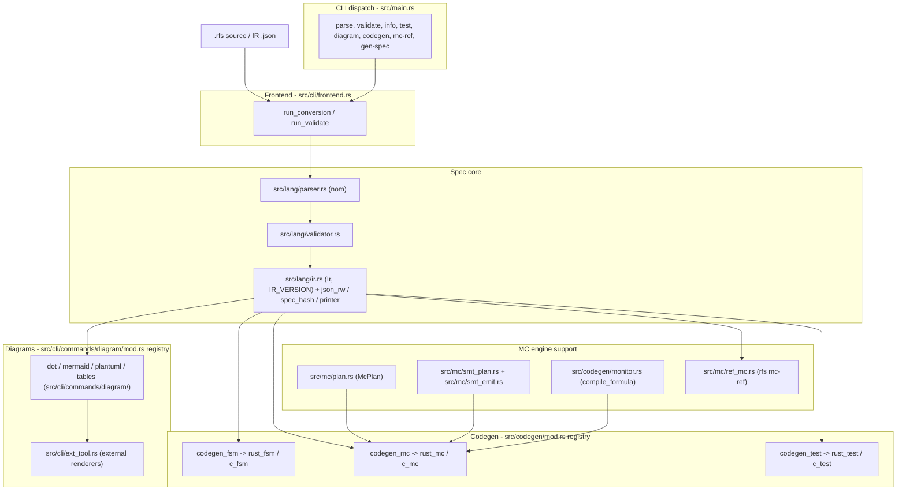
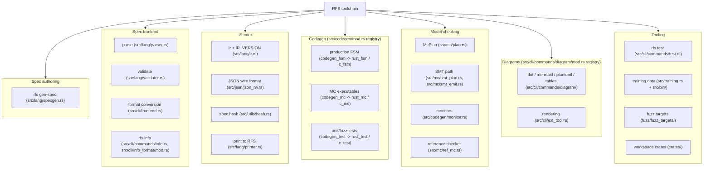

# RFS Architecture

Pipeline overview, component diagram, and functionality hierarchy of the RFS
toolchain: spec to parse to validate to IR to codegen / model checking /
diagrams.

## Pipeline overview

RFS is an in-memory pipeline: a command loads a spec, normalizes it to one
versioned IR, and derives its output from that IR alone - there is no
intermediate on-disk representation between stages.

1. **Input** - a spec arrives as RFS source text (`.rfs`) or as IR JSON
   (`.json`); `src/cli/frontend.rs::Format` maps extensions to formats and
   `src/cli/frontend.rs::convert_file_to_ir` loads either form into the IR.
2. **Parse** - RFS source is parsed by the nom-based parser,
   `src/lang/parser.rs::parse_source` (or `src/lang/parser.rs::parse_file` for a path),
   producing an `Ir` with source spans attached to every node
   (`src/lang/error.rs::Span`).
3. **Validate** - `src/lang/validator.rs::validate_ir` runs the semantic checks
   (well-formed states/events/transitions, expression typing) and returns a
   list of validation errors; a spec is usable only when that list is empty.
4. **IR** - the normalized form is `src/lang/ir.rs::Ir`, versioned by
   `src/lang/ir.rs::IR_VERSION`. Its wire format is hand-rolled JSON
   (`src/json/json_rw.rs`); every generated artifact carries the spec hash
   `src/utils/hash.rs::spec_hash16` (first 16 hex chars of SHA-256 over the
   canonical IR JSON) in its header line. The IR can be printed back to RFS
   source by `src/lang/printer.rs::print_ir`.
5. **Targets** - everything downstream consumes the validated IR:
   - *Production FSM code*, *model-checker executables* and *unit/fuzz tests*
     are generated through the backend plugin registry
     `src/codegen/mod.rs::BACKENDS` (lookup: `src/codegen/mod.rs::get_backend`), with
     the Rust and C backends registered in `src/codegen/backends/rust/mod.rs` /
     `src/codegen/backends/c/mod.rs`; shared codegen helpers live in
     `src/codegen/fsm.rs`, `src/codegen/mc_concepts.rs` and `src/codegen/test_plan.rs`.
   - *Model checking* plans are computed once per spec by
     `src/mc/plan.rs::McPlan` and embedded in both backends' checker
     binaries; the SMT path is rendered from `src/mc/smt_plan.rs` by
     `src/mc/smt_emit.rs`, and `src/mc/ref_mc.rs::run` provides the in-process
     reference checker behind `rfs mc-ref`.
   - *Monitors* for PSL properties are compiled by
     `src/codegen/monitor.rs::compile_formula` into `src/codegen/monitor.rs::MonitorPlan`s
     embedded in the generated checkers.
   - *Diagrams* (state diagrams, transition tables) come from the diagram
     plugin registry `src/cli/commands/diagram/mod.rs::DIAGRAMS`, one plugin per format under
     `src/cli/commands/diagram/`; external renderers are resolved through
     `src/cli/ext_tool.rs::ExtTool`.

The CLI (`src/main.rs`) exposes this pipeline as eight commands: `parse` and
`validate` (frontend logic in `src/cli/frontend.rs::run_conversion` /
`src/cli/frontend.rs::run_validate`), `info`, `test`, `diagram`, `codegen`,
`mc-ref`, and `gen-spec` (the one producer-side command: it writes a random
spec, then parses + validates it before writing).

## Component diagram

## Functionality hierarchy

### Relationship map

- **The IR is the only shared currency.** Every consumer - codegen, model
  checking, diagrams, `rfs info` - reads the validated `src/lang/ir.rs::Ir`; no
  component passes live data structures to another outside the shared helper
  modules. All file-based commands load their spec through the frontend
  gateway `src/cli/frontend.rs::convert_file_to_ir`; `gen-spec`
  (`src/lang/specgen.rs`) is the only producer-side command.
- **Two plugin registries, one pattern.** Codegen
  (`src/codegen/mod.rs::BACKENDS`, lookup `src/codegen/mod.rs::get_backend`) and
  diagrams (`src/cli/commands/diagram/mod.rs::DIAGRAMS`) both use a static registry of
  struct-plus-function-pointer entries; adding a backend or a diagram format
  means registering one entry, not touching the dispatch.
- **Parity by construction.** The model-checking plan is computed once in
  Rust (`src/mc/plan.rs::McPlan`) and embedded in BOTH backends' checker
  binaries, and the SMT spec is rendered from one backend-neutral source
  (`src/mc/smt_plan.rs`) into Rust (z3) and C (libz3) by `src/mc/smt_emit.rs` - so
  Rust/C checker behavior cannot drift apart at the plan level.
- **Independent ground truth.** The reference checker `src/mc/ref_mc.rs::run`
  deliberately shares no code with the generated checkers; it is the oracle
  that cross-checks them (`rfs mc-ref`).
- **Monitors are embedded, not linked.** `src/codegen/monitor.rs::compile_formula`
  runs at codegen time; the resulting `src/codegen/monitor.rs::MonitorPlan` is baked
  into the generated artifacts rather than being a runtime dependency.
- **Shared external-tool layer.** Optional external tools (diagram renderers,
  rustc/gcc for compiling generated tests) are resolved and invoked through
  `src/cli/ext_tool.rs::ExtTool`, which can also emit a deterministic POSIX sh
  script instead of executing (`--print-script`).
- **Workspace crates wrap the pipeline.** `crates/rfs-build` drives the same
  compile path from dependent crates' `build.rs`; `crates/rfs-adapters`
  provides runtime adapters around generated FSMs. The fuzz targets in
  `fuzz/fuzz_targets/` feed random inputs into the same parser/validator/IR/
codegen functions the pipeline uses.
