# RFS Dependencies

File-level and function-level dependency graphs (mermaid, validated by the
existing docs gate). Function-level graphs cover the core modules: parser,
validator, codegen core, both backends, MC engine, monitor compiler.

## File-level dependency graph

Module-level dependencies of all 71 hand-written files, derived from the
`use crate::` / `use super::` statements (plus verified inline `crate::x::`
paths). Edge direction: `A --> B` reads "A uses B". The graph is split into
per-area subgraphs to stay within the renderer's layout limits.

```mermaid
flowchart TD
    subgraph ROOT["root (6)"]
        lib["lib.rs"]
        main["main.rs"]
        err["error.rs"]
        clog["cli_log.rs"]
        fe["frontend.rs"]
        pr["printer.rs"]
    end

    subgraph PARSER["parser (2)"]
        par["parser.rs"]
        ebnf["ebnf_grammar.rs"]
    end

    subgraph VIR["validator + IR (5)"]
        val["validator.rs"]
        ir["ir.rs"]
        jr["json_rw.rs"]
        js["json_schema.rs"]
        sh["spec_hash.rs"]
    end

    subgraph CGEN["codegen core (4)"]
        cg["codegen.rs"]
        cfs["codegen_fsm.rs"]
        cmc["codegen_mc.rs"]
        ct["codegen_test.rs"]
    end

    subgraph BACK["backends (9)"]
        bm["backends/mod.rs"]
        br["backends/rust.rs"]
        brf["backends/rust_fsm.rs"]
        brm["backends/rust_mc.rs"]
        brt["backends/rust_test.rs"]
        bc["backends/c.rs"]
        bcf["backends/c_fsm.rs"]
        bcm["backends/c_mc.rs"]
        bct["backends/c_test.rs"]
    end

    subgraph MC["MC engine (4)"]
        mp["mc_plan.rs"]
        sp["smt_plan.rs"]
        se["smt_emit.rs"]
        rm["ref_mc.rs"]
    end

    subgraph MON["monitor (1)"]
        mon["monitor.rs"]
    end

    subgraph CLI["CLI (7)"]
        inf["info.rs"]
        infm["info_format.rs"]
        gsc["gen_spec_cmd.rs"]
        tc["test_cmd.rs"]
        mrc["mc_ref_cmd.rs"]
        sg["specgen.rs"]
        et["ext_tool.rs"]
    end

    subgraph DIAG["diagrams (6)"]
        dg["diagram.rs"]
        dm["diagrams/mod.rs"]
        dot["diagrams/dot.rs"]
        mmd["diagrams/mermaid.rs"]
        puml["diagrams/plantuml.rs"]
        tab["diagrams/tables.rs"]
    end

    subgraph BIN["bins + training (5)"]
        tr["training.rs"]
        b1["bin/build_training.rs"]
        b2["bin/extract_training_snippets.rs"]
        b3["bin/generate_code_tests.rs"]
        b4["bin/test_generated_code.rs"]
    end

    subgraph CRATES["workspace crates (17)"]
        rb["rfs-build/lib.rs"]
        rbi["rfs-build/tests"]
        ra["adapters/lib.rs"]
        raa["adapters/async_adapter.rs"]
        rac["adapters/callback.rs"]
        rach["adapters/channel.rs"]
        ram["adapters/minimal.rs"]
        rat["adapters/tests"]
        ran["adapters/nostd test"]
        ahb["async_handler/build.rs"]
        ahl["async_handler/lib.rs"]
        ahm["async_handler/main.rs"]
        shb["sync_handler/build.rs"]
        shl["sync_handler/lib.rs"]
        shm["sync_handler/main.rs"]
        frb["fuzz_rust/build.rs"]
        frl["fuzz_rust/lib.rs"]
    end

    subgraph FUZZ["fuzz targets (5)"]
        fp["fuzz/parser.rs"]
        fv["fuzz/validator.rs"]
        fir["fuzz/ir_roundtrip.rs"]
        fc["fuzz/codegen.rs"]
        fcm["fuzz/common.rs"]
    end

    main --> lib
    b1 --> lib
    b2 --> lib
    b3 --> lib
    b4 --> lib
    fp --> lib
    fv --> lib
    fir --> lib
    fc --> lib
    fcm --> lib

    fe --> ir
    fe --> jr
    fe --> pr
    fe --> val
    pr --> ir
    pr --> jr
    pr --> par
    par --> err
    par --> ir
    par --> jr
    par --> pr
    val --> ir
    val --> par
    ir --> jr
    js --> jr

    cg --> bm
    cg --> cmc
    cg --> ir
    cg --> sh
    cfs --> ir
    cfs --> par
    cmc --> cg
    cmc --> jr
    ct --> cg
    ct --> cfs
    ct --> ir
    ct --> mon
    ct --> par
    ct --> sg
    ct --> val

    br --> cg
    br --> cfs
    br --> ir
    brf --> bm
    brf --> cg
    brf --> cfs
    brf --> ir
    brf --> mon
    brf --> val
    brm --> bm
    brm --> cg
    brm --> cfs
    brm --> cmc
    brm --> ir
    brm --> mp
    brm --> pr
    brm --> se
    brm --> sp
    brt --> bm
    brt --> cg
    brt --> cfs
    brt --> ct
    brt --> ir
    brt --> par
    brt --> sh
    bc --> bm
    bc --> cg
    bc --> ir
    bcf --> bm
    bcf --> cg
    bcf --> cfs
    bcf --> ir
    bcf --> mon
    bcf --> val
    bcm --> bm
    bcm --> cg
    bcm --> cfs
    bcm --> cmc
    bcm --> ir
    bcm --> mp
    bcm --> pr
    bcm --> se
    bcm --> sp
    bct --> bm
    bct --> cg
    bct --> cfs
    bct --> ct
    bct --> ir

    mp --> cg
    mp --> cfs
    mp --> ir
    mp --> mon
    mp --> par
    sp --> cfs
    sp --> ir
    sp --> mp
    se --> sp
    rm --> cmc
    rm --> ir
    rm --> jr
    rm --> par
    mon --> ir
    mon --> par

    inf --> fe
    inf --> ir
    inf --> jr
    inf --> mon
    inf --> val
    infm --> cmc
    infm --> ebnf
    infm --> js
    gsc --> clog
    gsc --> fe
    gsc --> par
    gsc --> pr
    gsc --> sg
    gsc --> val
    tc --> clog
    tc --> cg
    tc --> et
    tc --> fe
    tc --> ir
    tc --> val
    mrc --> clog
    mrc --> cmc
    mrc --> fe
    mrc --> jr
    mrc --> rm
    mrc --> val
    sg --> ir
    sg --> par
    sg --> pr
    sg --> val

    dg --> dm
    dg --> et
    dg --> fe
    dg --> ir
    dg --> val
    dm --> et
    dm --> inf
    dm --> ir
    dot --> dg
    dot --> dm
    dot --> et
    dot --> ir
    mmd --> dg
    mmd --> dm
    mmd --> et
    mmd --> ir
    mmd --> jr
    puml --> dg
    puml --> dm
    puml --> et
    puml --> ir
    tab --> dg
    tab --> dm
    tab --> inf
    tab --> ir

    tr --> jr
    tr --> val

    rbi --> rb
    rat --> ra
    ran --> ram
    raa --> ra
    rac --> ra
    rach --> ra
    ram --> ra
    ahb --> rb
    ahl --> ra
    ahm --> ahl
    shb --> rb
    shl --> ra
    shm --> shl
    frb --> rb
```

Reading the graph:

- **The IR is the hub.** `src/ir.rs::Ir` is depended on by every consumer
  (frontend, codegen, backends, MC, diagrams, CLI); it depends only on
  `src/json_rw.rs`, which depends on nothing - the two together are the
  foundation of the crate.
- **The plugin registries are mutually dependent by design.**
  `src/codegen.rs` holds the `Backend` trait and the `BACKENDS` registry, so
  it references the backend files for their registration entries, while the
  backend files reference `src/codegen.rs` for the trait - the same pattern
  holds for `src/diagram.rs` and `src/diagrams/`. These cycles are type-level
  only and are the price of the static-registry plugin pattern.
- **The SMT path is a clean chain.** `src/smt_emit.rs` depends only on
  `src/smt_plan.rs`, which depends on `src/mc_plan.rs`; both `*_mc` backends
  consume the chain, and nothing else does.
- **The reference checker stays independent.** `src/ref_mc.rs` depends on the
  IR, `src/json_rw.rs`, the parser, and the shared report concepts in
  `src/codegen_mc.rs` - never on the backends or the codegen registry.
- **Workspace crates are standalone.** `rfs-build` and `rfs-adapters` have no
  dependency on the root crate; the example crates depend on `rfs-adapters`
  (and on `rfs-build` as a build dependency), and the fuzz targets link the
  root crate.

## Function level - parser + validator

TBD (task 4.2). Fragment anchor added in task 4.2.

## Function level - codegen core + Rust backend

TBD (task 4.3). Fragment anchor added in task 4.3.

## Function level - C backend + MC engine

TBD (task 4.4). Fragment anchor added in task 4.4.

## Function level - monitor compiler

TBD (task 4.5). Fragment anchor added in task 4.5.
