# RFS Dependencies

File-level and function-level dependency graphs (mermaid, validated by the
existing docs gate). Function-level graphs cover the core modules: parser,
validator, codegen core, both backends, MC engine, monitor compiler.

## File-level dependency graph

Module-level dependencies of all 71 hand-written files, derived from the
`use crate::` / `use super::` statements (plus verified inline `crate::x::`
paths). Edge direction: `A --> B` reads "A uses B". The graph is split into
per-area subgraphs to stay within the renderer's layout limits.

```mermaid
flowchart TD
    subgraph ROOT["root (6)"]
        lib["lib.rs"]
        main["main.rs"]
        err["error.rs"]
        clog["cli_log.rs"]
        fe["frontend.rs"]
        pr["printer.rs"]
    end

    subgraph PARSER["parser (2)"]
        par["parser.rs"]
        ebnf["ebnf_grammar.rs"]
    end

    subgraph VIR["validator + IR (5)"]
        val["validator.rs"]
        ir["ir.rs"]
        jr["json_rw.rs"]
        js["json_schema.rs"]
        sh["spec_hash.rs"]
    end

    subgraph CGEN["codegen core (4)"]
        cg["codegen.rs"]
        cfs["codegen_fsm.rs"]
        cmc["codegen_mc.rs"]
        ct["codegen_test.rs"]
    end

    subgraph BACK["backends (9)"]
        bm["backends/mod.rs"]
        br["backends/rust.rs"]
        brf["backends/rust_fsm.rs"]
        brm["backends/rust_mc.rs"]
        brt["backends/rust_test.rs"]
        bc["backends/c.rs"]
        bcf["backends/c_fsm.rs"]
        bcm["backends/c_mc.rs"]
        bct["backends/c_test.rs"]
    end

    subgraph MC["MC engine (4)"]
        mp["mc_plan.rs"]
        sp["smt_plan.rs"]
        se["smt_emit.rs"]
        rm["ref_mc.rs"]
    end

    subgraph MON["monitor (1)"]
        mon["monitor.rs"]
    end

    subgraph CLI["CLI (7)"]
        inf["info.rs"]
        infm["info_format.rs"]
        gsc["gen_spec_cmd.rs"]
        tc["test_cmd.rs"]
        mrc["mc_ref_cmd.rs"]
        sg["specgen.rs"]
        et["ext_tool.rs"]
    end

    subgraph DIAG["diagrams (6)"]
        dg["diagram.rs"]
        dm["diagrams/mod.rs"]
        dot["diagrams/dot.rs"]
        mmd["diagrams/mermaid.rs"]
        puml["diagrams/plantuml.rs"]
        tab["diagrams/tables.rs"]
    end

    subgraph BIN["bins + training (5)"]
        tr["training.rs"]
        b1["bin/build_training.rs"]
        b2["bin/extract_training_snippets.rs"]
        b3["bin/generate_code_tests.rs"]
        b4["bin/test_generated_code.rs"]
    end

    subgraph CRATES["workspace crates (17)"]
        rb["rfs-build/lib.rs"]
        rbi["rfs-build/tests"]
        ra["adapters/lib.rs"]
        raa["adapters/async_adapter.rs"]
        rac["adapters/callback.rs"]
        rach["adapters/channel.rs"]
        ram["adapters/minimal.rs"]
        rat["adapters/tests"]
        ran["adapters/nostd test"]
        ahb["async_handler/build.rs"]
        ahl["async_handler/lib.rs"]
        ahm["async_handler/main.rs"]
        shb["sync_handler/build.rs"]
        shl["sync_handler/lib.rs"]
        shm["sync_handler/main.rs"]
        frb["fuzz_rust/build.rs"]
        frl["fuzz_rust/lib.rs"]
    end

    subgraph FUZZ["fuzz targets (5)"]
        fp["fuzz/parser.rs"]
        fv["fuzz/validator.rs"]
        fir["fuzz/ir_roundtrip.rs"]
        fc["fuzz/codegen.rs"]
        fcm["fuzz/common.rs"]
    end

    main --> lib
    b1 --> lib
    b2 --> lib
    b3 --> lib
    b4 --> lib
    fp --> lib
    fv --> lib
    fir --> lib
    fc --> lib
    fcm --> lib

    fe --> ir
    fe --> jr
    fe --> pr
    fe --> val
    pr --> ir
    pr --> jr
    pr --> par
    par --> err
    par --> ir
    par --> jr
    par --> pr
    val --> ir
    val --> par
    ir --> jr
    js --> jr

    cg --> bm
    cg --> cmc
    cg --> ir
    cg --> sh
    cfs --> ir
    cfs --> par
    cmc --> cg
    cmc --> jr
    ct --> cg
    ct --> cfs
    ct --> ir
    ct --> mon
    ct --> par
    ct --> sg
    ct --> val

    br --> cg
    br --> cfs
    br --> ir
    brf --> bm
    brf --> cg
    brf --> cfs
    brf --> ir
    brf --> mon
    brf --> val
    brm --> bm
    brm --> cg
    brm --> cfs
    brm --> cmc
    brm --> ir
    brm --> mp
    brm --> pr
    brm --> se
    brm --> sp
    brt --> bm
    brt --> cg
    brt --> cfs
    brt --> ct
    brt --> ir
    brt --> par
    brt --> sh
    bc --> bm
    bc --> cg
    bc --> ir
    bcf --> bm
    bcf --> cg
    bcf --> cfs
    bcf --> ir
    bcf --> mon
    bcf --> val
    bcm --> bm
    bcm --> cg
    bcm --> cfs
    bcm --> cmc
    bcm --> ir
    bcm --> mp
    bcm --> pr
    bcm --> se
    bcm --> sp
    bct --> bm
    bct --> cg
    bct --> cfs
    bct --> ct
    bct --> ir

    mp --> cg
    mp --> cfs
    mp --> ir
    mp --> mon
    mp --> par
    sp --> cfs
    sp --> ir
    sp --> mp
    se --> sp
    rm --> cmc
    rm --> ir
    rm --> jr
    rm --> par
    mon --> ir
    mon --> par

    inf --> fe
    inf --> ir
    inf --> jr
    inf --> mon
    inf --> val
    infm --> cmc
    infm --> ebnf
    infm --> js
    gsc --> clog
    gsc --> fe
    gsc --> par
    gsc --> pr
    gsc --> sg
    gsc --> val
    tc --> clog
    tc --> cg
    tc --> et
    tc --> fe
    tc --> ir
    tc --> val
    mrc --> clog
    mrc --> cmc
    mrc --> fe
    mrc --> jr
    mrc --> rm
    mrc --> val
    sg --> ir
    sg --> par
    sg --> pr
    sg --> val

    dg --> dm
    dg --> et
    dg --> fe
    dg --> ir
    dg --> val
    dm --> et
    dm --> inf
    dm --> ir
    dot --> dg
    dot --> dm
    dot --> et
    dot --> ir
    mmd --> dg
    mmd --> dm
    mmd --> et
    mmd --> ir
    mmd --> jr
    puml --> dg
    puml --> dm
    puml --> et
    puml --> ir
    tab --> dg
    tab --> dm
    tab --> inf
    tab --> ir

    tr --> jr
    tr --> val

    rbi --> rb
    rat --> ra
    ran --> ram
    raa --> ra
    rac --> ra
    rach --> ra
    ram --> ra
    ahb --> rb
    ahl --> ra
    ahm --> ahl
    shb --> rb
    shl --> ra
    shm --> shl
    frb --> rb
```

Reading the graph:

- **The IR is the hub.** `src/ir.rs::Ir` is depended on by every consumer
  (frontend, codegen, backends, MC, diagrams, CLI); it depends only on
  `src/json_rw.rs`, which depends on nothing - the two together are the
  foundation of the crate.
- **The plugin registries are mutually dependent by design.**
  `src/codegen.rs` holds the `Backend` trait and the `BACKENDS` registry, so
  it references the backend files for their registration entries, while the
  backend files reference `src/codegen.rs` for the trait - the same pattern
  holds for `src/diagram.rs` and `src/diagrams/`. These cycles are type-level
  only and are the price of the static-registry plugin pattern.
- **The SMT path is a clean chain.** `src/smt_emit.rs` depends only on
  `src/smt_plan.rs`, which depends on `src/mc_plan.rs`; both `*_mc` backends
  consume the chain, and nothing else does.
- **The reference checker stays independent.** `src/ref_mc.rs` depends on the
  IR, `src/json_rw.rs`, the parser, and the shared report concepts in
  `src/codegen_mc.rs` - never on the backends or the codegen registry.
- **Workspace crates are standalone.** `rfs-build` and `rfs-adapters` have no
  dependency on the root crate; the example crates depend on `rfs-adapters`
  (and on `rfs-build` as a build dependency), and the fuzz targets link the
  root crate.

## Function level - parser + validator

### Parser (`src/parser.rs`)

The parser is a nom-based recursive-descent implementation: every grammar
rule is a function returning `IResult<&str, T>`, and the rule tree mirrors
the EBNF grammar (rendered by `src/ebnf_grammar.rs`). Entry: `src/parser.rs::parse_file`
reads the file and delegates to `src/parser.rs::parse_source`, which strips
comments (`strip_comments`), runs the nom root `rfs_source`, and maps failures
through `nom_error_to_parse_error` / `err_at` (with the dedicated
`find_eventually_missing_paren` recovery for a missing `eventually` paren).
`semantic_err` / `syntax_err` are the tagged-error constructors used inside
the grammar rules. The expression chain is a 12-level precedence climb
(`expr` down to `primary_expr`); the PSL formula chain is a separate 8-level
precedence climb (`formula` down to `primary_formula`), whose primary also
parses event/output patterns and non-boolean expressions for `on`-style
operands. `src/parser.rs::KEYWORDS` is the keyword table shared by the
`keyword` / `soft_keyword` lexical helpers.

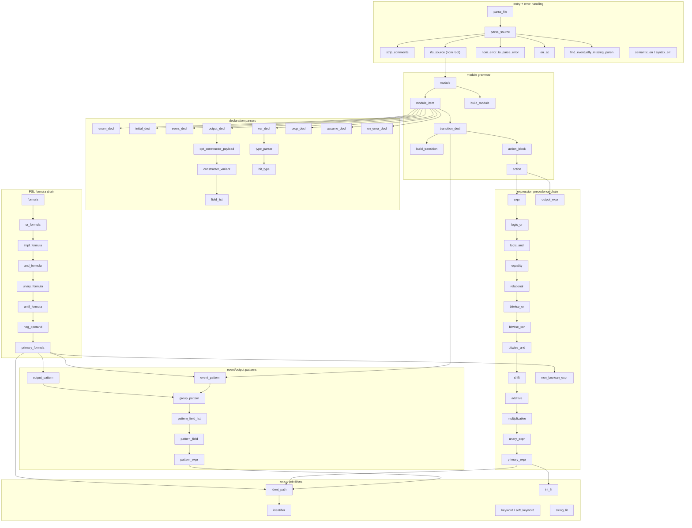

Isolated nodes (`semantic_err` / `syntax_err`, `keyword` / `soft_keyword`,
`string_lit`) are leaf helpers called from many grammar rules; the trivial
lexical leaves (`ident_start`, `ident_cont`, `digit`, `is_ident_byte`,
`p_tag`, `opt_p_tag`, `opt_semi`, `p_space0`, `p_space1`) are omitted for
readability.

### Validator (`src/validator.rs`)

Validation is two-phase. The fatal phase: `src/validator.rs::validate_ir`
iterates the modules and delegates to `validate_module`, which runs the
per-item checks - event/output pattern validation
(`validate_event_pattern` / `validate_output_expr`), expression typing
(`type_expr`), formula typing (`type_formula`), the bounded-always
malformation check (`bounded_always_error`), and the version-format check
(`is_valid_version_format`). The non-fatal phase: `src/validator.rs::module_warnings`
produces the Phase 2 diagnostics (unreachable states, dead events, unused
variables, impossible guards) via `contradictory_equalities`,
`is_literal_false` and `collect_names`; these never block code generation.
Typing resolves paths against the `src/validator.rs::Env` environment
(`resolve_path`), combines operand types in `binary_type` (which dispatches
to `bit_op_type` for the bit-level operators), and converts IR types via
`type_to_expr_type`. `type_formula` delegates pattern-group checks to
`check_pattern_group` / `check_output_pattern_group` - both are Phase 1
stubs (formula patterns do not bind variables yet). `src/validator.rs::is_safety_formula`
is a public utility with no internal callers (used by tests and external
tooling).

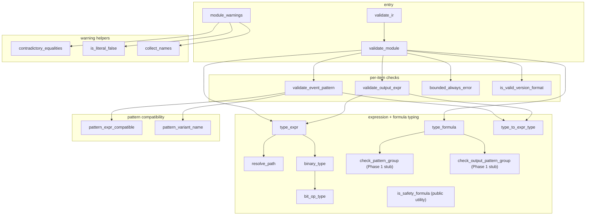

## Function level - codegen core + Rust backend

### Codegen core (`src/codegen.rs`)

The codegen core is the language-agnostic plugin layer: the `Backend` struct
carries one function pointer per command kind, and the static registry is
looked up by CLI name via `src/codegen.rs::get_backend` (listing via
`src/codegen.rs::list_backends`). `src/codegen.rs::parse_codegen_args` parses
the `rfs codegen` CLI into a `CodegenRequest`, collecting ALL errors before
failing (through the `finish` helper) and rejecting `--no-std` /
`--with-protocol-fsm` on the wrong commands with the pinned error constants.
`CodegenCommandKind::run` is the standard dispatch: it stamps the v1.0 spec
hash (`src/spec_hash.rs::spec_hash16` over the canonical IR JSON of the whole
file) into a cloned options set and delegates to `run_module`, which invokes
the backend's function pointer for the command kind. `src/codegen.rs::common_help`
and `src/codegen.rs::backend_help` render the help text from the registry
(command descriptors only - no generation happens there).

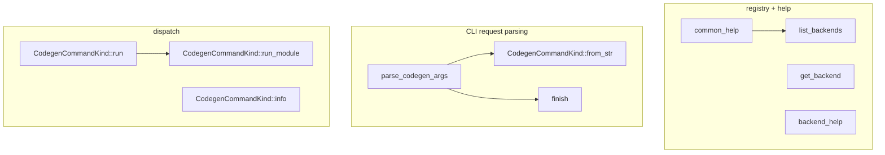

Isolated nodes: `get_backend` / `backend_help` / `CodegenCommandKind::info`
are leaves (registry reads only). `run` additionally calls
`src/spec_hash.rs::spec_hash16` and `Ir::to_json` (external); `run_module`
dispatches through the backend's function pointers, so the per-language edges
appear in the backend graphs below.

### Rust backend registration + helpers (`src/backends/rust.rs`)

`src/backends/rust.rs` registers `RUST_BACKEND` (three command descriptors
plus the three function pointers into `rust_fsm` / `rust_test` / `rust_mc`)
and provides the Rust-specific helpers shared by all three generator modules:
identifier mangling (`src/backends/rust.rs::rust_ident` for keywords,
`src/backends/rust.rs::rust_binding_ident` which additionally renames pattern
bindings that would shadow identifiers the generated body uses unqualified),
name normalization (`src/backends/rust.rs::snake`), type mapping
(`src/backends/rust.rs::rust_type` -> `src/backends/rust.rs::bit_rust_type`),
the bit-mask expression `src/backends/rust.rs::mask_expr`, and
`src/backends/rust.rs::representative_input_expr`, which renders a
representative input value from `src/codegen_fsm.rs::representative_values`.

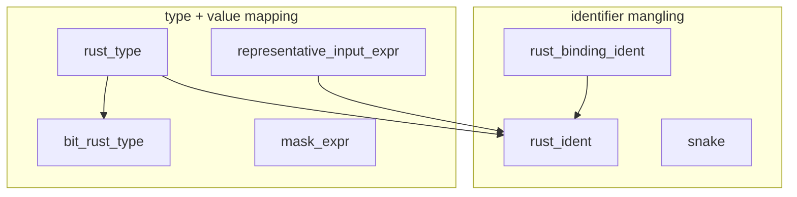

Isolated leaves: `snake` and `mask_expr` are called only from the other
backend modules (rust_fsm / rust_mc / rust_test); `representative_input_expr`
also calls `src/codegen_fsm.rs::representative_values` (external).

### Rust production FSM generation (`src/backends/rust_fsm.rs`)

`src/backends/rust_fsm.rs::generate_production` maps the
`--with-property-monitors` flag to a monitor mode and delegates to
`src/backends/rust_fsm.rs::generate_core` - the core generator shared by all
three commands (the test and mc entry points pass `with_tests` / `Always`
mode instead). `generate_core` re-validates the module
(`src/validator.rs::validate_module`) and then drives the `Gen` emitter:
`Gen::new` builds the variant table (`src/codegen_fsm.rs::build_variants`),
compiles the monitors, and runs the emission pipeline in a fixed order -
prelude (v1.0 header + no_std), enums, `Vars`, `Input`/`Output`, report
renderers, trace/handler types, monitors, the `Fsm` impl, and optionally the
`ProtocolFsm` impl and the test module
(`src/backends/rust_test.rs::emit_test_module`).

Monitor rendering: `compile_monitors` compiles each property/assumption
formula via `src/monitor.rs::compile_formula` (formulas outside the monitor
subset are skipped with a warning); `emit_monitors` renders one `Mon_*`
struct per plan via `render_monitor` -> `render_node` (nodes numbered in DFS
pre-order, evaluated in post-order), where each node's per-sample signal is
rendered by `gen_signal` -> `src/backends/rust_fsm.rs::render_signal_expr`
(recursive descent over the signal tree into `gen_expr` for variable
expressions and `src/backends/rust_fsm.rs::input_is_sample_expr` /
`src/backends/rust_fsm.rs::output_has_sample_expr` for pattern atoms).
`emit_fsm_impl` emits `Fsm::new` / `step` / `commit_step` plus the per-state
transition blocks (`transition_block` -> `pattern_block_open` / `gen_expr` /
`output_expr` / `pattern_block_close`) and the `on_error` fallback
(`on_error_block`). `src/backends/rust_fsm.rs::gen_expr` is the shared
expression renderer: it types every subexpression via
`src/validator.rs::type_expr` and renders bit-vector arithmetic with wrapping
ops plus width handling through `width_from_type` and the `mask_expr` /
`bit_rust_type` helpers of `src/backends/rust.rs`.

The MC/test shared renderers reuse the same helpers: `src/backends/rust_fsm.rs::render_mc_step_all`
renders the exact-mode `mc_step_all` (every enabled transition in firing
order) from the same IR with the same `pattern_block_open` / `gen_expr` /
`output_expr` helpers, and `src/backends/rust_fsm.rs::render_sample_formula_evaluator`
renders a per-sample boolean evaluator for liveness leaves via
`src/monitor.rs::formula_to_signal` + `gen_signal`. `src/backends/rust_fsm.rs::enum_renderer_names`
is the shared enum -> renderer name map used by both `emit_renderers` and the
MC JSON renderer (`src/backends/rust_mc.rs::json_renderers_rust`).

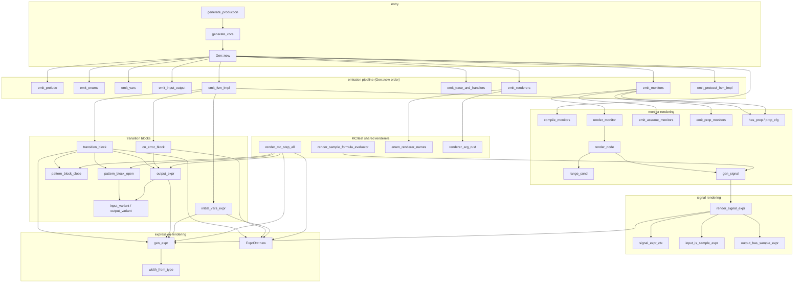

`render_signal_expr` and `gen_expr` are recursive (self-edges omitted). The
pipeline emitters `emit_prelude` / `emit_enums` / `emit_vars` /
`emit_input_output` / `emit_trace_and_handlers` are leaves (string emission
only); `emit_monitors` additionally calls
`src/backends/rust.rs::representative_input_expr` for the `ALL_INPUTS`
table, `render_monitor` uses `src/backends/rust.rs::snake`, and
`pattern_block_open` uses `src/backends/rust.rs::rust_binding_ident` plus
`src/validator.rs::type_to_expr_type` / `Env::for_module`.

### Rust unit-test generation (`src/backends/rust_test.rs`)

`src/backends/rust_test.rs::generate_unit_tests` runs
`src/backends/rust_fsm.rs::generate_core` with `with_tests` + `Always`
monitor mode, then appends the libfuzzer_sys fuzz skeleton as a separate
extra file via `src/backends/rust_test.rs::emit_fuzz_target` (decoding inputs
per `src/codegen_test.rs::build_fuzz_decode`). `src/backends/rust_test.rs::emit_test_module`
renders the `#[cfg(test)]` module from the shared plan
(`src/codegen_test.rs::build_test_plan`, with the negative-test assertion
chosen via `src/codegen_test.rs::has_definite_unexpected`): the module-level
tests (initial state, positive drive, negative search) plus one renderer per
plan class - `render_transition_test` (taken / not-taken),
`render_invariant_test` (re-checks the property atom at every sample via
`src/backends/rust_fsm.rs::render_signal_expr`), `render_monitor_test`, and
`render_random_trace_test`. Literal rendering flows through
`var_value_literal` / `vars_initializer` / `input_case_expr` /
`output_case_full_literal` / `resolve_output_variant` / `render_outputs_assert`
(full `assert_eq!` when every arg is statically known, otherwise the
documented partial-match fallback). `src/backends/rust_test.rs::generate_aggregate_test_crate`
(used by the `generate_code_tests` / `test_generated_code` bins) parses each
file (`src/parser.rs::parse_file`), stamps the per-file spec hash
(`src/spec_hash.rs::spec_hash16`), and codegens every module into its own
`pub mod` via `src/backends/rust_fsm.rs::generate_core`;
`src/backends/rust_test.rs::write_generated_crate` writes the crate under
`target/`.

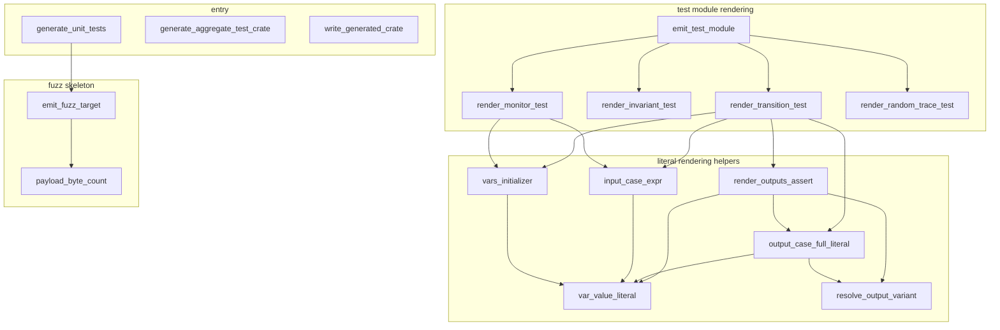

Isolated leaves: `write_generated_crate` (std::fs only) and
`render_random_trace_test` (pure formatting). `generate_unit_tests` and
`generate_aggregate_test_crate` both call
`src/backends/rust_fsm.rs::generate_core` (external); `emit_fuzz_target`
additionally uses `src/backends/rust.rs::bit_rust_type` /
`src/backends/rust.rs::rust_ident`.

### Rust model-checker generation (`src/backends/rust_mc.rs`)

`src/backends/rust_mc.rs::generate_model_checker` rejects `--no-std` and
`--with-protocol-fsm` with the pinned errors from `src/codegen.rs`; in
`smt-bounded` mode it renders a standalone z3 binary from the shared plan
(`src/smt_plan.rs::build_smt_spec` + `src/smt_emit.rs::emit_rust_spec`).
Otherwise it reuses the production FSM core
(`src/backends/rust_fsm.rs::generate_core` with `Always` monitors) and
appends the exact-mode runtime rendered by
`src/backends/rust_mc.rs::exact_codegen` from the codegen-time plan
(`src/mc_plan.rs::McPlan`): the canonical `all_inputs` enumeration (via
`domain_iter` / `rep_expr`), the `config_bytes` packing (via
`var_value_expr`), the shared `mc_step_all`
(`src/backends/rust_fsm.rs::render_mc_step_all`), the static BFS engine, the
JSON counterexample writer plus the per-module renderers
(`json_renderers_rust`, sharing `src/backends/rust_fsm.rs::enum_renderer_names`
with the text renderers), and the liveness engine - per-leaf sample
evaluators rendered by `src/backends/rust_fsm.rs::render_sample_formula_evaluator`,
skeleton expressions flattened by `flatten_skeleton`, property text via
`src/printer.rs::print_formula`. The fuzz runtime and the main dispatch are
static string templates (no codegen-time calls).

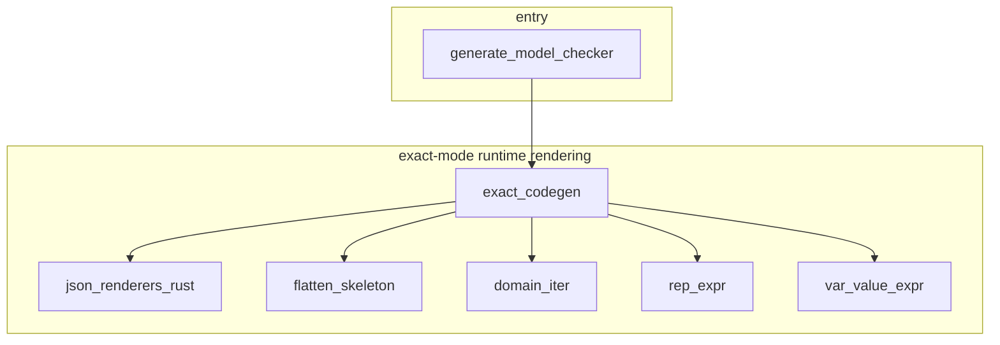

`flatten_skeleton` is recursive (self-edge omitted). `exact_codegen`
additionally calls `src/mc_plan.rs::LivenessDecomposition::compute` and the
`src/backends/rust.rs` helpers; `json_renderers_rust` calls
`src/codegen_fsm.rs::build_variants`; `domain_iter` / `rep_expr` /
`var_value_expr` use `src/backends/rust.rs::rust_ident`.

## Function level - C backend + MC engine

### C backend registration + helpers (`src/backends/c.rs`)

`src/backends/c.rs` registers `C_BACKEND` (three command descriptors plus
the three function pointers into `c_fsm` / `c_test` / `c_mc`) and provides
the C-specific helpers shared by all three generator modules: identifier
mangling (`src/backends/c.rs::c_ident` for keywords,
`src/backends/c.rs::c_binding_ident` which additionally renames pattern
bindings that would shadow identifiers the generated body uses unqualified),
type mapping (`src/backends/c.rs::c_type` ->
`src/backends/c.rs::bit_c_type`, which rejects widths other than 8/16/32/64
per decision D8), the in-range integer literal
`src/backends/c.rs::int_c_literal`, and the bit-mask expression
`src/backends/c.rs::mask_c_expr`.

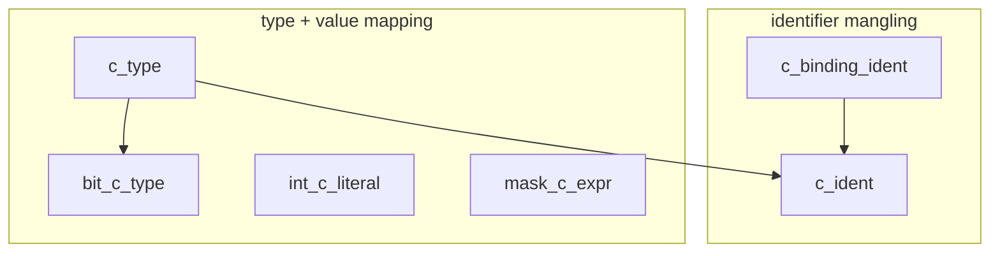

Isolated leaves: `int_c_literal` and `mask_c_expr` are called only from the
other backend modules (c_fsm / c_test / c_mc).

### C production FSM generation (`src/backends/c_fsm.rs`)

`src/backends/c_fsm.rs::generate_production` maps the
`--with-property-monitors` flag to a monitor mode and delegates to
`src/backends/c_fsm.rs::generate_core` - the core generator shared by all
three commands (the test and mc entry points pass `Always` mode instead).
`generate_core` drives the `Gen` emitter: `Gen::new` first rejects
unsupported bit widths (D8), then builds the variant table
(`src/codegen_fsm.rs::build_variants`), compiles the monitors, and runs the
emission pipeline in a fixed order - header (v1.0 artifact header +
`#define RFS_PROPERTY_MONITORS` in Gated mode), types (enums, `vars_t`,
tagged-union `input_t`/`output_t` via `emit_tagged`, trace/status/handler
types), monitors, and the `fsm_t` implementation.

Monitor rendering mirrors the Rust backend: `compile_monitors` compiles each
property/assumption formula via `src/monitor.rs::compile_formula` (formulas
outside the monitor subset are skipped with a warning); `emit_monitors`
renders one `mon_*` struct per plan via `render_monitor` -> `render_node`
(nodes numbered in DFS pre-order, evaluated in post-order), where each
node's per-sample signal is rendered by `gen_signal_c` ->
`src/backends/c_fsm.rs::render_signal_expr_c` (recursive descent over the
signal tree into `gen_expr_c` for variable expressions, referencing the
per-monitor pattern helpers `{prefix}_in_<i>` / `{prefix}_out_<i>` emitted
by `input_is_sample_helper_c` / `output_has_sample_helper_c` from the
conditions of `input_match_cond_c` / `output_match_cond_c`). `emit_fsm_impl`
emits `fsm_new` / `fsm_free` / `rfs_commit` / `fsm_step` plus the per-state
transition blocks (`transition_block_c` -> `gen_expr_c` /
`output_expr_c`, with bindings as local variables via `c_binding_ident`)
and the `on_error` fallback. `src/backends/c_fsm.rs::gen_expr_c` is the
shared expression lowering: it types every subexpression via
`src/validator.rs::type_expr` and renders bit-vector arithmetic with C
casts plus `mask_c_expr` masking (including the uint64-wide multiply and
guarded shift forms).

The MC/test shared renderers reuse the same helpers:
`src/backends/c_fsm.rs::render_mc_step_all_c` renders the exact-mode
`mc_step_all` (every enabled transition in firing order) via
`render_mc_step_all_body` + `mc_pattern_cond`, and
`src/backends/c_fsm.rs::render_liv_sample_evaluator_c` renders a per-sample
boolean evaluator for liveness leaves via
`src/monitor.rs::formula_to_signal` + `gen_signal_c`.

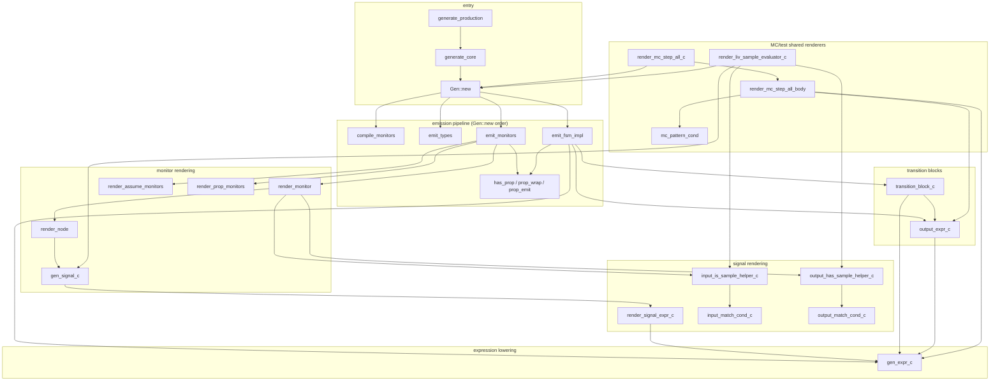

`render_signal_expr_c` and `gen_expr_c` are recursive (self-edges omitted).
Isolated nodes: `emit_header` (v1.0 header + no_std note), `emit_tagged`
(tagged-union types), `range_cond_c` (anchor-range condition),
`c_contains_ident` (whole-identifier check for the `(void)` unused-binding
cast), `collect_signal_patterns` / `collect_liv_signal_patterns` (recursive
pattern collectors), and the method wrappers `input_is_sample_helper_c` /
`output_has_sample_helper_c` on `Gen` (which delegate to the free
functions). `emit_monitors` additionally calls
`src/backends/rust.rs::snake` for label normalization; `render_monitor`
uses `src/backends/rust.rs::snake`; `gen_expr_c` uses
`src/backends/c.rs::bit_c_type` / `src/backends/c.rs::c_ident` /
`src/backends/c.rs::int_c_literal` / `src/backends/c.rs::mask_c_expr`;
`transition_block_c` / `mc_pattern_cond` / `render_mc_step_all_body` use
`src/backends/c.rs::c_binding_ident` / `src/backends/c.rs::c_type` /
`src/backends/c.rs::c_ident` / `src/backends/c.rs::int_c_literal` plus
`src/validator.rs::Env::for_module`.

### C unit-test generation (`src/backends/c_test.rs`)

`src/backends/c_test.rs::generate_unit_tests` runs
`src/backends/c_fsm.rs::generate_core` with `Always` monitor mode, then
appends a plain-assert harness (`main()` runs a table of test functions,
one `PASS`/`FAIL` line each) from the shared plan
(`src/codegen_test.rs::build_test_plan`): module-level tests (initial state,
positive drive, `render_negative_c`'s negative search), then one renderer
per plan class - `render_transition_test_c` (taken / not-taken via
`render_outputs_assert_c` / `render_signature_compare_c`),
`render_invariant_test_c` (re-checks the property atom at every sample via
`src/backends/c_fsm.rs::render_signal_expr_c` + the pattern helpers),
`render_monitor_test_c`, and `render_random_trace_test_c`. Literal rendering
flows through `var_value_literal_c` / `vars_initializer_c` /
`input_case_expr_c` / `resolve_output_variant_c`. The command also emits a
separate `fuzz_target.c` (a libFuzzer skeleton decoding inputs per
`src/codegen_test.rs::build_fuzz_decode`) via
`src/backends/c_test.rs::emit_fuzz_target_c`.

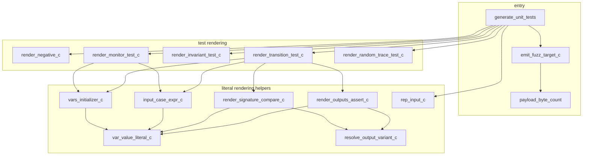

Isolated leaves: `render_random_trace_test_c` (pure formatting) and
`render_negative_c` (calls `src/codegen_test.rs::has_definite_unexpected`
plus `src/backends/c.rs::c_ident`). `generate_unit_tests` additionally
calls `src/backends/rust.rs::snake` for test-name normalization;
`render_invariant_test_c` calls the `src/backends/c_fsm.rs` pattern helpers
+ `render_signal_expr_c` (external); `emit_fuzz_target_c` additionally uses
`src/backends/c.rs::bit_c_type` / `src/backends/c.rs::c_ident`.

### C model-checker generation (`src/backends/c_mc.rs`)

`src/backends/c_mc.rs::generate_model_checker` rejects `--no-std` and
`--with-protocol-fsm` with the pinned errors from `src/codegen.rs`; in
`smt-bounded` mode it renders a standalone z3 binary from the shared plan
(`src/smt_plan.rs::build_smt_spec` + `src/smt_emit.rs::emit_c_spec`).
Otherwise it reuses the production FSM core
(`src/backends/c_fsm.rs::generate_core` with `Always` monitors) and appends
the exact-mode runtime rendered by
`src/backends/c_mc.rs::exact_codegen_c` from the codegen-time plan
(`src/mc_plan.rs::McPlan`): the shared trace/vars printers
(`shared_printers` -> `print_value_c`, byte-identical to the Rust MC's
Debug format), the canonical `all_inputs` enumeration (via `domain_loop` /
`rep_value_c` / `domain_size`), the `config_bytes` packing (via
`var_value_c`), the shared `mc_step_all`
(`src/backends/c_fsm.rs::render_mc_step_all_c`), the static BFS engine, the
JSON counterexample writer plus the per-module renderers
(`json_renderers_c` -> `json_value_c`), and the liveness engine - per-leaf
sample evaluators rendered by
`src/backends/c_fsm.rs::render_liv_sample_evaluator_c`, skeleton
expressions flattened by `flatten_skeleton_c`, property text via
`src/printer.rs::print_formula`. The fuzz runtime
(`fuzz_runtime` -> `rep_inputs` -> `rep_input_c`) and the main dispatch are
static string templates (no codegen-time calls).

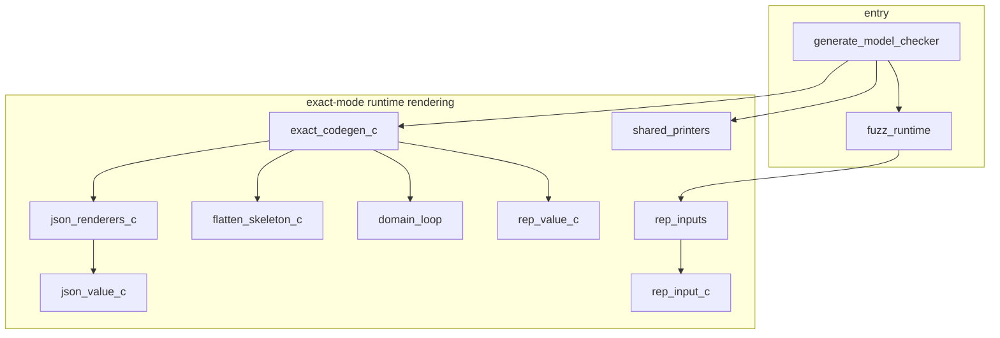

`flatten_skeleton_c` is recursive (self-edge omitted). `exact_codegen_c`
additionally calls `src/mc_plan.rs::LivenessDecomposition::compute` and the
`src/backends/c.rs` helpers; `shared_printers` / `json_renderers_c` call
`src/codegen_fsm.rs::build_variants`; `domain_loop` / `rep_value_c` /
`rep_input_c` / `var_value_c` use `src/backends/c.rs::c_ident` /
`src/backends/c.rs::int_c_literal` / `src/backends/c.rs::c_type`.

### MC plan (`src/mc_plan.rs`)

`src/mc_plan.rs::McPlan` is the codegen-time plan computed once per module
and embedded as tables in both MC binaries (D-P4-1..3):
`src/mc_plan.rs::McPlan::compute` builds the input abstraction
(`referenced_fields` decides which payload fields stay concrete - referenced
by guards/emit args/assignment values via `used_identifiers` /
`collect_paths`, or constrained by `input_is` literals via
`collect_input_is_refs` - the rest are abstracted to representative
values), the configuration encoding (`monitor_layouts` -> `layout_for` ->
`walk_node` assigns node ids and persistent-state bits; `config_encoding`
packs state + vars + monitors into a byte layout via `type_bits` /
`ceil_log2`), and the traversal spec (`traversal_spec`: canonical value
domains + per-state firing order). `src/mc_plan.rs::LivenessDecomposition`
(D-P4-9) decomposes liveness-bearing properties:
`src/mc_plan.rs::LivenessDecomposition::compute` -> `contains_liveness` +
`decompose_top` (obligations anywhere in the boolean skeleton; every other
leaf must be `boolean_over_atoms`), producing the obligations + skeleton
that both backends' liveness engines render.

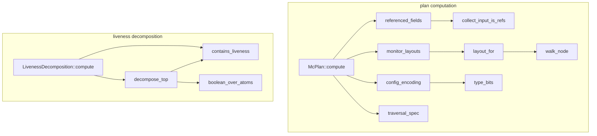

`walk_node` is recursive (self-edge omitted). Isolated leaves: `ceil_log2`,
`value_domain`, `used_identifiers`, `collect_paths`. `McPlan::compute`
additionally calls `src/codegen_fsm.rs::build_variants`; `monitor_layouts`
calls `src/monitor.rs::compile_formula`.

### Reference model checker (`src/ref_mc.rs`)

`src/ref_mc.rs::run` is the independent ground-truth engine (imports only
the IR + `src/codegen_mc.rs` report concepts - no backend code): it compiles
the safety monitors with its own compiler (`compile_formula` ->
`compile_check` -> `compile_signal`), decomposes liveness properties
(`decompose_properties` -> `decompose_top`), and runs a level-synchronous
BFS over the reachable configurations - `all_inputs` (its own input
abstraction: `referenced_fields` + `field_domain` /
`representative_value`), `match_effect` (transition matching:
`input_matches_variant` -> `input_matches`, `pattern_bindings`,
`eval_expr`), `mon_step` (the monitor interpreter: `min_trigger` for And/Or;
`mon_key` / `mon_key_node` for the configuration identity), `bnode_key` for
the visited set, `path_to` for counterexample paths. After the BFS,
liveness is checked on the explored graph by `liv_analyze` (per-leaf
progress automata: `leaf_signals` -> `compile_signal`, `leaf_bits` ->
`eval_sig`, `prod_delta` limit vectors, `skel_eval`), and the
counterexample is rendered by `trace_steps` + `liv_note`.

The public surface around `run`: `src/ref_mc.rs::verify_counterexample`
independently re-checks a reported counterexample (replay via
`step_trace` -> `match_effect`, configuration checks via
`check_initial` / `check_step_config`, property confirmation via
`property_confirms_at` -> `mon_step`, liveness via `verify_lasso` ->
`skel_eval` / `prod_delta`, deadlock via `verify_deadlock` ->
`mon_from_key`); `src/ref_mc.rs::minimal_violation_labels` re-runs the BFS
to collect all violated labels (`collect_min_labels`);
`src/ref_mc.rs::render_text` / `src/ref_mc.rs::to_json_report` render the
unified report (`render_text_impl` -> `render_vars` / `render_input` /
`render_output`). Expression evaluation is its own: `eval_expr` (with
`bool_of` / `val_eq` / `mask`) typed by `expr_type` -> `binary_type` ->
`bit_op_type` / `compatible`; signals via `eval_sig` -> `eval_expr` /
`input_matches` / `output_matches`.

```mermaid
flowchart TD
    subgraph ENTRY["entry points"]
        run["run (BFS engine)"]
        vce["verify_counterexample"]
        mvl["minimal_violation_labels"]
        rt["render_text"]
        tjr["to_json_report"]
        st["step_trace"]
    end

    subgraph BFS["BFS core"]
        bk["bnode_key"]
        mk["mon_key"]
        tst["trace_steps"]
    end

    subgraph MON["monitor interpreter (own compiler)"]
        cf["compile_formula"]
        cc["compile_check"]
        mi["mon_init"]
        ms["mon_step"]
        mt["min_trigger"]
    end

    subgraph EXPR["value + expression evaluation"]
        ee["eval_expr"]
        et["expr_type"]
        bt["binary_type"]
    end

    subgraph SIG["signals + patterns"]
        es["eval_sig"]
        im["input_matches"]
        om["output_matches"]
        fl["flatten"]
    end

    subgraph ABS["input abstraction (own copy)"]
        ai["all_inputs"]
        rf["referenced_fields"]
    end

    subgraph TRANS["transition matching"]
        me["match_effect"]
        imv["input_matches_variant"]
    end

    subgraph LIV["liveness analysis (own algorithm)"]
        dp["decompose_properties"]
        dt["decompose_top"]
        cl["contains_liveness"]
        boa["boolean_over_atoms"]
        ls["leaf_signals"]
        se["skel_eval"]
        la["liv_analyze"]
        lb["leaf_bits"]
        ln["liv_note"]
    end

    subgraph REND["report rendering"]
        rti["render_text_impl"]
        rv["render_vars"]
        ri["render_input"]
        ro["render_output"]
    end

    subgraph CE["counterexample verification"]
        vl["verify_lasso"]
        vd["verify_deadlock"]
        ci["check_initial"]
        pca["property_confirms_at"]
        mf["mon_from_key"]
        ic["initial_config"]
    end

    run --> cf
    run --> dp
    run --> ee
    run --> mi
    run --> ms
    run --> ai
    run --> fl
    run --> bk
    run --> me
    run --> mk
    run --> la
    run --> tst
    run --> ln
    mvl --> run
    rt --> rti
    tjr --> fl
    st --> ic
    st --> me
    vce --> ci
    vce --> st
    vce --> vl
    vce --> vd
    cf --> cc
    ms --> mt
    ms --> es
    bk --> mk
    ee --> et
    et --> bt
    es --> ee
    es --> im
    es --> om
    ai --> rf
    ai --> fl
    me --> imv
    me --> ee
    imv --> im
    dp --> cl
    dp --> dt
    dt --> boa
    dt --> cl
    la --> ls
    la --> se
    la --> lb
    lb --> es
    ln --> ls
    ln --> me
    rti --> rv
    rti --> ri
    rti --> ro
    vl --> dp
    vl --> ls
    vl --> se
    vd --> cf
    vd --> mf
    vd --> ai
    vd --> me
    vd --> ms
    pca --> cf
    pca --> mi
    pca --> ms
    ic --> ee
```

`compile_check`, `decompose_top`, `mon_init`, `mon_key_node`, `eval_expr`,
`expr_type`, `mon_step` are recursive (self-edges omitted). Isolated leaves
(omitted for readability): `compile_signal`, `mon_key_node`, `mon_bits`,
`ceil_log2`, `bool_of`, `val_eq`, `mask`, `ir_to_rtype`, `state_variants`,
`compatible`, `bit_op_type`, `enum_match`, `pattern_bindings`, `var_map`,
`state_index`, `output_variant_idx`, `input_group`, `used_identifiers`,
`collect_paths`, `collect_input_is_refs`, `field_domain`,
`representative_value`, `val_key`, `path_to`, `state_name`, `io_in`,
`io_out`, `leaf_good`, `prod_delta`, `render_val`, `render_outputs`,
`check_step_config`, `io_to_input` / `io_to_output` / `json_val`,
`ce_state_name`, and the formula/expr printing sublayer
(`print_formula_ctx` -> `print_expr_min` with the precedence tables
`bin_prec` / `bin_str`, `needs_parens`, `expr_has_boolean_op`,
`print_pattern_*`).

### SMT bounded path (`src/smt_plan.rs` + `src/smt_emit.rs`)

`src/smt_plan.rs::build_smt_spec` converts a validated module +
`src/mc_plan.rs::McPlan` into the language-agnostic `SmtSpec` (classes,
transitions, properties) shared by both SMT emitters: `convert_expr` /
`convert_formula` lower IR expressions/formulas into the `Se` / `Sf` AST
(concrete fields resolved via `fi_concrete`, variant names via
`variant_name`, property tags via `formula_tag`), and `se_type` /
`bit_op_type` compute the SMT-level types (mirroring the validator's
`bit_op_type`). `src/smt_emit.rs::emit_rust_spec` and
`src/smt_emit.rs::emit_c_spec` render the standalone z3 binaries from the
same `SmtSpec`: `render_sf_rust` / `render_sf_c` render property formulas,
`render_se_rust` / `render_se_c` render expressions (dispatching to
`render_bool_bin_rust` / `render_bool_bin_c` for boolean ops,
`render_bit_bin_rust` / `render_bit_bin_c` for bit-vector ops, and
`render_shift_rust` / `render_shift_c` for shifts), with width handling via
`cmp_widths_full` (widen to a common width when the operands differ) and
`produces_bool` (decide whether a binary op yields a boolean).

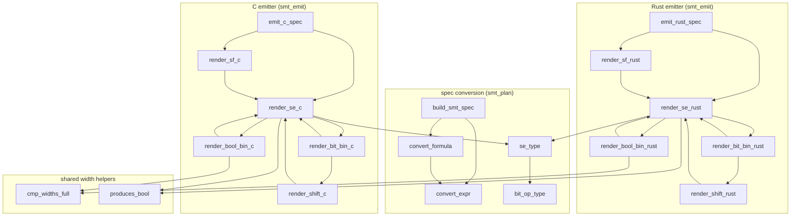

`convert_expr`, `convert_formula`, `se_type`, `render_se_rust`,
`render_se_c`, `render_bool_bin_rust`, `render_bool_bin_c`,
`render_bit_bin_rust`, `render_bit_bin_c` are recursive (self-edges
omitted). Isolated leaves: `variant_name`, `formula_tag`, `fi_concrete`,
`SeType::width`, `global_field_index`, `se_uses_step`, `sf_uses_step`,
`finish_bool_rust`, `finish_bool_c`, `widen_rust`, `widen_c`,
`rust_str_list`, `c_str_list`, `shift_amt_width`.

## Function level - monitor compiler

### Monitor compiler (`src/monitor.rs`)

`src/monitor.rs` is the language-agnostic PSL-to-monitor compiler (Phase 3):
it compiles formulas from the Phase 3 property subset into a
`src/monitor.rs::MonitorPlan` - a tree of `src/monitor.rs::MonNode` that
every backend renders with identical semantics (backend parity principle,
`docs/roadmap/INTRO.md`). The plan is the single source of truth: Rust and C
codegen render the same tree, so both backends step monitors identically on
the same input sequence. Semantics are pinned by D-P3-3
(`docs/roadmap/PHASE_3_PLAN.md`): samples carry post-step values, an
obligation triggered at sample i requires its body to hold at some sample j
with i <= j <= i + N - 1 (N >= 1), and the violation is confirmed at sample
i + N - 1 when the body still fails.

The module has two halves. The **compiler** (used by codegen):
`src/monitor.rs::compile_formula` is the entry point - it calls
`src/monitor.rs::compile_check` with the top-level anchor range
`src/monitor.rs::AnchorRange::all` and `in_temporal = false`.
`compile_check` (recursive) maps each formula form to a `MonNode`:
`bounded_eventually[N]` and `trigger -> bounded_eventually[N] body` become
`Obligation` nodes (the bare form's trigger is
`src/monitor.rs::true_signal`), `p -> next q` becomes a `DelayedCheck` and
bare `next p` a `RangeCheck`, both over the
`src/monitor.rs::AnchorRange::shifted` range, `always` recurses with
`in_temporal = true`, `always[N]` recurses over the window 0..N-1 (rejected
under a temporal operator, R3), boolean connectives recurse into both sides,
and `not` / bare signals compile to `RangeCheck` over a signal. Every
temporal-operator-free subformula is lowered by
`src/monitor.rs::compile_signal` (recursive) into a
`src/monitor.rs::SignalExpr` tree (`src/monitor.rs::SignalAtom` variants
`VarExpr` / `InputIs` / `OutputHas` / `True` under `Not` / `And` / `Or`);
`compile_signal` returns `None` (not `Err`) on temporal operators, and
callers decide whether that is an error. Formulas outside the monitor subset
(R1-R4, including the liveness operators `eventually` / `until`) make
`compile_formula` return `Err` - codegen in every backend emits the identical
"outside monitor subset; skipped" warning.

The **reference interpreter** (tests only) pins the same observable behavior
(violation sample + trigger step) as the generated code:
`src/monitor.rs::ReferenceMonitor::new` builds the initial state tree via
`src/monitor.rs::initial_state` (recursive over the `MonNode` tree), and
`src/monitor.rs::ReferenceMonitor::step` steps one sample via
`src/monitor.rs::step_node` (recursive over the state/spec pair), reporting a
newly confirmed failure via `src/monitor.rs::MonState::failed`. `step_node`
implements the D-P3-3 pending model for obligations (a re-trigger while
pending is ignored; a confirmed violation is terminal) and composes And/Or
from the children's current-sample failure statuses, with
`src/monitor.rs::min_trigger_at` picking the earliest trigger step among the
currently failing children (via `src/monitor.rs::MonState::trigger_step`).

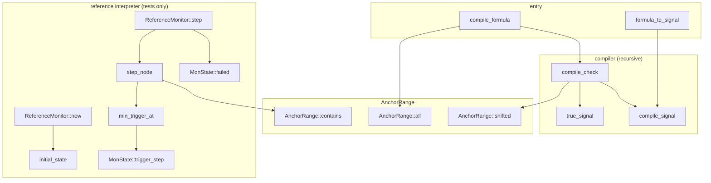

`compile_check`, `compile_signal`, `initial_state`, and `step_node` are
recursive (self-edges omitted). There are no isolated leaves: every helper
is reachable from `compile_formula` or the reference interpreter.

Consumers (edges out of this module): `src/backends/rust_fsm.rs::compile_monitors`
and `src/backends/c_fsm.rs::compile_monitors` call
`src/monitor.rs::compile_formula` for each property/assumption (formulas
outside the subset are skipped with a warning) and render the resulting
`MonNode` trees (see `dev:deps-fn-codegen-rust` / `dev:deps-fn-backend-c`);
`src/backends/rust_fsm.rs::render_sample_formula_evaluator` and
`src/backends/c_fsm.rs::render_liv_sample_evaluator_c` call
`src/monitor.rs::formula_to_signal` to render per-sample boolean evaluators
for liveness leaves; `src/mc_plan.rs::monitor_layouts` (called from
`src/mc_plan.rs::McPlan::compute`) calls `src/monitor.rs::compile_formula`
to compute the monitor state layout embedded in both MC binaries;
`src/info.rs::monitor_status` calls `src/monitor.rs::compile_formula` so
that `info` reports the same R1-R4 monitor-subset status as codegen; and
`src/codegen_test.rs` (tests) drives `src/monitor.rs::ReferenceMonitor` to
cross-check generated monitors against the reference interpreter.

The SMT bounded path does not use the monitor compiler:
`src/smt_plan.rs::build_smt_spec` lowers formulas directly into its own
`Se` / `Sf` AST (see `dev:deps-fn-mc-engine`). Likewise `src/ref_mc.rs`
carries its own independent monitor compiler (private `compile_formula` /
`compile_check` / `compile_signal` over its own `Mon` / `Sig` types) as
ground truth for the reference model checker. The monitor compiler in
`src/monitor.rs` is therefore the single shared compiler for the two
production backends, the MC plan, and `info`.
