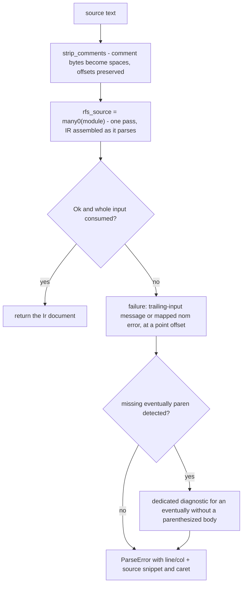

# RFS Parser (Class A)

The nom-based parser that turns RFS v0 source text into an IR document, plus
the EBNF grammar model that mirrors it for IDE/tooling output.

<a id="dev:parser-overview"></a>
## Overview

RFS v0 source is parsed by a hand-written recursive-descent parser built on
nom 8 combinators (`src/parser.rs`, 2091 lines including its 29 unit tests).
There is no separate lexer: lexical helpers (`identifier`, `keyword`,
`int_lit`) are inline functions, and every grammar rule is a function
returning `IResult<&str, T>`. Parsing and IR assembly happen in ONE pass -
the declaration parsers build IR nodes as they go, and `build_module`
finalizes each module (transition IDs, uniqueness) before the next one starts.

Entry points:

- `src/parser.rs::parse_source` - parse a source string into an `Ir`;
- `src/parser.rs::parse_file` - read a file and delegate to `parse_source`.

The parser is the first stage of the pipeline (input -> parse -> validate,
see `dev:architecture-pipeline`); its output is the versioned IR
(`src/ir.rs::Ir`, `src/ir.rs::IR_VERSION`) that every other stage consumes.
What the IR means semantically is specified in `docs/SEMANTICS.md`.

Companion module: `src/ebnf_grammar.rs` (902 lines) holds the EBNF model of
the input language - 61 rules mirroring DESIGN.md section 6 rule-for-rule -
plus the renderers behind `rfs info format spec-rfs` (`src/info_format.rs`).

Where to go next:

- algorithm levels (L1 abstract / L2 structures + invariants / L3 details):
  `dev:algorithms-parser-validation` in ALGORITHMS.md;
- function call graph: `dev:deps-fn-parser` in DEPENDENCIES.md;
- file entries: `dev:code-map-frontend` in CODE_MAP.md;
- external references (Pratt, the EBNF standard, nom, the Dragon Book):
  `dev:references-theory` in REFERENCES.md.

The parser is also a toolchain-fuzz target (`fuzz/fuzz_targets/parser.rs`):
malformed input must never panic.

Code: `src/parser.rs::parse_source`, `src/parser.rs::parse_file`,
`src/ir.rs::Ir`, `src/ebnf_grammar.rs::GRAMMAR_RULES`,
`fuzz/fuzz_targets/parser.rs`

<a id="dev:parser-entry-error"></a>
## Entry points and error model



**Offset-preserving comment stripping.** `strip_comments` replaces every
comment byte (`#...` to end of line, `//...` to end of line) with a space and
keeps newlines. The cleaned text is position-for-position the same length as
the original, so an error offset computed in the cleaned text maps 1:1 to the
original source - this is what makes `ParseError` line/col and the snippet +
caret display (`src/error.rs::rich_display`) point at the right place even
when comments are present.

**Two-tier error model.** Grammar rules fail with one of two constructors,
both tagged `ErrorKind::Verify`:

- `syntax_err` = nom `Err::Error` - BACKTRACKABLE: an enclosing `alt` tries
  its next branch;
- `semantic_err` = nom `Err::Failure` - NON-BACKTRACKABLE: the whole parse
  aborts immediately.

The tier is a per-construct choice, and the pattern is deliberate:

| Recognized but ill-formed (semantic_err, aborts) | Not recognized (syntax_err, backtrackable) |
|---|---|
| duplicate enum variant / field / set var / next / priority | unexpected token where a declaration was expected |
| missing required `next` (transition or on_error block) | unknown action name in a transition body |
| duplicate module-level names (enum, var, initial, on_error, prop/assume) | keyword mismatch inside the `keyword` helper |
| u64 literal overflow; bit width or priority above u32 | malformed identifier / literal shape |

**Offset computation.** `nom_error_to_parse_error` and `err_at` compute the
failure offset as cleaned-length minus residual-length (the position where
parsing stopped) and wrap it in a `ParseError` carrying the ORIGINAL source
(`src/error.rs::ParseError`, `src/error.rs::Span`). `line_col` converts the
byte offset to 1-based line/column; `rich_display` renders the source snippet
with a caret under the failing position.

**Dedicated eventually diagnostic.** `eventually` requires a parenthesized
body, and that shape can never parse - the top-level recovery would otherwise
swallow the failure into a generic trailing-input error. So after ANY parse
failure, `find_eventually_missing_paren` scans the cleaned text for the first
whole-word `eventually` whose body position (after whitespace) is not an open
paren: whole-word matching excludes `bounded_eventually`, occurrences inside
double-quoted string literals (version headers) are skipped, and the offset
of that keyword is returned. If found, the reported error is "expected '(' 
after 'eventually' (the body must be a parenthesized formula)" at exactly
that position.

Code: `src/parser.rs::strip_comments`, `src/parser.rs::semantic_err`,
`src/parser.rs::syntax_err`, `src/parser.rs::nom_error_to_parse_error`,
`src/parser.rs::err_at`, `src/parser.rs::find_eventually_missing_paren`,
`src/error.rs::ParseError`, `src/error.rs::line_col`,
`src/error.rs::rich_display`

<a id="dev:parser-grammar"></a>
## Module and declaration parsing

**Top level.** `rfs_source = many0(module)` - a file is zero or more modules,
assembled into `Ir { ir_version: IR_VERSION, modules }`.

**Module header.** `module` = keyword + name + optional version header +
braced items. The version header is `version "x.y"` - a quoted string literal
(`string_lit`, no escapes) between the module name and the opening brace; its
FORMAT is checked by the validator, not the parser.

**The nine declaration kinds.** `module_item` is an `alt` over enum,
initial, event, output, var, transition, prop, assume, on_error. Each starts
with a distinct keyword, so the choice is decided by one lookahead token
(LL(1)-style):

- **enum** (`enum_decl`, `enum_variants`) - named variants in braces;
  trailing comma allowed; duplicate variant is a semantic error.
- **initial** (`initial_decl`) - a single state name; optional semicolon.
- **event / output** (`event_decl`, `output_decl`) - constructor groups. A
  bare `event Name` declares the group with one unit variant of the same
  name; `event Name(Variant)` or `event Name(Variant(f: type, ...))`
  declares a unit or struct variant (`opt_constructor_payload`,
  `constructor_variant`, `field_list`). Repeated declarations of the same
  group merge via `merge_group` (worked example below); a duplicate variant
  within a group is a semantic error.
- **var** (`var_decl`) - name, type (`type_parser`: bool, bit<N> via
  `bit_type`, or an enum identifier), and an `init` expression.
- **transition** (`transition_decl`, `build_transition`, `action_block`,
  `action`) - `transition State on Pattern [where Guard] { actions }`. The
  action block is a loop over `next S;`, `emit O(...);`, `set v = expr;`,
  `priority N;` accumulating into a `TransitionBody`; `build_transition`
  then requires exactly one `next` (missing -> semantic error) and rejects
  duplicate `set` variables. Duplicate `next`/`priority` inside the block are
  rejected as they appear.
- **prop / assume** (`prop_decl`, `assume_decl`) - name + formula; the two
  lists share ONE namespace (enforced in `build_module`).
- **on_error** (`on_error_decl`) - a braced block of `next S;` and
  `emit O(...);` lines; requires `next` (missing -> semantic error at the
  closing brace).

**IR assembly.** `build_module` walks the parsed items in order and
finalizes the module: transition IDs are assigned as declaration order, and
module-level uniqueness is enforced - enum names, a single initial state,
variable names, the shared prop/assume namespace, a single on_error block.
All violations are semantic errors.

**Worked example - constructor-group merging.**

```rfs
event Recv(Ack)
event Recv(Data(x: bit<8>))
```

parses as two `ModuleItem::Event` entries; `merge_group` folds them into one
`ConstructorGroup { name: "Recv", variants: [Unit{Ack}, Struct{Data, ...}] }`.
A third declaration repeating `Ack` would fail with a semantic error.

**Event patterns.** `event_pattern` / `output_pattern` share `group_pattern`:
a bare group name (matches any variant) or `Group(Variant)` /
`Group(Variant(fields))`. Each pattern field (`pattern_field`) is one of: `_`
wildcard, an integer literal, `true`/`false`, a bare identifier (binds the
payload value to that name for use in guards), or `name: expr` (binds and
constrains). `pattern_expr` additionally accepts qualified paths (`A::B` ->
enum-variant match) via `ident_path`.

**Deliberate leniency.** The list parsers (variants, fields, pattern fields,
action blocks, output args) are hand-written loops that tolerate a missing
comma between items and a missing semicolon after actions - the canonical
printer never emits those omissions, so round-tripping is unaffected. The
EBNF model documents the strict form; `to_md`'s intro notes that the parser
is at least as lenient.

Code: `src/parser.rs::rfs_source`, `src/parser.rs::module`,
`src/parser.rs::module_item`, `src/parser.rs::enum_variants`,
`src/parser.rs::event_decl`, `src/parser.rs::merge_group`,
`src/parser.rs::var_decl`, `src/parser.rs::build_transition`,
`src/parser.rs::action_block`, `src/parser.rs::action`,
`src/parser.rs::prop_decl`, `src/parser.rs::on_error_decl`,
`src/parser.rs::build_module`, `src/parser.rs::group_pattern`,
`src/parser.rs::pattern_field`, `src/parser.rs::pattern_expr`,
`src/ir.rs::ConstructorGroup`

<a id="dev:parser-expressions"></a>
## Expression and formula ladders

**Expression ladder (12 levels).** Precedence climbing: each level parses the
tighter level on the left, then loops consuming its own operator(s) and the
tighter level again - left-associative by construction. Entry:
`src/parser.rs::expr` = level 1. Loosest to tightest:

1. **logical or** (`||`) - `src/parser.rs::logic_or`
2. **logical and** (`&&`) - `src/parser.rs::logic_and`
3. **equality** (`==`, `!=`) - `src/parser.rs::equality`
4. **relational** (`<=`, `<`, `>=`, `>`) - `src/parser.rs::relational`
5. **bitwise or** (`|`) - `src/parser.rs::bitwise_or`
6. **bitwise xor** (`^`) - `src/parser.rs::bitwise_xor`
7. **bitwise and** (`&`) - `src/parser.rs::bitwise_and`
8. **shift** (`<<`, `>>`) - `src/parser.rs::shift`
9. **additive** (`+`, `-`) - `src/parser.rs::additive`
10. **multiplicative** (`*` only - there is NO division operator) -
    `src/parser.rs::multiplicative`
11. **unary** (`!`, `~`, `-`) - `src/parser.rs::unary_expr`
12. **primary** (integer literal, true/false, parenthesized expression,
    identifier path) - `src/parser.rs::primary_expr`

Multi-character operator guards: where a shorter operator is a prefix of a
longer one at the same level, the loop checks the next byte before consuming
- `<` stops when followed by another `<` (that is a shift), `>` stops before
`>>`, `|` stops before `||`, and `-` stops before `->` (the formula-level
implication). This is what keeps `a << b`, `a || b` and `a - b -> c` shapes
unambiguous without a separate tokenizer.

**Formula ladder (7 levels + the non-boolean fallthrough).** Entry:
`src/parser.rs::formula` = level 1. Loosest to tightest:

1. **or** (`||`) - `src/parser.rs::or_formula`
2. **implies** (`->`, RIGHT-associative) - `src/parser.rs::impl_formula`
3. **and** (`&&`) - `src/parser.rs::and_formula`
4. **unary passthrough** (delegates to until; kept for the ladder's shape) -
   `src/parser.rs::unary_formula`
5. **until** (LEFT-associative) - `src/parser.rs::until_formula`
6. **negation** (`!`, binds TIGHTER than until: `!a until b` = `(!a) until b`)
   - `src/parser.rs::neg_operand`
7. **primary formula** - `src/parser.rs::primary_formula`: `next (f)`,
   `always (f)` / `always[N] (f)`, `bounded_eventually[N] (f)`,
   `eventually (f)`, `input_is(pattern)`, `output_has(pattern)`, a
   parenthesized formula, or the fallthrough below.

**The most important subtlety - the fallthrough.** A bare non-keyword operand
of a formula is a NON-BOOLEAN expression, parsed by `non_boolean_expr` which
enters the ladder at the EQUALITY level (comparisons and below) - NOT at the
full `expr` entry. The full `expr` grammar must not be used here: its
logical-or/logical-and levels would mis-consume identifier-looking formula
atoms as variable paths - in `state == S && output_has(O)` a full-expr
fallthrough would absorb `output_has` as an expression path and leave the
parenthesized pattern as trailing input. Because formula-level `&&`/`||` are
handled by `and_formula`/`or_formula` with each operand parsed independently
via `primary_formula`, `output_has(...)` reaches its keyword branch and mixed
atom kinds like `state == S && output_has(O)` parse correctly (pinned by the
unit tests `mixed_conjunction_state_comparison_left_parses` and friends).
Compound boolean operands of `until` require parentheses: `(a && b) until c`.

**Lexical helpers.** `identifier` = letter/underscore start, alphanumeric/
underscore continuation. `ident_path` extends it with `::` segments (`A::B`
qualified names). `keyword` and `soft_keyword` have IDENTICAL implementations
(parse an identifier, compare the word); the split is documentary - hard
keywords vs context-sensitive ones. `int_lit` parses a u64 decimal literal;
overflow is a semantic error. `KEYWORDS` (28 words) is the single source of
truth for reserved words: `keyword_list_matches_parser_sites` pins it against
the parser's own call sites in both directions, and the IDE grammar sanity
test (`tests/frontend_test.rs`) asserts every keyword appears in
`ide/textmate/rfs.json`.

Code: `src/parser.rs::expr`, `src/parser.rs::logic_or`,
`src/parser.rs::relational`, `src/parser.rs::multiplicative`,
`src/parser.rs::unary_expr`, `src/parser.rs::primary_expr`,
`src/parser.rs::formula`, `src/parser.rs::impl_formula`,
`src/parser.rs::until_formula`, `src/parser.rs::neg_operand`,
`src/parser.rs::primary_formula`, `src/parser.rs::non_boolean_expr`,
`src/parser.rs::keyword`, `src/parser.rs::soft_keyword`,
`src/parser.rs::int_lit`, `src/parser.rs::ident_path`,
`src/parser.rs::KEYWORDS`

<a id="dev:parser-ebnf-model"></a>
## EBNF grammar model (`src/ebnf_grammar.rs`)

**The model.** `RuleNode` is a 7-variant enum (Terminal, NonTerminal,
Sequence, Choice, Optional, ZeroOrMore, OneOrMore), all variants
const-constructible - slices + references instead of the plan's Vec/Box, which
are not const-stable - so `GRAMMAR_RULES` is a plain `static`. A Terminal
holds the literal text WITHOUT surrounding quotes (the text renderers quote
it); lexical placeholders (`character`, `a..z`) are terminals too - they name
a character class rather than a rule.

**GRAMMAR_RULES.** 61 rules mirroring DESIGN.md section 6 EXACTLY - same rule
names, same order, same structure. The list spans the source/module/declaration
rules, event/output patterns and actions, the formula ladder, the expression
ladder, and the lexical rules (`identifier`, `letter`, `digit`,
`unsigned_integer_literal`, `string_literal`). `RULE_NOTES` carries a
one-line description per rule for the markdown rule table (kept in sync by
review; the sync test pins names, not prose).

**Renderers.**

- `to_ebnf_text` - canonical EBNF text, one rule per line; this is EXACTLY
  what the DESIGN.md section 6 ebnf fence contains;
- `to_md` - intro + ebnf code block + rule table + a formula-precedence note
  (what `rfs info format spec-rfs --output md` prints);
- `to_plantuml_ebnf` - @startebnf/@endebnf wrapper; terminals quoted;
  optional is `[X]`, zero-or-more `{X}`, one-or-more `{X}-`; every rule line
  ends with `;` (verified against the current PlantUML tokenizer);
- `to_svg` - railroad diagram: Sequence/Choice/Optional/ZeroOrMore/OneOrMore
  mapped onto a stylesheet diagram (the `railroad` crate, standalone SVG).

**Sync tests** (`tests/info_format_test.rs`): the DESIGN.md section 6 fence
parses back to exactly this model's rule names (structural equality, both
directions, no duplicates); every `parser::KEYWORDS` entry appears as a quoted
terminal; the md/plantuml/svg outputs are pinned. Consequence: if the parser
language changes, update DESIGN.md section 6 and `GRAMMAR_RULES` TOGETHER -
the sync test fails otherwise.

**Consumers.** `rfs info format spec-rfs` (`src/info_format.rs`) prints from
this model. The IDE grammar (`ide/textmate/rfs.json`) is a separate
hand-maintained artifact pinned to `KEYWORDS` by the frontend test, not
derived from this model.

Code: `src/ebnf_grammar.rs::RuleNode`, `src/ebnf_grammar.rs::GRAMMAR_RULES`,
`src/ebnf_grammar.rs::RULE_NOTES`, `src/ebnf_grammar.rs::to_ebnf_text`,
`src/ebnf_grammar.rs::to_md`, `src/ebnf_grammar.rs::to_plantuml_ebnf`,
`src/ebnf_grammar.rs::to_svg`, `tests/info_format_test.rs`,
`src/info_format.rs`

## Changing the grammar

Developer checklist for changing the RFS v0 language (see also START.md's
"Before changing language syntax" protocol):

1. Add valid + invalid examples FIRST - the file-driven suite picks them up
   without test-code changes.
2. Update `src/parser.rs` (+ its unit tests in `mod tests`).
3. Update `src/ebnf_grammar.rs::GRAMMAR_RULES` and the DESIGN.md section 6
   fence TOGETHER - the sync test enforces rule-name parity both directions.
4. A new keyword goes into `KEYWORDS` AND `ide/textmate/rfs.json` -
   `keyword_list_matches_parser_sites` pins the list against parser call
   sites, and the IDE grammar sanity test asserts coverage.
5. Verify: `cargo test --lib` (parser unit tests),
   `cargo test --test examples_test`, `cargo test --test info_format_test`,
   then the full BUILD.md section 5 checklist.
6. If the change is language-visible, add training snippets per KB.md
   section 4.6 and regenerate (`cargo extract-training-snippets` +
   `cargo build-training`).
