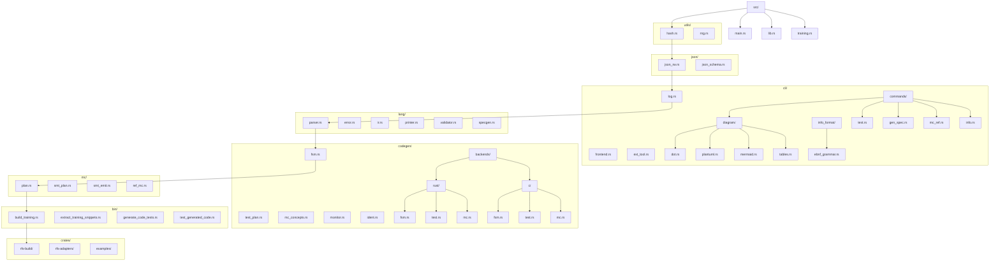

<!-- llm-budget: 1750 -->
# RFS Source Structure - function and type inventory

Complete, dependency-annotated inventory of every function and every data
type in the project's non-test source files, classified into component and
functionality categories, with the file-naming scheme and directory tree
layout as realized by the Phase 11 refactor. The dependency edges support
fine-grained impact analysis of future source changes and precise scoping of
refactoring/editing tasks. Test source has its own inventory:
`TEST_STRUCTURE.md`.

## Conventions (binding for all rows)

- Identifier formats: functions `<file>::<function>`, types `<file>::<Type>`,
  file paths relative to the repo root (e.g. `src/lang/parser.rs::parse_source`,
  `src/lang/ir.rs::Ir`). The All functions table's identifier column is named
  `Function`; the All types table's is named `Type`. A function nested inside
  another function body is `<file>::<parent_fn>::<child_fn>` (lowercase parent
  - distinct from the `<file>::<Type>::<method>` method form, whose middle
  segment is a capitalized type name); a type declared inside a function body
  follows the same form, `<file>::<parent_fn>::<Type>`.
- Depends column (BOTH tables, BOTH directions): comma-separated list of
  project identifiers - `<file>::<function>` AND `<file>::<Type>` - that the
  row depends on. A function row lists the functions it calls and the types it
  constructs/contains/matches; a type row lists the types it contains and the
  implementation functions its trait impls/methods delegate to. Cross-file and
  same-file alike; empty if none. Macro-generated call sites count once per
  distinct callee. External items (nom, std, dependency crates) are NOT
  dependencies - only project identifiers.
- Component and Functionality cells may be multi-valued; values are
  comma-separated and must come from the `## Components` / `## Functionality`
  category tables (filled by task 14; blank in rows until tasks 15-16).
- Documented in column: the `dev:` / `llm:` fragment names copied verbatim
  from the file's single `//! Docs:` pointer line (the 71-file manifest);
  blank for files without one.
- Private (`fn`, no `pub`) items are included - the inventory is complete by
  construction, not public-API-only.
- Every row stays on ONE physical line (grep-able, diff-friendly; future
  tooling and the refactoring phase rely on stable row identity).

## All functions

| Function | Depends | Component | Functionality | Short description | Documented in |
|---|---|---|---|---|---|
| src/lang/ir.rs::Ir::new |  | IR model | wire-format serialization, provenance | constructs an empty IR document with ir_version = IR_VERSION | dev:ir-json-rw-overview, dev:ir-model, dev:ir-wire-format, dev:algorithms-ir-codegen, llm:ir-json-rw |
| src/lang/ir.rs::Ir::default | src/lang/ir.rs::Ir::new | IR model | wire-format serialization | Default impl delegating to Ir::new() | dev:ir-json-rw-overview, dev:ir-model, dev:ir-wire-format, dev:algorithms-ir-codegen, llm:ir-json-rw |
| src/lang/ir.rs::IrJson::to_json |  | IR model | wire-format serialization | trait method definition: serialize one IR type to a Json value (fallible for u64-range values) | dev:ir-json-rw-overview, dev:ir-model, dev:ir-wire-format, dev:algorithms-ir-codegen, llm:ir-json-rw |
| src/lang/ir.rs::IrJson::from_json |  | IR model | wire-format serialization | trait method definition: deserialize one IR type from a Json value with an error path | dev:ir-json-rw-overview, dev:ir-model, dev:ir-wire-format, dev:algorithms-ir-codegen, llm:ir-json-rw |
| src/lang/ir.rs::json_type_name | src/json/json_rw.rs::Json | IR model | wire-format serialization | short human-readable name of a JSON value's type for error messages | dev:ir-json-rw-overview, dev:ir-model, dev:ir-wire-format, dev:algorithms-ir-codegen, llm:ir-json-rw |
| src/lang/ir.rs::type_err | src/lang/ir.rs::json_type_name, src/json/json_rw.rs::Json | IR model | wire-format serialization | formats 'expected X at path, got Y' error text | dev:ir-json-rw-overview, dev:ir-model, dev:ir-wire-format, dev:algorithms-ir-codegen, llm:ir-json-rw |
| src/lang/ir.rs::field | src/lang/ir.rs::type_err, src/json/json_rw.rs::Json | IR model | wire-format serialization | look up a required object field with a good error | dev:ir-json-rw-overview, dev:ir-model, dev:ir-wire-format, dev:algorithms-ir-codegen, llm:ir-json-rw |
| src/lang/ir.rs::str_field | src/lang/ir.rs::field, src/lang/ir.rs::type_err, src/json/json_rw.rs::Json | IR model | wire-format serialization | required string field extraction | dev:ir-json-rw-overview, dev:ir-model, dev:ir-wire-format, dev:algorithms-ir-codegen, llm:ir-json-rw |
| src/lang/ir.rs::opt_str_field | src/lang/ir.rs::field, src/lang/ir.rs::type_err, src/json/json_rw.rs::Json | IR model | wire-format serialization | string-or-null field extraction | dev:ir-json-rw-overview, dev:ir-model, dev:ir-wire-format, dev:algorithms-ir-codegen, llm:ir-json-rw |
| src/lang/ir.rs::arr_field | src/lang/ir.rs::field, src/lang/ir.rs::type_err, src/json/json_rw.rs::Json | IR model | wire-format serialization | array field extraction as a slice | dev:ir-json-rw-overview, dev:ir-model, dev:ir-wire-format, dev:algorithms-ir-codegen, llm:ir-json-rw |
| src/lang/ir.rs::uint_field | src/lang/ir.rs::field, src/lang/ir.rs::type_err, src/json/json_rw.rs::Json | IR model | wire-format serialization | non-negative integer field (u32/u64/usize IR values) | dev:ir-json-rw-overview, dev:ir-model, dev:ir-wire-format, dev:algorithms-ir-codegen, llm:ir-json-rw |
| src/lang/ir.rs::bool_field | src/lang/ir.rs::field, src/lang/ir.rs::type_err, src/json/json_rw.rs::Json | IR model | wire-format serialization | boolean field extraction | dev:ir-json-rw-overview, dev:ir-model, dev:ir-wire-format, dev:algorithms-ir-codegen, llm:ir-json-rw |
| src/lang/ir.rs::opt_uint32_field | src/lang/ir.rs::field, src/json/json_rw.rs::Json | IR model | wire-format serialization | 0..=u32::MAX-or-null field extraction | dev:ir-json-rw-overview, dev:ir-model, dev:ir-wire-format, dev:algorithms-ir-codegen, llm:ir-json-rw |
| src/lang/ir.rs::str_list | src/lang/ir.rs::type_err, src/json/json_rw.rs::Json | IR model | wire-format serialization | Vec<String> from a JSON string array with per-index errors | dev:ir-json-rw-overview, dev:ir-model, dev:ir-wire-format, dev:algorithms-ir-codegen, llm:ir-json-rw |
| src/lang/ir.rs::kind | src/lang/ir.rs::field, src/lang/ir.rs::type_err, src/json/json_rw.rs::Json | IR model | wire-format serialization | the 'kind' discriminator of an internally-tagged enum object | dev:ir-json-rw-overview, dev:ir-model, dev:ir-wire-format, dev:algorithms-ir-codegen, llm:ir-json-rw |
| src/lang/ir.rs::unknown_kind |  | IR model | wire-format serialization | error text for an unrecognized kind value listing the allowed kinds | dev:ir-json-rw-overview, dev:ir-model, dev:ir-wire-format, dev:algorithms-ir-codegen, llm:ir-json-rw |
| src/lang/ir.rs::uint_json | src/json/json_rw.rs::Json | IR model | wire-format serialization | render a u64 IR value as a JSON integer; rejects values above i64::MAX instead of clamping | dev:ir-json-rw-overview, dev:ir-model, dev:ir-wire-format, dev:algorithms-ir-codegen, llm:ir-json-rw |
| src/lang/ir.rs::Ir(IrJson)::to_json | src/lang/ir.rs::Module(IrJson)::to_json, src/json/json_rw.rs::Json | IR model | wire-format serialization | serialize the document root: ir_version + modules array in pinned key order | dev:ir-json-rw-overview, dev:ir-model, dev:ir-wire-format, dev:algorithms-ir-codegen, llm:ir-json-rw |
| src/lang/ir.rs::Ir(IrJson)::from_json | src/lang/ir.rs::uint_field, src/lang/ir.rs::arr_field, src/lang/ir.rs::Module(IrJson)::from_json, src/json/json_rw.rs::Json | IR model | wire-format serialization, provenance | deserialize the document root with the {0..=IR_VERSION} version read policy (D-P6-2) | dev:ir-json-rw-overview, dev:ir-model, dev:ir-wire-format, dev:algorithms-ir-codegen, llm:ir-json-rw |
| src/lang/ir.rs::Module(IrJson)::to_json | src/lang/ir.rs::OnError(IrJson)::to_json, src/lang/ir.rs::EnumDecl(IrJson)::to_json, src/lang/ir.rs::ConstructorGroup(IrJson)::to_json, src/lang/ir.rs::VarDecl(IrJson)::to_json, src/lang/ir.rs::Transition(IrJson)::to_json, src/lang/ir.rs::Property(IrJson)::to_json, src/json/json_rw.rs::Json | IR model | wire-format serialization | serialize the module document; ALL keys always present (empty arrays / null instead of omitted) | dev:ir-json-rw-overview, dev:ir-model, dev:ir-wire-format, dev:algorithms-ir-codegen, llm:ir-json-rw |
| src/lang/ir.rs::Module(IrJson)::from_json | src/lang/ir.rs::str_field, src/lang/ir.rs::opt_str_field, src/lang/ir.rs::arr_field, src/lang/ir.rs::OnError(IrJson)::from_json, src/lang/ir.rs::EnumDecl(IrJson)::from_json, src/lang/ir.rs::ConstructorGroup(IrJson)::from_json, src/lang/ir.rs::VarDecl(IrJson)::from_json, src/lang/ir.rs::Transition(IrJson)::from_json, src/lang/ir.rs::Property(IrJson)::from_json, src/json/json_rw.rs::Json | IR model | wire-format serialization | deserialize the module document with per-index child paths | dev:ir-json-rw-overview, dev:ir-model, dev:ir-wire-format, dev:algorithms-ir-codegen, llm:ir-json-rw |
| src/lang/ir.rs::OnError(IrJson)::to_json | src/lang/ir.rs::OutputExpr(IrJson)::to_json, src/json/json_rw.rs::Json | IR model | wire-format serialization | serialize the on_error fallback (next_state + emits) | dev:ir-json-rw-overview, dev:ir-model, dev:ir-wire-format, dev:algorithms-ir-codegen, llm:ir-json-rw |
| src/lang/ir.rs::OnError(IrJson)::from_json | src/lang/ir.rs::str_field, src/lang/ir.rs::OutputExpr(IrJson)::from_json, src/json/json_rw.rs::Json | IR model | wire-format serialization | deserialize the on_error fallback | dev:ir-json-rw-overview, dev:ir-model, dev:ir-wire-format, dev:algorithms-ir-codegen, llm:ir-json-rw |
| src/lang/ir.rs::EnumDecl(IrJson)::to_json | src/json/json_rw.rs::Json | IR model | wire-format serialization | serialize enum name + variant string list | dev:ir-json-rw-overview, dev:ir-model, dev:ir-wire-format, dev:algorithms-ir-codegen, llm:ir-json-rw |
| src/lang/ir.rs::EnumDecl(IrJson)::from_json | src/lang/ir.rs::str_field, src/lang/ir.rs::str_list, src/json/json_rw.rs::Json | IR model | wire-format serialization | deserialize enum declaration | dev:ir-json-rw-overview, dev:ir-model, dev:ir-wire-format, dev:algorithms-ir-codegen, llm:ir-json-rw |
| src/lang/ir.rs::Type(IrJson)::to_json | src/lang/ir.rs::uint_json, src/json/json_rw.rs::Json | IR model | wire-format serialization | tagged union: kind bool / bit (width) / enum (name) | dev:ir-json-rw-overview, dev:ir-model, dev:ir-wire-format, dev:algorithms-ir-codegen, llm:ir-json-rw |
| src/lang/ir.rs::Type(IrJson)::from_json | src/lang/ir.rs::kind, src/lang/ir.rs::unknown_kind, src/lang/ir.rs::str_field, src/lang/ir.rs::uint_field, src/json/json_rw.rs::Json | IR model | wire-format serialization | deserialize the type tagged union with kind validation | dev:ir-json-rw-overview, dev:ir-model, dev:ir-wire-format, dev:algorithms-ir-codegen, llm:ir-json-rw |
| src/lang/ir.rs::FieldDecl(IrJson)::to_json | src/lang/ir.rs::Type(IrJson)::to_json, src/json/json_rw.rs::Json | IR model | wire-format serialization | serialize a named field with its type | dev:ir-json-rw-overview, dev:ir-model, dev:ir-wire-format, dev:algorithms-ir-codegen, llm:ir-json-rw |
| src/lang/ir.rs::FieldDecl(IrJson)::from_json | src/lang/ir.rs::str_field, src/lang/ir.rs::Type(IrJson)::from_json, src/json/json_rw.rs::Json | IR model | wire-format serialization | deserialize a field declaration | dev:ir-json-rw-overview, dev:ir-model, dev:ir-wire-format, dev:algorithms-ir-codegen, llm:ir-json-rw |
| src/lang/ir.rs::ConstructorGroup(IrJson)::to_json | src/lang/ir.rs::ConstructorVariant(IrJson)::to_json, src/json/json_rw.rs::Json | IR model | wire-format serialization | serialize an event/output group with its variants | dev:ir-json-rw-overview, dev:ir-model, dev:ir-wire-format, dev:algorithms-ir-codegen, llm:ir-json-rw |
| src/lang/ir.rs::ConstructorGroup(IrJson)::from_json | src/lang/ir.rs::str_field, src/lang/ir.rs::arr_field, src/lang/ir.rs::ConstructorVariant(IrJson)::from_json, src/json/json_rw.rs::Json | IR model | wire-format serialization | deserialize a constructor group | dev:ir-json-rw-overview, dev:ir-model, dev:ir-wire-format, dev:algorithms-ir-codegen, llm:ir-json-rw |
| src/lang/ir.rs::ConstructorVariant(IrJson)::to_json | src/lang/ir.rs::FieldDecl(IrJson)::to_json, src/json/json_rw.rs::Json | IR model | wire-format serialization | tagged union: kind unit / struct (fields) | dev:ir-json-rw-overview, dev:ir-model, dev:ir-wire-format, dev:algorithms-ir-codegen, llm:ir-json-rw |
| src/lang/ir.rs::ConstructorVariant(IrJson)::from_json | src/lang/ir.rs::kind, src/lang/ir.rs::unknown_kind, src/lang/ir.rs::str_field, src/lang/ir.rs::FieldDecl(IrJson)::from_json, src/json/json_rw.rs::Json | IR model | wire-format serialization | deserialize a constructor variant | dev:ir-json-rw-overview, dev:ir-model, dev:ir-wire-format, dev:algorithms-ir-codegen, llm:ir-json-rw |
| src/lang/ir.rs::VarDecl(IrJson)::to_json | src/lang/ir.rs::Type(IrJson)::to_json, src/lang/ir.rs::Expr(IrJson)::to_json, src/json/json_rw.rs::Json | IR model | wire-format serialization | serialize variable name + type + init expression | dev:ir-json-rw-overview, dev:ir-model, dev:ir-wire-format, dev:algorithms-ir-codegen, llm:ir-json-rw |
| src/lang/ir.rs::VarDecl(IrJson)::from_json | src/lang/ir.rs::str_field, src/lang/ir.rs::Type(IrJson)::from_json, src/lang/ir.rs::Expr(IrJson)::from_json, src/json/json_rw.rs::Json | IR model | wire-format serialization | deserialize a variable declaration | dev:ir-json-rw-overview, dev:ir-model, dev:ir-wire-format, dev:algorithms-ir-codegen, llm:ir-json-rw |
| src/lang/ir.rs::Transition(IrJson)::to_json | src/lang/ir.rs::EventPattern(IrJson)::to_json, src/lang/ir.rs::Expr(IrJson)::to_json, src/lang/ir.rs::OutputExpr(IrJson)::to_json, src/lang/ir.rs::Assignment(IrJson)::to_json, src/json/json_rw.rs::Json | IR model | wire-format serialization | serialize a transition: id, state, pattern, guard (nullable), next_state, emits, assignments, priority | dev:ir-json-rw-overview, dev:ir-model, dev:ir-wire-format, dev:algorithms-ir-codegen, llm:ir-json-rw |
| src/lang/ir.rs::Transition(IrJson)::from_json | src/lang/ir.rs::uint_field, src/lang/ir.rs::str_field, src/lang/ir.rs::opt_uint32_field, src/lang/ir.rs::EventPattern(IrJson)::from_json, src/lang/ir.rs::Expr(IrJson)::from_json, src/lang/ir.rs::OutputExpr(IrJson)::from_json, src/lang/ir.rs::Assignment(IrJson)::from_json, src/json/json_rw.rs::Json | IR model | wire-format serialization | deserialize a transition with nullable guard/priority | dev:ir-json-rw-overview, dev:ir-model, dev:ir-wire-format, dev:algorithms-ir-codegen, llm:ir-json-rw |
| src/lang/ir.rs::EventPattern(IrJson)::to_json | src/lang/ir.rs::PatternVariant(IrJson)::to_json, src/json/json_rw.rs::Json | IR model | wire-format serialization | serialize input pattern group + optional variant | dev:ir-json-rw-overview, dev:ir-model, dev:ir-wire-format, dev:algorithms-ir-codegen, llm:ir-json-rw |
| src/lang/ir.rs::EventPattern(IrJson)::from_json | src/lang/ir.rs::str_field, src/lang/ir.rs::PatternVariant(IrJson)::from_json, src/json/json_rw.rs::Json | IR model | wire-format serialization | deserialize an event pattern | dev:ir-json-rw-overview, dev:ir-model, dev:ir-wire-format, dev:algorithms-ir-codegen, llm:ir-json-rw |
| src/lang/ir.rs::OutputPattern(IrJson)::to_json | src/lang/ir.rs::PatternVariant(IrJson)::to_json, src/json/json_rw.rs::Json | IR model | wire-format serialization | serialize output pattern group + optional variant | dev:ir-json-rw-overview, dev:ir-model, dev:ir-wire-format, dev:algorithms-ir-codegen, llm:ir-json-rw |
| src/lang/ir.rs::OutputPattern(IrJson)::from_json | src/lang/ir.rs::str_field, src/lang/ir.rs::PatternVariant(IrJson)::from_json, src/json/json_rw.rs::Json | IR model | wire-format serialization | deserialize an output pattern | dev:ir-json-rw-overview, dev:ir-model, dev:ir-wire-format, dev:algorithms-ir-codegen, llm:ir-json-rw |
| src/lang/ir.rs::PatternVariant(IrJson)::to_json | src/lang/ir.rs::PatternField(IrJson)::to_json, src/json/json_rw.rs::Json | IR model | wire-format serialization | tagged union: kind unit / struct (fields) | dev:ir-json-rw-overview, dev:ir-model, dev:ir-wire-format, dev:algorithms-ir-codegen, llm:ir-json-rw |
| src/lang/ir.rs::PatternVariant(IrJson)::from_json | src/lang/ir.rs::kind, src/lang/ir.rs::unknown_kind, src/lang/ir.rs::str_field, src/lang/ir.rs::PatternField(IrJson)::from_json, src/json/json_rw.rs::Json | IR model | wire-format serialization | deserialize a pattern variant | dev:ir-json-rw-overview, dev:ir-model, dev:ir-wire-format, dev:algorithms-ir-codegen, llm:ir-json-rw |
| src/lang/ir.rs::PatternField(IrJson)::to_json | src/lang/ir.rs::PatternExpr(IrJson)::to_json, src/json/json_rw.rs::Json | IR model | wire-format serialization | serialize optional name + pattern expression (name omitted for anonymous fields) | dev:ir-json-rw-overview, dev:ir-model, dev:ir-wire-format, dev:algorithms-ir-codegen, llm:ir-json-rw |
| src/lang/ir.rs::PatternField(IrJson)::from_json | src/lang/ir.rs::opt_str_field, src/lang/ir.rs::PatternExpr(IrJson)::from_json, src/json/json_rw.rs::Json | IR model | wire-format serialization | deserialize a pattern field | dev:ir-json-rw-overview, dev:ir-model, dev:ir-wire-format, dev:algorithms-ir-codegen, llm:ir-json-rw |
| src/lang/ir.rs::PatternExpr(IrJson)::to_json | src/json/json_rw.rs::Json | IR model | wire-format serialization | tagged union: kind wildcard / bind / int / bool / enum_variant | dev:ir-json-rw-overview, dev:ir-model, dev:ir-wire-format, dev:algorithms-ir-codegen, llm:ir-json-rw |
| src/lang/ir.rs::PatternExpr(IrJson)::from_json | src/lang/ir.rs::kind, src/lang/ir.rs::unknown_kind, src/lang/ir.rs::str_field, src/lang/ir.rs::uint_field, src/lang/ir.rs::bool_field, src/json/json_rw.rs::Json | IR model | wire-format serialization | deserialize a pattern expression | dev:ir-json-rw-overview, dev:ir-model, dev:ir-wire-format, dev:algorithms-ir-codegen, llm:ir-json-rw |
| src/lang/ir.rs::OutputExpr(IrJson)::to_json | src/lang/ir.rs::Expr(IrJson)::to_json, src/json/json_rw.rs::Json | IR model | wire-format serialization | serialize output group + optional variant + argument expressions | dev:ir-json-rw-overview, dev:ir-model, dev:ir-wire-format, dev:algorithms-ir-codegen, llm:ir-json-rw |
| src/lang/ir.rs::OutputExpr(IrJson)::from_json | src/lang/ir.rs::str_field, src/lang/ir.rs::opt_str_field, src/lang/ir.rs::arr_field, src/lang/ir.rs::Expr(IrJson)::from_json, src/json/json_rw.rs::Json | IR model | wire-format serialization | deserialize an output expression | dev:ir-json-rw-overview, dev:ir-model, dev:ir-wire-format, dev:algorithms-ir-codegen, llm:ir-json-rw |
| src/lang/ir.rs::Assignment(IrJson)::to_json | src/lang/ir.rs::Expr(IrJson)::to_json, src/json/json_rw.rs::Json | IR model | wire-format serialization | serialize var + value expression | dev:ir-json-rw-overview, dev:ir-model, dev:ir-wire-format, dev:algorithms-ir-codegen, llm:ir-json-rw |
| src/lang/ir.rs::Assignment(IrJson)::from_json | src/lang/ir.rs::str_field, src/lang/ir.rs::Expr(IrJson)::from_json, src/json/json_rw.rs::Json | IR model | wire-format serialization | deserialize an assignment | dev:ir-json-rw-overview, dev:ir-model, dev:ir-wire-format, dev:algorithms-ir-codegen, llm:ir-json-rw |
| src/lang/ir.rs::Property(IrJson)::to_json | src/lang/ir.rs::Formula(IrJson)::to_json, src/json/json_rw.rs::Json | IR model | wire-format serialization | serialize property name + formula | dev:ir-json-rw-overview, dev:ir-model, dev:ir-wire-format, dev:algorithms-ir-codegen, llm:ir-json-rw |
| src/lang/ir.rs::Property(IrJson)::from_json | src/lang/ir.rs::str_field, src/lang/ir.rs::Formula(IrJson)::from_json, src/json/json_rw.rs::Json | IR model | wire-format serialization | deserialize a property/assumption | dev:ir-json-rw-overview, dev:ir-model, dev:ir-wire-format, dev:algorithms-ir-codegen, llm:ir-json-rw |
| src/lang/ir.rs::Formula(IrJson)::to_json | src/lang/ir.rs::EventPattern(IrJson)::to_json, src/lang/ir.rs::OutputPattern(IrJson)::to_json, src/lang/ir.rs::Expr(IrJson)::to_json, src/lang/ir.rs::Formula(IrJson)::to_json, src/json/json_rw.rs::Json | IR model | wire-format serialization | tagged union over all 14 formula kinds with recursive inner serialization | dev:ir-json-rw-overview, dev:ir-model, dev:ir-wire-format, dev:algorithms-ir-codegen, llm:ir-json-rw |
| src/lang/ir.rs::Formula(IrJson)::from_json | src/lang/ir.rs::kind, src/lang/ir.rs::unknown_kind, src/lang/ir.rs::uint_field, src/lang/ir.rs::EventPattern(IrJson)::from_json, src/lang/ir.rs::OutputPattern(IrJson)::from_json, src/lang/ir.rs::Expr(IrJson)::from_json, src/lang/ir.rs::Formula(IrJson)::from_json, src/json/json_rw.rs::Json | IR model | wire-format serialization | deserialize the formula tagged union recursively | dev:ir-json-rw-overview, dev:ir-model, dev:ir-wire-format, dev:algorithms-ir-codegen, llm:ir-json-rw |
| src/lang/ir.rs::Expr(IrJson)::to_json | src/lang/ir.rs::UnaryOp(IrJson)::to_json, src/lang/ir.rs::BinOp(IrJson)::to_json, src/lang/ir.rs::Expr(IrJson)::to_json, src/json/json_rw.rs::Json | IR model | wire-format serialization | tagged union: kind int / bool / path / unary / binary with recursive children | dev:ir-json-rw-overview, dev:ir-model, dev:ir-wire-format, dev:algorithms-ir-codegen, llm:ir-json-rw |
| src/lang/ir.rs::Expr(IrJson)::from_json | src/lang/ir.rs::kind, src/lang/ir.rs::unknown_kind, src/lang/ir.rs::uint_field, src/lang/ir.rs::bool_field, src/lang/ir.rs::UnaryOp(IrJson)::from_json, src/lang/ir.rs::BinOp(IrJson)::from_json, src/lang/ir.rs::Expr(IrJson)::from_json, src/json/json_rw.rs::Json | IR model | wire-format serialization | deserialize the expression tagged union recursively | dev:ir-json-rw-overview, dev:ir-model, dev:ir-wire-format, dev:algorithms-ir-codegen, llm:ir-json-rw |
| src/lang/ir.rs::UnaryOp(IrJson)::to_json | src/json/json_rw.rs::Json | IR model | wire-format serialization | serialize as kind string not / bit_not / neg | dev:ir-json-rw-overview, dev:ir-model, dev:ir-wire-format, dev:algorithms-ir-codegen, llm:ir-json-rw |
| src/lang/ir.rs::UnaryOp(IrJson)::from_json | src/lang/ir.rs::kind, src/lang/ir.rs::unknown_kind, src/json/json_rw.rs::Json | IR model | wire-format serialization | deserialize a unary operator from its kind string | dev:ir-json-rw-overview, dev:ir-model, dev:ir-wire-format, dev:algorithms-ir-codegen, llm:ir-json-rw |
| src/lang/ir.rs::BinOp(IrJson)::to_json | src/json/json_rw.rs::Json | IR model | wire-format serialization | serialize as kind string (15 operators) | dev:ir-json-rw-overview, dev:ir-model, dev:ir-wire-format, dev:algorithms-ir-codegen, llm:ir-json-rw |
| src/lang/ir.rs::BinOp(IrJson)::from_json | src/lang/ir.rs::kind, src/lang/ir.rs::unknown_kind, src/json/json_rw.rs::Json | IR model | wire-format serialization | deserialize a binary operator from its kind string | dev:ir-json-rw-overview, dev:ir-model, dev:ir-wire-format, dev:algorithms-ir-codegen, llm:ir-json-rw |
| src/lang/ir.rs::Ir::to_json | src/lang/ir.rs::IrJson::to_json, src/json/json_rw.rs::Json | IR model | wire-format serialization | public entry: serialize the whole IR document to a Json value (delegates to the IrJson impl) | dev:ir-json-rw-overview, dev:ir-model, dev:ir-wire-format, dev:algorithms-ir-codegen, llm:ir-json-rw |
| src/lang/ir.rs::Ir::from_json | src/lang/ir.rs::IrJson::from_json, src/json/json_rw.rs::Json | IR model | wire-format serialization | public entry: deserialize an IR document from a parsed Json value at path $ | dev:ir-json-rw-overview, dev:ir-model, dev:ir-wire-format, dev:algorithms-ir-codegen, llm:ir-json-rw |
| src/lang/printer.rs::print_ir | src/lang/printer.rs::print_module, src/lang/ir.rs::Ir | Printer | source rendering | print an entire IR document as formatted RFS source (modules separated by a blank line) | dev:code-map-frontend |
| src/lang/printer.rs::print_module | src/lang/printer.rs::print_constructor_lines, src/lang/printer.rs::print_type, src/lang/printer.rs::print_expr, src/lang/printer.rs::print_transition, src/lang/printer.rs::print_on_error, src/lang/printer.rs::print_formula, src/lang/ir.rs::Module | Printer | source rendering | print one module: header with optional version, enums, initial, events/outputs, vars, transitions, on_error, props, assumes | dev:code-map-frontend |
| src/lang/printer.rs::print_on_error | src/lang/printer.rs::print_output_expr, src/lang/ir.rs::OnError | Printer | source rendering | render the on_error block (next + emits) | dev:code-map-frontend |
| src/lang/printer.rs::print_constructor_lines | src/lang/printer.rs::print_type, src/lang/ir.rs::ConstructorGroup, src/lang/ir.rs::ConstructorVariant | Printer | source rendering | one line per variant; a unit variant named like its group prints bare | dev:code-map-frontend |
| src/lang/printer.rs::print_type | src/lang/ir.rs::Type | Printer | source rendering | render bool / bit<N> / enum-name | dev:code-map-frontend |
| src/lang/printer.rs::print_transition | src/lang/printer.rs::print_pattern, src/lang/printer.rs::print_expr, src/lang/printer.rs::print_output_expr, src/lang/ir.rs::Transition | Printer | source rendering | render a transition with optional guard, next, emits, sets, priority | dev:code-map-frontend |
| src/lang/printer.rs::print_pattern | src/lang/printer.rs::print_pattern_field, src/lang/ir.rs::PatternVariant | Printer | source rendering | render Group / Group(Variant) / Group(Variant(fields)) | dev:code-map-frontend |
| src/lang/printer.rs::print_pattern_field | src/lang/printer.rs::print_pattern_expr, src/lang/ir.rs::PatternField | Printer | source rendering | render name: pattern; elide the name when it equals a Bind of the same name | dev:code-map-frontend |
| src/lang/printer.rs::print_pattern_expr | src/lang/ir.rs::PatternExpr | Printer | source rendering | render _ / bind-name / int / bool / Enum::Variant path | dev:code-map-frontend |
| src/lang/printer.rs::print_output_expr | src/lang/printer.rs::print_expr, src/lang/ir.rs::OutputExpr | Printer | source rendering | render Group / Group(Variant) / Group(Variant(args)) | dev:code-map-frontend |
| src/lang/printer.rs::bin_prec | src/lang/ir.rs::BinOp | Printer | source rendering | precedence level 1..=12 per operator (pinned table mirroring the parser chain) | dev:code-map-frontend |
| src/lang/printer.rs::bin_str | src/lang/ir.rs::BinOp | Printer | source rendering | operator symbol string (+ - * << >> == != < <= > >= \| ^ & \|\| &&) | dev:code-map-frontend |
| src/lang/printer.rs::print_expr | src/lang/printer.rs::print_expr_min, src/lang/ir.rs::Expr | Printer | source rendering | top-level expression printing entry (min precedence 0) | dev:code-map-frontend |
| src/lang/printer.rs::print_expr_min | src/lang/printer.rs::bin_prec, src/lang/printer.rs::bin_str, src/lang/printer.rs::print_expr_min, src/lang/ir.rs::Expr, src/lang/ir.rs::UnaryOp, src/lang/ir.rs::BinOp | Printer | source rendering | precedence-climbing printer with minimal parenthesization; left-associative operators print the right child at prec+1 | dev:code-map-frontend |
| src/lang/printer.rs::expr_has_boolean_op | src/lang/printer.rs::expr_has_boolean_op, src/lang/ir.rs::Expr, src/lang/ir.rs::BinOp | Printer | source rendering | detect surviving formula-level &&/\|\| inside an Expr (old JSON IR only - post-Phase-3 parses build Formula::And/Or) | dev:code-map-frontend |
| src/lang/printer.rs::needs_parens | src/lang/printer.rs::expr_has_boolean_op, src/lang/ir.rs::Formula, src/lang/printer.rs::Fctx | Printer | source rendering | context-dependent parenthesization decision table for formula nodes against the 7 parse contexts | dev:code-map-frontend |
| src/lang/printer.rs::print_formula | src/lang/printer.rs::print_formula_ctx, src/lang/ir.rs::Formula, src/lang/printer.rs::Fctx | Printer | source rendering | top-level formula printing entry (Fctx::Top) | dev:code-map-frontend |
| src/lang/printer.rs::print_formula_ctx | src/lang/printer.rs::needs_parens, src/lang/printer.rs::print_expr, src/lang/printer.rs::print_pattern, src/lang/printer.rs::print_formula_ctx, src/lang/ir.rs::Formula, src/lang/printer.rs::Fctx | Printer | source rendering | render each formula node with grammar-position-aware parenthesization (temporal bodies always parenthesized) | dev:code-map-frontend |
| src/lang/printer.rs::roundtrip_rfs | src/lang/parser.rs::parse_source, src/lang/ir.rs::Ir::to_json, src/json/json_rw.rs::parse, src/lang/ir.rs::Ir::from_json, src/lang/printer.rs::print_ir, src/lang/ir.rs::Ir | Printer, Parser | source rendering, wire-format serialization | verify rfs -> json -> rfs round-trip stability; returns the parsed IR and re-printed text (test helper) | dev:code-map-frontend |
| src/lang/printer.rs::roundtrip_json | src/lang/parser.rs::parse_source, src/lang/ir.rs::Ir::to_json, src/json/json_rw.rs::parse, src/lang/ir.rs::Ir::from_json, src/lang/printer.rs::print_ir, src/lang/ir.rs::Ir | Printer, Parser | source rendering, wire-format serialization | verify json -> rfs -> json round-trip stability (test helper) | dev:code-map-frontend |
| src/json/json_rw.rs::Json::obj |  | JSON I/O | wire-format serialization | compact object constructor preserving declaration order | dev:ir-json-rw-overview, dev:json-rw, dev:algorithms-ir-codegen, llm:ir-json-rw |
| src/json/json_rw.rs::Json::arr |  | JSON I/O | wire-format serialization | array constructor | dev:ir-json-rw-overview, dev:json-rw, dev:algorithms-ir-codegen, llm:ir-json-rw |
| src/json/json_rw.rs::Json::str |  | JSON I/O | wire-format serialization | string constructor (impl Into<String>) | dev:ir-json-rw-overview, dev:json-rw, dev:algorithms-ir-codegen, llm:ir-json-rw |
| src/json/json_rw.rs::Json::int |  | JSON I/O | wire-format serialization | integer constructor | dev:ir-json-rw-overview, dev:json-rw, dev:algorithms-ir-codegen, llm:ir-json-rw |
| src/json/json_rw.rs::Json::bool |  | JSON I/O | wire-format serialization | boolean constructor | dev:ir-json-rw-overview, dev:json-rw, dev:algorithms-ir-codegen, llm:ir-json-rw |
| src/json/json_rw.rs::Json::to_string_compact | src/json/json_rw.rs::write_compact, src/json/json_rw.rs::Json | JSON I/O | wire-format serialization | render as compact JSON (no whitespace outside strings) | dev:ir-json-rw-overview, dev:json-rw, dev:algorithms-ir-codegen, llm:ir-json-rw |
| src/json/json_rw.rs::Json::to_string_pretty | src/json/json_rw.rs::write_pretty, src/json/json_rw.rs::Json | JSON I/O | wire-format serialization | render as pretty JSON with 2-space indentation | dev:ir-json-rw-overview, dev:json-rw, dev:algorithms-ir-codegen, llm:ir-json-rw |
| src/json/json_rw.rs::Json::get | src/json/json_rw.rs::Json | JSON I/O | wire-format serialization | object field lookup by key (None if not an object or absent) | dev:ir-json-rw-overview, dev:json-rw, dev:algorithms-ir-codegen, llm:ir-json-rw |
| src/json/json_rw.rs::Json::as_str | src/json/json_rw.rs::Json | JSON I/O | wire-format serialization | string payload extraction | dev:ir-json-rw-overview, dev:json-rw, dev:algorithms-ir-codegen, llm:ir-json-rw |
| src/json/json_rw.rs::Json::as_int | src/json/json_rw.rs::Json | JSON I/O | wire-format serialization | integer payload extraction | dev:ir-json-rw-overview, dev:json-rw, dev:algorithms-ir-codegen, llm:ir-json-rw |
| src/json/json_rw.rs::Json::as_bool | src/json/json_rw.rs::Json | JSON I/O | wire-format serialization | boolean payload extraction | dev:ir-json-rw-overview, dev:json-rw, dev:algorithms-ir-codegen, llm:ir-json-rw |
| src/json/json_rw.rs::Json::as_arr | src/json/json_rw.rs::Json | JSON I/O | wire-format serialization | array element list extraction | dev:ir-json-rw-overview, dev:json-rw, dev:algorithms-ir-codegen, llm:ir-json-rw |
| src/json/json_rw.rs::Json::as_obj | src/json/json_rw.rs::Json | JSON I/O | wire-format serialization | ordered key/value pair extraction | dev:ir-json-rw-overview, dev:json-rw, dev:algorithms-ir-codegen, llm:ir-json-rw |
| src/json/json_rw.rs::Json::fmt | src/json/json_rw.rs::Json::to_string_compact, src/json/json_rw.rs::Json | JSON I/O | wire-format serialization | Display impl = compact rendering | dev:ir-json-rw-overview, dev:json-rw, dev:algorithms-ir-codegen, llm:ir-json-rw |
| src/json/json_rw.rs::write_compact | src/json/json_rw.rs::write_escaped, src/json/json_rw.rs::write_compact, src/json/json_rw.rs::Json | JSON I/O | wire-format serialization | recursive compact writer (objects keep insertion order) | dev:ir-json-rw-overview, dev:json-rw, dev:algorithms-ir-codegen, llm:ir-json-rw |
| src/json/json_rw.rs::write_pretty | src/json/json_rw.rs::write_escaped, src/json/json_rw.rs::write_compact, src/json/json_rw.rs::write_pretty, src/json/json_rw.rs::Json | JSON I/O | wire-format serialization | recursive pretty writer; empty containers stay inline ([] / {}) | dev:ir-json-rw-overview, dev:json-rw, dev:algorithms-ir-codegen, llm:ir-json-rw |
| src/json/json_rw.rs::write_escaped |  | JSON I/O | wire-format serialization | string escaping per the pinned contract: \b \t \n \f \r \\" \\\\ plus \u00XX lowercase hex for remaining control chars | dev:ir-json-rw-overview, dev:json-rw, dev:algorithms-ir-codegen, llm:ir-json-rw |
| src/json/json_rw.rs::JsonError::fmt | src/json/json_rw.rs::JsonError | JSON I/O | wire-format serialization | Display impl: 'message (byte offset N)' | dev:ir-json-rw-overview, dev:json-rw, dev:algorithms-ir-codegen, llm:ir-json-rw |
| src/json/json_rw.rs::parse | src/json/json_rw.rs::Reader, src/json/json_rw.rs::Json, src/json/json_rw.rs::JsonError | JSON I/O | wire-format serialization | entry point: strict JSON document parse - integers only, no trailing garbage, no duplicate keys, depth <= MAX_DEPTH | dev:ir-json-rw-overview, dev:json-rw, dev:algorithms-ir-codegen, llm:ir-json-rw |
| src/json/json_rw.rs::Reader::at_end | src/json/json_rw.rs::Reader | JSON I/O | wire-format serialization | cursor-at-end check | dev:ir-json-rw-overview, dev:json-rw, dev:algorithms-ir-codegen, llm:ir-json-rw |
| src/json/json_rw.rs::Reader::peek | src/json/json_rw.rs::Reader | JSON I/O | wire-format serialization | current character without consuming (always valid UTF-8) | dev:ir-json-rw-overview, dev:json-rw, dev:algorithms-ir-codegen, llm:ir-json-rw |
| src/json/json_rw.rs::Reader::next_char | src/json/json_rw.rs::Reader::peek, src/json/json_rw.rs::Reader::err, src/json/json_rw.rs::Reader, src/json/json_rw.rs::JsonError | JSON I/O | wire-format serialization | consume one UTF-8 character | dev:ir-json-rw-overview, dev:json-rw, dev:algorithms-ir-codegen, llm:ir-json-rw |
| src/json/json_rw.rs::Reader::err | src/json/json_rw.rs::Reader, src/json/json_rw.rs::JsonError | JSON I/O | wire-format serialization | error at the current cursor offset | dev:ir-json-rw-overview, dev:json-rw, dev:algorithms-ir-codegen, llm:ir-json-rw |
| src/json/json_rw.rs::Reader::err_at | src/json/json_rw.rs::Reader, src/json/json_rw.rs::JsonError | JSON I/O | wire-format serialization | error at a previously captured offset (number start, escape start) | dev:ir-json-rw-overview, dev:json-rw, dev:algorithms-ir-codegen, llm:ir-json-rw |
| src/json/json_rw.rs::Reader::skip_ws | src/json/json_rw.rs::Reader::peek, src/json/json_rw.rs::Reader | JSON I/O | wire-format serialization | skip space/tab/newline/CR | dev:ir-json-rw-overview, dev:json-rw, dev:algorithms-ir-codegen, llm:ir-json-rw |
| src/json/json_rw.rs::Reader::parse_value | src/json/json_rw.rs::Reader::parse_object, src/json/json_rw.rs::Reader::parse_array, src/json/json_rw.rs::Reader::parse_string, src/json/json_rw.rs::Reader::parse_literal, src/json/json_rw.rs::Reader::parse_number, src/json/json_rw.rs::Reader::err, src/json/json_rw.rs::Reader, src/json/json_rw.rs::Json | JSON I/O | wire-format serialization | dispatch on the first character with MAX_DEPTH recursion bounding | dev:ir-json-rw-overview, dev:json-rw, dev:algorithms-ir-codegen, llm:ir-json-rw |
| src/json/json_rw.rs::Reader::parse_literal | src/json/json_rw.rs::Reader::err, src/json/json_rw.rs::Reader, src/json/json_rw.rs::Json | JSON I/O | wire-format serialization | true/false/null literal match | dev:ir-json-rw-overview, dev:json-rw, dev:algorithms-ir-codegen, llm:ir-json-rw |
| src/json/json_rw.rs::Reader::parse_number | src/json/json_rw.rs::Reader::next_char, src/json/json_rw.rs::Reader::peek, src/json/json_rw.rs::Reader::err, src/json/json_rw.rs::Reader::err_at, src/json/json_rw.rs::Reader, src/json/json_rw.rs::Json | JSON I/O | wire-format serialization | integer-only number parse: no leading zeros, no fraction/exponent, i64 range incl. -2^63 | dev:ir-json-rw-overview, dev:json-rw, dev:algorithms-ir-codegen, llm:ir-json-rw |
| src/json/json_rw.rs::Reader::parse_string | src/json/json_rw.rs::Reader::next_char, src/json/json_rw.rs::Reader::peek, src/json/json_rw.rs::Reader::parse_hex4, src/json/json_rw.rs::Reader::err, src/json/json_rw.rs::Reader::err_at, src/json/json_rw.rs::Reader | JSON I/O | wire-format serialization | string with full escape handling incl. UTF-16 surrogate pairs; rejects unescaped control chars | dev:ir-json-rw-overview, dev:json-rw, dev:algorithms-ir-codegen, llm:ir-json-rw |
| src/json/json_rw.rs::Reader::parse_hex4 | src/json/json_rw.rs::Reader::err_at, src/json/json_rw.rs::Reader | JSON I/O | wire-format serialization | four hex digits of a \u escape | dev:ir-json-rw-overview, dev:json-rw, dev:algorithms-ir-codegen, llm:ir-json-rw |
| src/json/json_rw.rs::Reader::parse_object | src/json/json_rw.rs::Reader::skip_ws, src/json/json_rw.rs::Reader::peek, src/json/json_rw.rs::Reader::next_char, src/json/json_rw.rs::Reader::parse_string, src/json/json_rw.rs::Reader::parse_value, src/json/json_rw.rs::Reader::err, src/json/json_rw.rs::Reader::err_at, src/json/json_rw.rs::Reader, src/json/json_rw.rs::Json | JSON I/O | wire-format serialization | object with duplicate-key rejection and no trailing comma | dev:ir-json-rw-overview, dev:json-rw, dev:algorithms-ir-codegen, llm:ir-json-rw |
| src/json/json_rw.rs::Reader::parse_array | src/json/json_rw.rs::Reader::skip_ws, src/json/json_rw.rs::Reader::peek, src/json/json_rw.rs::Reader::next_char, src/json/json_rw.rs::Reader::parse_value, src/json/json_rw.rs::Reader::err, src/json/json_rw.rs::Reader, src/json/json_rw.rs::Json | JSON I/O | wire-format serialization | array with no trailing comma | dev:ir-json-rw-overview, dev:json-rw, dev:algorithms-ir-codegen, llm:ir-json-rw |
| src/lang/parser.rs::parse_source | src/lang/parser.rs::strip_comments, src/lang/parser.rs::rfs_source, src/lang/parser.rs::err_at, src/lang/parser.rs::nom_error_to_parse_error, src/lang/parser.rs::find_eventually_missing_paren, src/lang/ir.rs::Ir, src/lang/error.rs::ParseError | Parser | parsing | public entry: strips comments, runs the nom parser, checks trailing input, and on failure runs the dedicated eventually-missing-paren scan before reporting | dev:parser-overview, dev:parser-entry-error, dev:parser-grammar, dev:parser-expressions, dev:deps-fn-parser, dev:algorithms-parser-validation, dev:references-theory, llm:parser |
| src/lang/parser.rs::parse_file | src/lang/error.rs::ParseError, src/lang/error.rs::Span, src/lang/parser.rs::parse_source | Parser | parsing | reads a file to string (IO error becomes a ParseError at span 0) and delegates to parse_source | dev:parser-overview, dev:parser-entry-error, dev:parser-grammar, dev:parser-expressions, dev:deps-fn-parser, dev:algorithms-parser-validation, dev:references-theory, llm:parser |
| src/lang/parser.rs::strip_comments |  | Parser | parsing | replaces # and // comments with spaces while preserving newlines and byte offsets | dev:parser-overview, dev:parser-entry-error, dev:parser-grammar, dev:parser-expressions, dev:deps-fn-parser, dev:algorithms-parser-validation, dev:references-theory, llm:parser |
| src/lang/parser.rs::nom_error_to_parse_error | src/lang/error.rs::ParseError, src/lang/error.rs::Span | Parser | parsing, diagnostics | converts a nom Err into a ParseError at the residual offset, attaching the original source | dev:parser-overview, dev:parser-entry-error, dev:parser-grammar, dev:parser-expressions, dev:deps-fn-parser, dev:algorithms-parser-validation, dev:references-theory, llm:parser |
| src/lang/parser.rs::err_at | src/lang/error.rs::ParseError, src/lang/error.rs::Span | Parser | parsing, diagnostics | builds a ParseError with a message at the offset of a residual slice, attaching the original source | dev:parser-overview, dev:parser-entry-error, dev:parser-grammar, dev:parser-expressions, dev:deps-fn-parser, dev:algorithms-parser-validation, dev:references-theory, llm:parser |
| src/lang/parser.rs::find_eventually_missing_paren | src/lang/parser.rs::is_ident_byte | Parser | parsing, diagnostics | whole-word scan for an eventually keyword not followed by '(' (skips string literals, excludes bounded_eventually); consulted only after a parse failure | dev:parser-overview, dev:parser-entry-error, dev:parser-grammar, dev:parser-expressions, dev:deps-fn-parser, dev:algorithms-parser-validation, dev:references-theory, llm:parser |
| src/lang/parser.rs::is_ident_byte |  | Parser | parsing | true for ASCII alphanumerics and underscore - the whole-word boundary test | dev:parser-overview, dev:parser-entry-error, dev:parser-grammar, dev:parser-expressions, dev:deps-fn-parser, dev:algorithms-parser-validation, dev:references-theory, llm:parser |
| src/lang/parser.rs::semantic_err |  | Parser | parsing, diagnostics | hard nom Failure error constructor for semantic conditions after a construct has been committed | dev:parser-overview, dev:parser-entry-error, dev:parser-grammar, dev:parser-expressions, dev:deps-fn-parser, dev:algorithms-parser-validation, dev:references-theory, llm:parser |
| src/lang/parser.rs::syntax_err |  | Parser | parsing, diagnostics | recoverable nom Error constructor for backtracking alternatives (keyword mismatches) | dev:parser-overview, dev:parser-entry-error, dev:parser-grammar, dev:parser-expressions, dev:deps-fn-parser, dev:algorithms-parser-validation, dev:references-theory, llm:parser |
| src/lang/parser.rs::rfs_source | src/lang/parser.rs::module, src/lang/ir.rs::Ir | Parser | parsing, provenance | parses zero or more modules into an Ir document stamped with IR_VERSION | dev:parser-overview, dev:parser-entry-error, dev:parser-grammar, dev:parser-expressions, dev:deps-fn-parser, dev:algorithms-parser-validation, dev:references-theory, llm:parser |
| src/lang/parser.rs::module | src/lang/parser.rs::p_space0, src/lang/parser.rs::keyword, src/lang/parser.rs::p_space1, src/lang/parser.rs::identifier, src/lang/parser.rs::string_lit, src/lang/parser.rs::module_item, src/lang/parser.rs::build_module, src/lang/ir.rs::Module | Parser | parsing | parses the module header (name + optional version "x.y.z" string), items, and closing brace; sets m.version after build_module | dev:parser-overview, dev:parser-entry-error, dev:parser-grammar, dev:parser-expressions, dev:deps-fn-parser, dev:algorithms-parser-validation, dev:references-theory, llm:parser |
| src/lang/parser.rs::string_lit | src/lang/parser.rs::p_tag | Parser | parsing | double-quoted string literal without escapes (version header values) | dev:parser-overview, dev:parser-entry-error, dev:parser-grammar, dev:parser-expressions, dev:deps-fn-parser, dev:algorithms-parser-validation, dev:references-theory, llm:parser |
| src/lang/parser.rs::module_item | src/lang/parser.rs::enum_decl, src/lang/parser.rs::initial_decl, src/lang/parser.rs::event_decl, src/lang/parser.rs::output_decl, src/lang/parser.rs::var_decl, src/lang/parser.rs::transition_decl, src/lang/parser.rs::prop_decl, src/lang/parser.rs::assume_decl, src/lang/parser.rs::on_error_decl, src/lang/parser.rs::ModuleItem | Parser | parsing | alt over the nine module-item declarations | dev:parser-overview, dev:parser-entry-error, dev:parser-grammar, dev:parser-expressions, dev:deps-fn-parser, dev:algorithms-parser-validation, dev:references-theory, llm:parser |
| src/lang/parser.rs::enum_decl | src/lang/parser.rs::p_space0, src/lang/parser.rs::keyword, src/lang/parser.rs::p_space1, src/lang/parser.rs::identifier, src/lang/parser.rs::enum_variants, src/lang/ir.rs::EnumDecl, src/lang/parser.rs::ModuleItem | Parser | parsing | parses enum Name { variants } into an EnumDecl item | dev:parser-overview, dev:parser-entry-error, dev:parser-grammar, dev:parser-expressions, dev:deps-fn-parser, dev:algorithms-parser-validation, dev:references-theory, llm:parser |
| src/lang/parser.rs::enum_variants | src/lang/parser.rs::p_space0, src/lang/parser.rs::p_tag, src/lang/parser.rs::identifier, src/lang/parser.rs::semantic_err | Parser | parsing | brace-delimited variant list with trailing commas; duplicate variant is a semantic failure | dev:parser-overview, dev:parser-entry-error, dev:parser-grammar, dev:parser-expressions, dev:deps-fn-parser, dev:algorithms-parser-validation, dev:references-theory, llm:parser |
| src/lang/parser.rs::initial_decl | src/lang/parser.rs::p_space0, src/lang/parser.rs::keyword, src/lang/parser.rs::p_space1, src/lang/parser.rs::identifier, src/lang/parser.rs::opt_semi, src/lang/parser.rs::ModuleItem | Parser | parsing | parses initial StateName; duplicate detection happens in build_module | dev:parser-overview, dev:parser-entry-error, dev:parser-grammar, dev:parser-expressions, dev:deps-fn-parser, dev:algorithms-parser-validation, dev:references-theory, llm:parser |
| src/lang/parser.rs::event_decl | src/lang/parser.rs::p_space0, src/lang/parser.rs::keyword, src/lang/parser.rs::p_space1, src/lang/parser.rs::identifier, src/lang/parser.rs::opt_constructor_payload, src/lang/parser.rs::opt_semi, src/lang/ir.rs::ConstructorGroup, src/lang/parser.rs::ModuleItem | Parser | parsing | parses event Name or event Name(Variant(...)) into a single-variant ConstructorGroup | dev:parser-overview, dev:parser-entry-error, dev:parser-grammar, dev:parser-expressions, dev:deps-fn-parser, dev:algorithms-parser-validation, dev:references-theory, llm:parser |
| src/lang/parser.rs::output_decl | src/lang/parser.rs::p_space0, src/lang/parser.rs::keyword, src/lang/parser.rs::p_space1, src/lang/parser.rs::identifier, src/lang/parser.rs::opt_constructor_payload, src/lang/parser.rs::opt_semi, src/lang/ir.rs::ConstructorGroup, src/lang/parser.rs::ModuleItem | Parser | parsing | parses output Name or output Name(Variant(...)) into a single-variant ConstructorGroup | dev:parser-overview, dev:parser-entry-error, dev:parser-grammar, dev:parser-expressions, dev:deps-fn-parser, dev:algorithms-parser-validation, dev:references-theory, llm:parser |
| src/lang/parser.rs::opt_constructor_payload | src/lang/parser.rs::p_space0, src/lang/parser.rs::p_tag, src/lang/parser.rs::constructor_variant, src/lang/ir.rs::ConstructorVariant | Parser | parsing | optional (Variant(...)) payload after an event/output name; absent means the unit variant named after the group | dev:parser-overview, dev:parser-entry-error, dev:parser-grammar, dev:parser-expressions, dev:deps-fn-parser, dev:algorithms-parser-validation, dev:references-theory, llm:parser |
| src/lang/parser.rs::constructor_variant | src/lang/parser.rs::identifier, src/lang/parser.rs::opt_p_tag, src/lang/parser.rs::field_list, src/lang/ir.rs::ConstructorVariant | Parser | parsing | named variant: bare identifier (Unit) or identifier with a field list (Struct) | dev:parser-overview, dev:parser-entry-error, dev:parser-grammar, dev:parser-expressions, dev:deps-fn-parser, dev:algorithms-parser-validation, dev:references-theory, llm:parser |
| src/lang/parser.rs::field_list | src/lang/parser.rs::p_space0, src/lang/parser.rs::p_tag, src/lang/parser.rs::identifier, src/lang/parser.rs::type_parser, src/lang/parser.rs::semantic_err, src/lang/ir.rs::FieldDecl | Parser | parsing | parenthesized name: Type field list with trailing commas; duplicate field name is a semantic failure | dev:parser-overview, dev:parser-entry-error, dev:parser-grammar, dev:parser-expressions, dev:deps-fn-parser, dev:algorithms-parser-validation, dev:references-theory, llm:parser |
| src/lang/parser.rs::type_parser | src/lang/parser.rs::p_space0, src/lang/parser.rs::keyword, src/lang/parser.rs::bit_type, src/lang/parser.rs::identifier, src/lang/ir.rs::Type | Parser | parsing | bool \| bit<N> \| enum-name type grammar | dev:parser-overview, dev:parser-entry-error, dev:parser-grammar, dev:parser-expressions, dev:deps-fn-parser, dev:algorithms-parser-validation, dev:references-theory, llm:parser |
| src/lang/parser.rs::bit_type | src/lang/parser.rs::keyword, src/lang/parser.rs::p_tag, src/lang/parser.rs::int_lit, src/lang/parser.rs::semantic_err, src/lang/ir.rs::Type | Parser | parsing | bit<width> with u32 range check (overflow is a semantic failure) | dev:parser-overview, dev:parser-entry-error, dev:parser-grammar, dev:parser-expressions, dev:deps-fn-parser, dev:algorithms-parser-validation, dev:references-theory, llm:parser |
| src/lang/parser.rs::var_decl | src/lang/parser.rs::p_space0, src/lang/parser.rs::keyword, src/lang/parser.rs::p_space1, src/lang/parser.rs::identifier, src/lang/parser.rs::p_tag, src/lang/parser.rs::type_parser, src/lang/parser.rs::expr, src/lang/parser.rs::opt_semi, src/lang/ir.rs::VarDecl, src/lang/parser.rs::ModuleItem | Parser | parsing | parses var name: Type init Expr into a VarDecl item | dev:parser-overview, dev:parser-entry-error, dev:parser-grammar, dev:parser-expressions, dev:deps-fn-parser, dev:algorithms-parser-validation, dev:references-theory, llm:parser |
| src/lang/parser.rs::transition_decl | src/lang/parser.rs::p_space0, src/lang/parser.rs::keyword, src/lang/parser.rs::p_space1, src/lang/parser.rs::identifier, src/lang/parser.rs::event_pattern, src/lang/parser.rs::expr, src/lang/parser.rs::action_block, src/lang/parser.rs::build_transition, src/lang/parser.rs::ModuleItem | Parser | parsing | parses transition State on Pattern [where Guard] { actions } and builds the Transition | dev:parser-overview, dev:parser-entry-error, dev:parser-grammar, dev:parser-expressions, dev:deps-fn-parser, dev:algorithms-parser-validation, dev:references-theory, llm:parser |
| src/lang/parser.rs::build_transition | src/lang/parser.rs::semantic_err, src/lang/ir.rs::Transition, src/lang/parser.rs::TransitionBody | Parser | parsing | validates the action body (next present, no duplicate set targets) and assembles the Transition with id 0 (assigned later in build_module) | dev:parser-overview, dev:parser-entry-error, dev:parser-grammar, dev:parser-expressions, dev:deps-fn-parser, dev:algorithms-parser-validation, dev:references-theory, llm:parser |
| src/lang/parser.rs::action_block | src/lang/parser.rs::p_space0, src/lang/parser.rs::p_tag, src/lang/parser.rs::action, src/lang/parser.rs::TransitionBody | Parser | parsing | brace-delimited action list; each action must be followed by a semicolon | dev:parser-overview, dev:parser-entry-error, dev:parser-grammar, dev:parser-expressions, dev:deps-fn-parser, dev:algorithms-parser-validation, dev:references-theory, llm:parser |
| src/lang/parser.rs::action | src/lang/parser.rs::identifier, src/lang/parser.rs::p_space1, src/lang/parser.rs::output_expr, src/lang/parser.rs::expr, src/lang/parser.rs::int_lit, src/lang/parser.rs::semantic_err, src/lang/parser.rs::syntax_err, src/lang/parser.rs::TransitionBody, src/lang/ir.rs::Assignment | Parser | parsing | one action: next State \| emit Output(...) \| set var = Expr \| priority N; duplicate next/set/priority are semantic failures, unknown names syntax failures | dev:parser-overview, dev:parser-entry-error, dev:parser-grammar, dev:parser-expressions, dev:deps-fn-parser, dev:algorithms-parser-validation, dev:references-theory, llm:parser |
| src/lang/parser.rs::prop_decl | src/lang/parser.rs::p_space0, src/lang/parser.rs::keyword, src/lang/parser.rs::p_space1, src/lang/parser.rs::identifier, src/lang/parser.rs::p_tag, src/lang/parser.rs::formula, src/lang/parser.rs::opt_semi, src/lang/ir.rs::Property, src/lang/parser.rs::ModuleItem | Parser | parsing, PSL translation | parses prop name: Formula into a Property item | dev:parser-overview, dev:parser-entry-error, dev:parser-grammar, dev:parser-expressions, dev:deps-fn-parser, dev:algorithms-parser-validation, dev:references-theory, llm:parser |
| src/lang/parser.rs::assume_decl | src/lang/parser.rs::p_space0, src/lang/parser.rs::keyword, src/lang/parser.rs::p_space1, src/lang/parser.rs::identifier, src/lang/parser.rs::p_tag, src/lang/parser.rs::formula, src/lang/parser.rs::opt_semi, src/lang/ir.rs::Property, src/lang/parser.rs::ModuleItem | Parser | parsing, PSL translation | parses assume name: Formula into an assumption Property item | dev:parser-overview, dev:parser-entry-error, dev:parser-grammar, dev:parser-expressions, dev:deps-fn-parser, dev:algorithms-parser-validation, dev:references-theory, llm:parser |
| src/lang/parser.rs::on_error_decl | src/lang/parser.rs::p_space0, src/lang/parser.rs::keyword, src/lang/parser.rs::p_space1, src/lang/parser.rs::p_tag, src/lang/parser.rs::identifier, src/lang/parser.rs::output_expr, src/lang/parser.rs::semantic_err, src/lang/ir.rs::OnError, src/lang/parser.rs::ModuleItem | Parser | parsing | parses the on_error { next State; emit ... } fallback block; missing next is a semantic failure | dev:parser-overview, dev:parser-entry-error, dev:parser-grammar, dev:parser-expressions, dev:deps-fn-parser, dev:algorithms-parser-validation, dev:references-theory, llm:parser |
| src/lang/parser.rs::build_module | src/lang/parser.rs::merge_group, src/lang/parser.rs::semantic_err, src/lang/parser.rs::ModuleItem, src/lang/ir.rs::Module | Parser | parsing | assembles the Module from parsed items with duplicate-name checks (enums, vars, props/assumes, single initial/on_error) and assigns transition ids in order | dev:parser-overview, dev:parser-entry-error, dev:parser-grammar, dev:parser-expressions, dev:deps-fn-parser, dev:algorithms-parser-validation, dev:references-theory, llm:parser |
| src/lang/parser.rs::merge_group | src/lang/parser.rs::semantic_err, src/lang/ir.rs::ConstructorGroup, src/lang/ir.rs::ConstructorVariant | Parser | parsing | merges a repeated event/output group into the existing one; duplicate variant names are semantic failures | dev:parser-overview, dev:parser-entry-error, dev:parser-grammar, dev:parser-expressions, dev:deps-fn-parser, dev:algorithms-parser-validation, dev:references-theory, llm:parser |
| src/lang/parser.rs::event_pattern | src/lang/parser.rs::group_pattern, src/lang/ir.rs::EventPattern | Parser | parsing | event input pattern: Group or Group(Variant(fields)) | dev:parser-overview, dev:parser-entry-error, dev:parser-grammar, dev:parser-expressions, dev:deps-fn-parser, dev:algorithms-parser-validation, dev:references-theory, llm:parser |
| src/lang/parser.rs::output_pattern | src/lang/parser.rs::group_pattern, src/lang/ir.rs::OutputPattern | Parser | parsing | output pattern for output_has formulas: same shape as event patterns | dev:parser-overview, dev:parser-entry-error, dev:parser-grammar, dev:parser-expressions, dev:deps-fn-parser, dev:algorithms-parser-validation, dev:references-theory, llm:parser |
| src/lang/parser.rs::group_pattern | src/lang/parser.rs::p_space0, src/lang/parser.rs::identifier, src/lang/parser.rs::opt_p_tag, src/lang/parser.rs::pattern_field_list, src/lang/parser.rs::p_tag, src/lang/ir.rs::PatternVariant | Parser | parsing | shared group[.variant(fields)] pattern parser for events and outputs | dev:parser-overview, dev:parser-entry-error, dev:parser-grammar, dev:parser-expressions, dev:deps-fn-parser, dev:algorithms-parser-validation, dev:references-theory, llm:parser |
| src/lang/parser.rs::pattern_field_list | src/lang/parser.rs::p_space0, src/lang/parser.rs::p_tag, src/lang/parser.rs::pattern_field, src/lang/ir.rs::PatternField | Parser | parsing | parenthesized pattern-field list with trailing commas | dev:parser-overview, dev:parser-entry-error, dev:parser-grammar, dev:parser-expressions, dev:deps-fn-parser, dev:algorithms-parser-validation, dev:references-theory, llm:parser |
| src/lang/parser.rs::pattern_field | src/lang/parser.rs::p_space0, src/lang/parser.rs::p_tag, src/lang/parser.rs::int_lit, src/lang/parser.rs::soft_keyword, src/lang/parser.rs::identifier, src/lang/parser.rs::pattern_expr, src/lang/ir.rs::PatternField, src/lang/ir.rs::PatternExpr | Parser | parsing | one pattern field: _ wildcard \| literal int/bool \| name (bind) \| name: pattern-expr | dev:parser-overview, dev:parser-entry-error, dev:parser-grammar, dev:parser-expressions, dev:deps-fn-parser, dev:algorithms-parser-validation, dev:references-theory, llm:parser |
| src/lang/parser.rs::pattern_expr | src/lang/parser.rs::p_space0, src/lang/parser.rs::p_tag, src/lang/parser.rs::int_lit, src/lang/parser.rs::soft_keyword, src/lang/parser.rs::ident_path, src/lang/ir.rs::PatternExpr | Parser | parsing | pattern expression: _ \| int \| true/false \| identifier (bind) \| Enum::Variant path | dev:parser-overview, dev:parser-entry-error, dev:parser-grammar, dev:parser-expressions, dev:deps-fn-parser, dev:algorithms-parser-validation, dev:references-theory, llm:parser |
| src/lang/parser.rs::output_expr | src/lang/parser.rs::p_space0, src/lang/parser.rs::identifier, src/lang/parser.rs::opt_p_tag, src/lang/parser.rs::expr_list, src/lang/parser.rs::p_tag, src/lang/ir.rs::OutputExpr | Parser | parsing | emit argument: Group or Group(Variant(expr, ...)) | dev:parser-overview, dev:parser-entry-error, dev:parser-grammar, dev:parser-expressions, dev:deps-fn-parser, dev:algorithms-parser-validation, dev:references-theory, llm:parser |
| src/lang/parser.rs::expr_list | src/lang/parser.rs::p_space0, src/lang/parser.rs::p_tag, src/lang/parser.rs::expr, src/lang/ir.rs::Expr | Parser | parsing | parenthesized expression list with trailing commas (constructor arguments) | dev:parser-overview, dev:parser-entry-error, dev:parser-grammar, dev:parser-expressions, dev:deps-fn-parser, dev:algorithms-parser-validation, dev:references-theory, llm:parser |
| src/lang/parser.rs::expr | src/lang/parser.rs::logic_or | Parser | parsing | expression entry point at the lowest-precedence level | dev:parser-overview, dev:parser-entry-error, dev:parser-grammar, dev:parser-expressions, dev:deps-fn-parser, dev:algorithms-parser-validation, dev:references-theory, llm:parser |
| src/lang/parser.rs::logic_or | src/lang/parser.rs::logic_and, src/lang/parser.rs::p_space0, src/lang/parser.rs::p_tag, src/lang/ir.rs::Expr, src/lang/ir.rs::BinOp | Parser | parsing | left-associative \|\| level; must not consume the first char of a following \|\| | dev:parser-overview, dev:parser-entry-error, dev:parser-grammar, dev:parser-expressions, dev:deps-fn-parser, dev:algorithms-parser-validation, dev:references-theory, llm:parser |
| src/lang/parser.rs::logic_and | src/lang/parser.rs::equality, src/lang/parser.rs::p_space0, src/lang/parser.rs::p_tag, src/lang/ir.rs::Expr, src/lang/ir.rs::BinOp | Parser | parsing | left-associative && level above \|\| | dev:parser-overview, dev:parser-entry-error, dev:parser-grammar, dev:parser-expressions, dev:deps-fn-parser, dev:algorithms-parser-validation, dev:references-theory, llm:parser |
| src/lang/parser.rs::equality | src/lang/parser.rs::relational, src/lang/parser.rs::p_space0, src/lang/parser.rs::p_tag, src/lang/ir.rs::Expr, src/lang/ir.rs::BinOp | Parser | parsing | == and != level above && | dev:parser-overview, dev:parser-entry-error, dev:parser-grammar, dev:parser-expressions, dev:deps-fn-parser, dev:algorithms-parser-validation, dev:references-theory, llm:parser |
| src/lang/parser.rs::relational | src/lang/parser.rs::bitwise_or, src/lang/parser.rs::p_space0, src/lang/parser.rs::p_tag, src/lang/ir.rs::Expr, src/lang/ir.rs::BinOp | Parser | parsing | <= < >= > level; bails when the next char would start a shift operator | dev:parser-overview, dev:parser-entry-error, dev:parser-grammar, dev:parser-expressions, dev:deps-fn-parser, dev:algorithms-parser-validation, dev:references-theory, llm:parser |
| src/lang/parser.rs::bitwise_or | src/lang/parser.rs::bitwise_xor, src/lang/parser.rs::p_space0, src/lang/parser.rs::p_tag, src/lang/ir.rs::Expr, src/lang/ir.rs::BinOp | Parser | parsing | \| level; must not consume the first char of \|\| | dev:parser-overview, dev:parser-entry-error, dev:parser-grammar, dev:parser-expressions, dev:deps-fn-parser, dev:algorithms-parser-validation, dev:references-theory, llm:parser |
| src/lang/parser.rs::bitwise_xor | src/lang/parser.rs::bitwise_and, src/lang/parser.rs::p_space0, src/lang/parser.rs::p_tag, src/lang/ir.rs::Expr, src/lang/ir.rs::BinOp | Parser | parsing | ^ level above \| | dev:parser-overview, dev:parser-entry-error, dev:parser-grammar, dev:parser-expressions, dev:deps-fn-parser, dev:algorithms-parser-validation, dev:references-theory, llm:parser |
| src/lang/parser.rs::bitwise_and | src/lang/parser.rs::shift, src/lang/parser.rs::p_space0, src/lang/parser.rs::p_tag, src/lang/ir.rs::Expr, src/lang/ir.rs::BinOp | Parser | parsing | & level; must not consume the first char of && | dev:parser-overview, dev:parser-entry-error, dev:parser-grammar, dev:parser-expressions, dev:deps-fn-parser, dev:algorithms-parser-validation, dev:references-theory, llm:parser |
| src/lang/parser.rs::shift | src/lang/parser.rs::additive, src/lang/parser.rs::p_space0, src/lang/parser.rs::p_tag, src/lang/ir.rs::Expr, src/lang/ir.rs::BinOp | Parser | parsing | << and >> level - checked before relational < > where they can appear | dev:parser-overview, dev:parser-entry-error, dev:parser-grammar, dev:parser-expressions, dev:deps-fn-parser, dev:algorithms-parser-validation, dev:references-theory, llm:parser |
| src/lang/parser.rs::additive | src/lang/parser.rs::multiplicative, src/lang/parser.rs::p_space0, src/lang/parser.rs::p_tag, src/lang/ir.rs::Expr, src/lang/ir.rs::BinOp | Parser | parsing | + and - level; must not consume the first char of formula implication -> | dev:parser-overview, dev:parser-entry-error, dev:parser-grammar, dev:parser-expressions, dev:deps-fn-parser, dev:algorithms-parser-validation, dev:references-theory, llm:parser |
| src/lang/parser.rs::multiplicative | src/lang/parser.rs::unary_expr, src/lang/parser.rs::p_space0, src/lang/parser.rs::p_tag, src/lang/ir.rs::Expr, src/lang/ir.rs::BinOp | Parser | parsing | * level (no / in RFS v0) | dev:parser-overview, dev:parser-entry-error, dev:parser-grammar, dev:parser-expressions, dev:deps-fn-parser, dev:algorithms-parser-validation, dev:references-theory, llm:parser |
| src/lang/parser.rs::unary_expr | src/lang/parser.rs::p_space0, src/lang/parser.rs::p_tag, src/lang/parser.rs::primary_expr, src/lang/ir.rs::Expr, src/lang/ir.rs::UnaryOp | Parser | parsing | prefix ! ~ - levels above * | dev:parser-overview, dev:parser-entry-error, dev:parser-grammar, dev:parser-expressions, dev:deps-fn-parser, dev:algorithms-parser-validation, dev:references-theory, llm:parser |
| src/lang/parser.rs::primary_expr | src/lang/parser.rs::p_space0, src/lang/parser.rs::int_lit, src/lang/parser.rs::soft_keyword, src/lang/parser.rs::p_tag, src/lang/parser.rs::expr, src/lang/parser.rs::ident_path, src/lang/ir.rs::Expr | Parser | parsing | atom: int literal \| true/false \| ( expr ) \| identifier path | dev:parser-overview, dev:parser-entry-error, dev:parser-grammar, dev:parser-expressions, dev:deps-fn-parser, dev:algorithms-parser-validation, dev:references-theory, llm:parser |
| src/lang/parser.rs::formula | src/lang/parser.rs::or_formula | Parser | parsing, PSL translation | property-formula entry point at the lowest-precedence level | dev:parser-overview, dev:parser-entry-error, dev:parser-grammar, dev:parser-expressions, dev:deps-fn-parser, dev:algorithms-parser-validation, dev:references-theory, llm:parser |
| src/lang/parser.rs::or_formula | src/lang/parser.rs::impl_formula, src/lang/parser.rs::p_space0, src/lang/parser.rs::p_tag, src/lang/ir.rs::Formula | Parser | parsing, PSL translation | left-associative formula-level \|\| above -> | dev:parser-overview, dev:parser-entry-error, dev:parser-grammar, dev:parser-expressions, dev:deps-fn-parser, dev:algorithms-parser-validation, dev:references-theory, llm:parser |
| src/lang/parser.rs::impl_formula | src/lang/parser.rs::and_formula, src/lang/parser.rs::p_space0, src/lang/parser.rs::p_tag, src/lang/ir.rs::Formula | Parser | parsing, PSL translation | right-branching -> (implication) level above && | dev:parser-overview, dev:parser-entry-error, dev:parser-grammar, dev:parser-expressions, dev:deps-fn-parser, dev:algorithms-parser-validation, dev:references-theory, llm:parser |
| src/lang/parser.rs::and_formula | src/lang/parser.rs::unary_formula, src/lang/parser.rs::p_space0, src/lang/parser.rs::p_tag, src/lang/ir.rs::Formula | Parser | parsing, PSL translation | left-associative formula-level && above -> | dev:parser-overview, dev:parser-entry-error, dev:parser-grammar, dev:parser-expressions, dev:deps-fn-parser, dev:algorithms-parser-validation, dev:references-theory, llm:parser |
| src/lang/parser.rs::unary_formula | src/lang/parser.rs::until_formula | Parser | parsing, PSL translation | delegates to the until level (no standalone ! at this level) | dev:parser-overview, dev:parser-entry-error, dev:parser-grammar, dev:parser-expressions, dev:deps-fn-parser, dev:algorithms-parser-validation, dev:references-theory, llm:parser |
| src/lang/parser.rs::until_formula | src/lang/parser.rs::neg_operand, src/lang/parser.rs::p_space0, src/lang/parser.rs::soft_keyword, src/lang/ir.rs::Formula | Parser | parsing, PSL translation | left-associative a until b; operands are negation expressions so ! binds tighter than until (PSL/CTL convention) | dev:parser-overview, dev:parser-entry-error, dev:parser-grammar, dev:parser-expressions, dev:deps-fn-parser, dev:algorithms-parser-validation, dev:references-theory, llm:parser |
| src/lang/parser.rs::neg_operand | src/lang/parser.rs::p_space0, src/lang/parser.rs::p_tag, src/lang/parser.rs::primary_formula, src/lang/ir.rs::Formula | Parser | parsing, PSL translation | chained ! level between until and the formula primaries | dev:parser-overview, dev:parser-entry-error, dev:parser-grammar, dev:parser-expressions, dev:deps-fn-parser, dev:algorithms-parser-validation, dev:references-theory, llm:parser |
| src/lang/parser.rs::primary_formula | src/lang/parser.rs::p_space0, src/lang/parser.rs::soft_keyword, src/lang/parser.rs::p_tag, src/lang/parser.rs::int_lit, src/lang/parser.rs::formula, src/lang/parser.rs::event_pattern, src/lang/parser.rs::output_pattern, src/lang/parser.rs::non_boolean_expr, src/lang/ir.rs::Formula | Parser | parsing, PSL translation | formula atom: next(f) \| always`[N](f)` \| bounded_eventually`[N](f)` \| eventually(f) \| input_is(P) \| output_has(P) \| ( f ) \| non-boolean expression fallthrough | dev:parser-overview, dev:parser-entry-error, dev:parser-grammar, dev:parser-expressions, dev:deps-fn-parser, dev:algorithms-parser-validation, dev:references-theory, llm:parser |
| src/lang/parser.rs::non_boolean_expr | src/lang/parser.rs::equality, src/lang/ir.rs::Expr | Parser | parsing, PSL translation | formula-operand fallthrough at the comparisons-and-below level - the full expr grammar is forbidden here so formula atoms like output_has are not mis-consumed as paths | dev:parser-overview, dev:parser-entry-error, dev:parser-grammar, dev:parser-expressions, dev:deps-fn-parser, dev:algorithms-parser-validation, dev:references-theory, llm:parser |
| src/lang/parser.rs::identifier | src/lang/parser.rs::ident_start, src/lang/parser.rs::ident_cont | Parser | parsing | ASCII identifier: letter/underscore start, alphanumeric/underscore continuation | dev:parser-overview, dev:parser-entry-error, dev:parser-grammar, dev:parser-expressions, dev:deps-fn-parser, dev:algorithms-parser-validation, dev:references-theory, llm:parser |
| src/lang/parser.rs::ident_start |  | Parser | parsing | first identifier character (letter or underscore) | dev:parser-overview, dev:parser-entry-error, dev:parser-grammar, dev:parser-expressions, dev:deps-fn-parser, dev:algorithms-parser-validation, dev:references-theory, llm:parser |
| src/lang/parser.rs::ident_cont |  | Parser | parsing | continuation identifier character (alphanumeric or underscore) | dev:parser-overview, dev:parser-entry-error, dev:parser-grammar, dev:parser-expressions, dev:deps-fn-parser, dev:algorithms-parser-validation, dev:references-theory, llm:parser |
| src/lang/parser.rs::digit |  | Parser | parsing | ASCII digit character | dev:parser-overview, dev:parser-entry-error, dev:parser-grammar, dev:parser-expressions, dev:deps-fn-parser, dev:algorithms-parser-validation, dev:references-theory, llm:parser |
| src/lang/parser.rs::ident_path | src/lang/parser.rs::identifier, src/lang/parser.rs::p_space0, src/lang/parser.rs::p_tag | Parser | parsing | dot-dot path of identifiers (Enum::Variant references) | dev:parser-overview, dev:parser-entry-error, dev:parser-grammar, dev:parser-expressions, dev:deps-fn-parser, dev:algorithms-parser-validation, dev:references-theory, llm:parser |
| src/lang/parser.rs::keyword | src/lang/parser.rs::identifier, src/lang/parser.rs::syntax_err | Parser | parsing | hard keyword match - mismatch is a recoverable syntax error for backtracking | dev:parser-overview, dev:parser-entry-error, dev:parser-grammar, dev:parser-expressions, dev:deps-fn-parser, dev:algorithms-parser-validation, dev:references-theory, llm:parser |
| src/lang/parser.rs::soft_keyword | src/lang/parser.rs::identifier, src/lang/parser.rs::syntax_err | Parser | parsing | soft keyword match (identifiers that may also be names, e.g. true/false/next in expression context) | dev:parser-overview, dev:parser-entry-error, dev:parser-grammar, dev:parser-expressions, dev:deps-fn-parser, dev:algorithms-parser-validation, dev:references-theory, llm:parser |
| src/lang/parser.rs::int_lit | src/lang/parser.rs::digit, src/lang/parser.rs::semantic_err | Parser | parsing | decimal integer literal with u64 range check (overflow is a semantic failure) | dev:parser-overview, dev:parser-entry-error, dev:parser-grammar, dev:parser-expressions, dev:deps-fn-parser, dev:algorithms-parser-validation, dev:references-theory, llm:parser |
| src/lang/parser.rs::opt_semi | src/lang/parser.rs::p_space0, src/lang/parser.rs::opt_p_tag | Parser | parsing | optional trailing semicolon after declarations | dev:parser-overview, dev:parser-entry-error, dev:parser-grammar, dev:parser-expressions, dev:deps-fn-parser, dev:algorithms-parser-validation, dev:references-theory, llm:parser |
| src/lang/parser.rs::p_tag |  | Parser | parsing | nom tag wrapper returning () instead of the matched bytes | dev:parser-overview, dev:parser-entry-error, dev:parser-grammar, dev:parser-expressions, dev:deps-fn-parser, dev:algorithms-parser-validation, dev:references-theory, llm:parser |
| src/lang/parser.rs::opt_p_tag |  | Parser | parsing | optional nom tag wrapper returning Option<()> | dev:parser-overview, dev:parser-entry-error, dev:parser-grammar, dev:parser-expressions, dev:deps-fn-parser, dev:algorithms-parser-validation, dev:references-theory, llm:parser |
| src/lang/parser.rs::p_space0 |  | Parser | parsing | multispace0 wrapper (spaces, tabs, CR, LF) returning () | dev:parser-overview, dev:parser-entry-error, dev:parser-grammar, dev:parser-expressions, dev:deps-fn-parser, dev:algorithms-parser-validation, dev:references-theory, llm:parser |
| src/lang/parser.rs::p_space1 |  | Parser | parsing | multispace1 wrapper requiring at least one whitespace char | dev:parser-overview, dev:parser-entry-error, dev:parser-grammar, dev:parser-expressions, dev:deps-fn-parser, dev:algorithms-parser-validation, dev:references-theory, llm:parser |
| src/lang/error.rs::Span::new |  | Parser | diagnostics | constructs a span from start/end byte offsets | dev:code-map-frontend |
| src/lang/error.rs::Span::point |  | Parser | diagnostics | zero-width span at a single byte offset | dev:code-map-frontend |
| src/lang/error.rs::ParseError::new | src/lang/error.rs::Span | Parser | diagnostics | error with message + span and no source copy | dev:code-map-frontend |
| src/lang/error.rs::ParseError::with_source | src/lang/error.rs::ParseError | Parser | diagnostics | builder attaching the original source text for rich diagnostics | dev:code-map-frontend |
| src/lang/error.rs::ParseError::line_col | src/lang/error.rs::line_col_in | Parser | diagnostics | 1-based line/column of span.start within the attached source (0/0-safe without one) | dev:code-map-frontend |
| src/lang/error.rs::ParseError::rich_display | src/lang/error.rs::ParseError::line_col, src/lang/error.rs::Span | Parser | diagnostics | miette-style snippet with caret at the error position; falls back to message+offset when no source is attached | dev:code-map-frontend |
| src/lang/error.rs::line_col_in |  | Parser | diagnostics | computes 1-based line/column of a byte index by scanning newlines | dev:code-map-frontend |
| src/lang/error.rs::ParseError::fmt | src/lang/error.rs::ParseError::rich_display | Parser | diagnostics | Display impl delegating to rich_display | dev:code-map-frontend |
| src/lib.rs::collect_rfs_files | src/lib.rs::collect_rfs_dir | Shared test planning | codegen-tests | collects .rfs files from a file or directory; directories are traversed recursively and results sorted - what makes the example suite file-driven | dev:index, llm:index, dev:architecture-pipeline, dev:architecture-components, dev:architecture-hierarchy, dev:code-map-frontend, dev:cli-commands-library, dev:deps-file-level, dev:decisions-early, dev:decisions-p2-p3, dev:decisions-p4-p5, dev:decisions-p6-p7, llm:task-map, llm:change-impact |
| src/lib.rs::collect_rfs_dir |  | Shared test planning | codegen-tests | recursive directory walk collecting .rfs files (skips other extensions) | dev:index, llm:index, dev:architecture-pipeline, dev:architecture-components, dev:architecture-hierarchy, dev:code-map-frontend, dev:cli-commands-library, dev:deps-file-level, dev:decisions-early, dev:decisions-p2-p3, dev:decisions-p4-p5, dev:decisions-p6-p7, llm:task-map, llm:change-impact |
| src/lang/validator.rs::ValidationError::new |  | Validator | semantic validation/typing | private constructor wrapping a message into a ValidationError | dev:validator-overview, dev:validator-fatal-pass, dev:validator-typing, dev:validator-warnings, dev:deps-fn-validator, dev:algorithms-parser-validation, llm:validator |
| src/lang/validator.rs::Env::for_module | src/lang/validator.rs::type_to_expr_type, src/lang/ir.rs::Module | Validator | semantic validation/typing | builds the typing environment from a module: variable types, State variant set, per-enum variant sets | dev:validator-overview, dev:validator-fatal-pass, dev:validator-typing, dev:validator-warnings, dev:deps-fn-validator, dev:algorithms-parser-validation, llm:validator |
| src/lang/validator.rs::Env::with_binding | src/lang/validator.rs::Env, src/lang/validator.rs::ExprType | Validator | semantic validation/typing | returns a copy of the environment with one additional pattern binding | dev:validator-overview, dev:validator-fatal-pass, dev:validator-typing, dev:validator-warnings, dev:deps-fn-validator, dev:algorithms-parser-validation, llm:validator |
| src/lang/validator.rs::type_to_expr_type | src/lang/ir.rs::Type, src/lang/validator.rs::ExprType | Validator | semantic validation/typing | maps an IR variable type to its expression typing (Bool / Bit(width) / Enum(name)) | dev:validator-overview, dev:validator-fatal-pass, dev:validator-typing, dev:validator-warnings, dev:deps-fn-validator, dev:algorithms-parser-validation, llm:validator |
| src/lang/validator.rs::validate_ir | src/lang/validator.rs::validate_module, src/lang/ir.rs::Ir | Validator | semantic validation/typing | validates every module of an IR document; Ok only when no module produced errors | dev:validator-overview, dev:validator-fatal-pass, dev:validator-typing, dev:validator-warnings, dev:deps-fn-validator, dev:algorithms-parser-validation, llm:validator |
| src/lang/validator.rs::is_valid_version_format |  | Validator | semantic validation/typing | checks the v1.0 syntax version header format X.Y or X.Y.Z with all-digit components (D-P6-1) | dev:validator-overview, dev:validator-fatal-pass, dev:validator-typing, dev:validator-warnings, dev:deps-fn-validator, dev:algorithms-parser-validation, llm:validator |
| src/lang/validator.rs::validate_module | src/lang/validator.rs::Env::for_module, src/lang/validator.rs::is_valid_version_format, src/lang/validator.rs::type_expr, src/lang/validator.rs::ExprType::must_bool, src/lang/validator.rs::validate_event_pattern, src/lang/validator.rs::validate_output_expr, src/lang/validator.rs::bounded_always_error, src/lang/validator.rs::type_formula, src/lang/ir.rs::Module, src/lang/validator.rs::ValidationError | Validator | semantic validation/typing | fatal semantic pass over one module: State-variant and initial-state checks, version header format, var-init/guard/set/emit typing, Phase 2 duplicate-priority and shadowed-transition errors, on_error validation, duplicate prop/assume names (D-P3-4), property formula typing plus always[N] bound check | dev:validator-overview, dev:validator-fatal-pass, dev:validator-typing, dev:validator-warnings, dev:deps-fn-validator, dev:algorithms-parser-validation, llm:validator |
| src/lang/validator.rs::bounded_always_error | src/lang/ir.rs::Formula | Validator | semantic validation/typing, PSL translation | finds an always[N] with N < 1 anywhere in the formula tree (D-P3-2); bounded_eventually[0] stays legal | dev:validator-overview, dev:validator-fatal-pass, dev:validator-typing, dev:validator-warnings, dev:deps-fn-validator, dev:algorithms-parser-validation, llm:validator |
| src/lang/validator.rs::pattern_variant_name | src/lang/ir.rs::PatternVariant | Validator | semantic validation/typing | the variant name of a pattern variant regardless of unit/struct shape | dev:validator-overview, dev:validator-fatal-pass, dev:validator-typing, dev:validator-warnings, dev:deps-fn-validator, dev:algorithms-parser-validation, llm:validator |
| src/lang/validator.rs::validate_event_pattern | src/lang/validator.rs::pattern_variant_name, src/lang/validator.rs::type_to_expr_type, src/lang/validator.rs::pattern_expr_compatible, src/lang/ir.rs::EventPattern, src/lang/ir.rs::ConstructorVariant, src/lang/ir.rs::PatternVariant, src/lang/ir.rs::Module, src/lang/validator.rs::Env | Validator | semantic validation/typing | checks an event pattern against the module's event groups: unknown group/variant, field-count mismatch, duplicate bindings, per-field literal compatibility; binds pattern fields into the environment | dev:validator-overview, dev:validator-fatal-pass, dev:validator-typing, dev:validator-warnings, dev:deps-fn-validator, dev:algorithms-parser-validation, llm:validator |
| src/lang/validator.rs::pattern_expr_compatible | src/lang/ir.rs::PatternExpr, src/lang/ir.rs::Type | Validator | semantic validation/typing | literal-vs-type compatibility for one pattern field (bit-width fit, bool/int/enum mismatches, enum variant path prefix) | dev:validator-overview, dev:validator-fatal-pass, dev:validator-typing, dev:validator-warnings, dev:deps-fn-validator, dev:algorithms-parser-validation, llm:validator |
| src/lang/validator.rs::validate_output_expr | src/lang/validator.rs::type_expr, src/lang/validator.rs::type_to_expr_type, src/lang/validator.rs::ExprType::compatible_with, src/lang/ir.rs::OutputExpr, src/lang/ir.rs::ConstructorVariant, src/lang/ir.rs::Module | Validator | semantic validation/typing | checks an emit against the module's output groups: unknown group/variant, bare-output ambiguity, argument count and per-argument type compatibility | dev:validator-overview, dev:validator-fatal-pass, dev:validator-typing, dev:validator-warnings, dev:deps-fn-validator, dev:algorithms-parser-validation, llm:validator |
| src/lang/validator.rs::type_expr | src/lang/validator.rs::resolve_path, src/lang/validator.rs::binary_type, src/lang/validator.rs::ExprType::must_bool, src/lang/ir.rs::Expr, src/lang/ir.rs::UnaryOp, src/lang/validator.rs::ExprType | Validator | semantic validation/typing | types an expression: literals, path resolution, unary not/bit_not/neg with bitvector rules, binary via binary_type | dev:validator-overview, dev:validator-fatal-pass, dev:validator-typing, dev:validator-warnings, dev:deps-fn-validator, dev:algorithms-parser-validation, llm:validator |
| src/lang/validator.rs::resolve_path | src/lang/validator.rs::Env, src/lang/validator.rs::ExprType | Validator | semantic validation/typing | resolves a path to a type: the implicit state variable, pattern bindings, module vars, State-variant names, and Enum::Variant paths | dev:validator-overview, dev:validator-fatal-pass, dev:validator-typing, dev:validator-warnings, dev:deps-fn-validator, dev:algorithms-parser-validation, llm:validator |
| src/lang/validator.rs::binary_type | src/lang/validator.rs::ExprType::must_bool, src/lang/validator.rs::ExprType::compatible_with, src/lang/validator.rs::bit_op_type, src/lang/ir.rs::BinOp, src/lang/validator.rs::ExprType | Validator | semantic validation/typing | result type of a binary operator: logic requires bool operands, comparisons require compatible operands, arithmetic/bitwise/shift go through bit_op_type with shift-operand rules | dev:validator-overview, dev:validator-fatal-pass, dev:validator-typing, dev:validator-warnings, dev:deps-fn-validator, dev:algorithms-parser-validation, llm:validator |
| src/lang/validator.rs::bit_op_type | src/lang/validator.rs::ExprType | Validator | semantic validation/typing | bitvector width unification for arithmetic and bitwise operators (equal widths, integer literals adapt to 8 bits) | dev:validator-overview, dev:validator-fatal-pass, dev:validator-typing, dev:validator-warnings, dev:deps-fn-validator, dev:algorithms-parser-validation, llm:validator |
| src/lang/validator.rs::ExprType::must_bool | src/lang/validator.rs::ExprType | Validator | semantic validation/typing | asserts the type is Bool, erroring with the operand description otherwise | dev:validator-overview, dev:validator-fatal-pass, dev:validator-typing, dev:validator-warnings, dev:deps-fn-validator, dev:algorithms-parser-validation, llm:validator |
| src/lang/validator.rs::ExprType::compatible_with | src/lang/validator.rs::ExprType | Validator | semantic validation/typing | equality-compatibility check: integer literals adapt to bitvectors, identical types match, literal-bool is rejected | dev:validator-overview, dev:validator-fatal-pass, dev:validator-typing, dev:validator-warnings, dev:deps-fn-validator, dev:algorithms-parser-validation, llm:validator |
| src/lang/validator.rs::is_safety_formula | src/lang/ir.rs::Formula | Validator | semantic validation/typing, PSL translation | true when the formula contains no liveness operator (bounded_eventually/eventually/until) - D-P4-8 safety classification | dev:validator-overview, dev:validator-fatal-pass, dev:validator-typing, dev:validator-warnings, dev:deps-fn-validator, dev:algorithms-parser-validation, llm:validator |
| src/lang/validator.rs::type_formula | src/lang/validator.rs::type_expr, src/lang/validator.rs::ExprType::must_bool, src/lang/validator.rs::check_pattern_group, src/lang/validator.rs::check_output_pattern_group, src/lang/ir.rs::Formula | Validator | semantic validation/typing, PSL translation | types a property formula recursively: expression atoms must be bool, pattern atoms checked, temporal and boolean bodies type-check as formulas | dev:validator-overview, dev:validator-fatal-pass, dev:validator-typing, dev:validator-warnings, dev:deps-fn-validator, dev:algorithms-parser-validation, llm:validator |
| src/lang/validator.rs::check_pattern_group | src/lang/ir.rs::EventPattern, src/lang/ir.rs::PatternVariant | Validator | semantic validation/typing, PSL translation | rejects named bindings in formula input patterns (Phase 1: formula patterns bind nothing); group/variant plausibility only | dev:validator-overview, dev:validator-fatal-pass, dev:validator-typing, dev:validator-warnings, dev:deps-fn-validator, dev:algorithms-parser-validation, llm:validator |
| src/lang/validator.rs::check_output_pattern_group |  | Validator | semantic validation/typing, PSL translation | placeholder check for formula output patterns - always Ok in Phase 1 | dev:validator-overview, dev:validator-fatal-pass, dev:validator-typing, dev:validator-warnings, dev:deps-fn-validator, dev:algorithms-parser-validation, llm:validator |
| src/lang/validator.rs::collect_names | src/lang/ir.rs::Expr | Validator | semantic validation/typing | collects the single-segment path identifiers referenced by an expression (for unused-variable detection) | dev:validator-overview, dev:validator-fatal-pass, dev:validator-typing, dev:validator-warnings, dev:deps-fn-validator, dev:algorithms-parser-validation, llm:validator |
| src/lang/validator.rs::is_literal_false | src/lang/ir.rs::Expr | Validator | semantic validation/typing | true when the expression is the literal false | dev:validator-overview, dev:validator-fatal-pass, dev:validator-typing, dev:validator-warnings, dev:deps-fn-validator, dev:algorithms-parser-validation, llm:validator |
| src/lang/validator.rs::contradictory_equalities | src/lang/ir.rs::Expr, src/lang/ir.rs::BinOp | Validator | semantic validation/typing | finds a variable compared equal to two different integer literals in top-level && conjuncts (syntactically impossible guard) | dev:validator-overview, dev:validator-fatal-pass, dev:validator-typing, dev:validator-warnings, dev:deps-fn-validator, dev:algorithms-parser-validation, llm:validator |
| src/lang/validator.rs::module_warnings | src/lang/validator.rs::pattern_variant_name, src/lang/validator.rs::collect_names, src/lang/validator.rs::is_literal_false, src/lang/validator.rs::contradictory_equalities, src/lang/ir.rs::Module, src/lang/ir.rs::ConstructorVariant | Validator | semantic validation/typing | non-fatal Phase 2 diagnostics: unreachable states, dead events, unused variables, order-dependent guard pairs, impossible guards (literal false / contradictory equalities) | dev:validator-overview, dev:validator-fatal-pass, dev:validator-typing, dev:validator-warnings, dev:deps-fn-validator, dev:algorithms-parser-validation, llm:validator |
| src/codegen/fsm.rs::FsmVariants::input_variant | src/codegen/fsm.rs::FsmVariants, src/codegen/fsm.rs::VariantInfo | Shared FSM concepts | codegen-production | looks up a flattened input variant by group and variant name | dev:codegen-core-overview, dev:codegen-fsm-helpers, dev:algorithms-ir-codegen, llm:codegen-core |
| src/codegen/fsm.rs::FsmVariants::output_variant | src/codegen/fsm.rs::FsmVariants, src/codegen/fsm.rs::VariantInfo | Shared FSM concepts | codegen-production | looks up a flattened output variant by group and variant name | dev:codegen-core-overview, dev:codegen-fsm-helpers, dev:algorithms-ir-codegen, llm:codegen-core |
| src/codegen/fsm.rs::build_variants | src/lang/ir.rs::Module, src/lang/ir.rs::ConstructorVariant, src/lang/ir.rs::FieldDecl, src/lang/ir.rs::Type, src/codegen/fsm.rs::VariantInfo, src/codegen/fsm.rs::FsmVariants | Shared FSM concepts | codegen-production | flattens the module's event and output groups into collision-free variant lists (single-variant groups keep the group name; duplicates get numeric suffixes) | dev:codegen-core-overview, dev:codegen-fsm-helpers, dev:algorithms-ir-codegen, llm:codegen-core |
| src/codegen/fsm.rs::representative_values | src/codegen/fsm.rs::VariantInfo, src/lang/ir.rs::Module, src/lang/ir.rs::Type, src/lang/ir.rs::EnumDecl, src/codegen/fsm.rs::RepValue | Shared FSM concepts | codegen-production | one representative value per variant field: false for bool, 0 for bit<N>, the first declared variant for enums (unrepresentable when the enum is empty or unknown) | dev:codegen-core-overview, dev:codegen-fsm-helpers, dev:algorithms-ir-codegen, llm:codegen-core |
| src/codegen/fsm.rs::contains_liveness | src/lang/ir.rs::Formula | Shared FSM concepts | codegen-production, PSL translation | true when the formula contains bounded_eventually anywhere (liveness in the Phase 1 translated subset) | dev:codegen-core-overview, dev:codegen-fsm-helpers, dev:algorithms-ir-codegen, llm:codegen-core |
| src/codegen/fsm.rs::safety_formula_inner | src/codegen/fsm.rs::contains_liveness, src/lang/ir.rs::Formula | Shared FSM concepts | codegen-production, PSL translation | the inner formula of always(phi) when phi is liveness-free - the translatable safety property; None outside the subset | dev:codegen-core-overview, dev:codegen-fsm-helpers, dev:algorithms-ir-codegen, llm:codegen-core |
| src/codegen/monitor.rs::AnchorRange::all |  | Monitor compiler | property monitoring | the top-level anchor range: all samples from 0 onward | dev:monitor-compiler-overview, dev:monitor-compiler-signals, dev:monitor-compiler-nodes, dev:monitor-compiler-compile, dev:monitor-compiler-reference, dev:algorithms-monitor-compile, llm:monitor-compiler, dev:deps-fn-monitor |
| src/codegen/monitor.rs::AnchorRange::contains | src/codegen/monitor.rs::AnchorRange | Monitor compiler | property monitoring | whether sample s lies in the range (to = None means unbounded) | dev:monitor-compiler-overview, dev:monitor-compiler-signals, dev:monitor-compiler-nodes, dev:monitor-compiler-compile, dev:monitor-compiler-reference, dev:algorithms-monitor-compile, llm:monitor-compiler, dev:deps-fn-monitor |
| src/codegen/monitor.rs::AnchorRange::shifted | src/codegen/monitor.rs::AnchorRange | Monitor compiler | property monitoring | shifts the whole range by +1 - the effect of next | dev:monitor-compiler-overview, dev:monitor-compiler-signals, dev:monitor-compiler-nodes, dev:monitor-compiler-compile, dev:monitor-compiler-reference, dev:algorithms-monitor-compile, llm:monitor-compiler, dev:deps-fn-monitor |
| src/codegen/monitor.rs::formula_to_signal | src/codegen/monitor.rs::compile_signal, src/lang/ir.rs::Formula, src/codegen/monitor.rs::SignalExpr | Monitor compiler | property monitoring, PSL translation | public wrapper converting a temporal-operator-free subformula into a per-sample signal (None when temporal operators are present); used by the Phase 4 liveness engine | dev:monitor-compiler-overview, dev:monitor-compiler-signals, dev:monitor-compiler-nodes, dev:monitor-compiler-compile, dev:monitor-compiler-reference, dev:algorithms-monitor-compile, llm:monitor-compiler, dev:deps-fn-monitor |
| src/codegen/monitor.rs::compile_formula | src/codegen/monitor.rs::compile_check, src/codegen/monitor.rs::AnchorRange::all, src/lang/ir.rs::Formula, src/codegen/monitor.rs::MonitorPlan | Monitor compiler | property monitoring, PSL translation | compiles a formula into a monitor plan anchored over all samples; Err when the formula is outside the R1-R4 monitor subset | dev:monitor-compiler-overview, dev:monitor-compiler-signals, dev:monitor-compiler-nodes, dev:monitor-compiler-compile, dev:monitor-compiler-reference, dev:algorithms-monitor-compile, llm:monitor-compiler, dev:deps-fn-monitor |
| src/codegen/monitor.rs::true_signal | src/codegen/monitor.rs::SignalExpr, src/codegen/monitor.rs::SignalAtom | Monitor compiler | property monitoring, PSL translation | the constant true signal - trigger of bare obligations | dev:monitor-compiler-overview, dev:monitor-compiler-signals, dev:monitor-compiler-nodes, dev:monitor-compiler-compile, dev:monitor-compiler-reference, dev:algorithms-monitor-compile, llm:monitor-compiler, dev:deps-fn-monitor |
| src/codegen/monitor.rs::compile_check | src/codegen/monitor.rs::compile_signal, src/codegen/monitor.rs::true_signal, src/codegen/monitor.rs::AnchorRange::shifted, src/lang/ir.rs::Formula, src/codegen/monitor.rs::MonNode, src/codegen/monitor.rs::SignalExpr, src/codegen/monitor.rs::AnchorRange | Monitor compiler | property monitoring, PSL translation | compiles a formula as a check anchored at range into monitor nodes: obligations (bare and triggered bounded_eventually), delayed checks (p -> next q), bounded windows (always[N], R3), next shifts (R4), signal-level implication/negation (R1), And/Or trees; liveness operators rejected | dev:monitor-compiler-overview, dev:monitor-compiler-signals, dev:monitor-compiler-nodes, dev:monitor-compiler-compile, dev:monitor-compiler-reference, dev:algorithms-monitor-compile, llm:monitor-compiler, dev:deps-fn-monitor |
| src/codegen/monitor.rs::compile_signal | src/lang/ir.rs::Formula, src/codegen/monitor.rs::SignalExpr, src/codegen/monitor.rs::SignalAtom, src/lang/ir.rs::Expr, src/lang/ir.rs::EventPattern, src/lang/ir.rs::OutputPattern | Monitor compiler | property monitoring, PSL translation | compiles a temporal-operator-free subformula into a per-sample signal tree (atoms, not, and, or; implies desugared to !l \|\| r); None when temporal operators appear | dev:monitor-compiler-overview, dev:monitor-compiler-signals, dev:monitor-compiler-nodes, dev:monitor-compiler-compile, dev:monitor-compiler-reference, dev:algorithms-monitor-compile, llm:monitor-compiler, dev:deps-fn-monitor |
| src/codegen/monitor.rs::MonState::failed | src/codegen/monitor.rs::MonState | Monitor compiler | property monitoring | the sticky failure flag of any node state (test-only reference interpreter) | dev:monitor-compiler-overview, dev:monitor-compiler-signals, dev:monitor-compiler-nodes, dev:monitor-compiler-compile, dev:monitor-compiler-reference, dev:algorithms-monitor-compile, llm:monitor-compiler, dev:deps-fn-monitor |
| src/codegen/monitor.rs::MonState::trigger_step | src/codegen/monitor.rs::MonState | Monitor compiler | property monitoring | the trigger step recorded by an obligation/And/Or state (-1 for per-sample checks) (test-only reference interpreter) | dev:monitor-compiler-overview, dev:monitor-compiler-signals, dev:monitor-compiler-nodes, dev:monitor-compiler-compile, dev:monitor-compiler-reference, dev:algorithms-monitor-compile, llm:monitor-compiler, dev:deps-fn-monitor |
| src/codegen/monitor.rs::initial_state | src/codegen/monitor.rs::initial_state, src/codegen/monitor.rs::MonNode, src/codegen/monitor.rs::MonState | Monitor compiler | property monitoring | builds the initial state tree for a plan before sample 0 (delay registers false, obligations not pending, trigger steps -1) (test-only reference interpreter) | dev:monitor-compiler-overview, dev:monitor-compiler-signals, dev:monitor-compiler-nodes, dev:monitor-compiler-compile, dev:monitor-compiler-reference, dev:algorithms-monitor-compile, llm:monitor-compiler, dev:deps-fn-monitor |
| src/codegen/monitor.rs::ReferenceMonitor::new | src/codegen/monitor.rs::initial_state, src/codegen/monitor.rs::MonitorPlan | Monitor compiler | property monitoring | creates a reference monitor over a plan with its initial state tree (test-only reference interpreter) | dev:monitor-compiler-overview, dev:monitor-compiler-signals, dev:monitor-compiler-nodes, dev:monitor-compiler-compile, dev:monitor-compiler-reference, dev:algorithms-monitor-compile, llm:monitor-compiler, dev:deps-fn-monitor |
| src/codegen/monitor.rs::ReferenceMonitor::step | src/codegen/monitor.rs::ReferenceMonitor, src/codegen/monitor.rs::MonState::failed, src/codegen/monitor.rs::step_node | Monitor compiler | property monitoring | steps one sample with a caller-supplied signal evaluator; true when the failure is newly confirmed at this sample (test-only reference interpreter) | dev:monitor-compiler-overview, dev:monitor-compiler-signals, dev:monitor-compiler-nodes, dev:monitor-compiler-compile, dev:monitor-compiler-reference, dev:algorithms-monitor-compile, llm:monitor-compiler, dev:deps-fn-monitor |
| src/codegen/monitor.rs::step_node | src/codegen/monitor.rs::AnchorRange::contains, src/codegen/monitor.rs::min_trigger_at, src/codegen/monitor.rs::MonState, src/codegen/monitor.rs::MonNode, src/codegen/monitor.rs::SignalExpr | Monitor compiler | property monitoring | steps one node on sample s returning its current-sample failure status; implements the D-P3-3 pending model for obligations and per-sample And/Or composition (test-only reference interpreter) | dev:monitor-compiler-overview, dev:monitor-compiler-signals, dev:monitor-compiler-nodes, dev:monitor-compiler-compile, dev:monitor-compiler-reference, dev:algorithms-monitor-compile, llm:monitor-compiler, dev:deps-fn-monitor |
| src/codegen/monitor.rs::min_trigger_at | src/codegen/monitor.rs::MonState::trigger_step, src/codegen/monitor.rs::MonState | Monitor compiler | property monitoring | earliest trigger step among the currently failing children (-1 when none carries one) (test-only reference interpreter) | dev:monitor-compiler-overview, dev:monitor-compiler-signals, dev:monitor-compiler-nodes, dev:monitor-compiler-compile, dev:monitor-compiler-reference, dev:algorithms-monitor-compile, llm:monitor-compiler, dev:deps-fn-monitor |
| src/codegen/mod.rs::McMode(FromStr)::from_str |  | Codegen core | CLI surface | CLI name parsing: exact / fuzz / smt-bounded, error naming the unknown value otherwise | dev:codegen-core-overview, dev:codegen-plugin-api, dev:algorithms-ir-codegen, llm:codegen-core, dev:code-map-codegen, dev:deps-fn-codegen-rust |
| src/codegen/mod.rs::AssumptionSelection(FromStr)::from_str |  | Codegen core | CLI surface | CLI name parsing: all / none, otherwise a comma-separated label list (never an error) | dev:codegen-core-overview, dev:codegen-plugin-api, dev:algorithms-ir-codegen, llm:codegen-core, dev:code-map-codegen, dev:deps-fn-codegen-rust |
| src/codegen/mod.rs::BackendOptions(Default)::default | src/codegen/mod.rs::AssumptionSelection, src/codegen/mod.rs::McMode, src/codegen/mc_concepts.rs::CounterexampleFormat | Codegen core | CLI surface | pinned defaults: all assumptions, 4 steps, exact MC mode with the codegen-time limits (1M states, no timeout, 1 thread, SMT bound 10), text counterexamples, no opt-ins, empty spec hash | dev:codegen-core-overview, dev:codegen-plugin-api, dev:algorithms-ir-codegen, llm:codegen-core, dev:code-map-codegen, dev:deps-fn-codegen-rust |
| src/codegen/mod.rs::list_backends | src/codegen/mod.rs::Backend | Codegen core | CLI surface | all registered backends as (name, description) pairs for --list | dev:codegen-core-overview, dev:codegen-plugin-api, dev:algorithms-ir-codegen, llm:codegen-core, dev:code-map-codegen, dev:deps-fn-codegen-rust |
| src/codegen/mod.rs::get_backend | src/codegen/mod.rs::Backend | Codegen core | CLI surface | look up a backend by CLI name | dev:codegen-core-overview, dev:codegen-plugin-api, dev:algorithms-ir-codegen, llm:codegen-core, dev:code-map-codegen, dev:deps-fn-codegen-rust |
| src/codegen/mod.rs::common_help | src/codegen/mod.rs::list_backends | Codegen core | CLI surface | common help text for rfs codegen --help: usage, the backend table, and every shared option with its pinned defaults | dev:codegen-core-overview, dev:codegen-plugin-api, dev:algorithms-ir-codegen, llm:codegen-core, dev:code-map-codegen, dev:deps-fn-codegen-rust |
| src/codegen/mod.rs::backend_help | src/codegen/mod.rs::Backend, src/codegen/mod.rs::BackendCommandInfo | Codegen core | CLI surface | help text for one backend: description plus each registered command's name, summary, usage and options | dev:codegen-core-overview, dev:codegen-plugin-api, dev:algorithms-ir-codegen, llm:codegen-core, dev:code-map-codegen, dev:deps-fn-codegen-rust |
| src/codegen/mod.rs::CodegenCommandKind::from_str |  | Codegen core | CLI surface | CLI names: production / test / mc; None otherwise | dev:codegen-core-overview, dev:codegen-plugin-api, dev:algorithms-ir-codegen, llm:codegen-core, dev:code-map-codegen, dev:deps-fn-codegen-rust |
| src/codegen/mod.rs::CodegenCommandKind::info | src/codegen/mod.rs::CodegenCommandKind, src/codegen/mod.rs::Backend, src/codegen/mod.rs::BackendCommandInfo | Codegen core | CLI surface | the command descriptor registered by the backend for this kind (panics if a backend skips a command) | dev:codegen-core-overview, dev:codegen-plugin-api, dev:algorithms-ir-codegen, llm:codegen-core, dev:code-map-codegen, dev:deps-fn-codegen-rust |
| src/codegen/mod.rs::CodegenCommandKind::run | src/codegen/mod.rs::CodegenCommandKind::run_module, src/lang/ir.rs::Ir::to_json, src/utils/hash.rs::spec_hash16, src/codegen/mod.rs::CodegenCommandKind, src/codegen/mod.rs::Backend, src/lang/ir.rs::Ir, src/codegen/mod.rs::BackendOptions, src/codegen/mod.rs::CodegenOutput | Codegen core | codegen-production, codegen-tests, model-checking, provenance | standard dispatch (the CLI rule): generate for the FIRST module of the IR, stamping the v1.0 spec hash (D-P6-3) - SHA-256 of the canonical whole-file IR JSON, first 16 hex chars - into the options so every artifact carries it in its line-1 header | dev:codegen-core-overview, dev:codegen-plugin-api, dev:algorithms-ir-codegen, llm:codegen-core, dev:code-map-codegen, dev:deps-fn-codegen-rust |
| src/codegen/mod.rs::CodegenCommandKind::run_module | src/codegen/mod.rs::CodegenCommandKind, src/codegen/mod.rs::Backend, src/lang/ir.rs::Module, src/codegen/mod.rs::BackendOptions, src/codegen/mod.rs::CodegenOutput | Codegen core | codegen-production, codegen-tests, model-checking | per-module dispatch for library consumers generating each module individually; the caller owns options.spec_hash | dev:codegen-core-overview, dev:codegen-plugin-api, dev:algorithms-ir-codegen, llm:codegen-core, dev:code-map-codegen, dev:deps-fn-codegen-rust |
| src/codegen/mod.rs::parse_codegen_args | src/codegen/mod.rs::CodegenCommandKind::from_str, src/codegen/mod.rs::finish, src/codegen/mc_concepts.rs::CounterexampleFormat::parse, src/codegen/mod.rs::CodegenRequest, src/codegen/mod.rs::CodegenCommandKind, src/codegen/mod.rs::AssumptionSelection, src/codegen/mod.rs::McMode, src/codegen/mc_concepts.rs::CounterexampleFormat | Codegen core | CLI surface | parses rfs codegen arguments into a request collecting ALL errors: --list/--help dispatch, backend help, command + input, and every option with its pinned defaults and command-scope rejections (--with-property-monitors production-only, --no-std production-only, --with-protocol-fsm mc-rejected) | dev:codegen-core-overview, dev:codegen-plugin-api, dev:algorithms-ir-codegen, llm:codegen-core, dev:code-map-codegen, dev:deps-fn-codegen-rust |
| src/codegen/mod.rs::finish | src/codegen/mod.rs::CodegenRequest | Codegen core | CLI surface, diagnostics | Ok when no errors were collected, Err with the full error list otherwise | dev:codegen-core-overview, dev:codegen-plugin-api, dev:algorithms-ir-codegen, llm:codegen-core, dev:code-map-codegen, dev:deps-fn-codegen-rust |
| src/codegen/mc_concepts.rs::ViolationSpec::parse |  | Shared MC concepts | model-checking, CLI surface | parses the CLI wire format label or label:prob or label:prob:percent%; missing fields default to prob 1.0 and percent 100.0 | dev:codegen-core-overview, dev:codegen-mc-concepts, dev:algorithms-ir-codegen, llm:codegen-core |
| src/codegen/mc_concepts.rs::ViolationSpec::to_wire | src/codegen/mc_concepts.rs::ViolationSpec | Shared MC concepts | model-checking, CLI surface | re-renders in the CLI wire format label:prob:percent | dev:codegen-core-overview, dev:codegen-mc-concepts, dev:algorithms-ir-codegen, llm:codegen-core |
| src/codegen/mc_concepts.rs::McConfig(Default)::default | src/codegen/mod.rs::AssumptionSelection | Shared MC concepts | model-checking | default bounded run configuration: bound 5, runs 20, seed 12345, all assumptions, no forced violations, no unexpected injection | dev:codegen-core-overview, dev:codegen-mc-concepts, dev:algorithms-ir-codegen, llm:codegen-core |
| src/codegen/mc_concepts.rs::parse_assume_selection |  | Shared MC concepts | model-checking, CLI surface | parses an assumption-selection string (all / none / comma-separated labels filtered against the known labels) | dev:codegen-core-overview, dev:codegen-mc-concepts, dev:algorithms-ir-codegen, llm:codegen-core |
| src/codegen/mc_concepts.rs::FailReason::wire | src/codegen/mc_concepts.rs::FailReason | Shared MC concepts | model-checking, wire-format serialization | wire name in the summary line (reason=<r>): property-violation / liveness-violation / deadlock | dev:codegen-core-overview, dev:codegen-mc-concepts, dev:algorithms-ir-codegen, llm:codegen-core |
| src/codegen/mc_concepts.rs::ExactStatus::wire | src/codegen/mc_concepts.rs::ExactStatus | Shared MC concepts | model-checking, wire-format serialization | wire name in the summary line (status=<s>): pass-complete / fail / unknown-state-limit | dev:codegen-core-overview, dev:codegen-mc-concepts, dev:algorithms-ir-codegen, llm:codegen-core |
| src/codegen/mc_concepts.rs::ExactStatus::human | src/codegen/mc_concepts.rs::ExactStatus | Shared MC concepts | model-checking, wire-format serialization | human-facing text: PASS (complete) / FAIL / UNKNOWN (state limit reached) | dev:codegen-core-overview, dev:codegen-mc-concepts, dev:algorithms-ir-codegen, llm:codegen-core |
| src/codegen/mc_concepts.rs::ExactStatus::exit_code | src/codegen/mc_concepts.rs::ExactStatus | Shared MC concepts | model-checking, CLI surface | process exit code: 0 = pass-complete, 1 = fail, 2 = unknown | dev:codegen-core-overview, dev:codegen-mc-concepts, dev:algorithms-ir-codegen, llm:codegen-core |
| src/codegen/mc_concepts.rs::exact_summary_line | src/codegen/mc_concepts.rs::ExactStatus::wire, src/codegen/mc_concepts.rs::FailReason::wire, src/codegen/mc_concepts.rs::ExactStatus, src/codegen/mc_concepts.rs::FailReason | Shared MC concepts | model-checking, wire-format serialization | the machine-readable summary line in the exact D-P4-4 format (parity-checked across backends), with reason/label/step appended on fail (deadlock uses label=-) | dev:codegen-core-overview, dev:codegen-mc-concepts, dev:algorithms-ir-codegen, llm:codegen-core |
| src/codegen/mc_concepts.rs::CounterexampleFormat::wire | src/codegen/mc_concepts.rs::CounterexampleFormat | Shared MC concepts | model-checking, CLI surface | wire name for --counterexample-format: text / json | dev:codegen-core-overview, dev:codegen-mc-concepts, dev:algorithms-ir-codegen, llm:codegen-core |
| src/codegen/mc_concepts.rs::CounterexampleFormat::parse |  | Shared MC concepts | model-checking, CLI surface | parses the CLI value; accepts exactly text or json, None otherwise | dev:codegen-core-overview, dev:codegen-mc-concepts, dev:algorithms-ir-codegen, llm:codegen-core |
| src/codegen/mc_concepts.rs::json_io | src/json/json_rw.rs::Json::obj, src/json/json_rw.rs::Json::str, src/codegen/mc_concepts.rs::JsonIo, src/json/json_rw.rs::Json | Shared MC concepts | model-checking, wire-format serialization | renders one input/output value object (variant + fields in declaration order) with the pinned key names | dev:codegen-core-overview, dev:codegen-mc-concepts, dev:algorithms-ir-codegen, llm:codegen-core |
| src/codegen/mc_concepts.rs::json_step | src/codegen/mc_concepts.rs::json_io, src/json/json_rw.rs::Json::obj, src/json/json_rw.rs::Json::arr, src/json/json_rw.rs::Json::str, src/codegen/mc_concepts.rs::JsonStep, src/json/json_rw.rs::Json | Shared MC concepts | model-checking, wire-format serialization | renders one counterexample step object (input, outputs, from_state, to_state, vars) with the pinned key order | dev:codegen-core-overview, dev:codegen-mc-concepts, dev:algorithms-ir-codegen, llm:codegen-core |
| src/codegen/mc_concepts.rs::JsonCounterexample::ce_steps | src/codegen/mc_concepts.rs::JsonCounterexample | Shared MC concepts | model-checking, wire-format serialization | counterexample quality metric (Phase 6 task 6): trace length in steps - steps.len() for a trace, prefix + cycle length for a lasso, depth for a deadlock configuration | dev:codegen-core-overview, dev:codegen-mc-concepts, dev:algorithms-ir-codegen, llm:codegen-core |
| src/codegen/mc_concepts.rs::JsonCounterexample::to_json | src/codegen/mc_concepts.rs::json_step, src/codegen/mc_concepts.rs::JsonCounterexample::ce_steps, src/json/json_rw.rs::Json::obj, src/json/json_rw.rs::Json::str, src/json/json_rw.rs::Json::int, src/json/json_rw.rs::Json::arr, src/codegen/mc_concepts.rs::JsonCounterexample, src/json/json_rw.rs::Json | Shared MC concepts | model-checking, wire-format serialization | renders the counterexample object with the pinned key order (kind first, ce_steps always last) | dev:codegen-core-overview, dev:codegen-mc-concepts, dev:algorithms-ir-codegen, llm:codegen-core |
| src/codegen/mc_concepts.rs::McJsonReport::to_json | src/codegen/mc_concepts.rs::ExactStatus::wire, src/codegen/mc_concepts.rs::FailReason::wire, src/codegen/mc_concepts.rs::JsonCounterexample::to_json, src/json/json_rw.rs::Json::obj, src/json/json_rw.rs::Json::str, src/json/json_rw.rs::Json::int, src/codegen/mc_concepts.rs::McJsonReport, src/json/json_rw.rs::Json | Shared MC concepts | model-checking, wire-format serialization | builds the canonical JSON report document (key order per the module docs; reason/label/step and counterexample present iff status is fail) | dev:codegen-core-overview, dev:codegen-mc-concepts, dev:algorithms-ir-codegen, llm:codegen-core |
| src/codegen/mc_concepts.rs::McJsonReport::to_json_string | src/codegen/mc_concepts.rs::McJsonReport::to_json, src/json/json_rw.rs::Json::to_string_compact, src/codegen/mc_concepts.rs::McJsonReport | Shared MC concepts | model-checking, wire-format serialization | compact rendering - the wire form the generated engines print | dev:codegen-core-overview, dev:codegen-mc-concepts, dev:algorithms-ir-codegen, llm:codegen-core |
| src/codegen/test_plan.rs::expect_progress_from_initial | src/codegen/test_plan.rs::init_var_values, src/codegen/test_plan.rs::representative_var_value, src/codegen/test_plan.rs::eval_env, src/codegen/test_plan.rs::eval_bool, src/codegen/fsm.rs::FsmVariants, src/lang/ir.rs::Module, src/lang/ir.rs::PatternVariant, src/lang/ir.rs::ConstructorVariant, src/lang/ir.rs::FieldDecl, src/lang/ir.rs::PatternExpr, src/lang/ir.rs::EnumDecl, src/codegen/test_plan.rs::VarValue | Shared test planning | codegen-tests | whether the positive drive is expected to make at least one step from the initial configuration - computed exactly as the generated driver runs (representative candidates, initial variable values, guard evaluation; Phase 6 task 6 finding) | dev:codegen-core-overview, dev:codegen-test-plan, dev:algorithms-ir-codegen, llm:codegen-core |
| src/codegen/test_plan.rs::build_test_plan | src/codegen/test_plan.rs::expect_progress_from_initial, src/codegen/test_plan.rs::has_definite_unexpected, src/codegen/test_plan.rs::plan_transitions, src/codegen/test_plan.rs::select_invariants, src/codegen/test_plan.rs::plan_monitor_violations, src/codegen/test_plan.rs::build_random_trace, src/codegen/test_plan.rs::build_fuzz_decode, src/codegen/fsm.rs::FsmVariants, src/lang/ir.rs::Module, src/codegen/test_plan.rs::TestPlan | Shared test planning | codegen-tests | builds the complete unit-test plan for a module: progress expectation, definite-unexpected probe, per-transition cases, invariant selection, monitor-violation traces, the precomputed random trace, and the fuzz decode plan | dev:codegen-core-overview, dev:codegen-test-plan, dev:algorithms-ir-codegen, llm:codegen-core |
| src/codegen/test_plan.rs::has_definite_unexpected | src/codegen/fsm.rs::FsmVariants::input_variant, src/codegen/fsm.rs::FsmVariants, src/lang/ir.rs::Module, src/lang/ir.rs::PatternVariant | Shared test planning | codegen-tests | true when at least one input variant is never matched by any transition pattern - its representative value is guaranteed to produce an UnexpectedEvent on some reachable state | dev:codegen-core-overview, dev:codegen-test-plan, dev:algorithms-ir-codegen, llm:codegen-core |
| src/codegen/test_plan.rs::is_deadlocked_initial | src/lang/ir.rs::Module, src/codegen/fsm.rs::FsmVariants | Shared test planning | codegen-tests | true when the module has inputs but no transitions at all: every input is unexpected from the initial state | dev:codegen-core-overview, dev:codegen-test-plan, dev:algorithms-ir-codegen, llm:codegen-core |
| src/codegen/test_plan.rs::plan_transitions | src/codegen/test_plan.rs::concrete_input_for_pattern, src/codegen/test_plan.rs::pattern_can_match_variant, src/codegen/test_plan.rs::expr_refs_var, src/codegen/test_plan.rs::eval_env, src/codegen/test_plan.rs::eval_bool, src/codegen/test_plan.rs::complete_configuration, src/codegen/test_plan.rs::not_taken_observable, src/codegen/test_plan.rs::eval_outputs, src/codegen/fsm.rs::FsmVariants, src/lang/ir.rs::Module, src/codegen/test_plan.rs::TransitionTestCase, src/codegen/test_plan.rs::TransitionExpectation, src/codegen/test_plan.rs::OnCase, src/codegen/test_plan.rs::PlannerNote, src/codegen/test_plan.rs::ConcreteInput | Shared test planning | codegen-tests | plans one or two test cases per transition in declaration order: static guard search for taken/not-taken configurations (capped enumeration), unguarded-sibling shadowing detection, on_error landing and signature observability checks, documented fallback notes | dev:codegen-core-overview, dev:codegen-test-plan, dev:algorithms-ir-codegen, llm:codegen-core |
| src/codegen/test_plan.rs::earlier_sibling_fires | src/codegen/test_plan.rs::pattern_can_match_variant, src/codegen/test_plan.rs::eval_bool, src/lang/ir.rs::Module, src/codegen/test_plan.rs::InputCase, src/codegen/test_plan.rs::EvalEnv | Shared test planning | codegen-tests | true when any transition firing before t (descending effective priority, then source order - mirroring the generated fsm_step) can match the input and fires under env | dev:codegen-core-overview, dev:codegen-test-plan, dev:algorithms-ir-codegen, llm:codegen-core |
| src/codegen/test_plan.rs::pattern_can_match_variant | src/lang/ir.rs::EventPattern, src/lang/ir.rs::PatternVariant | Shared test planning | codegen-tests | true when the pattern can match a concrete input of the given variant in the given group (same group; no variant restriction or exactly that variant) | dev:codegen-core-overview, dev:codegen-test-plan, dev:algorithms-ir-codegen, llm:codegen-core |
| src/codegen/test_plan.rs::concrete_input_for_pattern | src/codegen/test_plan.rs::representative_var_value, src/codegen/fsm.rs::FsmVariants, src/lang/ir.rs::Module, src/lang/ir.rs::EventPattern, src/lang/ir.rs::PatternVariant, src/lang/ir.rs::ConstructorVariant, src/lang/ir.rs::PatternField, src/lang/ir.rs::PatternExpr, src/codegen/test_plan.rs::ConcreteInput, src/codegen/test_plan.rs::InputCase, src/codegen/test_plan.rs::VarValue | Shared test planning | codegen-tests | the representative concrete input matching a transition pattern: the named variant (or the group's first for whole-group patterns), literal pattern fields kept, wildcard/bound fields at their representative values | dev:codegen-core-overview, dev:codegen-test-plan, dev:algorithms-ir-codegen, llm:codegen-core |
| src/codegen/test_plan.rs::not_taken_observable | src/codegen/test_plan.rs::eval_bool, src/lang/ir.rs::Module, src/codegen/test_plan.rs::EvalEnv | Shared test planning | codegen-tests | the not-taken decision is observable when no matching sibling can fire with an outcome identical to t's signature under env (and the on_error landing differs too) | dev:codegen-core-overview, dev:codegen-test-plan, dev:algorithms-ir-codegen, llm:codegen-core |
| src/codegen/test_plan.rs::select_invariants | src/codegen/test_plan.rs::has_liveness_op, src/codegen/monitor.rs::formula_to_signal, src/lang/ir.rs::Module, src/lang/ir.rs::Formula, src/codegen/test_plan.rs::InvariantCase, src/codegen/monitor.rs::SignalExpr | Shared test planning | codegen-tests, property monitoring, PSL translation | selects the in-subset SAFETY properties for invariant re-checking: always (p) / always[N] (p) where p is a liveness-free per-sample signal; liveness-bearing properties belong to the model checker | dev:codegen-core-overview, dev:codegen-test-plan, dev:algorithms-ir-codegen, llm:codegen-core |
| src/codegen/test_plan.rs::has_liveness_op | src/lang/ir.rs::Formula | Shared test planning | codegen-tests, PSL translation | true when the formula contains a liveness operator anywhere (bounded_eventually, eventually, until) - mirrors the Phase 4 MC classification, the superset of codegen_fsm::contains_liveness | dev:codegen-core-overview, dev:codegen-test-plan, dev:algorithms-ir-codegen, llm:codegen-core |
| src/codegen/test_plan.rs::plan_monitor_violations | src/codegen/test_plan.rs::init_var_values, src/codegen/test_plan.rs::eval_env, src/codegen/test_plan.rs::eval_expr, src/codegen/test_plan.rs::expr_refs_var, src/codegen/test_plan.rs::concrete_input_for_pattern, src/codegen/test_plan.rs::earlier_sibling_fires, src/codegen/test_plan.rs::eval_bool, src/codegen/test_plan.rs::apply_assignments, src/codegen/test_plan.rs::complete_configuration, src/codegen/monitor.rs::formula_to_signal, src/codegen/fsm.rs::FsmVariants, src/lang/ir.rs::Module, src/lang/ir.rs::Formula, src/codegen/monitor.rs::SignalExpr, src/codegen/monitor.rs::SignalAtom, src/lang/ir.rs::EnumDecl, src/codegen/test_plan.rs::MonitorViolationCase, src/codegen/test_plan.rs::PlannerNote, src/codegen/test_plan.rs::VarValue | Shared test planning | codegen-tests, property monitoring | plans injected violating traces for always [N] (p) where p is a boolean atom over state/vars: the initial-configuration violation or a one-step drive whose post-step configuration violates the atom (sibling-firing aware); other shapes are skipped with a note | dev:codegen-core-overview, dev:codegen-test-plan, dev:algorithms-ir-codegen, llm:codegen-core |
| src/codegen/test_plan.rs::build_random_trace | src/utils/rng.rs::Rng::new, src/utils/rng.rs::Rng::pick_index, src/codegen/fsm.rs::FsmVariants, src/lang/ir.rs::Module, src/codegen/test_plan.rs::RandomTraceCase | Shared test planning | codegen-tests | builds the deterministic random-trace case: fixed seed + K steps with the input sequence precomputed at plan time (byte-pinned by unit tests) | dev:codegen-core-overview, dev:codegen-test-plan, dev:algorithms-ir-codegen, llm:codegen-core |
| src/codegen/test_plan.rs::build_fuzz_decode | src/codegen/fsm.rs::FsmVariants, src/lang/ir.rs::Type, src/codegen/test_plan.rs::FuzzDecodePlan, src/codegen/test_plan.rs::FuzzVariantDecode, src/codegen/test_plan.rs::FuzzFieldStrategy | Shared test planning | codegen-tests, fuzzing | builds the per-variant field decode strategies (v1 placeholders consumed by the libfuzzer_sys / libFuzzer renderers): bool -> one nonzero byte, bit<N> -> ceil(N/8) masked little-endian bytes, enum -> constant representative | dev:codegen-core-overview, dev:codegen-test-plan, dev:algorithms-ir-codegen, llm:codegen-core |
| src/codegen/test_plan.rs::init_var_values | src/codegen/test_plan.rs::eval_expr, src/codegen/test_plan.rs::representative_var_value, src/lang/validator.rs::Env::for_module, src/lang/ir.rs::Module, src/codegen/test_plan.rs::EvalEnv, src/codegen/test_plan.rs::VarValue | Shared test planning | codegen-tests | concrete values of all module variables at the initial configuration; initializers may reference earlier variables (declaration order) with representative fallbacks | dev:codegen-core-overview, dev:codegen-test-plan, dev:algorithms-ir-codegen, llm:codegen-core |
| src/codegen/test_plan.rs::EvalEnv(Debug)::fmt | src/codegen/test_plan.rs::EvalEnv | Shared test planning | codegen-tests | Debug rendering showing state + vals (the validator Env is intentionally omitted) | dev:codegen-core-overview, dev:codegen-test-plan, dev:algorithms-ir-codegen, llm:codegen-core |
| src/codegen/test_plan.rs::eval_env | src/codegen/test_plan.rs::representative_var_value, src/lang/validator.rs::Env::for_module, src/lang/validator.rs::Env::with_binding, src/lang/validator.rs::type_to_expr_type, src/lang/ir.rs::Module, src/lang/ir.rs::Type, src/lang/validator.rs::Env, src/codegen/test_plan.rs::EvalEnv, src/codegen/test_plan.rs::VarValue | Shared test planning | codegen-tests | builds an evaluation environment for a configuration: assignment values for the listed variables (representatives for the rest), pattern bindings with their declared types and concrete values | dev:codegen-core-overview, dev:codegen-test-plan, dev:algorithms-ir-codegen, llm:codegen-core |
| src/codegen/test_plan.rs::representative_var_value | src/lang/ir.rs::Type, src/lang/ir.rs::Module, src/lang/ir.rs::EnumDecl, src/codegen/test_plan.rs::VarValue | Shared test planning | codegen-tests | the representative concrete value of a type (bool -> false, bit<N> -> 0, enum -> first declared variant) | dev:codegen-core-overview, dev:codegen-test-plan, dev:algorithms-ir-codegen, llm:codegen-core |
| src/codegen/test_plan.rs::complete_configuration | src/codegen/test_plan.rs::representative_var_value, src/lang/ir.rs::Module, src/codegen/test_plan.rs::VarValue | Shared test planning | codegen-tests | extends an assignment to a COMPLETE configuration: every module variable in declaration order, keeping assigned values and filling the rest with representatives - exactly what eval_env assumes | dev:codegen-core-overview, dev:codegen-test-plan, dev:algorithms-ir-codegen, llm:codegen-core |
| src/codegen/test_plan.rs::candidate_values | src/lang/ir.rs::Type, src/lang/ir.rs::Module, src/lang/ir.rs::EnumDecl, src/codegen/test_plan.rs::VarValue | Shared test planning | codegen-tests | candidate concrete values for one variable type in deterministic order: bool -> [false, true], bit<N> -> [0, 1, 2^N-1] deduplicated, enum -> all declared variants | dev:codegen-core-overview, dev:codegen-test-plan, dev:algorithms-ir-codegen, llm:codegen-core |
| src/codegen/test_plan.rs::enumerate_assignments | src/codegen/test_plan.rs::candidate_values, src/lang/ir.rs::Module, src/lang/ir.rs::Type, src/codegen/test_plan.rs::VarValue | Shared test planning | codegen-tests | enumerates concrete assignments over the named variables as the lexicographic product of their candidate values (last variable fastest) capped at MAX_STATIC_ASSIGNMENTS | dev:codegen-core-overview, dev:codegen-test-plan, dev:algorithms-ir-codegen, llm:codegen-core |
| src/codegen/test_plan.rs::expr_refs_var | src/lang/ir.rs::Expr | Shared test planning | codegen-tests | true when the expression references module variable name (a single-segment path that is a declared variable) | dev:codegen-core-overview, dev:codegen-test-plan, dev:algorithms-ir-codegen, llm:codegen-core |
| src/codegen/test_plan.rs::bools | src/codegen/test_plan.rs::VarValue | Shared test planning | codegen-tests | both operands as booleans (None when either is not a bool) | dev:codegen-core-overview, dev:codegen-test-plan, dev:algorithms-ir-codegen, llm:codegen-core |
| src/codegen/test_plan.rs::ints | src/codegen/test_plan.rs::VarValue | Shared test planning | codegen-tests | both operands as integers (None when either is not an int) | dev:codegen-core-overview, dev:codegen-test-plan, dev:algorithms-ir-codegen, llm:codegen-core |
| src/codegen/test_plan.rs::values_equal | src/codegen/test_plan.rs::VarValue | Shared test planning | codegen-tests | structural equality of two concrete values | dev:codegen-core-overview, dev:codegen-test-plan, dev:algorithms-ir-codegen, llm:codegen-core |
| src/codegen/test_plan.rs::eval_expr | src/codegen/test_plan.rs::eval_expr, src/codegen/test_plan.rs::width_of, src/codegen/test_plan.rs::mask, src/codegen/test_plan.rs::bools, src/codegen/test_plan.rs::ints, src/codegen/test_plan.rs::values_equal, src/codegen/test_plan.rs::is_state_variant, src/codegen/test_plan.rs::is_bool_expr, src/lang/ir.rs::Expr, src/lang/ir.rs::UnaryOp, src/lang/ir.rs::BinOp, src/codegen/test_plan.rs::EvalEnv, src/codegen/test_plan.rs::VarValue | Shared test planning | codegen-tests | evaluates an expression to a concrete value mirroring the backend lowering EXACTLY (u128 wrapping arithmetic masked to the type width, shifts saturating to 0 at the width, logical bool bitwise ops); None where no concrete interpretation exists | dev:codegen-core-overview, dev:codegen-test-plan, dev:algorithms-ir-codegen, llm:codegen-core |
| src/codegen/test_plan.rs::is_state_variant | src/lang/ir.rs::Module, src/lang/ir.rs::EnumDecl | Shared test planning | codegen-tests | true when name is a variant of the module's State enum | dev:codegen-core-overview, dev:codegen-test-plan, dev:algorithms-ir-codegen, llm:codegen-core |
| src/codegen/test_plan.rs::width_of | src/lang/validator.rs::type_expr, src/lang/ir.rs::Expr, src/lang/validator.rs::ExprType, src/codegen/test_plan.rs::EvalEnv | Shared test planning | codegen-tests | the bit width an arithmetic/bitwise result is masked to - exactly the backend's width_from_type with no expected context (the validator type Bit(w), or 8 for integer literals) | dev:codegen-core-overview, dev:codegen-test-plan, dev:algorithms-ir-codegen, llm:codegen-core |
| src/codegen/test_plan.rs::is_bool_expr | src/lang/validator.rs::type_expr, src/lang/ir.rs::Expr, src/lang/validator.rs::ExprType, src/codegen/test_plan.rs::EvalEnv | Shared test planning | codegen-tests | true when the expression's validator type is Bool | dev:codegen-core-overview, dev:codegen-test-plan, dev:algorithms-ir-codegen, llm:codegen-core |
| src/codegen/test_plan.rs::eval_bool | src/codegen/test_plan.rs::eval_expr, src/lang/ir.rs::Expr, src/codegen/test_plan.rs::EvalEnv, src/codegen/test_plan.rs::VarValue | Shared test planning | codegen-tests | evaluates a guard/atom expression and requires a boolean result | dev:codegen-core-overview, dev:codegen-test-plan, dev:algorithms-ir-codegen, llm:codegen-core |
| src/codegen/test_plan.rs::mask |  | Shared test planning | codegen-tests | bit mask for a width (mirrors mask_expr): all ones, u128-wide | dev:codegen-core-overview, dev:codegen-test-plan, dev:algorithms-ir-codegen, llm:codegen-core |
| src/codegen/test_plan.rs::apply_assignments | src/codegen/test_plan.rs::eval_env, src/codegen/test_plan.rs::eval_expr, src/codegen/test_plan.rs::representative_var_value, src/lang/ir.rs::Module, src/lang/ir.rs::Transition, src/codegen/test_plan.rs::VarValue | Shared test planning | codegen-tests | applies a transition's assignments SIMULTANEOUSLY to a pre-step assignment (all values computed from the pre-step variables, like the generated temporary-next-variable lowering); unassigned variables carry over | dev:codegen-core-overview, dev:codegen-test-plan, dev:algorithms-ir-codegen, llm:codegen-core |
| src/codegen/test_plan.rs::eval_outputs | src/codegen/test_plan.rs::eval_env, src/codegen/test_plan.rs::eval_expr, src/lang/ir.rs::OutputExpr, src/lang/ir.rs::Module, src/lang/ir.rs::Type, src/codegen/test_plan.rs::OutputCase, src/codegen/test_plan.rs::VarValue | Shared test planning | codegen-tests | evaluates emitted outputs against a concrete configuration (args that do not evaluate become None - the renderer asserts only what is known) | dev:codegen-core-overview, dev:codegen-test-plan, dev:algorithms-ir-codegen, llm:codegen-core |
| src/mc/plan.rs::MonitorNodeState::total_bits | src/mc/plan.rs::MonitorNodeState | MC plan | model-checking | total bits of this node's persistent state (pending + remaining + antecedent) | dev:mc-engine-overview, dev:mc-engine-plan, dev:algorithms-mc-engine, llm:mc-engine, dev:deps-fn-mc-engine |
| src/mc/plan.rs::McPlan::compute | src/codegen/fsm.rs::build_variants, src/mc/plan.rs::referenced_fields, src/codegen/fsm.rs::representative_values, src/mc/plan.rs::value_domain, src/mc/plan.rs::monitor_layouts, src/mc/plan.rs::config_encoding, src/mc/plan.rs::traversal_spec, src/lang/ir.rs::Module, src/codegen/mod.rs::AssumptionSelection, src/mc/plan.rs::McPlan, src/mc/plan.rs::InputAbstraction, src/mc/plan.rs::VariantInputSpec, src/mc/plan.rs::FieldSpec | MC plan | model-checking | computes the complete MC plan for a validated module (D-P4-1): input abstraction with per-field concreteness, monitor layouts for properties + selected assumptions, configuration encoding, traversal spec - both backends render it verbatim | dev:mc-engine-overview, dev:mc-engine-plan, dev:algorithms-mc-engine, llm:mc-engine, dev:deps-fn-mc-engine |
| src/mc/plan.rs::ceil_log2 |  | MC plan | model-checking | smallest k with 2^k >= n (0 for n <= 1) | dev:mc-engine-overview, dev:mc-engine-plan, dev:algorithms-mc-engine, llm:mc-engine, dev:deps-fn-mc-engine |
| src/mc/plan.rs::type_bits | src/mc/plan.rs::ceil_log2, src/lang/ir.rs::Type, src/lang/ir.rs::Module, src/lang/ir.rs::EnumDecl | MC plan | model-checking | bit width of a type when packed into a configuration (bool 1, bit<N> N, enum ceil_log2 of the variant count) | dev:mc-engine-overview, dev:mc-engine-plan, dev:algorithms-mc-engine, llm:mc-engine, dev:deps-fn-mc-engine |
| src/mc/plan.rs::value_domain | src/lang/ir.rs::Type, src/lang/ir.rs::Module, src/lang/ir.rs::EnumDecl, src/mc/plan.rs::ValueDomain | MC plan | model-checking | canonical value domain of a payload field type (bool false<true, bit<N> 0..=max ascending saturated at u64::MAX for N >= 64, enum in declaration order) | dev:mc-engine-overview, dev:mc-engine-plan, dev:algorithms-mc-engine, llm:mc-engine, dev:deps-fn-mc-engine |
| src/mc/plan.rs::referenced_fields | src/mc/plan.rs::used_identifiers, src/mc/plan.rs::collect_input_is_refs, src/lang/ir.rs::Module, src/codegen/fsm.rs::VariantInfo, src/lang/ir.rs::PatternVariant, src/lang/ir.rs::PatternExpr, src/lang/ir.rs::Transition, src/lang/ir.rs::Formula | MC plan | model-checking | per event variant: the set of field positions referenced by guards, output payload expressions, variable update expressions, or property/assumption formulas (input_is patterns with constraining field values) - fields outside this set are abstracted (D-P4-3) | dev:mc-engine-overview, dev:mc-engine-plan, dev:algorithms-mc-engine, llm:mc-engine, dev:deps-fn-mc-engine |
| src/mc/plan.rs::used_identifiers | src/mc/plan.rs::collect_paths, src/lang/ir.rs::Transition, src/lang/ir.rs::Expr | MC plan | model-checking | single-segment path identifiers used in a transition's guard, emit args, and assignment values (the contexts where pattern bindings are in scope) | dev:mc-engine-overview, dev:mc-engine-plan, dev:algorithms-mc-engine, llm:mc-engine, dev:deps-fn-mc-engine |
| src/mc/plan.rs::collect_paths | src/lang/ir.rs::Expr | MC plan | model-checking | collects the single-segment path identifiers of an expression | dev:mc-engine-overview, dev:mc-engine-plan, dev:algorithms-mc-engine, llm:mc-engine, dev:deps-fn-mc-engine |
| src/mc/plan.rs::collect_input_is_refs | src/lang/ir.rs::Formula, src/codegen/fsm.rs::VariantInfo, src/lang/ir.rs::PatternVariant, src/lang/ir.rs::PatternExpr | MC plan | model-checking, PSL translation | walks a formula and marks fields constrained by input_is patterns (literals / enum-variant matches; wildcards and binds constrain nothing) - liveness-operator bodies included | dev:mc-engine-overview, dev:mc-engine-plan, dev:algorithms-mc-engine, llm:mc-engine, dev:deps-fn-mc-engine |
| src/mc/plan.rs::monitor_layouts | src/codegen/monitor.rs::compile_formula, src/mc/plan.rs::layout_for, src/lang/ir.rs::Module, src/codegen/mod.rs::AssumptionSelection, src/mc/plan.rs::MonitorStateLayout | MC plan | model-checking, property monitoring | monitor layouts for the MC binary: properties (declaration order) then SELECTED assumptions - the aggregate stepping order; formulas outside the monitor subset are skipped (no monitor, no state) | dev:mc-engine-overview, dev:mc-engine-plan, dev:algorithms-mc-engine, llm:mc-engine, dev:deps-fn-mc-engine |
| src/mc/plan.rs::layout_for | src/mc/plan.rs::walk_node, src/codegen/monitor.rs::MonitorPlan, src/mc/plan.rs::MonitorStateLayout, src/mc/plan.rs::MonitorNodeState | MC plan | model-checking, property monitoring | the packed transition-state layout of one monitor plan (preorder node ids, persistent state only) | dev:mc-engine-overview, dev:mc-engine-plan, dev:algorithms-mc-engine, llm:mc-engine, dev:deps-fn-mc-engine |
| src/mc/plan.rs::walk_node | src/mc/plan.rs::ceil_log2, src/codegen/monitor.rs::MonNode, src/mc/plan.rs::MonitorNodeState | MC plan | model-checking, property monitoring | preorder walk assigning node ids (matching the backends' n{id} naming) and recording each node's persistent state (obligation pending + remaining counter, delayed-check antecedent register) | dev:mc-engine-overview, dev:mc-engine-plan, dev:algorithms-mc-engine, llm:mc-engine, dev:deps-fn-mc-engine |
| src/mc/plan.rs::config_encoding | src/mc/plan.rs::ceil_log2, src/mc/plan.rs::type_bits, src/lang/ir.rs::Module, src/lang/ir.rs::EnumDecl, src/mc/plan.rs::VarSlot, src/mc/plan.rs::MonitorStateLayout, src/mc/plan.rs::ConfigEncoding | MC plan | model-checking | the configuration encoding (D-P4-2): config = (state index, packed variables, monitor transition states) bit-packed little-endian; assigns absolute monitor offsets and the total buffer size both engines hash for the visited set | dev:mc-engine-overview, dev:mc-engine-plan, dev:algorithms-mc-engine, llm:mc-engine, dev:deps-fn-mc-engine |
| src/mc/plan.rs::traversal_spec | src/lang/ir.rs::Module, src/lang/ir.rs::EnumDecl, src/lang/ir.rs::Transition, src/mc/plan.rs::InputAbstraction, src/mc/plan.rs::StateTransitionOrder, src/mc/plan.rs::TraversalSpec | MC plan | model-checking | the traversal spec shared by both engines (D-P4-2): canonical value domains per field (None = abstracted), per-state transition firing order (effective priority descending, declaration order for ties), and all assumption labels for --assumes selection (D-P4-6) | dev:mc-engine-overview, dev:mc-engine-plan, dev:algorithms-mc-engine, llm:mc-engine, dev:deps-fn-mc-engine |
| src/mc/plan.rs::boolean_over_atoms | src/lang/ir.rs::Formula | MC plan | model-checking, PSL translation | true iff f is a boolean formula over atomic propositions: only Expr/InputIs/OutputHas atoms combined with !/&&/\|\|/-> - no temporal operators (D-P4-9) | dev:mc-engine-overview, dev:mc-engine-plan, dev:algorithms-mc-engine, llm:mc-engine, dev:deps-fn-mc-engine |
| src/mc/plan.rs::LivenessDecomposition::compute | src/mc/plan.rs::contains_liveness, src/mc/plan.rs::decompose_top, src/lang/ir.rs::Module, src/mc/plan.rs::LivenessDecomposition, src/mc/plan.rs::LivenessPropertySpec, src/mc/plan.rs::LivenessObligation | MC plan | model-checking, PSL translation | decomposes every property of the module (D-P4-9): liveness-free properties yield None (monitor machinery as before); liveness-bearing ones become obligations + skeleton, or a diagnostic when uncheckable | dev:mc-engine-overview, dev:mc-engine-plan, dev:algorithms-mc-engine, llm:mc-engine, dev:deps-fn-mc-engine |
| src/mc/plan.rs::contains_liveness | src/lang/ir.rs::Formula | MC plan | model-checking, PSL translation | true iff the formula contains an eventually/until operator anywhere | dev:mc-engine-overview, dev:mc-engine-plan, dev:algorithms-mc-engine, llm:mc-engine, dev:deps-fn-mc-engine |
| src/mc/plan.rs::decompose_top | src/mc/plan.rs::boolean_over_atoms, src/mc/plan.rs::contains_liveness, src/lang/ir.rs::Formula, src/mc/plan.rs::Skeleton, src/mc/plan.rs::SkeletonLeaf, src/mc/plan.rs::LivenessObligation | MC plan | model-checking, PSL translation | decomposes a TOP-LEVEL liveness-bearing formula (D-P4-9): obligations may appear anywhere in the boolean skeleton; every other leaf must be boolean over atomic propositions; temporal operators inside are rejected with a diagnostic | dev:mc-engine-overview, dev:mc-engine-plan, dev:algorithms-mc-engine, llm:mc-engine, dev:deps-fn-mc-engine |
| src/mc/smt_plan.rs::ceil_log2_pub |  | SMT plan + emitter | model-checking | ceil(log2(n)), minimum 1 (bit width of an index space of size n) - public for the emitters' CLS_BITS constant | dev:mc-engine-overview, dev:mc-engine-smt, dev:algorithms-mc-engine, llm:mc-engine |
| src/mc/smt_plan.rs::ceil_log2 | src/mc/smt_plan.rs::ceil_log2_pub | SMT plan + emitter | model-checking | private alias for ceil_log2_pub | dev:mc-engine-overview, dev:mc-engine-smt, dev:algorithms-mc-engine, llm:mc-engine |
| src/mc/smt_plan.rs::build_smt_spec | src/mc/smt_plan.rs::variant_name, src/mc/smt_plan.rs::formula_tag, src/mc/smt_plan.rs::fi_concrete, src/mc/smt_plan.rs::convert_expr, src/mc/smt_plan.rs::convert_formula, src/mc/smt_plan.rs::ceil_log2, src/lang/ir.rs::Module, src/mc/plan.rs::McPlan, src/lang/ir.rs::Type, src/lang/ir.rs::Expr, src/lang/ir.rs::Formula, src/mc/plan.rs::ValueDomain, src/codegen/fsm.rs::RepValue, src/mc/smt_plan.rs::SmtVar, src/mc/smt_plan.rs::SmtClass, src/mc/smt_plan.rs::SmtTrans, src/mc/smt_plan.rs::SmtProp, src/mc/smt_plan.rs::SmtSpec, src/mc/smt_plan.rs::ExprCtx | SMT plan + emitter | model-checking | builds the shared SMT spec from a validated module + its MC plan (task 11): states/vars/classes/transitions-in-firing-order/properties; v1 limitations rejected with shared error strings (no assumptions, no on_error, bit<N>/bool vars only, literal inits, concrete fields <= 64 bits, top-level always/eventually properties only) | dev:mc-engine-overview, dev:mc-engine-smt, dev:algorithms-mc-engine, llm:mc-engine |
| src/mc/smt_plan.rs::variant_name | src/lang/ir.rs::PatternVariant | SMT plan + emitter | model-checking | the variant name of an optional pattern variant (unit or struct shape) | dev:mc-engine-overview, dev:mc-engine-smt, dev:algorithms-mc-engine, llm:mc-engine |
| src/mc/smt_plan.rs::formula_tag | src/lang/ir.rs::Formula | SMT plan + emitter | model-checking, PSL translation | short tag of a formula kind for error messages (input_is/output_has/expr/not/and/or/implies/next/always/temporal) | dev:mc-engine-overview, dev:mc-engine-smt, dev:algorithms-mc-engine, llm:mc-engine |
| src/mc/smt_plan.rs::fi_concrete | src/mc/smt_plan.rs::SmtClass | SMT plan + emitter | model-checking | index of a concrete field within the class's concrete-fields list | dev:mc-engine-overview, dev:mc-engine-smt, dev:algorithms-mc-engine, llm:mc-engine |
| src/mc/smt_plan.rs::convert_expr | src/mc/smt_plan.rs::convert_expr, src/mc/smt_plan.rs::ceil_log2, src/lang/ir.rs::Expr, src/lang/ir.rs::UnaryOp, src/lang/ir.rs::BinOp, src/mc/plan.rs::VariantInputSpec, src/mc/plan.rs::ValueDomain, src/codegen/fsm.rs::RepValue, src/mc/smt_plan.rs::ExprCtx, src/mc/smt_plan.rs::Se, src/mc/smt_plan.rs::Sb | SMT plan + emitter | model-checking, PSL translation | converts one IR expression to the SMT encoding with name resolution following the validator's order exactly (state -> payload bindings -> vars -> state variants); abstracted fields are substituted as their representative literal; enum paths rejected in v1 | dev:mc-engine-overview, dev:mc-engine-smt, dev:algorithms-mc-engine, llm:mc-engine |
| src/mc/smt_plan.rs::convert_formula | src/mc/smt_plan.rs::convert_expr, src/mc/smt_plan.rs::formula_tag, src/lang/ir.rs::Formula, src/mc/plan.rs::VariantInputSpec, src/mc/smt_plan.rs::ExprCtx, src/mc/smt_plan.rs::Sf | SMT plan + emitter | model-checking, PSL translation | converts a property formula (expr/not/and/or/implies only in v1) to the boolean SMT layer over an empty payload context | dev:mc-engine-overview, dev:mc-engine-smt, dev:algorithms-mc-engine, llm:mc-engine |
| src/mc/smt_plan.rs::SeType::width | src/mc/smt_plan.rs::SeType | SMT plan + emitter | model-checking | bit width used for z3 sort selection (bool = 1 bit; IntLit defaults to 8 - only valid when no parent context applies) | dev:mc-engine-overview, dev:mc-engine-smt, dev:algorithms-mc-engine, llm:mc-engine |
| src/mc/smt_plan.rs::se_type | src/mc/smt_plan.rs::se_type, src/mc/smt_plan.rs::bit_op_type, src/mc/smt_plan.rs::Se, src/mc/smt_plan.rs::Sb, src/mc/smt_plan.rs::SmtSpec, src/mc/smt_plan.rs::SeType | SMT plan + emitter | model-checking | bottom-up type of an expression node computed with EXACTLY the validator's rules (type_expr/binary_type/bit_op_type): integer literals default to Bit(8) and are lifted by their parent; both emitters use it to pick z3 constructors and mask literals | dev:mc-engine-overview, dev:mc-engine-smt, dev:algorithms-mc-engine, llm:mc-engine |
| src/mc/smt_plan.rs::bit_op_type | src/mc/smt_plan.rs::SeType | SMT plan + emitter | model-checking | validator bit_op_type: (Bit(a),Bit(b)) requires a==b, IntLit lifts to the other operand's width, (IntLit,IntLit) -> Bit(8) | dev:mc-engine-overview, dev:mc-engine-smt, dev:algorithms-mc-engine, llm:mc-engine |
| src/mc/smt_emit.rs::global_field_index | src/mc/smt_plan.rs::SmtSpec, src/mc/smt_plan.rs::SmtClass | SMT plan + emitter | model-checking | global concrete-field ordering: all classes in order, fields within a class in order - the index both emitters use for the fld step-variable arrays | dev:mc-engine-overview, dev:mc-engine-smt, dev:algorithms-mc-engine, llm:mc-engine |
| src/mc/smt_emit.rs::se_uses_step | src/mc/smt_plan.rs::Se | SMT plan + emitter | model-checking | whether an expression references step variables (state/vars/fields) - decides whether the builder function's i parameter is used (_i otherwise, so generated code compiles warning-free) | dev:mc-engine-overview, dev:mc-engine-smt, dev:algorithms-mc-engine, llm:mc-engine |
| src/mc/smt_emit.rs::sf_uses_step | src/mc/smt_emit.rs::se_uses_step, src/mc/smt_plan.rs::Sf, src/mc/smt_plan.rs::Se | SMT plan + emitter | model-checking, PSL translation | whether a property formula references step variables (via its Se leaves) | dev:mc-engine-overview, dev:mc-engine-smt, dev:algorithms-mc-engine, llm:mc-engine |
| src/mc/smt_emit.rs::RustRender::new |  | SMT plan + emitter | model-checking | creates an empty Rust binding-line accumulator | dev:mc-engine-overview, dev:mc-engine-smt, dev:algorithms-mc-engine, llm:mc-engine |
| src/mc/smt_emit.rs::RustRender::push | src/mc/smt_emit.rs::RustRender | SMT plan + emitter | model-checking | pushes a binding line and returns the fresh binding name e{n} - all bindings are OWNED z3 values (leaves are recreated constants) | dev:mc-engine-overview, dev:mc-engine-smt, dev:algorithms-mc-engine, llm:mc-engine |
| src/mc/smt_emit.rs::render_se_rust | src/mc/smt_emit.rs::global_field_index, src/mc/smt_plan.rs::se_type, src/mc/smt_emit.rs::produces_bool, src/mc/smt_emit.rs::render_bool_bin_rust, src/mc/smt_emit.rs::render_bit_bin_rust, src/mc/smt_emit.rs::finish_bool_rust, src/mc/smt_emit.rs::RustRender::push, src/mc/smt_plan.rs::Se, src/mc/smt_plan.rs::SmtSpec, src/mc/smt_emit.rs::RustRender | SMT plan + emitter | model-checking | renders an Se tree to sequential let-bindings (z3 Rust crate): literals at the expected width, state/vars/fields as recreated hash-consed constants, bool results optionally wrapped as BV(1) at assignment top level | dev:mc-engine-overview, dev:mc-engine-smt, dev:algorithms-mc-engine, llm:mc-engine |
| src/mc/smt_emit.rs::finish_bool_rust | src/mc/smt_emit.rs::RustRender::push, src/mc/smt_emit.rs::RustRender | SMT plan + emitter | model-checking | wraps a z3 Bool result as BV(1) when the context requires it (assignment values); the ite is structurally identical in both backends | dev:mc-engine-overview, dev:mc-engine-smt, dev:algorithms-mc-engine, llm:mc-engine |
| src/mc/smt_emit.rs::produces_bool | src/mc/smt_plan.rs::Sb, src/mc/smt_plan.rs::SeType | SMT plan + emitter | model-checking | whether a binary op produces a Bool-typed result (validator rules) | dev:mc-engine-overview, dev:mc-engine-smt, dev:algorithms-mc-engine, llm:mc-engine |
| src/mc/smt_emit.rs::cmp_widths_full | src/mc/smt_plan.rs::se_type, src/mc/smt_plan.rs::Se, src/mc/smt_plan.rs::SeType, src/mc/smt_plan.rs::SmtSpec | SMT plan + emitter | model-checking | comparison operand widths (validator lifting + exact-MC full-value semantics): integer literals lift to the sibling's width; if a literal does not fit, BOTH sides widen and the non-literal side is zero-extended; returns per-side (render width, extra zero bits) | dev:mc-engine-overview, dev:mc-engine-smt, dev:algorithms-mc-engine, llm:mc-engine |
| src/mc/smt_emit.rs::widen_rust | src/mc/smt_emit.rs::RustRender::push, src/mc/smt_emit.rs::RustRender | SMT plan + emitter | model-checking | zero-extends a rendered operand when the comparison widened past its natural width (literals render directly at the final width instead) | dev:mc-engine-overview, dev:mc-engine-smt, dev:algorithms-mc-engine, llm:mc-engine |
| src/mc/smt_emit.rs::widen_c | src/mc/smt_emit.rs::CRender::push, src/mc/smt_emit.rs::CRender | SMT plan + emitter | model-checking | C mirror of widen_rust | dev:mc-engine-overview, dev:mc-engine-smt, dev:algorithms-mc-engine, llm:mc-engine |
| src/mc/smt_emit.rs::render_bool_bin_rust | src/mc/smt_plan.rs::se_type, src/mc/smt_emit.rs::render_se_rust, src/mc/smt_emit.rs::cmp_widths_full, src/mc/smt_emit.rs::widen_rust, src/mc/smt_emit.rs::RustRender::push, src/mc/smt_plan.rs::Sb, src/mc/smt_plan.rs::Se, src/mc/smt_plan.rs::SmtSpec, src/mc/smt_plan.rs::SeType, src/mc/smt_emit.rs::RustRender | SMT plan + emitter | model-checking | bool-producing binary ops in Rust: logic and/or, comparisons with full-value widening (bool ordering encodings for bool operands), logical bitand/bitor on bools | dev:mc-engine-overview, dev:mc-engine-smt, dev:algorithms-mc-engine, llm:mc-engine |
| src/mc/smt_emit.rs::render_bit_bin_rust | src/mc/smt_plan.rs::se_type, src/mc/smt_emit.rs::render_se_rust, src/mc/smt_emit.rs::render_shift_rust, src/mc/smt_emit.rs::RustRender::push, src/mc/smt_plan.rs::Sb, src/mc/smt_plan.rs::Se, src/mc/smt_plan.rs::SmtSpec, src/mc/smt_plan.rs::SeType, src/mc/smt_emit.rs::RustRender | SMT plan + emitter | model-checking | bit(w)-producing binary ops in Rust (arithmetic, bitwise, shifts) at the unified operand width | dev:mc-engine-overview, dev:mc-engine-smt, dev:algorithms-mc-engine, llm:mc-engine |
| src/mc/smt_emit.rs::render_sf_rust | src/mc/smt_emit.rs::render_se_rust, src/mc/smt_emit.rs::RustRender::push, src/mc/smt_plan.rs::Sf, src/mc/smt_plan.rs::SmtSpec, src/mc/smt_emit.rs::RustRender | SMT plan + emitter | model-checking, PSL translation | renders a property formula (boolean layer) to Rust z3 bindings | dev:mc-engine-overview, dev:mc-engine-smt, dev:algorithms-mc-engine, llm:mc-engine |
| src/mc/smt_emit.rs::rust_str_list |  | SMT plan + emitter | model-checking | renders a string list as a Rust array literal of &str | dev:mc-engine-overview, dev:mc-engine-smt, dev:algorithms-mc-engine, llm:mc-engine |
| src/mc/smt_emit.rs::emit_rust_spec | src/mc/smt_emit.rs::rust_str_list, src/mc/smt_plan.rs::ceil_log2_pub, src/mc/smt_emit.rs::se_uses_step, src/mc/smt_emit.rs::sf_uses_step, src/mc/smt_emit.rs::render_se_rust, src/mc/smt_emit.rs::render_sf_rust, src/mc/smt_emit.rs::RustRender::new, src/mc/smt_plan.rs::SmtSpec, src/mc/smt_plan.rs::SmtPropKind, src/mc/smt_emit.rs::RustRender | SMT plan + emitter | model-checking | emits the full Rust spec section (constants + one builder function per guard/assignment/property + ASGN_MAP + function-pointer tables); step variables are z3 constants with fixed names so hash-consing makes both backends build structurally identical formulas | dev:mc-engine-overview, dev:mc-engine-smt, dev:algorithms-mc-engine, llm:mc-engine |
| src/mc/smt_emit.rs::CRender::new |  | SMT plan + emitter | model-checking | creates an empty C statement-line accumulator | dev:mc-engine-overview, dev:mc-engine-smt, dev:algorithms-mc-engine, llm:mc-engine |
| src/mc/smt_emit.rs::CRender::push | src/mc/smt_emit.rs::CRender | SMT plan + emitter | model-checking | pushes a statement line and returns the fresh binding name e{n} | dev:mc-engine-overview, dev:mc-engine-smt, dev:algorithms-mc-engine, llm:mc-engine |
| src/mc/smt_emit.rs::shift_amt_width | src/mc/smt_plan.rs::se_type, src/mc/smt_plan.rs::Se, src/mc/smt_plan.rs::SeType, src/mc/smt_plan.rs::SmtSpec | SMT plan + emitter | model-checking | width at which a shift amount is rendered (exact-MC semantics use the amount's FULL value): bitvectors keep their own width; integer literals lift to at least wl and to enough bits to hold the value | dev:mc-engine-overview, dev:mc-engine-smt, dev:algorithms-mc-engine, llm:mc-engine |
| src/mc/smt_emit.rs::render_shift_rust | src/mc/smt_plan.rs::se_type, src/mc/smt_emit.rs::shift_amt_width, src/mc/smt_emit.rs::render_se_rust, src/mc/smt_emit.rs::RustRender::push, src/mc/smt_plan.rs::Sb, src/mc/smt_plan.rs::Se, src/mc/smt_plan.rs::SmtSpec, src/mc/smt_emit.rs::RustRender | SMT plan + emitter | model-checking | shift rendering in Rust (both backends share the algorithm): zero-extend the amount to max(amount width, wl), guard with amount < wl (larger amounts yield 0), truncate the amount to wl bits for the z3 shift op | dev:mc-engine-overview, dev:mc-engine-smt, dev:algorithms-mc-engine, llm:mc-engine |
| src/mc/smt_emit.rs::render_shift_c | src/mc/smt_plan.rs::se_type, src/mc/smt_emit.rs::shift_amt_width, src/mc/smt_emit.rs::render_se_c, src/mc/smt_emit.rs::CRender::push, src/mc/smt_plan.rs::Sb, src/mc/smt_plan.rs::Se, src/mc/smt_plan.rs::SmtSpec, src/mc/smt_emit.rs::CRender | SMT plan + emitter | model-checking | C mirror of render_shift_rust | dev:mc-engine-overview, dev:mc-engine-smt, dev:algorithms-mc-engine, llm:mc-engine |
| src/mc/smt_emit.rs::render_se_c | src/mc/smt_emit.rs::global_field_index, src/mc/smt_plan.rs::se_type, src/mc/smt_emit.rs::produces_bool, src/mc/smt_emit.rs::render_bool_bin_c, src/mc/smt_emit.rs::render_bit_bin_c, src/mc/smt_emit.rs::finish_bool_c, src/mc/smt_emit.rs::CRender::push, src/mc/smt_plan.rs::Se, src/mc/smt_plan.rs::SmtSpec, src/mc/smt_emit.rs::CRender | SMT plan + emitter | model-checking | C mirror of render_se_rust: same structure, z3 C API calls (leaves are the engine's step-variable arrays s/v/fld) | dev:mc-engine-overview, dev:mc-engine-smt, dev:algorithms-mc-engine, llm:mc-engine |
| src/mc/smt_emit.rs::finish_bool_c | src/mc/smt_emit.rs::CRender::push, src/mc/smt_emit.rs::CRender | SMT plan + emitter | model-checking | C mirror of finish_bool_rust | dev:mc-engine-overview, dev:mc-engine-smt, dev:algorithms-mc-engine, llm:mc-engine |
| src/mc/smt_emit.rs::render_bool_bin_c | src/mc/smt_plan.rs::se_type, src/mc/smt_emit.rs::render_se_c, src/mc/smt_emit.rs::cmp_widths_full, src/mc/smt_emit.rs::widen_c, src/mc/smt_emit.rs::CRender::push, src/mc/smt_plan.rs::Sb, src/mc/smt_plan.rs::Se, src/mc/smt_plan.rs::SmtSpec, src/mc/smt_plan.rs::SeType, src/mc/smt_emit.rs::CRender | SMT plan + emitter | model-checking | C mirror of render_bool_bin_rust | dev:mc-engine-overview, dev:mc-engine-smt, dev:algorithms-mc-engine, llm:mc-engine |
| src/mc/smt_emit.rs::render_bit_bin_c | src/mc/smt_plan.rs::se_type, src/mc/smt_emit.rs::render_se_c, src/mc/smt_emit.rs::render_shift_c, src/mc/smt_emit.rs::CRender::push, src/mc/smt_plan.rs::Sb, src/mc/smt_plan.rs::Se, src/mc/smt_plan.rs::SmtSpec, src/mc/smt_plan.rs::SeType, src/mc/smt_emit.rs::CRender | SMT plan + emitter | model-checking | C mirror of render_bit_bin_rust | dev:mc-engine-overview, dev:mc-engine-smt, dev:algorithms-mc-engine, llm:mc-engine |
| src/mc/smt_emit.rs::render_sf_c | src/mc/smt_emit.rs::render_se_c, src/mc/smt_emit.rs::CRender::push, src/mc/smt_plan.rs::Sf, src/mc/smt_plan.rs::SmtSpec, src/mc/smt_emit.rs::CRender | SMT plan + emitter | model-checking, PSL translation | C mirror of render_sf_rust | dev:mc-engine-overview, dev:mc-engine-smt, dev:algorithms-mc-engine, llm:mc-engine |
| src/mc/smt_emit.rs::c_str_list |  | SMT plan + emitter | model-checking | renders a string list as a C array initializer of literals | dev:mc-engine-overview, dev:mc-engine-smt, dev:algorithms-mc-engine, llm:mc-engine |
| src/mc/smt_emit.rs::emit_c_spec | src/mc/smt_emit.rs::c_str_list, src/mc/smt_plan.rs::ceil_log2_pub, src/mc/smt_emit.rs::render_se_c, src/mc/smt_emit.rs::render_sf_c, src/mc/smt_emit.rs::CRender::new, src/mc/smt_plan.rs::SmtSpec, src/mc/smt_plan.rs::SmtPropKind, src/mc/smt_emit.rs::CRender | SMT plan + emitter | model-checking | emits the full C spec section (includes, constants with zero-size-array dummies, the z3_num helper, one builder function per guard/assignment/property, ASGN_MAP, function-pointer tables) - the generated binary links libz3 directly | dev:mc-engine-overview, dev:mc-engine-smt, dev:algorithms-mc-engine, llm:mc-engine |
| src/codegen/ident.rs::rust_ident |  | Rust backend, C backend | codegen-production | mangling of an identifier for Rust: keywords become raw identifiers (r#...) | dev:codegen-core-overview |
| src/codegen/ident.rs::rust_binding_ident | src/codegen/ident.rs::rust_ident | Rust backend, C backend | codegen-production | mangling of a PATTERN BINDING identifier for Rust: in addition to keyword mangling, bindings that collide with identifiers the generated transition body uses unqualified are renamed to <name>__rfsb (and further suffixed until unique) - prevents a field named out from shadowing mc_step_all's effect vector (Phase 6 task 6 finding) | dev:codegen-core-overview |
| src/codegen/ident.rs::snake |  | Rust backend, C backend | codegen-production | lowercase, non-alphanumeric characters become underscores; a leading digit is prefixed with an underscore - used for generated function/variable names | dev:codegen-core-overview |
| src/codegen/backends/rust/mod.rs::bit_rust_type |  | Rust backend | codegen-production | Rust integer type for a bit<N> width (u8/u16/u32/u64/u128) | dev:backend-rust-overview, dev:backend-rust-plugin, llm:backend-rust |
| src/codegen/backends/rust/mod.rs::rust_type | src/codegen/backends/rust/mod.rs::bit_rust_type, src/codegen/ident.rs::rust_ident, src/lang/ir.rs::Type | Rust backend | codegen-production | Rust type for an RFS type (bool / u8..u128 by width / mangled enum name) | dev:backend-rust-overview, dev:backend-rust-plugin, llm:backend-rust |
| src/codegen/backends/rust/mod.rs::mask_expr |  | Rust backend | codegen-production | bit mask expression for a width (used to wrap arithmetic results): u128::MAX for w >= 128, else ((1u128 << w) - 1u128) | dev:backend-rust-overview, dev:backend-rust-plugin, llm:backend-rust |
| src/codegen/backends/rust/mod.rs::representative_input_expr | src/codegen/fsm.rs::representative_values, src/codegen/ident.rs::rust_ident, src/codegen/fsm.rs::VariantInfo, src/codegen/fsm.rs::RepValue, src/lang/ir.rs::Module | Rust backend | codegen-production | renders a representative input value for a variant as Rust source (Input::Variant { field: value, ... }; unit variants bare; enum fields as Enum::Variant paths with __Empty__/__Unknown__ fallbacks) | dev:backend-rust-overview, dev:backend-rust-plugin, llm:backend-rust |
| src/codegen/backends/rust/fsm.rs::generate_production | src/codegen/backends/rust/fsm.rs::generate_core, src/lang/ir.rs::Module, src/codegen/mod.rs::BackendOptions, src/codegen/mod.rs::PropertyMonitorMode, src/codegen/mod.rs::CodegenOutput | Rust backend | codegen-production | entry point for the production command: production FSM code without tests; property monitors emitted only with --with-property-monitors (D-P3-6), gated behind #[cfg(debug_assertions)] | dev:backend-rust-overview, dev:backend-rust-fsm, llm:backend-rust |
| src/codegen/backends/rust/fsm.rs::generate_core | src/lang/validator.rs::validate_module, src/codegen/backends/rust/fsm.rs::Gen::new, src/lang/ir.rs::Module, src/codegen/mod.rs::BackendOptions, src/codegen/mod.rs::PropertyMonitorMode, src/codegen/mod.rs::CodegenOutput | Rust backend | codegen-production | core generator shared by all three commands: validates the module, then emits the Rust FSM source; with_tests appends the unit-test module; prop_mode selects property-monitor activation (D-P3-6) | dev:backend-rust-overview, dev:backend-rust-fsm, llm:backend-rust |
| src/codegen/backends/rust/fsm.rs::Gen::new | src/codegen/fsm.rs::build_variants, src/codegen/backends/rust/fsm.rs::Gen::compile_monitors, src/codegen/backends/rust/fsm.rs::Gen::emit_prelude, src/codegen/backends/rust/fsm.rs::Gen::emit_enums, src/codegen/backends/rust/fsm.rs::Gen::emit_vars, src/codegen/backends/rust/fsm.rs::Gen::emit_input_output, src/codegen/backends/rust/fsm.rs::Gen::emit_renderers, src/codegen/backends/rust/fsm.rs::Gen::emit_trace_and_handlers, src/codegen/backends/rust/fsm.rs::Gen::emit_monitors, src/codegen/backends/rust/fsm.rs::Gen::emit_fsm_impl, src/codegen/backends/rust/fsm.rs::Gen::emit_protocol_fsm_impl, src/codegen/backends/rust/test.rs::emit_test_module, src/lang/ir.rs::Module, src/codegen/mod.rs::BackendOptions, src/codegen/mod.rs::PropertyMonitorMode, src/codegen/backends/rust/fsm.rs::Gen | Rust backend | codegen-production | constructs the generator: builds variants, compiles monitors, then emits prelude/enums/vars/input-output/renderers/trace-handlers/monitors/fsm-impl in order; appends the ProtocolFsm impl and the test module when requested | dev:backend-rust-overview, dev:backend-rust-fsm, llm:backend-rust |
| src/codegen/backends/rust/fsm.rs::Gen::emit_protocol_fsm_impl | src/codegen/backends/rust/fsm.rs::Gen | Rust backend | codegen-production, protocol adapters/integration | the opt-in ProtocolFsm impl (--with-protocol-fsm, Phase 5 task 11): links the artifact to the rfs-adapters crate; inherent Fsm methods are called explicitly so the trait impl forwards instead of recursing | dev:backend-rust-overview, dev:backend-rust-fsm, llm:backend-rust |
| src/codegen/backends/rust/fsm.rs::Gen::has_prop | src/codegen/backends/rust/fsm.rs::Gen, src/codegen/mod.rs::PropertyMonitorMode | Rust backend | codegen-production, property monitoring | whether property-monitor machinery is emitted at all (D-P3-6) | dev:backend-rust-overview, dev:backend-rust-fsm, llm:backend-rust |
| src/codegen/backends/rust/fsm.rs::Gen::prop_cfg | src/codegen/backends/rust/fsm.rs::Gen, src/codegen/mod.rs::PropertyMonitorMode | Rust backend | codegen-production, property monitoring | the #[cfg(...)] prefix for gated property-monitor items (#[cfg(debug_assertions)] in Gated mode, empty otherwise) | dev:backend-rust-overview, dev:backend-rust-fsm, llm:backend-rust |
| src/codegen/backends/rust/fsm.rs::Gen::input_variant | src/codegen/backends/rust/fsm.rs::Gen, src/codegen/fsm.rs::FsmVariants::input_variant, src/codegen/fsm.rs::VariantInfo | Rust backend | codegen-production | delegates to the flattened input variant table | dev:backend-rust-overview, dev:backend-rust-fsm, llm:backend-rust |
| src/codegen/backends/rust/fsm.rs::Gen::output_variant | src/codegen/backends/rust/fsm.rs::Gen, src/codegen/fsm.rs::FsmVariants::output_variant, src/codegen/fsm.rs::VariantInfo | Rust backend | codegen-production | delegates to the flattened output variant table | dev:backend-rust-overview, dev:backend-rust-fsm, llm:backend-rust |
| src/codegen/backends/rust/fsm.rs::Gen::emit_prelude | src/codegen/backends/rust/fsm.rs::Gen | Rust backend | codegen-production, provenance | emits line 1 - the v1.0 unified artifact header (toolchain version + spec hash + module name, D-P6-3) - plus the allow attributes and the no_std header (extern crate alloc, selective imports; the vec! macro only when some transition emits outputs) | dev:backend-rust-overview, dev:backend-rust-fsm, llm:backend-rust |
| src/codegen/backends/rust/fsm.rs::Gen::emit_enums | src/codegen/ident.rs::rust_ident, src/codegen/backends/rust/fsm.rs::Gen, src/lang/ir.rs::EnumDecl | Rust backend | codegen-production | emits every module enum as a derived Rust enum with mangled variant names | dev:backend-rust-overview, dev:backend-rust-fsm, llm:backend-rust |
| src/codegen/backends/rust/fsm.rs::Gen::emit_vars | src/codegen/ident.rs::rust_ident, src/codegen/backends/rust/mod.rs::rust_type, src/codegen/backends/rust/fsm.rs::Gen, src/lang/ir.rs::VarDecl | Rust backend | codegen-production | emits the Vars struct (unit when the module has no variables) | dev:backend-rust-overview, dev:backend-rust-fsm, llm:backend-rust |
| src/codegen/backends/rust/fsm.rs::Gen::emit_input_output | src/codegen/ident.rs::rust_ident, src/codegen/backends/rust/mod.rs::rust_type, src/codegen/backends/rust/fsm.rs::Gen, src/codegen/fsm.rs::VariantInfo | Rust backend | codegen-production | emits the Input and Output tagged enums from the flattened variant tables (unit when empty) | dev:backend-rust-overview, dev:backend-rust-fsm, llm:backend-rust |
| src/codegen/backends/rust/fsm.rs::Gen::emit_renderers | src/codegen/backends/rust/fsm.rs::enum_renderer_names, src/codegen/ident.rs::rust_ident, src/codegen/backends/rust/fsm.rs::renderer_arg_rust, src/codegen/backends/rust/fsm.rs::Gen, src/codegen/fsm.rs::VariantInfo, src/lang/ir.rs::VarDecl, src/lang/ir.rs::Type | Rust backend | codegen-production | emits the report value renderers (rfs_render_state / rfs_render_eN / rfs_render_input / rfs_render_output / rfs_render_vars) - byte-identical to ref_mc's text/JSON value forms | dev:backend-rust-overview, dev:backend-rust-fsm, llm:backend-rust |
| src/codegen/backends/rust/fsm.rs::Gen::emit_trace_and_handlers | src/codegen/backends/rust/fsm.rs::Gen::has_prop, src/codegen/backends/rust/fsm.rs::Gen::prop_cfg, src/codegen/backends/rust/fsm.rs::Gen | Rust backend | codegen-production | emits the trace/sample runtime (TraceStep/Trace/Sample), the AssumptionHandler trait with Panic/Stop/Continue handlers, and StepError (with the PropertyViolation variant only when property monitors are on) | dev:backend-rust-overview, dev:backend-rust-fsm, llm:backend-rust |
| src/codegen/backends/rust/fsm.rs::Gen::compile_monitors | src/codegen/monitor.rs::compile_formula, src/codegen/backends/rust/fsm.rs::Gen, src/codegen/mod.rs::AssumptionSelection, src/codegen/monitor.rs::MonitorPlan | Rust backend | codegen-production, property monitoring | compiles all property/assumption formulas into monitor plans; formulas outside the monitor subset (R1-R4) are skipped with the identical warning text in every backend (D-P3-5) | dev:backend-rust-overview, dev:backend-rust-fsm, llm:backend-rust |
| src/codegen/backends/rust/fsm.rs::Gen::emit_monitors | src/codegen/backends/rust/fsm.rs::Gen::render_monitor, src/codegen/backends/rust/fsm.rs::Gen::has_prop, src/codegen/backends/rust/fsm.rs::Gen::prop_cfg, src/codegen/backends/rust/mod.rs::representative_input_expr, src/codegen/backends/rust/fsm.rs::Gen, src/codegen/mod.rs::PropertyMonitorMode, src/codegen/monitor.rs::MonitorPlan | Rust backend | codegen-production, property monitoring | emits the per-label monitor structs (assumptions first, then properties; property monitors gated in Gated mode), the PropertyViolation record, the label constants (D-P3-4), and ALL_INPUTS (representative inputs) | dev:backend-rust-overview, dev:backend-rust-fsm, llm:backend-rust |
| src/codegen/backends/rust/fsm.rs::Gen::render_monitor | src/codegen/ident.rs::snake, src/codegen/backends/rust/fsm.rs::Gen::render_node, src/codegen/backends/rust/fsm.rs::Gen, src/codegen/monitor.rs::MonitorPlan | Rust backend | codegen-production, property monitoring | renders one monitor struct from a compiled plan: nodes numbered in DFS pre-order, the step body evaluates them in post-order (children before parents), mirroring the reference interpreter | dev:backend-rust-overview, dev:backend-rust-fsm, llm:backend-rust |
| src/codegen/backends/rust/fsm.rs::Gen::render_node | src/codegen/backends/rust/fsm.rs::Gen::gen_signal, src/codegen/backends/rust/fsm.rs::Gen::range_cond, src/codegen/backends/rust/fsm.rs::Gen, src/codegen/monitor.rs::MonNode, src/codegen/monitor.rs::AnchorRange | Rust backend | codegen-production, property monitoring | renders one monitor node's fields/inits/step block: RangeCheck (per-sample now + sticky failed), Obligation (D-P3-3 pending model; be[0] same-sample), DelayedCheck (one-sample antecedent register), And/Or (per-sample composition over children's current status with min trigger step) | dev:backend-rust-overview, dev:backend-rust-fsm, llm:backend-rust |
| src/codegen/backends/rust/fsm.rs::Gen::range_cond | src/codegen/backends/rust/fsm.rs::Gen, src/codegen/monitor.rs::AnchorRange | Rust backend | codegen-production, property monitoring | the idx condition for an anchor range (true when unbounded from 0) | dev:backend-rust-overview, dev:backend-rust-fsm, llm:backend-rust |
| src/codegen/backends/rust/fsm.rs::Gen::gen_signal | src/codegen/backends/rust/fsm.rs::render_signal_expr, src/codegen/backends/rust/fsm.rs::Gen, src/codegen/monitor.rs::SignalExpr | Rust backend | codegen-production, property monitoring | renders a per-sample signal expression against s: &Sample (delegates to the shared renderer) | dev:backend-rust-overview, dev:backend-rust-fsm, llm:backend-rust |
| src/codegen/backends/rust/fsm.rs::Gen::emit_assume_monitors | src/codegen/ident.rs::snake, src/codegen/backends/rust/fsm.rs::Gen, src/codegen/monitor.rs::MonitorPlan | Rust backend | codegen-production, property monitoring | emits the AssumeMonitors aggregate (always present, even when empty): step returns the label of a newly failed ACTIVE assumption (first in declaration order) | dev:backend-rust-overview, dev:backend-rust-fsm, llm:backend-rust |
| src/codegen/backends/rust/fsm.rs::Gen::emit_prop_monitors | src/codegen/ident.rs::snake, src/codegen/backends/rust/fsm.rs::Gen, src/codegen/mod.rs::PropertyMonitorMode, src/codegen/monitor.rs::MonitorPlan | Rust backend | codegen-production, property monitoring | emits the PropMonitors aggregate (only when property monitors are on): step returns the first newly failed monitor's PropertyViolation (declaration order) | dev:backend-rust-overview, dev:backend-rust-fsm, llm:backend-rust |
| src/codegen/backends/rust/fsm.rs::Gen::initial_vars_expr | src/lang/validator.rs::Env::for_module, src/codegen/backends/rust/fsm.rs::ExprCtx::new, src/codegen/backends/rust/fsm.rs::gen_expr, src/codegen/ident.rs::rust_ident, src/codegen/backends/rust/fsm.rs::Gen, src/lang/validator.rs::Env, src/codegen/backends/rust/fsm.rs::ExprCtx | Rust backend | codegen-production | renders the initial Vars literal from the module's variable initializers (expression-only context; falls back to bare Vars on error) | dev:backend-rust-overview, dev:backend-rust-fsm, llm:backend-rust |
| src/codegen/backends/rust/fsm.rs::Gen::emit_fsm_impl | src/codegen/backends/rust/fsm.rs::Gen::initial_vars_expr, src/codegen/backends/rust/fsm.rs::Gen::prop_cfg, src/codegen/backends/rust/fsm.rs::Gen::has_prop, src/codegen/backends/rust/fsm.rs::Gen::transition_block, src/codegen/backends/rust/fsm.rs::Gen::on_error_block, src/codegen/ident.rs::rust_ident, src/codegen/ident.rs::snake, src/codegen/backends/rust/fsm.rs::Gen, src/lang/ir.rs::Transition, src/lang/ir.rs::EnumDecl, src/codegen/fsm.rs::VariantInfo | Rust backend | codegen-production | emits the Fsm struct + new/step/step_with_handler/commit_step: transitions grouped by state in first-appearance order, checked in descending effective priority; sample-0 monitor stepping; group-match helpers for multi-variant groups | dev:backend-rust-overview, dev:backend-rust-fsm, llm:backend-rust |
| src/codegen/backends/rust/fsm.rs::Gen::transition_block | src/codegen/backends/rust/fsm.rs::Gen::pattern_block_open, src/codegen/backends/rust/fsm.rs::ExprCtx::new, src/codegen/backends/rust/fsm.rs::gen_expr, src/codegen/backends/rust/fsm.rs::Gen::output_expr, src/codegen/backends/rust/fsm.rs::Gen::pattern_block_close, src/codegen/ident.rs::rust_ident, src/codegen/ident.rs::snake, src/codegen/backends/rust/fsm.rs::Gen, src/lang/ir.rs::Transition, src/lang/validator.rs::Env, src/codegen/backends/rust/fsm.rs::ExprCtx | Rust backend | codegen-production | renders one transition's match block: state check, pattern open (bindings + literal guards), guard condition, outputs, next state, simultaneous assignment via tmp variables, commit_step call | dev:backend-rust-overview, dev:backend-rust-fsm, llm:backend-rust |
| src/codegen/backends/rust/fsm.rs::Gen::on_error_block | src/lang/validator.rs::Env::for_module, src/codegen/backends/rust/fsm.rs::ExprCtx::new, src/codegen/backends/rust/fsm.rs::Gen::output_expr, src/codegen/ident.rs::rust_ident, src/codegen/backends/rust/fsm.rs::Gen, src/lang/ir.rs::OnError, src/lang/validator.rs::Env, src/codegen/backends/rust/fsm.rs::ExprCtx | Rust backend | codegen-production | renders the on_error fallback block (no state check, no pattern bindings; variable values carried over unchanged) | dev:backend-rust-overview, dev:backend-rust-fsm, llm:backend-rust |
| src/codegen/backends/rust/fsm.rs::Gen::pattern_block_open | src/lang/validator.rs::Env::for_module, src/codegen/backends/rust/fsm.rs::Gen::input_variant, src/codegen/ident.rs::rust_binding_ident, src/lang/validator.rs::type_to_expr_type, src/codegen/ident.rs::rust_ident, src/codegen/ident.rs::snake, src/codegen/backends/rust/fsm.rs::Gen, src/lang/ir.rs::Transition, src/lang/ir.rs::PatternVariant, src/lang/ir.rs::PatternExpr, src/lang/ir.rs::ConstructorGroup, src/codegen/fsm.rs::VariantInfo, src/lang/validator.rs::Env | Rust backend | codegen-production | opens the pattern match for a transition: whole-group (single-variant direct, multi-variant via group-match helper), unit variant, or struct variant with mangled bindings + literal-field guards; returns the code and the binding environment | dev:backend-rust-overview, dev:backend-rust-fsm, llm:backend-rust |
| src/codegen/backends/rust/fsm.rs::Gen::pattern_block_close | src/codegen/backends/rust/fsm.rs::Gen, src/lang/ir.rs::Transition, src/lang/ir.rs::PatternVariant, src/lang/ir.rs::PatternExpr | Rust backend | codegen-production | closes the pattern match braces (an extra level when literal guards were emitted) | dev:backend-rust-overview, dev:backend-rust-fsm, llm:backend-rust |
| src/codegen/backends/rust/fsm.rs::Gen::output_expr | src/codegen/backends/rust/fsm.rs::Gen::output_variant, src/lang/validator.rs::type_to_expr_type, src/codegen/backends/rust/fsm.rs::gen_expr, src/codegen/ident.rs::rust_ident, src/codegen/backends/rust/fsm.rs::Gen, src/lang/ir.rs::OutputExpr, src/lang/ir.rs::ConstructorVariant, src/codegen/fsm.rs::VariantInfo, src/lang/validator.rs::Env, src/codegen/backends/rust/fsm.rs::ExprCtx | Rust backend | codegen-production | renders one emit as an Output constructor expression (bare output resolves to the group's single variant; each arg typed against its field type via the expected-width context) | dev:backend-rust-overview, dev:backend-rust-fsm, llm:backend-rust |
| src/codegen/backends/rust/fsm.rs::signal_expr_ctx | src/codegen/backends/rust/fsm.rs::ExprCtx::new, src/codegen/ident.rs::rust_ident, src/lang/ir.rs::Module, src/codegen/backends/rust/fsm.rs::ExprCtx | Rust backend | codegen-production, property monitoring | expression context for per-sample signals: state is the post-step state and variables read from the sample | dev:backend-rust-overview, dev:backend-rust-fsm, llm:backend-rust |
| src/codegen/backends/rust/fsm.rs::render_signal_expr | src/lang/validator.rs::Env::for_module, src/codegen/backends/rust/fsm.rs::signal_expr_ctx, src/codegen/backends/rust/fsm.rs::gen_expr, src/codegen/backends/rust/fsm.rs::input_is_sample_expr, src/codegen/backends/rust/fsm.rs::output_has_sample_expr, src/lang/ir.rs::Module, src/codegen/fsm.rs::FsmVariants, src/codegen/monitor.rs::SignalExpr, src/codegen/monitor.rs::SignalAtom, src/lang/validator.rs::Env, src/codegen/backends/rust/fsm.rs::ExprCtx | Rust backend | codegen-production, property monitoring | renders a per-sample signal expression as Rust code against s: &Sample (shared by the monitor rendering and the invariant re-checks of the test module) | dev:backend-rust-overview, dev:backend-rust-fsm, llm:backend-rust |
| src/codegen/backends/rust/fsm.rs::input_is_sample_expr | src/codegen/ident.rs::rust_ident, src/codegen/fsm.rs::FsmVariants::input_variant, src/codegen/fsm.rs::FsmVariants, src/lang/ir.rs::EventPattern, src/lang/ir.rs::PatternVariant, src/lang/ir.rs::PatternExpr, src/codegen/fsm.rs::VariantInfo | Rust backend | codegen-production, property monitoring | renders an input_is pattern match against the sample's input (whole-group arms, unit variant, struct variant with field guards - a matches! + external guard would not compile) | dev:backend-rust-overview, dev:backend-rust-fsm, llm:backend-rust |
| src/codegen/backends/rust/fsm.rs::output_has_sample_expr | src/codegen/ident.rs::rust_ident, src/codegen/fsm.rs::FsmVariants::output_variant, src/codegen/fsm.rs::FsmVariants, src/lang/ir.rs::OutputPattern, src/lang/ir.rs::PatternVariant, src/codegen/fsm.rs::VariantInfo | Rust backend | codegen-production, property monitoring | renders an output_has pattern match: any of the sample's outputs matches the pattern (whole-group arms, unit variant, struct variant with ..) | dev:backend-rust-overview, dev:backend-rust-fsm, llm:backend-rust |
| src/codegen/backends/rust/fsm.rs::ExprCtx(Clone)::clone | src/codegen/backends/rust/fsm.rs::ExprCtx | Rust backend | codegen-production | manual Clone impl (names/state_variants/expected cloned field by field) | dev:backend-rust-overview, dev:backend-rust-fsm, llm:backend-rust |
| src/codegen/backends/rust/fsm.rs::ExprCtx::new | src/codegen/backends/rust/fsm.rs::ExprCtx, src/lang/ir.rs::Module, src/lang/ir.rs::EnumDecl | Rust backend | codegen-production | creates an expression context with the module's State-variant set (for bare state-name resolution) | dev:backend-rust-overview, dev:backend-rust-fsm, llm:backend-rust |
| src/codegen/backends/rust/fsm.rs::gen_expr | src/codegen/backends/rust/fsm.rs::gen_expr, src/lang/validator.rs::type_expr, src/codegen/backends/rust/fsm.rs::width_from_type, src/codegen/backends/rust/mod.rs::mask_expr, src/codegen/backends/rust/mod.rs::bit_rust_type, src/codegen/ident.rs::rust_ident, src/lang/ir.rs::Expr, src/lang/ir.rs::UnaryOp, src/lang/ir.rs::BinOp, src/lang/validator.rs::Env, src/lang/validator.rs::ExprType, src/codegen/backends/rust/fsm.rs::ExprCtx | Rust backend | codegen-production | renders an IR expression as Rust source with the validator's typing: u128 wrapping arithmetic masked to the type width, shifts saturating to 0 at the width, logical bool bitwise ops, comparisons via u128 casts | dev:backend-rust-overview, dev:backend-rust-fsm, llm:backend-rust |
| src/codegen/backends/rust/fsm.rs::width_from_type | src/lang/validator.rs::ExprType | Rust backend | codegen-production | the bit width an arithmetic/bitwise result is masked to: the expected context's Bit(w) when present, else the expression's own type (IntLit -> 8) | dev:backend-rust-overview, dev:backend-rust-fsm, llm:backend-rust |
| src/codegen/backends/rust/fsm.rs::render_mc_step_all | src/codegen/fsm.rs::build_variants, src/codegen/backends/rust/fsm.rs::Gen::pattern_block_open, src/codegen/backends/rust/fsm.rs::ExprCtx::new, src/codegen/backends/rust/fsm.rs::gen_expr, src/codegen/backends/rust/fsm.rs::Gen::output_expr, src/codegen/backends/rust/fsm.rs::Gen::pattern_block_close, src/codegen/ident.rs::rust_ident, src/codegen/ident.rs::snake, src/lang/ir.rs::Module, src/codegen/mod.rs::BackendOptions, src/codegen/mod.rs::PropertyMonitorMode, src/codegen/backends/rust/fsm.rs::Gen, src/codegen/backends/rust/fsm.rs::ExprCtx, src/lang/validator.rs::Env | Rust backend | codegen-production, model-checking | renders the mc_step_all function used by the exact MC runtime (D-P4-11): for (state, input), the effects of EVERY enabled transition in firing order plus the on_error fallback; rendered from the same IR with the same helpers as Fsm::step so both paths agree by construction | dev:backend-rust-overview, dev:backend-rust-fsm, llm:backend-rust |
| src/codegen/backends/rust/fsm.rs::render_sample_formula_evaluator | src/codegen/monitor.rs::formula_to_signal, src/codegen/fsm.rs::build_variants, src/codegen/backends/rust/fsm.rs::Gen::gen_signal, src/lang/ir.rs::Module, src/lang/ir.rs::Formula, src/codegen/mod.rs::BackendOptions, src/codegen/mod.rs::PropertyMonitorMode, src/codegen/backends/rust/fsm.rs::Gen | Rust backend | codegen-production, property monitoring, model-checking | renders a per-sample evaluator for a boolean-over-atoms formula (Phase 4 task 6, liveness engine): fn <name>(s: &Sample) -> bool using the SAME signal rendering as monitors, so obligation bodies and safety leaves agree with monitor semantics by construction | dev:backend-rust-overview, dev:backend-rust-fsm, llm:backend-rust |
| src/codegen/backends/rust/fsm.rs::enum_renderer_names | src/lang/ir.rs::Module, src/lang/ir.rs::EnumDecl | Rust backend | codegen-production, model-checking | maps every module enum to its report-renderer function name in declaration order (State gets the fixed rfs_render_state; other enums get indexed names) - shared by the Rust emitter and the JSON renderer | dev:backend-rust-overview, dev:backend-rust-fsm, llm:backend-rust |
| src/codegen/backends/rust/fsm.rs::renderer_arg_rust | src/lang/ir.rs::Type | Rust backend | codegen-production, model-checking | format-argument expression rendering expr of type ty in ref_mc's value form: bool/bit print directly; enums go through their renderer | dev:backend-rust-overview, dev:backend-rust-fsm, llm:backend-rust |
| src/codegen/backends/rust/test.rs::generate_unit_tests | src/codegen/backends/rust/fsm.rs::generate_core, src/codegen/fsm.rs::build_variants, src/codegen/backends/rust/test.rs::emit_fuzz_target, src/lang/ir.rs::Module, src/codegen/mod.rs::BackendOptions, src/codegen/mod.rs::CodegenOutput, src/codegen/mod.rs::ExtraFile, src/codegen/fsm.rs::FsmVariants | Rust backend | codegen-tests | entry point for the test command: production FSM code + unit tests (property monitors always included, D-P3-6) + the separate libfuzzer_sys fuzz-target skeleton as an extra file; rejects --no-std | dev:backend-rust-overview, dev:backend-rust-test, llm:backend-rust |
| src/codegen/backends/rust/test.rs::emit_test_module | src/codegen/test_plan.rs::build_test_plan, src/codegen/backends/rust/mod.rs::representative_input_expr, src/codegen/test_plan.rs::has_definite_unexpected, src/codegen/ident.rs::rust_ident, src/codegen/backends/rust/test.rs::render_transition_test, src/codegen/backends/rust/test.rs::render_invariant_test, src/codegen/backends/rust/test.rs::render_monitor_test, src/codegen/backends/rust/test.rs::render_random_trace_test, src/lang/ir.rs::Module, src/codegen/fsm.rs::FsmVariants, src/codegen/test_plan.rs::TestPlan | Rust backend | codegen-tests | renders the #[cfg(test)] module appended by the test command: module-level tests (initial state, positive drive with the planner's progress expectation, negative unexpected-input search with on_error fallback assertion) plus every planned per-transition/invariant/monitor-violation/random-trace case | dev:backend-rust-overview, dev:backend-rust-test, llm:backend-rust |
| src/codegen/backends/rust/test.rs::var_value_literal | src/codegen/ident.rs::rust_ident, src/codegen/test_plan.rs::VarValue | Rust backend | codegen-tests | renders a concrete value for a typed position (struct field / initializer): bool/int as plain literals, enum as a mangled Enum::Variant path | dev:backend-rust-overview, dev:backend-rust-test, llm:backend-rust |
| src/codegen/backends/rust/test.rs::vars_initializer | src/codegen/ident.rs::rust_ident, src/codegen/backends/rust/test.rs::var_value_literal, src/lang/ir.rs::Module, src/codegen/test_plan.rs::VarValue | Rust backend | codegen-tests | renders the complete Vars initializer from a case's variable configuration (the planner always covers every module variable - panics otherwise) | dev:backend-rust-overview, dev:backend-rust-test, llm:backend-rust |
| src/codegen/backends/rust/test.rs::input_case_expr | src/codegen/fsm.rs::FsmVariants::input_variant, src/codegen/ident.rs::rust_ident, src/codegen/backends/rust/test.rs::var_value_literal, src/codegen/fsm.rs::FsmVariants, src/codegen/fsm.rs::VariantInfo, src/codegen/test_plan.rs::InputCase | Rust backend | codegen-tests | renders a concrete input case as a Rust expression (Input::Variant { field: value, ... }; unit variants bare; None on field-count mismatch) | dev:backend-rust-overview, dev:backend-rust-test, llm:backend-rust |
| src/codegen/backends/rust/test.rs::resolve_output_variant | src/codegen/fsm.rs::FsmVariants::output_variant, src/codegen/fsm.rs::FsmVariants, src/codegen/test_plan.rs::OutputCase, src/codegen/fsm.rs::VariantInfo | Rust backend | codegen-tests | resolves an output case to its concrete variant (a bare emit Group; resolves to the group's single variant - multi-variant groups are rejected by production codegen) | dev:backend-rust-overview, dev:backend-rust-test, llm:backend-rust |
| src/codegen/backends/rust/test.rs::output_case_full_literal | src/codegen/backends/rust/test.rs::resolve_output_variant, src/codegen/ident.rs::rust_ident, src/codegen/backends/rust/test.rs::var_value_literal, src/codegen/fsm.rs::FsmVariants, src/codegen/fsm.rs::VariantInfo, src/codegen/test_plan.rs::OutputCase | Rust backend | codegen-tests | renders one output case as a full literal; None when some arg could not be evaluated statically (the caller falls back to a partial assertion) | dev:backend-rust-overview, dev:backend-rust-test, llm:backend-rust |
| src/codegen/backends/rust/test.rs::render_outputs_assert | src/codegen/backends/rust/test.rs::output_case_full_literal, src/codegen/backends/rust/test.rs::resolve_output_variant, src/codegen/ident.rs::rust_ident, src/codegen/backends/rust/test.rs::var_value_literal, src/codegen/fsm.rs::FsmVariants, src/codegen/fsm.rs::VariantInfo, src/codegen/test_plan.rs::OutputCase | Rust backend | codegen-tests | renders the outputs assertion for a taken case: full assert_eq! when every arg is statically known, otherwise per-output partial match assertions (variant + known fields only - the documented planner fallback) | dev:backend-rust-overview, dev:backend-rust-test, llm:backend-rust |
| src/codegen/backends/rust/test.rs::render_transition_test | src/codegen/backends/rust/test.rs::input_case_expr, src/codegen/fsm.rs::FsmVariants::input_variant, src/codegen/ident.rs::snake, src/codegen/backends/rust/test.rs::vars_initializer, src/codegen/ident.rs::rust_ident, src/codegen/backends/rust/test.rs::render_outputs_assert, src/codegen/backends/rust/test.rs::output_case_full_literal, src/lang/ir.rs::Module, src/codegen/fsm.rs::FsmVariants, src/codegen/test_plan.rs::TransitionTestCase, src/codegen/test_plan.rs::InputCase, src/codegen/test_plan.rs::OutputCase, src/codegen/test_plan.rs::TransitionExpectation | Rust backend | codegen-tests | renders one per-transition unit test (taken: assert next state + outputs; not-taken: assert no progress or an outcome differing from the transition's own signature - refusing to emit a toothless test when signature outputs are not statically known) | dev:backend-rust-overview, dev:backend-rust-test, llm:backend-rust |
| src/codegen/backends/rust/test.rs::render_invariant_test | src/codegen/backends/rust/fsm.rs::render_signal_expr, src/codegen/ident.rs::snake, src/lang/ir.rs::Module, src/codegen/fsm.rs::FsmVariants, src/codegen/test_plan.rs::InvariantCase, src/codegen/monitor.rs::SignalExpr | Rust backend | codegen-tests, property monitoring | renders the invariant re-check test: drive the positive trace (same greedy policy as positive_sequence_runs) and re-evaluate the property's per-sample atom at every recorded sample within the bound, failing with the step index | dev:backend-rust-overview, dev:backend-rust-test, llm:backend-rust |
| src/codegen/backends/rust/test.rs::render_monitor_test | src/codegen/ident.rs::snake, src/codegen/backends/rust/test.rs::input_case_expr, src/codegen/backends/rust/test.rs::vars_initializer, src/codegen/ident.rs::rust_ident, src/lang/ir.rs::Module, src/codegen/fsm.rs::FsmVariants, src/codegen/test_plan.rs::MonitorViolationCase, src/codegen/test_plan.rs::InputCase | Rust backend | codegen-tests, property monitoring | renders the monitor-violating-trace test: drive the planned trace (or rely on Fsm::new() when the initial configuration already violates) and assert the sticky property_violation record holds the target label | dev:backend-rust-overview, dev:backend-rust-test, llm:backend-rust |
| src/codegen/backends/rust/test.rs::render_random_trace_test | src/codegen/test_plan.rs::RandomTraceCase | Rust backend | codegen-tests | renders the deterministic random-trace test: drive the precomputed LCG input sequence (seed + indices fixed at plan time - same constants as the fuzz wire format) and print deterministic coverage counts | dev:backend-rust-overview, dev:backend-rust-test, llm:backend-rust |
| src/codegen/backends/rust/test.rs::payload_byte_count |  | Rust backend | codegen-tests, fuzzing | number of little-endian bytes a bit<W> payload field decodes from (ceil(W/8)) | dev:backend-rust-overview, dev:backend-rust-test, llm:backend-rust |
| src/codegen/backends/rust/test.rs::emit_fuzz_target | src/codegen/test_plan.rs::build_fuzz_decode, src/codegen/ident.rs::rust_ident, src/codegen/backends/rust/mod.rs::bit_rust_type, src/codegen/backends/rust/test.rs::payload_byte_count, src/lang/ir.rs::Module, src/codegen/fsm.rs::FsmVariants, src/codegen/fsm.rs::VariantInfo, src/codegen/test_plan.rs::FuzzFieldStrategy, src/lang/ir.rs::Type, src/lang/ir.rs::EnumDecl | Rust backend | codegen-tests, fuzzing | emits the fuzz_target.rs skeleton: #![no_main] + a fuzz_target! that decodes inputs per the planner's strategy (first byte selects the variant; bool = one non-zero byte, bit<W> = ceil(W/8) masked little-endian bytes, enum = constant representative) and loops them over Fsm::step - separate file because it depends on libfuzzer_sys | dev:backend-rust-overview, dev:backend-rust-test, llm:backend-rust |
| src/codegen/backends/rust/test.rs::generate_aggregate_test_crate | src/lang/parser.rs::parse_file, src/lang/ir.rs::Ir::to_json, src/utils/hash.rs::spec_hash16, src/codegen/backends/rust/fsm.rs::generate_core, src/codegen/ident.rs::snake, src/codegen/mod.rs::BackendOptions, src/codegen/mod.rs::PropertyMonitorMode, src/codegen/backends/rust/test.rs::GeneratedCrate | Rust backend | codegen-tests, provenance | generates the aggregate test crate from a list of RFS files: every module is code-generated (with unit tests) into its own pub mod with the whole-file spec hash stamped (D-P6-3); the fuzz skeleton is NOT part of the aggregate (it must stay dependency-free); the empty [workspace] table makes the generated crate its own workspace root | dev:backend-rust-overview, dev:backend-rust-test, llm:backend-rust |
| src/codegen/backends/rust/test.rs::write_generated_crate | src/codegen/backends/rust/test.rs::GeneratedCrate | Rust backend | codegen-tests | writes the aggregate crate to <root>/target/rfs_codegen_tests (Cargo.toml + src/lib.rs) | dev:backend-rust-overview, dev:backend-rust-test, llm:backend-rust |
| src/codegen/backends/rust/mc.rs::generate_model_checker | src/mc/plan.rs::McPlan::compute, src/mc/smt_plan.rs::build_smt_spec, src/mc/smt_emit.rs::emit_rust_spec, src/codegen/backends/rust/fsm.rs::generate_core, src/codegen/backends/rust/mc.rs::exact_codegen, src/lang/ir.rs::Module, src/codegen/mod.rs::BackendOptions, src/codegen/mod.rs::McMode, src/codegen/mod.rs::CodegenOutput, src/mc/plan.rs::McPlan | Rust backend | model-checking, fuzzing | entry point for the mc command: rejects --no-std and --with-protocol-fsm with the pinned errors; SmtBounded mode emits a standalone z3 binary (shared spec section + SMT engine); otherwise reuses the production FSM core (monitors always on) plus the exact-mode runtime, the fuzz runtime, and the main dispatch | dev:backend-rust-overview, dev:backend-rust-mc, llm:backend-rust |
| src/codegen/backends/rust/mc.rs::exact_codegen | src/codegen/ident.rs::rust_ident, src/codegen/ident.rs::snake, src/codegen/backends/rust/mc.rs::domain_iter, src/codegen/backends/rust/mc.rs::rep_expr, src/codegen/backends/rust/mc.rs::var_value_expr, src/codegen/backends/rust/fsm.rs::render_mc_step_all, src/codegen/backends/rust/mc.rs::json_renderers_rust, src/mc/plan.rs::LivenessDecomposition::compute, src/codegen/backends/rust/mc.rs::flatten_skeleton, src/codegen/backends/rust/fsm.rs::render_sample_formula_evaluator, src/lang/printer.rs::print_formula, src/lang/ir.rs::Module, src/mc/plan.rs::McPlan, src/mc/plan.rs::ValueDomain, src/mc/plan.rs::SkeletonLeaf, src/mc/plan.rs::LivenessObligation, src/codegen/mod.rs::BackendOptions, src/codegen/mc_concepts.rs::CounterexampleFormat | Rust backend | model-checking | renders the exact-mode runtime from the plan (D-P4-1..6): codegen-time default constants, all_inputs() canonical enumeration, put_bits/config_bytes per the plan encoding (ref_mc's mon_key_node packing), mc_step_all, the static BFS engine, the JSON writer + module renderers, and the liveness decomposition (per-leaf sample evaluators, skeleton functions, property table); returns liveness diagnostics as codegen warnings (D-P4-9) | dev:backend-rust-overview, dev:backend-rust-mc, llm:backend-rust |
| src/codegen/backends/rust/mc.rs::json_renderers_rust | src/codegen/fsm.rs::build_variants, src/codegen/backends/rust/fsm.rs::enum_renderer_names, src/codegen/ident.rs::rust_ident, src/lang/ir.rs::Module, src/codegen/fsm.rs::VariantInfo, src/lang/ir.rs::Type, src/lang/ir.rs::VarDecl | Rust backend | model-checking, wire-format serialization | codegen-specific JSON renderers for this module's input/output/vars types (Phase 5 task 10): names use rust_ident - the same name source as the text report printers - so JSON and text carry identical data | dev:backend-rust-overview, dev:backend-rust-mc, llm:backend-rust |
| src/codegen/backends/rust/mc.rs::flatten_skeleton | src/mc/plan.rs::Skeleton, src/mc/plan.rs::SkeletonLeaf | Rust backend | model-checking | re-indexes the skeleton leaves in first-appearance order and renders the boolean expression over t[0..L) (per-leaf satisfaction flags) | dev:backend-rust-overview, dev:backend-rust-mc, llm:backend-rust |
| src/codegen/backends/rust/mc.rs::domain_iter | src/codegen/ident.rs::rust_ident, src/mc/plan.rs::ValueDomain | Rust backend | model-checking | canonical iterator expression for a concrete field domain (D-P4-2): bool [false, true], bit 0..=max, enum as qualified variant paths | dev:backend-rust-overview, dev:backend-rust-mc, llm:backend-rust |
| src/codegen/backends/rust/mc.rs::rep_expr | src/codegen/ident.rs::rust_ident, src/codegen/fsm.rs::RepValue | Rust backend | model-checking | representative value expression for an abstracted field (bool/int literals, Enum::Variant path, __Empty__/__Unknown__ fallbacks) | dev:backend-rust-overview, dev:backend-rust-mc, llm:backend-rust |
| src/codegen/backends/rust/mc.rs::var_value_expr | src/codegen/ident.rs::rust_ident, src/mc/plan.rs::VarSlot, src/lang/ir.rs::Module, src/lang/ir.rs::Type, src/lang/ir.rs::EnumDecl | Rust backend | model-checking | value expression for one variable slot in config_bytes (bool as 0/1, bit as u64 cast, enum as a variant-index match) | dev:backend-rust-overview, dev:backend-rust-mc, llm:backend-rust |
| src/codegen/backends/c/mod.rs::c_ident |  | C backend | codegen-production | C identifier mangling: keywords and reserved words get a `c_` prefix; everything else is kept as-is (RFS identifiers are already snake_case-friendly) | dev:backend-c-overview, dev:backend-c-plugin, llm:backend-c, dev:deps-fn-backend-c |
| src/codegen/backends/c/mod.rs::c_binding_ident | src/codegen/backends/c/mod.rs::c_ident | C backend | codegen-production | pattern-binding identifier mangling: in addition to keyword mangling, bindings that collide with identifiers the generated body uses unqualified are renamed to `<name>__rfsb` (further suffixed until unique) - fixes the Phase 6 task 6 shadowing bug where a field named `n` clobbered mc_step_all's effect counter | dev:backend-c-overview, dev:backend-c-plugin, llm:backend-c, dev:deps-fn-backend-c |
| src/codegen/backends/c/mod.rs::bit_c_type |  | C backend | codegen-production | fixed-width integer C type for bit<N>: 8/16/32/64 map to uintN_t, any other width is a codegen error (D8) | dev:backend-c-overview, dev:backend-c-plugin, llm:backend-c, dev:deps-fn-backend-c |
| src/codegen/backends/c/mod.rs::c_type | src/codegen/backends/c/mod.rs::bit_c_type, src/codegen/backends/c/mod.rs::c_ident, src/lang/ir.rs::Type | C backend | codegen-production | C type for an RFS type: bool -> bool, bit<N> -> uintN_t, enum -> the `<Name>_t` typedef emitted by the FSM generator | dev:backend-c-overview, dev:backend-c-plugin, llm:backend-c, dev:deps-fn-backend-c |
| src/codegen/backends/c/mod.rs::int_c_literal |  | C backend | codegen-production | C integer literal expression that keeps the value in range for the target width (e.g. `(255u)` for uint8_t; unbounded values get a ULL suffix) | dev:backend-c-overview, dev:backend-c-plugin, llm:backend-c, dev:deps-fn-backend-c |
| src/codegen/backends/c/mod.rs::mask_c_expr |  | C backend | codegen-production | mask expression for a bit width used after bitwise ops (full 64-bit constant at >= 64) | dev:backend-c-overview, dev:backend-c-plugin, llm:backend-c, dev:deps-fn-backend-c |
| src/codegen/backends/c/fsm.rs::generate_production | src/codegen/backends/c/fsm.rs::generate_core, src/lang/ir.rs::Module, src/codegen/mod.rs::BackendOptions, src/codegen/mod.rs::PropertyMonitorMode, src/codegen/mod.rs::CodegenOutput | C backend | codegen-production | entry point for the production command: production FSM code without tests; property monitors emitted only with --with-property-monitors (D-P3-6), gated behind #ifdef RFS_PROPERTY_MONITORS | dev:backend-c-overview, dev:backend-c-fsm, llm:backend-c |
| src/codegen/backends/c/fsm.rs::generate_core | src/codegen/backends/c/fsm.rs::Gen::new, src/lang/ir.rs::Module, src/codegen/mod.rs::BackendOptions, src/codegen/mod.rs::PropertyMonitorMode, src/codegen/mod.rs::CodegenOutput, src/codegen/backends/c/fsm.rs::Gen | C backend | codegen-production | core generator shared by all three commands (D-P3-6): production maps the CLI flag to Off/Gated; test and mc always pass Always | dev:backend-c-overview, dev:backend-c-fsm, llm:backend-c |
| src/codegen/backends/c/fsm.rs::render_signal_expr_c | src/lang/validator.rs::Env::for_module, src/codegen/backends/c/mod.rs::c_ident, src/codegen/backends/c/fsm.rs::gen_expr_c, src/lang/ir.rs::Module, src/codegen/monitor.rs::SignalExpr, src/codegen/monitor.rs::SignalAtom, src/lang/ir.rs::EventPattern, src/lang/ir.rs::OutputPattern, src/codegen/backends/c/fsm.rs::Ctx | C backend | codegen-production, property monitoring | renders a per-sample signal expression against s: const rfs_sample_t*, referencing pattern helpers named {prefix}_in_<i> / {prefix}_out_<i>; shared by the monitor renderer (prefix mon_<m>), the liveness sample evaluator and the generated invariant tests (Phase 5 task 6) | dev:backend-c-overview, dev:backend-c-fsm, llm:backend-c |
| src/codegen/backends/c/fsm.rs::input_is_sample_helper_c | src/codegen/backends/c/fsm.rs::input_match_cond_c, src/lang/ir.rs::EventPattern, src/codegen/fsm.rs::FsmVariants | C backend | codegen-production, property monitoring | emits a static inline bool {prefix}_in_<idx> helper: does the sample input match this pattern (NULL input - sample 0 - never matches) | dev:backend-c-overview, dev:backend-c-fsm, llm:backend-c |
| src/codegen/backends/c/fsm.rs::output_has_sample_helper_c | src/codegen/backends/c/fsm.rs::output_match_cond_c, src/lang/ir.rs::OutputPattern, src/codegen/fsm.rs::FsmVariants | C backend | codegen-production, property monitoring | emits a static inline bool {prefix}_out_<idx> helper: does the sample contain an output matching this pattern | dev:backend-c-overview, dev:backend-c-fsm, llm:backend-c |
| src/codegen/backends/c/fsm.rs::input_match_cond_c | src/codegen/fsm.rs::FsmVariants::input_variant, src/codegen/backends/c/mod.rs::c_ident, src/codegen/backends/c/mod.rs::int_c_literal, src/codegen/fsm.rs::FsmVariants, src/lang/ir.rs::EventPattern, src/lang/ir.rs::PatternVariant, src/lang/ir.rs::PatternExpr | C backend | codegen-production | C condition for an input matching a pattern over inp: group disjunction, unit kind check, or struct kind + per-field guards (int/bool/enum-variant; wildcard and bind unconstrained); None when unresolvable | dev:backend-c-overview, dev:backend-c-fsm, llm:backend-c |
| src/codegen/backends/c/fsm.rs::output_match_cond_c | src/codegen/fsm.rs::FsmVariants::output_variant, src/codegen/backends/c/mod.rs::c_ident, src/codegen/backends/c/mod.rs::int_c_literal, src/codegen/fsm.rs::FsmVariants, src/lang/ir.rs::OutputPattern, src/lang/ir.rs::PatternVariant, src/lang/ir.rs::PatternExpr | C backend | codegen-production | C condition for an output matching a pattern over o (same guard structure as the input form) | dev:backend-c-overview, dev:backend-c-fsm, llm:backend-c |
| src/codegen/backends/c/fsm.rs::Gen::new | src/codegen/fsm.rs::build_variants, src/codegen/backends/c/fsm.rs::Gen::compile_monitors, src/codegen/backends/c/fsm.rs::Gen::emit_header, src/codegen/backends/c/fsm.rs::Gen::emit_types, src/codegen/backends/c/fsm.rs::Gen::emit_monitors, src/codegen/backends/c/fsm.rs::Gen::emit_fsm_impl, src/lang/ir.rs::Module, src/codegen/mod.rs::BackendOptions, src/codegen/mod.rs::PropertyMonitorMode, src/lang/ir.rs::Type, src/lang/ir.rs::ConstructorVariant, src/codegen/backends/c/fsm.rs::Gen | C backend | codegen-production | constructs the generator: rejects unsupported bit widths up front (D8), builds variants, compiles monitors, then emits header/types/monitors/fsm-impl in order | dev:backend-c-overview, dev:backend-c-fsm, llm:backend-c |
| src/codegen/backends/c/fsm.rs::Gen::has_prop | src/codegen/mod.rs::PropertyMonitorMode, src/codegen/backends/c/fsm.rs::Gen | C backend | codegen-production, property monitoring | whether property-monitor machinery is emitted at all (D-P3-6) | dev:backend-c-overview, dev:backend-c-fsm, llm:backend-c |
| src/codegen/backends/c/fsm.rs::Gen::prop_wrap | src/codegen/mod.rs::PropertyMonitorMode, src/codegen/backends/c/fsm.rs::Gen | C backend | codegen-production, property monitoring | wraps a chunk of generated C in the property-monitor guard: Gated mode puts it behind #ifdef RFS_PROPERTY_MONITORS (standalone directive lines), Always/Off emit it bare | dev:backend-c-overview, dev:backend-c-fsm, llm:backend-c |
| src/codegen/backends/c/fsm.rs::Gen::prop_emit | src/codegen/backends/c/fsm.rs::Gen::has_prop, src/codegen/backends/c/fsm.rs::Gen::prop_wrap, src/codegen/backends/c/fsm.rs::Gen | C backend | codegen-production, property monitoring | property-monitor-only generated C: present in Gated (behind the #ifdef) and Always modes, absent in Off | dev:backend-c-overview, dev:backend-c-fsm, llm:backend-c |
| src/codegen/backends/c/fsm.rs::Gen::emit_header | src/lang/ir.rs::Module, src/codegen/mod.rs::BackendOptions, src/codegen/mod.rs::PropertyMonitorMode, src/codegen/backends/c/fsm.rs::Gen | C backend | codegen-production, provenance | emits line 1 - the v1.0 unified artifact header (toolchain version + spec hash + module name, D-P6-3) - plus includes, the optional RFS_SPEC_VERSION define, the --no-std acceptance note (a no-op in C), and the RFS_PROPERTY_MONITORS define in Gated mode | dev:backend-c-overview, dev:backend-c-fsm, llm:backend-c |
| src/codegen/backends/c/fsm.rs::Gen::emit_types | src/codegen/backends/c/mod.rs::c_ident, src/codegen/backends/c/mod.rs::c_type, src/codegen/backends/c/fsm.rs::Gen::emit_tagged, src/lang/ir.rs::Module, src/codegen/fsm.rs::VariantInfo, src/codegen/backends/c/fsm.rs::Gen | C backend | codegen-production | emits every non-State enum as a <Name>_t typedef, the State enum as state_t (int fallback when undeclared), the vars_t struct, both tagged unions via emit_tagged, MAX_OUTPUTS, the trace types, and the status/policy/handler machinery mirroring Rust's StepError + AssumptionHandler | dev:backend-c-overview, dev:backend-c-fsm, llm:backend-c |
| src/codegen/backends/c/fsm.rs::Gen::emit_tagged | src/codegen/backends/c/mod.rs::c_type, src/codegen/backends/c/mod.rs::c_ident, src/codegen/fsm.rs::VariantInfo, src/codegen/backends/c/fsm.rs::Gen | C backend | codegen-production | emits a tagged-union type for inputs or outputs: per-struct payload typedefs, the kind enum, and the union wrapper (empty-group fallback keeps a valid shape) | dev:backend-c-overview, dev:backend-c-fsm, llm:backend-c |
| src/codegen/backends/c/fsm.rs::c_contains_ident |  | C backend | codegen-production | true iff ident occurs in s as a whole C identifier (word boundaries on both sides) | dev:backend-c-overview, dev:backend-c-fsm, llm:backend-c |
| src/codegen/backends/c/fsm.rs::gen_expr_c | src/codegen/backends/c/fsm.rs::gen_expr_c, src/lang/validator.rs::type_expr, src/codegen/backends/c/mod.rs::bit_c_type, src/codegen/backends/c/mod.rs::int_c_literal, src/codegen/backends/c/mod.rs::mask_c_expr, src/codegen/backends/c/mod.rs::c_ident, src/lang/ir.rs::Expr, src/lang/ir.rs::UnaryOp, src/lang/ir.rs::BinOp, src/lang/validator.rs::Env, src/lang/validator.rs::ExprType, src/codegen/backends/c/fsm.rs::Ctx, src/lang/ir.rs::Module | C backend | codegen-production | renders an IR expression as C source with the validator's typing: wide bitvector ops use native unsigned wrap (Phase 6 correction 2a - multiplication in a uint64_t intermediate so bit<16> products above INT_MAX are not signed overflow, shifts widened to uint64_t with an amount >= w -> 0 runtime guard), results masked to the type width | dev:backend-c-overview, dev:backend-c-fsm, llm:backend-c |
| src/codegen/backends/c/fsm.rs::Gen::compile_monitors | src/codegen/monitor.rs::compile_formula, src/codegen/mod.rs::AssumptionSelection, src/lang/ir.rs::Module, src/codegen/monitor.rs::MonitorPlan, src/codegen/backends/c/fsm.rs::Gen | C backend | codegen-production, property monitoring | compiles all property/assumption formulas into monitor plans: formulas outside the monitor subset (R1-R4) are skipped with a warning - the same text in every backend (D-P3-5); assumptions selected via --assumes | dev:backend-c-overview, dev:backend-c-fsm, llm:backend-c |
| src/codegen/backends/c/fsm.rs::Gen::emit_monitors | src/codegen/backends/c/fsm.rs::Gen::render_monitor, src/codegen/backends/c/fsm.rs::Gen::has_prop, src/codegen/backends/c/fsm.rs::Gen::prop_wrap, src/codegen/backends/c/fsm.rs::Gen::render_assume_monitors, src/codegen/backends/c/fsm.rs::Gen::render_prop_monitors, src/codegen/monitor.rs::MonitorPlan, src/codegen/backends/c/fsm.rs::Gen | C backend | codegen-production, property monitoring | emits the rfs_sample_t type, per-label assumption monitor structs, the property-monitor machinery (violation record + structs + aggregate, gated together in Gated mode), the assume_monitors aggregate (empty fallback keeps fsm_t uniform), and the RFS_UNUSED label tables (D-P3-4) | dev:backend-c-overview, dev:backend-c-fsm, llm:backend-c |
| src/codegen/backends/c/fsm.rs::Gen::render_monitor | src/codegen/ident.rs::snake, src/codegen/backends/c/fsm.rs::collect_signal_patterns, src/codegen/backends/c/fsm.rs::Gen::render_node, src/codegen/backends/c/fsm.rs::Gen::input_is_sample_helper_c, src/codegen/backends/c/fsm.rs::Gen::output_has_sample_helper_c, src/codegen/monitor.rs::MonitorPlan, src/codegen/backends/c/fsm.rs::Gen | C backend | codegen-production, property monitoring | renders one monitor struct from a compiled plan: nodes numbered in DFS pre-order, step body evaluating them in post-order (children before parents), mirroring the reference interpreter; distinct InputIs/OutputHas patterns get one helper function each | dev:backend-c-overview, dev:backend-c-fsm, llm:backend-c |
| src/codegen/backends/c/fsm.rs::Gen::render_node | src/codegen/backends/c/fsm.rs::Gen::gen_signal_c, src/codegen/backends/c/fsm.rs::Gen::range_cond_c, src/codegen/monitor.rs::MonNode, src/codegen/monitor.rs::AnchorRange, src/codegen/backends/c/fsm.rs::Gen | C backend | codegen-production, property monitoring | renders one monitor node's fields/initializers/step block: RangeCheck (per-sample, sticky failed), Obligation (be[0] same-sample or the D-P3-3 pending model with countdown), DelayedCheck (previous-sample antecedent), And/Or (per-sample composition over children's current failure status, min trigger step) | dev:backend-c-overview, dev:backend-c-fsm, llm:backend-c |
| src/codegen/backends/c/fsm.rs::Gen::range_cond_c | src/codegen/monitor.rs::AnchorRange, src/codegen/backends/c/fsm.rs::Gen | C backend | codegen-production, property monitoring | the idx condition for an anchor range ("true" when unbounded from 0) | dev:backend-c-overview, dev:backend-c-fsm, llm:backend-c |
| src/codegen/backends/c/fsm.rs::Gen::gen_signal_c | src/codegen/backends/c/fsm.rs::render_signal_expr_c, src/codegen/monitor.rs::SignalExpr, src/lang/ir.rs::EventPattern, src/lang/ir.rs::OutputPattern, src/codegen/backends/c/fsm.rs::Gen | C backend | codegen-production, property monitoring | renders a per-sample signal expression against s: const rfs_sample_t* with monitor helpers named mon_{m}_in_<i> / mon_{m}_out_<i> | dev:backend-c-overview, dev:backend-c-fsm, llm:backend-c |
| src/codegen/backends/c/fsm.rs::Gen::input_is_sample_helper_c | src/codegen/backends/c/fsm.rs::input_is_sample_helper_c, src/lang/ir.rs::EventPattern, src/codegen/backends/c/fsm.rs::Gen | C backend | codegen-production, property monitoring | helper: does the sample input match this pattern (NULL input - sample 0 - never matches), prefixed mon_{m} | dev:backend-c-overview, dev:backend-c-fsm, llm:backend-c |
| src/codegen/backends/c/fsm.rs::Gen::output_has_sample_helper_c | src/codegen/backends/c/fsm.rs::output_has_sample_helper_c, src/lang/ir.rs::OutputPattern, src/codegen/backends/c/fsm.rs::Gen | C backend | codegen-production, property monitoring | helper: does the sample contain an output matching this pattern, prefixed mon_{m} | dev:backend-c-overview, dev:backend-c-fsm, llm:backend-c |
| src/codegen/backends/c/fsm.rs::Gen::render_assume_monitors | src/codegen/ident.rs::snake, src/codegen/monitor.rs::MonitorPlan, src/codegen/backends/c/fsm.rs::Gen | C backend | codegen-production, property monitoring | emits the assume_monitors aggregate (always present on fsm_t): step all assumption monitors on sample idx, returning the label of a newly failed ACTIVE assumption (first in declaration order) or NULL | dev:backend-c-overview, dev:backend-c-fsm, llm:backend-c |
| src/codegen/backends/c/fsm.rs::Gen::render_prop_monitors | src/codegen/ident.rs::snake, src/codegen/monitor.rs::MonitorPlan, src/codegen/backends/c/fsm.rs::Gen | C backend | codegen-production, property monitoring | emits the prop_monitors aggregate (only when property monitors are on): step all property monitors, returning 1 and filling out with the first newly failed monitor's violation (declaration order); empty-plan fallback keeps a valid shape | dev:backend-c-overview, dev:backend-c-fsm, llm:backend-c |
| src/codegen/backends/c/fsm.rs::Gen::emit_fsm_impl | src/lang/validator.rs::Env::for_module, src/codegen/backends/c/mod.rs::c_ident, src/codegen/backends/c/fsm.rs::gen_expr_c, src/codegen/backends/c/fsm.rs::Gen::prop_emit, src/codegen/backends/c/fsm.rs::Gen::transition_block_c, src/codegen/backends/c/fsm.rs::Gen::output_expr_c, src/lang/ir.rs::Module, src/codegen/backends/c/fsm.rs::Ctx, src/codegen/backends/c/fsm.rs::Gen | C backend | codegen-production | emits the fsm_t struct (property fields gated in Gated mode), fsm_new (initial vars literal, sample-0 monitor step with assumption abort), fsm_free (frees trace buffer + active_assumes array - Phase 5 task 16 close-out fix), rfs_commit (trace push + online monitor stepping: assumption handler path and sticky property violation record, D-P3-4), and the priority-ordered fsm_step grouped by state with the on_error fallback | dev:backend-c-overview, dev:backend-c-fsm, llm:backend-c |
| src/codegen/backends/c/fsm.rs::Gen::transition_block_c | src/codegen/fsm.rs::FsmVariants::input_variant, src/codegen/backends/c/mod.rs::int_c_literal, src/lang/validator.rs::Env::for_module, src/codegen/backends/c/mod.rs::c_type, src/codegen/backends/c/mod.rs::c_binding_ident, src/lang/validator.rs::type_to_expr_type, src/codegen/backends/c/fsm.rs::gen_expr_c, src/codegen/backends/c/fsm.rs::Gen::output_expr_c, src/codegen/backends/c/fsm.rs::c_contains_ident, src/codegen/backends/c/mod.rs::c_ident, src/lang/ir.rs::Transition, src/lang/ir.rs::PatternVariant, src/lang/ir.rs::PatternExpr, src/codegen/backends/c/fsm.rs::Ctx, src/codegen/backends/c/fsm.rs::Gen | C backend | codegen-production | renders one transition as nested if-blocks: pattern match (bindings become local variables via c_binding_ident against the reserved f/in/handler/user) -> guard -> actions; unused bindings get a (void) cast for -Wall; simultaneous var updates evaluate all RHS into temps (old values only), then assign | dev:backend-c-overview, dev:backend-c-fsm, llm:backend-c |
| src/codegen/backends/c/fsm.rs::Gen::output_expr_c | src/codegen/fsm.rs::FsmVariants::output_variant, src/codegen/backends/c/fsm.rs::gen_expr_c, src/codegen/backends/c/mod.rs::c_ident, src/lang/ir.rs::OutputExpr, src/lang/validator.rs::Env, src/lang/ir.rs::ConstructorVariant, src/codegen/backends/c/fsm.rs::Ctx, src/codegen/backends/c/fsm.rs::Gen | C backend | codegen-production | renders an output expression as a C initializer for output_t: bare emit resolves to the group's single variant (multi-variant groups rejected by production codegen), arg count checked against the variant's fields | dev:backend-c-overview, dev:backend-c-fsm, llm:backend-c |
| src/codegen/backends/c/fsm.rs::collect_signal_patterns | src/codegen/backends/c/fsm.rs::collect_signal_patterns, src/codegen/backends/c/fsm.rs::collect_signal_patterns::push, src/codegen/monitor.rs::MonNode, src/codegen/monitor.rs::SignalExpr, src/codegen/monitor.rs::SignalAtom, src/lang/ir.rs::EventPattern, src/lang/ir.rs::OutputPattern | C backend | codegen-production, property monitoring | collects distinct InputIs/OutputHas patterns from a plan tree in first-seen DFS order (used to number the per-monitor helper functions) | dev:backend-c-overview, dev:backend-c-fsm, llm:backend-c |
| src/codegen/backends/c/fsm.rs::collect_signal_patterns::push | src/codegen/monitor.rs::SignalExpr, src/codegen/monitor.rs::SignalAtom, src/lang/ir.rs::EventPattern, src/lang/ir.rs::OutputPattern | C backend | codegen-production, property monitoring | iteratively walks one signal tree (stack-based), recording each distinct InputIs/OutputHas pattern once | dev:backend-c-overview, dev:backend-c-fsm, llm:backend-c |
| src/codegen/backends/c/fsm.rs::render_mc_step_all_c | src/codegen/backends/c/fsm.rs::Gen::new, src/codegen/backends/c/fsm.rs::Gen::render_mc_step_all_body, src/codegen/mod.rs::BackendOptions, src/codegen/mod.rs::PropertyMonitorMode, src/lang/ir.rs::Module, src/codegen/backends/c/fsm.rs::Gen | C backend | codegen-production, model-checking | renders the mc_step_all function used by the exact C MC runtime (D-P4-11): for (state, input), the effects of EVERY enabled transition in firing order plus the on_error fallback; rendered from the same IR with the same helpers as fsm_step so both paths agree by construction | dev:backend-c-overview, dev:backend-c-fsm, llm:backend-c |
| src/codegen/backends/c/fsm.rs::collect_liv_signal_patterns | src/codegen/backends/c/fsm.rs::collect_liv_signal_patterns::walk, src/codegen/monitor.rs::SignalExpr, src/lang/ir.rs::EventPattern, src/lang/ir.rs::OutputPattern | C backend | codegen-production, property monitoring | collects the distinct input/output patterns of a signal in first-appearance order (for helper emission + gen_signal_c index resolution) | dev:backend-c-overview, dev:backend-c-fsm, llm:backend-c |
| src/codegen/backends/c/fsm.rs::collect_liv_signal_patterns::walk | src/codegen/backends/c/fsm.rs::collect_liv_signal_patterns::walk, src/codegen/monitor.rs::SignalExpr, src/codegen/monitor.rs::SignalAtom, src/lang/ir.rs::EventPattern, src/lang/ir.rs::OutputPattern | C backend | codegen-production, property monitoring | recursive walk recording each distinct InputIs/OutputHas pattern once | dev:backend-c-overview, dev:backend-c-fsm, llm:backend-c |
| src/codegen/backends/c/fsm.rs::render_liv_sample_evaluator_c | src/codegen/monitor.rs::formula_to_signal, src/codegen/backends/c/fsm.rs::Gen::new, src/codegen/backends/c/fsm.rs::collect_liv_signal_patterns, src/codegen/backends/c/fsm.rs::Gen::input_is_sample_helper_c, src/codegen/backends/c/fsm.rs::Gen::output_has_sample_helper_c, src/codegen/backends/c/fsm.rs::Gen::gen_signal_c, src/codegen/mod.rs::BackendOptions, src/codegen/mod.rs::PropertyMonitorMode, src/lang/ir.rs::Module, src/lang/ir.rs::Formula, src/codegen/backends/c/fsm.rs::Gen | C backend | codegen-production, property monitoring | renders a per-sample boolean evaluator for a temporal-operator-free formula (Phase 4 task 7 liveness leaves; C mirror of rust_fsm's render_sample_formula_evaluator): unique pattern helpers plus static int {name}(const rfs_sample_t*) returning 0/1 | dev:backend-c-overview, dev:backend-c-fsm, llm:backend-c |
| src/codegen/backends/c/fsm.rs::Gen::mc_pattern_cond | src/codegen/fsm.rs::FsmVariants::input_variant, src/codegen/backends/c/mod.rs::c_ident, src/codegen/backends/c/mod.rs::int_c_literal, src/lang/ir.rs::Transition, src/lang/ir.rs::PatternVariant, src/lang/ir.rs::PatternExpr, src/codegen/backends/c/fsm.rs::Gen | C backend | codegen-production, model-checking | pattern condition for mc_step_all (mirrors the pattern part of transition_block_c; in is a local parameter there) | dev:backend-c-overview, dev:backend-c-fsm, llm:backend-c |
| src/codegen/backends/c/fsm.rs::Gen::render_mc_step_all_body | src/codegen/backends/c/fsm.rs::Gen::mc_pattern_cond, src/lang/validator.rs::Env::for_module, src/codegen/backends/c/mod.rs::c_type, src/codegen/backends/c/mod.rs::c_binding_ident, src/lang/validator.rs::type_to_expr_type, src/codegen/backends/c/fsm.rs::gen_expr_c, src/codegen/backends/c/fsm.rs::Gen::output_expr_c, src/codegen/backends/c/fsm.rs::c_contains_ident, src/codegen/backends/c/mod.rs::c_ident, src/lang/ir.rs::Type, src/codegen/backends/c/fsm.rs::Ctx, src/codegen/backends/c/fsm.rs::Gen | C backend | codegen-production, model-checking | renders the full mc_step_all C function: per-state firing order identical to emit_fsm_impl, bindings as locals (reserved state/vars/out/n), unused-binding (void) casts, guard, effect collection into out[n] (no commit), and the on_error fallback appended when no transition matched | dev:backend-c-overview, dev:backend-c-fsm, llm:backend-c |
| src/codegen/backends/c/fsm.rs::strip_redundant_outer_parens |  | C backend | codegen-production, model-checking | if s is exactly one fully-parenthesized expression (a leading paren whose matching close is the final character) return the inner text, else s unchanged: drops the redundant outer parens gen_expr_c adds around a binary op before it is wrapped again by an if (...), so a single-equality guard renders if (c == X) instead of if ((c == X)) which clang -Wall flags (-Wparentheses-equality) while gcc accepts; applied at both guard-emission sites (production fsm_step + mc_step_all) | dev:backend-c-overview, dev:backend-c-fsm, llm:backend-c |
| src/codegen/backends/c/test.rs::rep_input_c | src/codegen/backends/c/mod.rs::c_ident, src/codegen/fsm.rs::VariantInfo, src/lang/ir.rs::Module, src/lang/ir.rs::Type | C backend | codegen-tests | a representative input_t initializer for a variant (default field values: bool false, zero integers, first declared enum variant) | dev:backend-c-overview, dev:backend-c-test, llm:backend-c |
| src/codegen/backends/c/test.rs::var_value_literal_c | src/codegen/backends/c/mod.rs::c_ident, src/codegen/test_plan.rs::VarValue | C backend | codegen-tests | renders a concrete value for a typed position (struct field / initializer): bool/int as plain literals, enum as a mangled Enum_VARIANT path; integer values are within the declared bit width by construction | dev:backend-c-overview, dev:backend-c-test, llm:backend-c |
| src/codegen/backends/c/test.rs::vars_initializer_c | src/codegen/backends/c/mod.rs::c_ident, src/codegen/backends/c/test.rs::var_value_literal_c, src/lang/ir.rs::Module, src/codegen/test_plan.rs::VarValue | C backend | codegen-tests | renders the complete vars_t initializer from a case's variable configuration (the planner always covers every module variable - panics otherwise) | dev:backend-c-overview, dev:backend-c-test, llm:backend-c |
| src/codegen/backends/c/test.rs::input_case_expr_c | src/codegen/fsm.rs::FsmVariants::input_variant, src/codegen/backends/c/mod.rs::c_ident, src/codegen/backends/c/test.rs::var_value_literal_c, src/codegen/fsm.rs::FsmVariants, src/codegen/test_plan.rs::InputCase | C backend | codegen-tests | renders a concrete input case as a C initializer expression (None on unresolvable variant or field-count/name mismatch) | dev:backend-c-overview, dev:backend-c-test, llm:backend-c |
| src/codegen/backends/c/test.rs::resolve_output_variant_c | src/codegen/fsm.rs::FsmVariants::output_variant, src/codegen/fsm.rs::FsmVariants, src/codegen/test_plan.rs::OutputCase, src/codegen/fsm.rs::VariantInfo | C backend | codegen-tests | resolves an output case to its concrete variant: a bare emit Group resolves to the group's single variant (multi-variant groups rejected by production codegen) | dev:backend-c-overview, dev:backend-c-test, llm:backend-c |
| src/codegen/backends/c/test.rs::render_outputs_assert_c | src/codegen/backends/c/test.rs::resolve_output_variant_c, src/codegen/backends/c/mod.rs::c_ident, src/codegen/backends/c/test.rs::var_value_literal_c, src/codegen/fsm.rs::FsmVariants, src/codegen/test_plan.rs::OutputCase | C backend | codegen-tests | renders the outputs assertion for a taken case: output count + per-output variant and every statically known field (the documented planner fallback when an arg is not evaluable) | dev:backend-c-overview, dev:backend-c-test, llm:backend-c |
| src/codegen/backends/c/test.rs::render_signature_compare_c | src/codegen/backends/c/test.rs::resolve_output_variant_c, src/codegen/backends/c/mod.rs::c_ident, src/codegen/backends/c/test.rs::var_value_literal_c, src/codegen/fsm.rs::FsmVariants, src/codegen/test_plan.rs::OutputCase | C backend | codegen-tests | renders the same_sig computation for a not-taken case: 1 iff the recorded landing equals the transition's own signature (state + full outputs); refuses to emit a toothless test when values are not statically known (strict) | dev:backend-c-overview, dev:backend-c-test, llm:backend-c |
| src/codegen/backends/c/test.rs::render_transition_test_c | src/codegen/backends/c/test.rs::input_case_expr_c, src/codegen/fsm.rs::FsmVariants::input_variant, src/codegen/ident.rs::snake, src/codegen/backends/c/test.rs::vars_initializer_c, src/codegen/backends/c/mod.rs::c_ident, src/codegen/backends/c/test.rs::render_outputs_assert_c, src/codegen/backends/c/test.rs::render_signature_compare_c, src/lang/ir.rs::Module, src/codegen/fsm.rs::FsmVariants, src/codegen/test_plan.rs::TransitionTestCase, src/codegen/test_plan.rs::TransitionExpectation | C backend | codegen-tests | renders one per-transition unit test (taken: assert next state + outputs; not-taken: assert no progress or an outcome differing from the transition's own signature) with the stable name t<id>_<state>_on_<event>[_not_taken] | dev:backend-c-overview, dev:backend-c-test, llm:backend-c |
| src/codegen/backends/c/test.rs::render_invariant_test_c | src/codegen/backends/c/fsm.rs::collect_liv_signal_patterns, src/codegen/backends/c/fsm.rs::input_is_sample_helper_c, src/codegen/backends/c/fsm.rs::output_has_sample_helper_c, src/codegen/backends/c/fsm.rs::render_signal_expr_c, src/codegen/ident.rs::snake, src/lang/ir.rs::Module, src/codegen/fsm.rs::FsmVariants, src/codegen/test_plan.rs::InvariantCase | C backend | codegen-tests, property monitoring | renders the invariant re-check test: drive the positive trace (same greedy policy as positive_sequence_runs) and re-evaluate the property's per-sample atom at every recorded sample within the bound, failing with the step index | dev:backend-c-overview, dev:backend-c-test, llm:backend-c |
| src/codegen/backends/c/test.rs::render_monitor_test_c | src/codegen/backends/c/test.rs::input_case_expr_c, src/codegen/backends/c/test.rs::vars_initializer_c, src/codegen/backends/c/mod.rs::c_ident, src/codegen/ident.rs::snake, src/lang/ir.rs::Module, src/codegen/fsm.rs::FsmVariants, src/codegen/test_plan.rs::MonitorViolationCase | C backend | codegen-tests, property monitoring | renders the monitor-violating-trace test: drive the planned trace (or rely on fsm_new when the initial configuration already violates) and assert the sticky property_violation record holds the target label | dev:backend-c-overview, dev:backend-c-test, llm:backend-c |
| src/codegen/backends/c/test.rs::render_random_trace_test_c | src/lang/ir.rs::Module, src/codegen/test_plan.rs::RandomTraceCase | C backend | codegen-tests | renders the deterministic random-trace test: drive the precomputed LCG input sequence (seed + indices fixed at plan time - same constants as the fuzz wire format) and print deterministic coverage counts | dev:backend-c-overview, dev:backend-c-test, llm:backend-c |
| src/codegen/backends/c/test.rs::payload_byte_count |  | C backend | codegen-tests, fuzzing | number of little-endian bytes a bit<W> payload field decodes from (ceil(W/8)) | dev:backend-c-overview, dev:backend-c-test, llm:backend-c |
| src/codegen/backends/c/test.rs::emit_fuzz_target_c | src/codegen/test_plan.rs::build_fuzz_decode, src/codegen/backends/c/mod.rs::c_ident, src/codegen/backends/c/mod.rs::bit_c_type, src/codegen/backends/c/test.rs::payload_byte_count, src/lang/ir.rs::Module, src/codegen/fsm.rs::FsmVariants, src/codegen/test_plan.rs::FuzzFieldStrategy, src/lang/ir.rs::Type | C backend | codegen-tests, fuzzing | emits the fuzz_target.c skeleton: LLVMFuzzerTestOneInput decoding inputs per the planner's strategy (first byte selects the variant; bool = one non-zero byte, bit<W> = ceil(W/8) masked little-endian bytes, enum = constant representative) and looping them over fsm_step with a single-exit decode so the trailing fsm_free always runs - separate file because it needs a libFuzzer-enabled clang | dev:backend-c-overview, dev:backend-c-test, llm:backend-c |
| src/codegen/backends/c/test.rs::generate_unit_tests | src/codegen/backends/c/fsm.rs::generate_core, src/codegen/fsm.rs::build_variants, src/codegen/test_plan.rs::build_test_plan, src/codegen/backends/c/test.rs::rep_input_c, src/codegen/backends/c/test.rs::render_negative_c, src/codegen/backends/c/test.rs::render_transition_test_c, src/codegen/fsm.rs::FsmVariants::input_variant, src/codegen/ident.rs::snake, src/codegen/backends/c/test.rs::render_invariant_test_c, src/codegen/backends/c/test.rs::render_monitor_test_c, src/codegen/backends/c/test.rs::render_random_trace_test_c, src/codegen/backends/c/test.rs::emit_fuzz_target_c, src/lang/ir.rs::Module, src/codegen/mod.rs::BackendOptions, src/codegen/mod.rs::CodegenOutput, src/codegen/mod.rs::ExtraFile, src/codegen/mod.rs::PropertyMonitorMode | C backend | codegen-tests | entry point for the test command: production FSM code (property monitors always included, D-P3-6) + the plain-assert harness (CHECK macro counting failures without aborting, clone_fsm, ALL_INPUTS representative table) + module-level tests (initial state, positive drive with the planner's progress expectation, negative unexpected-input search) + every planned per-transition/invariant/monitor-violation/random-trace case run from a table in main() with one PASS/FAIL line per test; rejects --no-std and emits the separate fuzz_target.c as an extra file | dev:backend-c-overview, dev:backend-c-test, llm:backend-c |
| src/codegen/backends/c/test.rs::render_negative_c | src/codegen/test_plan.rs::has_definite_unexpected, src/codegen/backends/c/mod.rs::c_ident, src/codegen/test_plan.rs::TestPlan, src/codegen/fsm.rs::FsmVariants, src/lang/ir.rs::Module | C backend | codegen-tests | renders the negative unexpected-input search test: with on_error, drive until the fallback state is reached (asserting it when a definite unexpected input exists); without, assert an unexpected-event failure when statically obvious; otherwise an empty body | dev:backend-c-overview, dev:backend-c-test, llm:backend-c |
| src/codegen/backends/c/mc.rs::generate_model_checker | src/codegen/backends/c/fsm.rs::generate_core, src/mc/plan.rs::McPlan::compute, src/mc/smt_plan.rs::build_smt_spec, src/mc/smt_emit.rs::emit_c_spec, src/codegen/backends/c/mc.rs::shared_printers, src/codegen/backends/c/mc.rs::exact_codegen_c, src/codegen/backends/c/mc.rs::fuzz_runtime, src/lang/ir.rs::Module, src/codegen/mod.rs::BackendOptions, src/codegen/mod.rs::CodegenOutput, src/codegen/mod.rs::McMode, src/codegen/mod.rs::PropertyMonitorMode | C backend | model-checking, fuzzing | entry point for the mc command: rejects --no-std and --with-protocol-fsm; SMT bounded mode emits the shared spec section (smt_plan/smt_emit - identical constraints in both backends, D-P4-12) above the libz3 engine; otherwise the production FSM core (property monitors always on) + shared printers + exact runtime + fuzz runtime + main dispatch | dev:backend-c-overview, dev:backend-c-mc, llm:backend-c |
| src/codegen/backends/c/mc.rs::shared_printers | src/codegen/fsm.rs::build_variants, src/codegen/ident.rs::rust_ident, src/codegen/backends/c/mod.rs::c_ident, src/codegen/backends/c/mc.rs::print_value_c, src/lang/ir.rs::Module, src/lang/ir.rs::Type | C backend | model-checking | trace/vars printers shared by the exact and fuzz runtimes: per-enum name lookups (only enums actually referenced - an unused static would trip gcc -Wall), state_name_c in ref_mc's State::Variant form, print_vars_debug / print_input_debug / print_outputs_debug / print_trace reproducing byte-for-byte the Rust MC binary's Debug-based counterexample format (D-P4-4) | dev:backend-c-overview, dev:backend-c-mc, llm:backend-c |
| src/codegen/backends/c/mc.rs::print_value_c | src/codegen/backends/c/mod.rs::c_ident, src/lang/ir.rs::Type | C backend | model-checking | C statement printing the Rust Debug rendering of expr: bool as true/false, bit<N> as unsigned long long decimal, enum via its name-lookup function | dev:backend-c-overview, dev:backend-c-mc, llm:backend-c |
| src/codegen/backends/c/mc.rs::domain_loop | src/codegen/backends/c/mod.rs::int_c_literal, src/mc/plan.rs::ValueDomain | C backend | model-checking | canonical iterator bounds for a concrete field domain (D-P4-2): the condition and value expression for loop counter _c{k} (bool 0..2 as 0/1, int 0..=max, enum over the _dom_{k} array) | dev:backend-c-overview, dev:backend-c-mc, llm:backend-c |
| src/codegen/backends/c/mc.rs::rep_value_c | src/codegen/backends/c/mod.rs::int_c_literal, src/codegen/backends/c/mod.rs::c_ident, src/codegen/fsm.rs::RepValue | C backend | model-checking | representative value expression for an abstracted field (C): bool/int literals, Enum_VARIANT path; Err for empty/unknown enums | dev:backend-c-overview, dev:backend-c-mc, llm:backend-c |
| src/codegen/backends/c/mc.rs::domain_size | src/mc/plan.rs::ValueDomain | C backend | model-checking | size of a concrete field's domain (for N_TOTAL_INPUTS) | dev:backend-c-overview, dev:backend-c-mc, llm:backend-c |
| src/codegen/backends/c/mc.rs::rep_inputs | src/codegen/fsm.rs::build_variants, src/codegen/backends/c/mc.rs::rep_input_c, src/lang/ir.rs::Module | C backend | model-checking | representative input_t initializers for every input variant (same defaults as the C tests) | dev:backend-c-overview, dev:backend-c-mc, llm:backend-c |
| src/codegen/backends/c/mc.rs::rep_input_c | src/codegen/backends/c/mod.rs::c_ident, src/codegen/fsm.rs::VariantInfo, src/lang/ir.rs::Module, src/lang/ir.rs::Type | C backend | model-checking | a representative input_t initializer for a variant (default field values: bool false, zero integers, first declared enum variant) | dev:backend-c-overview, dev:backend-c-mc, llm:backend-c |
| src/codegen/backends/c/mc.rs::exact_codegen_c | src/codegen/backends/c/mc.rs::domain_size, src/codegen/fsm.rs::build_variants, src/codegen/backends/c/mod.rs::c_type, src/codegen/backends/c/mod.rs::c_ident, src/codegen/backends/c/mc.rs::domain_loop, src/codegen/backends/c/mc.rs::rep_value_c, src/codegen/backends/c/mc.rs::var_value_c, src/codegen/ident.rs::snake, src/codegen/backends/c/fsm.rs::render_mc_step_all_c, src/codegen/backends/c/mc.rs::json_renderers_c, src/mc/plan.rs::LivenessDecomposition::compute, src/codegen/backends/c/mc.rs::flatten_skeleton_c, src/codegen/backends/c/fsm.rs::render_liv_sample_evaluator_c, src/lang/printer.rs::print_formula, src/codegen/backends/c/mc.rs::c_string_literal, src/lang/ir.rs::Module, src/mc/plan.rs::McPlan, src/codegen/mod.rs::BackendOptions, src/codegen/mod.rs::McMode, src/codegen/mc_concepts.rs::CounterexampleFormat, src/mc/plan.rs::ValueDomain, src/mc/plan.rs::SkeletonLeaf, src/mc/plan.rs::LivenessObligation | C backend | model-checking | renders the exact-mode C runtime from the plan (D-P4-1..6): codegen-time default constants, all_inputs() canonical enumeration, put_bits/config_bytes per the plan encoding (ref_mc's mon_key_node packing), mc_step_all, the static BFS engine, the JSON writer + module renderers, and the liveness decomposition (per-leaf sample evaluators, skeleton functions, property table); returns liveness diagnostics as codegen warnings (D-P4-9) | dev:backend-c-overview, dev:backend-c-mc, llm:backend-c |
| src/codegen/backends/c/mc.rs::json_renderers_c | src/codegen/fsm.rs::build_variants, src/codegen/ident.rs::rust_ident, src/codegen/backends/c/mod.rs::c_ident, src/codegen/backends/c/mc.rs::json_value_c, src/lang/ir.rs::Module, src/lang/ir.rs::Type | C backend | model-checking, wire-format serialization | codegen-specific JSON renderers for this module's input/output/vars types (Phase 5 task 10): names use rust_ident - the same name source as the text report printers - so JSON and text carry identical data | dev:backend-c-overview, dev:backend-c-mc, llm:backend-c |
| src/codegen/backends/c/mc.rs::json_value_c | src/codegen/backends/c/mod.rs::c_ident, src/lang/ir.rs::Type | C backend | model-checking, wire-format serialization | C statement appending the JSON rendering of expr: bool -> true/false, bit<N> -> unsigned long long decimal (the same reduction the text printers use), enum -> variant name via the shared lookup function | dev:backend-c-overview, dev:backend-c-mc, llm:backend-c |
| src/codegen/backends/c/mc.rs::flatten_skeleton_c | src/codegen/backends/c/mc.rs::flatten_skeleton_c, src/mc/plan.rs::Skeleton, src/mc/plan.rs::SkeletonLeaf | C backend | model-checking | re-indexes the skeleton leaves in first-appearance order and renders the boolean expression over t[0..L) (per-leaf satisfaction flags) - C mirror of rust_mc's flatten_skeleton | dev:backend-c-overview, dev:backend-c-mc, llm:backend-c |
| src/codegen/backends/c/mc.rs::c_string_literal |  | C backend | model-checking | escapes a Rust string as a C string literal (quotes, backslashes, newlines, tabs, other control chars as \xNN) | dev:backend-c-overview, dev:backend-c-mc, llm:backend-c |
| src/codegen/backends/c/mc.rs::var_value_c | src/codegen/backends/c/mod.rs::c_ident, src/mc/plan.rs::VarSlot, src/lang/ir.rs::Module, src/lang/ir.rs::Type | C backend | model-checking | value expression for one variable slot in config_bytes (C): bool as 0/1, bit and enum as uint64_t casts | dev:backend-c-overview, dev:backend-c-mc, llm:backend-c |
| src/codegen/backends/c/mc.rs::fuzz_runtime | src/codegen/backends/c/mc.rs::rep_inputs, src/lang/ir.rs::Module | C backend | model-checking, fuzzing | renders the fuzz-mode runtime: clone_fsm + stop/cont handlers, the LCG with the Rust MC's exact constants (6364136223846793005 / 1442695040888963407), violation-spec parsing (label:prob:percent%), report_property_violation, and run_fuzz with its three phases (forced assumption/property violation injection, optional unexpected injection, allowed representative input) and the pinned summary line | dev:backend-c-overview, dev:backend-c-mc, llm:backend-c |
| src/cli/args.rs::usage |  | CLI dispatch | CLI surface | the full CLI usage text for all eight subcommands (parse/validate/info/test/diagram/codegen/mc-ref/gen-spec) with per-command option documentation and examples | dev:code-map-frontend, dev:code-map-cli, dev:cli-commands-dispatch |
| src/main.rs::main | src/cli/commands/parse.rs::run_cli, src/cli/commands/validate.rs::run_cli, src/cli/commands/info.rs::run_cli, src/cli/commands/test.rs::run_cli, src/cli/commands/diagram/mod.rs::run_cli, src/cli/commands/codegen.rs::run_cli, src/cli/commands/mc_ref.rs::run_cli, src/cli/commands/gen_spec.rs::run_cli, src/cli/args.rs::usage | CLI dispatch | CLI surface | CLI entry point: dispatches the eight subcommands; an unknown or missing subcommand prints usage and exits with failure | dev:code-map-frontend, dev:code-map-cli, dev:cli-commands-dispatch |
| src/cli/args.rs::take_format | src/cli/utils.rs::Format | CLI dispatch | CLI surface | parse a --input/--output-style format flag, advancing the index | dev:code-map-frontend, dev:code-map-cli, dev:cli-commands-dispatch |
| src/cli/args.rs::take_value |  | CLI dispatch | CLI surface | generic --flag VALUE taker: advance the index and return the value, or an error naming the flag if it is absent | dev:code-map-frontend, dev:code-map-cli, dev:cli-commands-dispatch |
| src/cli/args.rs::unknown_option |  | CLI dispatch | CLI surface | print "unknown option: <arg>" + usage and return failure (an unrecognised --flag) | dev:code-map-frontend, dev:code-map-cli, dev:cli-commands-dispatch |
| src/cli/args.rs::unexpected_arg |  | CLI dispatch | CLI surface | print "unexpected extra argument: <arg>" + usage and return failure (a positional where none is allowed) | dev:code-map-frontend, dev:code-map-cli, dev:cli-commands-dispatch |
| src/cli/args.rs::missing_required |  | CLI dispatch | CLI surface | print "error: <msg>" + usage and return failure (a required argument is absent) | dev:code-map-frontend, dev:code-map-cli, dev:cli-commands-dispatch |
| src/cli/commands/mod.rs::find | src/cli/commands/mod.rs::ALL_COMMANDS | CLI dispatch | CLI surface | look up a command plugin by its CLI name (None if unregistered) - the dispatcher's registry probe | dev:code-map-cli-surface, dev:cli-commands-dispatch |
| src/cli/commands/parse.rs::run_cli | src/cli/args.rs::take_format, src/cli/args.rs::usage, src/cli/utils.rs::run_conversion, src/cli/utils.rs::Format::name, src/cli/utils.rs::Format | CLI dispatch | CLI surface | rfs parse: load RFS or IR-JSON files, convert through the IR, and write formatted output (directory input scans only --input matches; without --target-dir each output is written next to its input; conversions that would overwrite the input are refused) | dev:code-map-frontend, dev:code-map-cli, dev:cli-commands-dispatch |
| src/cli/commands/validate.rs::run_cli | src/cli/args.rs::take_format, src/cli/args.rs::usage, src/cli/commands/validate.rs::run_validate_structured, src/cli/commands/validate.rs::render_validate_json, src/cli/commands/validate.rs::run_validate, src/cli/utils.rs::Format | CLI dispatch | CLI surface | rfs validate: parse + semantically validate; file mode reports errors on stderr, directory mode writes a <name>.rfs-validation.err per failing source; --json emits the pinned structured diagnostics on stdout (Phase 5 task 13) with unchanged exit codes | dev:code-map-frontend, dev:code-map-cli, dev:cli-commands-dispatch |
| src/cli/commands/codegen.rs::run_cli | src/codegen/mod.rs::parse_codegen_args, src/codegen/mod.rs::list_backends, src/codegen/mod.rs::common_help, src/codegen/mod.rs::get_backend, src/codegen/mod.rs::backend_help, src/cli/utils.rs::Format::from_extension, src/cli/utils.rs::convert_file_to_ir, src/codegen/mod.rs::CodegenCommandKind::run, src/cli/args.rs::usage, src/codegen/mod.rs::CodegenRequest, src/codegen/mod.rs::BackendOptions, src/cli/utils.rs::Format | CLI dispatch | CLI surface | rfs codegen: --list/--help/<backend> --help dispatch plus Generate running the backend command on the FIRST module of the spec (spec_hash stamped by run per D-P6-3); writes to --out (extra files next to it) or stdout, strictly refusing stdout mode when extra files would be emitted | dev:code-map-frontend, dev:code-map-cli, dev:cli-commands-dispatch |
| src/cli/commands/info.rs::run_cli | src/cli/args.rs::usage, src/cli/log.rs::LogLevel::parse, src/cli/log.rs::Logger::new, src/cli/commands/info.rs::run_info, src/cli/commands/info.rs::run_info_format, src/cli/log.rs::Logger, src/cli/commands/info.rs::InfoOptions | CLI dispatch | CLI surface | rfs info: static spec introspection (per-module version/state/enums/events/vars/transitions + monitor-subset status for properties/assumptions); --json emits the machine-readable document; --log-level filters stderr progress output; dispatches to run_info_format on the bare first token `format` BEFORE any path handling so a file named format cannot collide (D-P7-6) | dev:code-map-frontend, dev:code-map-cli, dev:cli-commands-dispatch |
| src/cli/commands/info.rs::run_info_format | src/cli/args.rs::usage, src/cli/info_format/mod.rs::list_markdown, src/cli/info_format/mod.rs::find, src/cli/info_format/mod.rs::render | CLI dispatch | CLI surface, self-describing formats/documentation | rfs info format (Phase 7 task 5): machine-readable descriptions of rfs input/output formats rendered from the in-binary models; --list shows registered formats, <name> [--output KIND] prints one document (default output = the format's first) | dev:code-map-frontend, dev:code-map-cli, dev:cli-commands-dispatch |
| src/cli/commands/test.rs::run_cli | src/cli/args.rs::usage, src/cli/commands/test.rs::TestOptions::default, src/cli/log.rs::LogLevel::parse, src/cli/log.rs::Logger::new, src/cli/commands/test.rs::TestSuite::from_str, src/cli/commands/test.rs::run_test, src/cli/log.rs::Logger, src/cli/commands/test.rs::TestOptions | CLI dispatch | CLI surface | rfs test: thin wrapper over test_cmd - parses --backend/--steps/tool paths+args/--suite (repeatable or comma-separated, order-preserving dedupe, the first replaces the default [Unit])/--fuzz-max-total-time/--fuzz-flags/--print-script/--log-level; prints the script verbatim in --print-script mode, otherwise logs the success note | dev:code-map-frontend, dev:code-map-cli, dev:cli-commands-dispatch |
| src/cli/commands/diagram/mod.rs::run_cli | src/cli/args.rs::usage, src/cli/commands/diagram/mod.rs::DiagramOptions::default, src/cli/commands/diagram/mod.rs::list_diagrams, src/cli/log.rs::LogLevel::parse, src/cli/log.rs::Logger::new, src/cli/commands/diagram/mod.rs::run_diagram, src/cli/commands/diagram/mod.rs::tool_override_mut, src/cli/log.rs::Logger, src/cli/commands/diagram/mod.rs::Renderer, src/cli/commands/diagram/mod.rs::DiagramOptions | CLI dispatch | CLI surface | rfs diagram: state-diagram + table formats as plugins; --list/--format/--out/--render svg (requires --out)/--renderer internal\|external (internal is the default since Phase 7 - no external binaries needed)/--print-script/--log-level/tool path+args overrides; runs on the first module of the spec | dev:code-map-frontend, dev:code-map-cli, dev:cli-commands-dispatch |
| src/cli/commands/diagram/mod.rs::tool_override_mut | src/cli/commands/diagram/mod.rs::DiagramOptions, src/cli/commands/diagram/mod.rs::ToolOverride | CLI dispatch | CLI surface | route a tool flag (--dot/--plantuml/--mermaid, with or without the -args suffix) to its override slot | dev:code-map-frontend, dev:code-map-cli, dev:cli-commands-dispatch |
| src/cli/utils.rs::Format::name | src/cli/utils.rs::Format | Frontend CLI logic | CLI surface | the format name ("rfs"/"json") | dev:code-map-frontend, dev:cli-commands-frontend |
| src/cli/utils.rs::Format::ext | src/cli/utils.rs::Format::name, src/cli/utils.rs::Format | Frontend CLI logic | CLI surface | file extension (without dot) for this format - the same as the name | dev:code-map-frontend, dev:cli-commands-frontend |
| src/cli/utils.rs::Format::from_extension | src/cli/utils.rs::Format | Frontend CLI logic | CLI surface | map a file extension to a format, case-insensitively; None for anything else | dev:code-map-frontend, dev:cli-commands-frontend |
| src/cli/utils.rs::Format::from_str | src/cli/utils.rs::Format | Frontend CLI logic | CLI surface | parse "rfs"/"json" case-insensitively with an error naming both accepted values | dev:code-map-frontend, dev:cli-commands-frontend |
| src/cli/utils.rs::normalize_abs |  | Frontend CLI logic | CLI surface | lexically normalize a path to an absolute form, resolving . and .. components; does not require the path to exist | dev:code-map-frontend, dev:cli-commands-frontend |
| src/cli/utils.rs::collect_files_with_ext | src/cli/utils.rs::collect_dir_with_ext | Frontend CLI logic | CLI surface | recursively collect files with the given extension (case-insensitive) under root, sorted by path | dev:code-map-frontend, dev:cli-commands-frontend |
| src/cli/utils.rs::collect_dir_with_ext | src/cli/utils.rs::collect_dir_with_ext | Frontend CLI logic | CLI surface | recursive directory walk collecting matching-extension files; subdirectories are visited in sorted order for deterministic traversal | dev:code-map-frontend, dev:cli-commands-frontend |
| src/cli/utils.rs::plan_conversion | src/cli/utils.rs::Format::from_extension, src/cli/utils.rs::Format::ext, src/cli/utils.rs::Format::name, src/cli/utils.rs::collect_files_with_ext, src/cli/utils.rs::output_path_for, src/cli/utils.rs::normalize_abs, src/cli/utils.rs::Format | Frontend CLI logic | CLI surface | compute the input/output file pairs for a conversion request: extension checks against --input (file mode), directory scan by extension, and the collision guard refusing any output whose normalized absolute path equals its input; returns all mapping errors at once (an empty error list is never returned with Err) | dev:code-map-frontend, dev:cli-commands-frontend |
| src/cli/utils.rs::output_path_for | src/cli/utils.rs::Format::ext, src/cli/utils.rs::Format | Frontend CLI logic | CLI surface | compute the output path for one input file: the original extension is replaced (never stacked); with --target-dir the input directory structure relative to the scan root is preserved inside it | dev:code-map-frontend, dev:cli-commands-frontend |
| src/cli/utils.rs::convert_file_to_ir | src/lang/parser.rs::parse_source, src/json/json_rw.rs::parse, src/lang/ir.rs::Ir::from_json, src/cli/utils.rs::Format, src/lang/ir.rs::Ir | Frontend CLI logic | parsing, wire-format serialization | load a file (RFS source or IR JSON) into an IR document with per-format error text | dev:code-map-frontend, dev:cli-commands-frontend |
| src/cli/utils.rs::render_ir | src/lang/printer.rs::print_ir, src/lang/ir.rs::Ir::to_json, src/json/json_rw.rs::Json::to_string_pretty, src/cli/utils.rs::Format, src/lang/ir.rs::Ir | Frontend CLI logic | source rendering, wire-format serialization | render an IR document as formatted output text for the target format (RFS via the printer; JSON pretty-printed with a trailing newline) | dev:code-map-frontend, dev:cli-commands-frontend |
| src/cli/utils.rs::run_conversion | src/cli/utils.rs::plan_conversion, src/cli/utils.rs::convert_file_to_ir, src/cli/utils.rs::render_ir, src/cli/utils.rs::Format | Frontend CLI logic | parsing, source rendering, wire-format serialization, CLI surface | run a full conversion request: planning errors (extension mismatches, collisions) abort before any file is written; per-file conversion errors are collected without stopping the run; returns (written output paths, errors) | dev:code-map-frontend, dev:cli-commands-frontend |
| src/cli/commands/validate.rs::validate_one | src/cli/commands/validate.rs::validate_one_with_warnings, src/cli/utils.rs::Format | Frontend CLI logic | parsing, semantic validation/typing | parse + validate one file, returning error messages on failure (warnings discarded - the text path's contract) | dev:code-map-frontend, dev:cli-commands-frontend |
| src/cli/commands/validate.rs::validate_one_with_warnings | src/cli/utils.rs::convert_file_to_ir, src/lang/validator.rs::validate_ir, src/lang/validator.rs::module_warnings, src/cli/utils.rs::Format, src/cli/commands/validate.rs::ValidateOneResult | Frontend CLI logic | parsing, semantic validation/typing | parse + validate one file, returning fatal errors and non-fatal warnings (per-module Phase 2 diagnostics) | dev:code-map-frontend, dev:cli-commands-frontend |
| src/cli/commands/validate.rs::validate_one_structured | src/lang/parser.rs::parse_source, src/json/json_rw.rs::parse, src/lang/ir.rs::Ir::from_json, src/lang/validator.rs::validate_ir, src/cli/utils.rs::Format, src/cli/commands/validate.rs::StructuredError, src/lang/ir.rs::Ir | Frontend CLI logic | parsing, semantic validation/typing, diagnostics | parse + validate one file with STRUCTURED diagnostics (Phase 5 task 13): parse errors carry kind "parse" + line/col from the parser span; semantic errors carry kind "semantic" with line/col 0 (the validator reports messages only); Err holds CLI-level misuse messages | dev:code-map-frontend, dev:cli-commands-frontend |
| src/cli/commands/validate.rs::validate_json_doc | src/json/json_rw.rs::Json::obj, src/json/json_rw.rs::Json::str, src/json/json_rw.rs::Json::bool, src/json/json_rw.rs::Json::int, src/json/json_rw.rs::Json::arr, src/cli/commands/validate.rs::StructuredError, src/json/json_rw.rs::Json | Frontend CLI logic | wire-format serialization, diagnostics | one validate --json document (pinned shape - Phase 5 task 13): {file, ok, errors: [{kind, line, col, message}]} | dev:code-map-frontend, dev:cli-commands-frontend |
| src/cli/commands/validate.rs::run_validate_structured | src/cli/utils.rs::Format::from_extension, src/cli/utils.rs::Format::name, src/cli/utils.rs::Format::ext, src/cli/utils.rs::collect_files_with_ext, src/cli/commands/validate.rs::validate_one_structured, src/cli/utils.rs::Format, src/cli/commands/validate.rs::StructuredError | Frontend CLI logic | parsing, semantic validation/typing, diagnostics | run STRUCTURED validation over a file or directory (validate --json): mirrors run_validate's traversal/extension contract but reports only FAILING files with structured errors and writes no .rfs-validation.err side files | dev:code-map-frontend, dev:cli-commands-frontend |
| src/cli/commands/validate.rs::render_validate_json | src/cli/commands/validate.rs::validate_json_doc, src/json/json_rw.rs::Json::arr, src/json/json_rw.rs::Json::to_string_pretty, src/cli/commands/validate.rs::StructuredError, src/json/json_rw.rs::Json | Frontend CLI logic | wire-format serialization, diagnostics | render the validate --json stdout: one document for the input file (file mode - ok: true with empty errors on success) or an array of one document per FAILING file (directory mode); pretty-printed like rfs info --json | dev:code-map-frontend, dev:cli-commands-frontend |
| src/cli/commands/validate.rs::run_validate | src/cli/utils.rs::Format::from_extension, src/cli/utils.rs::Format::name, src/cli/utils.rs::Format::ext, src/cli/utils.rs::collect_files_with_ext, src/cli/commands/validate.rs::validate_one_with_warnings, src/cli/commands/validate.rs::write_err_file, src/cli/utils.rs::Format, src/cli/commands/validate.rs::ValidateResult, src/cli/commands/validate.rs::FailedFile | Frontend CLI logic | parsing, semantic validation/typing | run validation over a file or directory: file mode selects the format from the extension (--input must agree); directory mode requires --input and writes a .rfs-validation.err next to each failing source; Err holds CLI-level misuse messages | dev:code-map-frontend, dev:cli-commands-frontend |
| src/cli/commands/validate.rs::err_file_path |  | Frontend CLI logic | diagnostics | the .rfs-validation.err path for a failing source file: the full source file name with .rfs-validation.err appended, next to the source | dev:code-map-frontend, dev:cli-commands-frontend |
| src/cli/commands/validate.rs::write_err_file | src/cli/commands/validate.rs::err_file_path | Frontend CLI logic | diagnostics | write validation/parse error messages for a failing source file next to it (one "- message" line each under a header) | dev:code-map-frontend, dev:cli-commands-frontend |
| src/cli/ext_tool.rs::ExtTool::resolve | src/cli/ext_tool.rs::non_empty, src/cli/ext_tool.rs::split_args, src/cli/ext_tool.rs::ResolvedTool, src/cli/ext_tool.rs::ExtTool | External tool resolution | external tool integration | resolve the tool PATH and extra parameters: PATH precedence CLI flag > $env_path_var > bare name on PATH; args are $env_args_var first, then CLI args appended verbatim (order unit-test-pinned) | dev:cli-commands-overview, dev:cli-commands-ext-tool, llm:cli-commands |
| src/cli/ext_tool.rs::non_empty |  | External tool resolution | external tool integration | trim an optional string and return None when empty (an empty string counts as unset) | dev:cli-commands-overview, dev:cli-commands-ext-tool, llm:cli-commands |
| src/cli/ext_tool.rs::split_args |  | External tool resolution | external tool integration | split an optional space-separated argument string into words (None -> empty list) | dev:cli-commands-overview, dev:cli-commands-ext-tool, llm:cli-commands |
| src/cli/ext_tool.rs::ResolvedTool::display_name | src/cli/ext_tool.rs::ResolvedTool | External tool resolution | external tool integration | display name for diagnostics ("cargo-fuzz" when a subcommand is set, otherwise the bare name) | dev:cli-commands-overview, dev:cli-commands-ext-tool, llm:cli-commands |
| src/cli/ext_tool.rs::ResolvedTool::render | src/cli/ext_tool.rs::sh_quote, src/cli/ext_tool.rs::ResolvedTool | External tool resolution | external tool integration | render one logical command line with POSIX sh quoting: path + fixed subcommand + extra args + the real arguments | dev:cli-commands-overview, dev:cli-commands-ext-tool, llm:cli-commands |
| src/cli/ext_tool.rs::ResolvedTool::run | src/cli/ext_tool.rs::ResolvedTool::run_impl, src/cli/ext_tool.rs::ResolvedTool, src/cli/ext_tool.rs::ToolOutput | External tool resolution | external tool integration | execute the tool, capturing stdout/stderr for diagnostics | dev:cli-commands-overview, dev:cli-commands-ext-tool, llm:cli-commands |
| src/cli/ext_tool.rs::ResolvedTool::run_in | src/cli/ext_tool.rs::ResolvedTool::run_impl, src/cli/ext_tool.rs::ResolvedTool, src/cli/ext_tool.rs::ToolOutput | External tool resolution | external tool integration | execute the tool from a specific working directory (Phase 5 task 17: cargo fuzz resolves its project from the CWD, so the temp scaffold must be it) | dev:cli-commands-overview, dev:cli-commands-ext-tool, llm:cli-commands |
| src/cli/ext_tool.rs::ResolvedTool::run_in_without | src/cli/ext_tool.rs::ResolvedTool::run_impl, src/cli/ext_tool.rs::ResolvedTool, src/cli/ext_tool.rs::ToolOutput | External tool resolution | external tool integration | like run_in, but with the listed environment variables REMOVED from the child (Phase 5 task 17: a parent rustup may pin RUSTUP_TOOLCHAIN=stable, which would override the scaffold's rust-toolchain.toml nightly pin) | dev:cli-commands-overview, dev:cli-commands-ext-tool, llm:cli-commands |
| src/cli/ext_tool.rs::ResolvedTool::run_impl | src/cli/ext_tool.rs::ResolvedTool, src/cli/ext_tool.rs::ToolOutput | External tool resolution | external tool integration | shared execution core: build the Command (path + fixed subcommand + cwd + env removals), append extra args before the real args, capture the output as lossy UTF-8 | dev:cli-commands-overview, dev:cli-commands-ext-tool, llm:cli-commands |
| src/cli/ext_tool.rs::ToolOutput::success | src/cli/ext_tool.rs::ToolOutput | External tool resolution | external tool integration | whether the invocation exited successfully | dev:cli-commands-overview, dev:cli-commands-ext-tool, llm:cli-commands |
| src/cli/ext_tool.rs::sh_quote |  | External tool resolution | external tool integration | POSIX sh quoting for one word: bare if it consists only of safe characters, otherwise single-quoted with embedded ' escaped as '\'\'' | dev:cli-commands-overview, dev:cli-commands-ext-tool, llm:cli-commands |
| src/cli/ext_tool.rs::Script::new | src/cli/ext_tool.rs::Script | External tool resolution | external tool integration | start a script for the invoking command line + spec path (header comment only) | dev:cli-commands-overview, dev:cli-commands-ext-tool, llm:cli-commands |
| src/cli/ext_tool.rs::Script::with_note | src/cli/ext_tool.rs::Script | External tool resolution | external tool integration | record a header note (emitted as # note: ... after the tools - e.g. required external runtimes for the fuzz suites) | dev:cli-commands-overview, dev:cli-commands-ext-tool, llm:cli-commands |
| src/cli/ext_tool.rs::Script::with_tool | src/cli/ext_tool.rs::Script, src/cli/ext_tool.rs::ResolvedTool | External tool resolution | external tool integration | record a resolved tool (emits one # tools: header line with path + subcommand/args) | dev:cli-commands-overview, dev:cli-commands-ext-tool, llm:cli-commands |
| src/cli/ext_tool.rs::Script::step | src/cli/ext_tool.rs::Script | External tool resolution | external tool integration | append an execution step (comment + rendered command line), executed in order | dev:cli-commands-overview, dev:cli-commands-ext-tool, llm:cli-commands |
| src/cli/ext_tool.rs::Script::render | src/cli/ext_tool.rs::ResolvedTool, src/cli/ext_tool.rs::Script | External tool resolution | external tool integration | render the full deterministic POSIX sh script (byte-pinned by unit tests): shebang, rfs version/command/spec header, # tools: lines, # note: lines, set -e, then numbered # step N: comment + command pairs; no timestamps, no volatile temp paths | dev:cli-commands-overview, dev:cli-commands-ext-tool, llm:cli-commands |
| src/cli/log.rs::LogLevel::parse | src/cli/log.rs::LogLevel | CLI dispatch | CLI surface | parse the --log-level value (case-sensitive lowercase keywords off/error/warn/info/debug); None otherwise | dev:code-map-frontend |
| src/cli/log.rs::Logger::new | src/cli/log.rs::Logger, src/cli/log.rs::LogLevel | CLI dispatch | CLI surface | create a stderr logger with the level filter | dev:code-map-frontend |
| src/cli/log.rs::Logger::level | src/cli/log.rs::Logger, src/cli/log.rs::LogLevel | CLI dispatch | CLI surface | the configured level (tests / diagnostics) | dev:code-map-frontend |
| src/cli/log.rs::Logger::log | src/cli/log.rs::Logger, src/cli/log.rs::LogLevel | CLI dispatch | CLI surface | print "prefix + msg" to stderr when the configured level is at least min - the shared gate behind every level method | dev:code-map-frontend |
| src/cli/log.rs::Logger::error | src/cli/log.rs::Logger::log, src/cli/log.rs::Logger, src/cli/log.rs::LogLevel | CLI dispatch | CLI surface | "error: ..." (printed when level >= Error) | dev:code-map-frontend |
| src/cli/log.rs::Logger::warn | src/cli/log.rs::Logger::log, src/cli/log.rs::Logger, src/cli/log.rs::LogLevel | CLI dispatch | CLI surface | "warning: ..." (printed when level >= Warn) | dev:code-map-frontend |
| src/cli/log.rs::Logger::info | src/cli/log.rs::Logger::log, src/cli/log.rs::Logger, src/cli/log.rs::LogLevel | CLI dispatch | CLI surface | "info: ..." (printed when level >= Info) - the informational progress output of the external-tool commands | dev:code-map-frontend |
| src/cli/log.rs::Logger::debug | src/cli/log.rs::Logger::log, src/cli/log.rs::Logger, src/cli/log.rs::LogLevel | CLI dispatch | CLI surface | "debug: ..." (printed when level >= Debug) | dev:code-map-frontend |
| src/cli/commands/test.rs::TestSuite::from_str | src/cli/commands/test.rs::TestSuite | rfs-test command | CLI surface, codegen-tests | parse the --suite value (unit/fuzz); None for anything else | dev:cli-commands-overview, dev:cli-commands-test, llm:cli-commands |
| src/cli/commands/test.rs::TestOptions::default | src/cli/commands/test.rs::TestOptions, src/cli/commands/test.rs::TestSuite | rfs-test command | CLI surface, codegen-tests | pinned defaults: rust backend, steps 4, no tool overrides, suites [Unit], fuzz budget 30 s, no extra fuzz flags, execution mode | dev:cli-commands-overview, dev:cli-commands-test, llm:cli-commands |
| src/cli/commands/test.rs::Guard::drop | src/cli/commands/test.rs::Guard | rfs-test command | codegen-tests | remove the temp dir on every exit path (the execution pipeline's cleanup guarantee) | dev:cli-commands-overview, dev:cli-commands-test, llm:cli-commands |
| src/cli/commands/test.rs::resolved_fuzz_flags | src/cli/commands/test.rs::TestOptions | rfs-test command | external tool integration, fuzzing | the RFS_FUZZ_FLAGS env value first, then the CLI value (whitespace-split, appended verbatim - the *_ARGS convention) | dev:cli-commands-overview, dev:cli-commands-test, llm:cli-commands |
| src/cli/commands/test.rs::run_test | src/cli/utils.rs::Format::from_extension, src/cli/utils.rs::convert_file_to_ir, src/lang/validator.rs::validate_ir, src/codegen/mod.rs::get_backend, src/codegen/mod.rs::list_backends, src/cli/ext_tool.rs::ExtTool::resolve, src/codegen/mod.rs::BackendOptions(Default)::default, src/codegen/mod.rs::CodegenCommandKind::run, src/cli/commands/test.rs::build_fuzz_context, src/cli/commands/test.rs::render_script, src/cli/commands/test.rs::make_temp_dir, src/cli/commands/test.rs::run_unit_suite, src/cli/commands/test.rs::run_fuzz_suite, src/cli/log.rs::Logger, src/codegen/mod.rs::Backend, src/codegen/mod.rs::BackendOptions, src/codegen/mod.rs::CodegenCommandKind, src/cli/ext_tool.rs::ExtTool, src/cli/utils.rs::Format, src/lang/ir.rs::Ir, src/cli/commands/test.rs::TestOptions, src/cli/commands/test.rs::TestOutcome, src/cli/commands/test.rs::TestSuite | rfs-test command | codegen-tests, external tool integration | run the full pipeline: load + validate (same contract as rfs info / rfs diagram), resolve the backend and the external tool (task 3's resolver), codegen the test artifact via the registry dispatch (the fuzz skeleton extra file is consumed by the fuzz suite when selected); --print-script renders the deterministic POSIX sh without executing, otherwise the execution pipeline in a temp dir (cleaned on EVERY path via Drop) runs every SELECTED suite sequentially so one invocation surfaces all problems; Ok carries the script or the per-suite success notes | dev:cli-commands-overview, dev:cli-commands-test, llm:cli-commands |
| src/cli/commands/test.rs::run_unit_suite | src/cli/commands/test.rs::artifact_names, src/cli/ext_tool.rs::ResolvedTool::run, src/cli/ext_tool.rs::ToolOutput::success, src/cli/log.rs::Logger::info, src/cli/log.rs::Logger::warn, src/cli/commands/test.rs::TestOptions, src/cli/ext_tool.rs::ResolvedTool, src/cli/log.rs::Logger | rfs-test command | codegen-tests, external tool integration | unit suite (task 7 pipeline): write the test artifact, compile with the resolved tool (rustc --edition 2021 --test / gcc -Wall), run the executable with stdout inherited and stderr captured for diagnostics | dev:cli-commands-overview, dev:cli-commands-test, llm:cli-commands |
| src/cli/commands/test.rs::build_fuzz_context | src/codegen/mod.rs::CodegenCommandKind::run, src/cli/ext_tool.rs::ExtTool::resolve, src/cli/commands/test.rs::TestOptions, src/codegen/mod.rs::Backend, src/lang/ir.rs::Ir, src/codegen/mod.rs::BackendOptions, src/codegen/mod.rs::CodegenOutput, src/codegen/mod.rs::ExtraFile, src/cli/ext_tool.rs::ExtTool, src/cli/ext_tool.rs::ResolvedTool, src/cli/commands/test.rs::FuzzContext | rfs-test command | codegen-tests, external tool integration, fuzzing | everything the fuzz pipeline needs: the emitted skeleton extra file (a backend bug if absent), the generated PRODUCTION source (second registry dispatch, same options - no renderer logic duplicated), and the resolved fuzz tool (cargo-fuzz for rust, clang for C) | dev:cli-commands-overview, dev:cli-commands-test, llm:cli-commands |
| src/cli/commands/test.rs::run_fuzz_suite | src/cli/commands/test.rs::run_fuzz_rust, src/cli/commands/test.rs::run_fuzz_c, src/cli/commands/test.rs::TestOptions, src/cli/commands/test.rs::FuzzContext, src/cli/log.rs::Logger | rfs-test command | codegen-tests, external tool integration, fuzzing | fuzz suite (task 17): build the libFuzzer target from the emitted skeleton and run it bounded (-max_total_time); dispatches on backend | dev:cli-commands-overview, dev:cli-commands-test, llm:cli-commands |
| src/cli/commands/test.rs::run_fuzz_c | src/cli/ext_tool.rs::ResolvedTool::run, src/cli/ext_tool.rs::ToolOutput::success, src/cli/ext_tool.rs::ResolvedTool::display_name, src/cli/log.rs::Logger::info, src/cli/log.rs::Logger::warn, src/cli/commands/test.rs::run_fuzz_binary, src/cli/commands/test.rs::TestOptions, src/cli/commands/test.rs::FuzzContext, src/cli/log.rs::Logger | rfs-test command | codegen-tests, external tool integration, fuzzing | C pipeline: the skeleton hardcodes #include "rfs_generated_fsm.c", so the production source is written under EXACTLY that name next to it; only the skeleton is compiled (compiling both would define every symbol twice); clang -O1 -fsanitize=fuzzer,address build, then the bounded run | dev:cli-commands-overview, dev:cli-commands-test, llm:cli-commands |
| src/cli/commands/test.rs::run_fuzz_rust | src/cli/ext_tool.rs::ResolvedTool::run_in_without, src/cli/ext_tool.rs::ToolOutput::success, src/cli/ext_tool.rs::ResolvedTool::display_name, src/cli/commands/test.rs::cargo_fuzz_missing_diagnostic, src/cli/commands/test.rs::cargo_fuzz_failure_diagnostic, src/cli/commands/test.rs::resolved_fuzz_flags, src/cli/log.rs::Logger::info, src/cli/commands/test.rs::TestOptions, src/cli/commands/test.rs::FuzzContext, src/cli/ext_tool.rs::ResolvedTool, src/cli/log.rs::Logger | rfs-test command | codegen-tests, external tool integration, fuzzing | Rust pipeline: scaffold a temp cargo-fuzz project (task 12 layout - lib root = generated production source, nightly toolchain pin scoped to the scaffold, emitted skeleton in fuzz/fuzz_targets/ with its use crate::{ import adapted to the lib name), then cargo fuzz build + bounded run from the scaffold CWD with a non-nightly RUSTUP_TOOLCHAIN stripped | dev:cli-commands-overview, dev:cli-commands-test, llm:cli-commands |
| src/cli/commands/test.rs::cargo_fuzz_missing_diagnostic | src/cli/ext_tool.rs::ResolvedTool | rfs-test command | external tool integration, diagnostics, fuzzing | cargo-fuzz is a subcommand of cargo: a missing install surfaces as cargo's no-such-command error, not as a spawn failure - the diagnostic says so and names the tried path | dev:cli-commands-overview, dev:cli-commands-test, llm:cli-commands |
| src/cli/commands/test.rs::cargo_fuzz_failure_diagnostic | src/cli/commands/test.rs::cargo_fuzz_missing_diagnostic, src/cli/ext_tool.rs::ResolvedTool::display_name, src/cli/ext_tool.rs::ResolvedTool | rfs-test command | external tool integration, diagnostics, fuzzing | classify a failed cargo-fuzz build: no-such-command -> missing install, nightly-option/toolchain-not-installed -> the rustup toolchain install nightly remedy, otherwise a plain build failure | dev:cli-commands-overview, dev:cli-commands-test, llm:cli-commands |
| src/cli/commands/test.rs::run_fuzz_binary | src/cli/commands/test.rs::resolved_fuzz_flags, src/cli/commands/test.rs::c_asan_options, src/cli/log.rs::Logger::info, src/cli/commands/test.rs::TestOptions, src/cli/log.rs::Logger | rfs-test command | external tool integration, fuzzing | bounded libFuzzer run: -max_total_time first, then the extra runtime flags; libFuzzer streams its stats on stderr so both stdio are inherited; the C pipeline sets ASAN_OPTIONS with leak detection off (the generated FSM has no free API - ASan's exit-time leak report would fail every run) | dev:cli-commands-overview, dev:cli-commands-test, llm:cli-commands |
| src/cli/commands/test.rs::make_temp_dir |  | rfs-test command | codegen-tests | temp workspace for one invocation: unique per process + call counter under the system temp dir | dev:cli-commands-overview, dev:cli-commands-test, llm:cli-commands |
| src/cli/commands/test.rs::artifact_names | src/cli/commands/test.rs::TestOptions | rfs-test command | codegen-tests, external tool integration | artifact names + compile arguments per backend (shared by execution and script modes so the two can never drift): rustc --edition 2021 --test vs gcc -Wall | dev:cli-commands-overview, dev:cli-commands-test, llm:cli-commands |
| src/cli/commands/test.rs::render_script | src/cli/ext_tool.rs::Script::new, src/cli/ext_tool.rs::Script::with_tool, src/cli/ext_tool.rs::Script::with_note, src/cli/ext_tool.rs::Script::step, src/cli/ext_tool.rs::Script::render, src/cli/ext_tool.rs::ResolvedTool::render, src/cli/commands/test.rs::artifact_names, src/cli/ext_tool.rs::sh_quote, src/cli/commands/test.rs::render_fuzz_steps, src/cli/commands/test.rs::TestOptions, src/cli/ext_tool.rs::ResolvedTool, src/cli/ext_tool.rs::Script, src/cli/commands/test.rs::FuzzContext, src/cli/commands/test.rs::TestSuite | rfs-test command | external tool integration | build the --print-script output: a self-contained POSIX sh script that performs exactly what execution mode would have done, minus the volatile temp dir (CWD-relative names); the command description lists only non-default options; unit steps are task 7's byte-pinned four (heredoc write, compile, run, clean up) and the fuzz steps are appended when selected | dev:cli-commands-overview, dev:cli-commands-test, llm:cli-commands |
| src/cli/commands/test.rs::render_fuzz_steps | src/cli/ext_tool.rs::ResolvedTool::render, src/cli/commands/test.rs::resolved_fuzz_flags, src/cli/commands/test.rs::heredoc, src/cli/ext_tool.rs::ResolvedTool, src/cli/ext_tool.rs::Script, src/cli/commands/test.rs::TestOptions, src/cli/commands/test.rs::FuzzContext | rfs-test command | external tool integration, fuzzing | the fuzz-suite script steps (task 17): C - heredocs for skeleton + production source under the hardcoded include name, clang build, bounded run with leak detection off; Rust - scaffold via mkdir/cat heredocs, cargo-fuzz build + bounded run inside the scaffold | dev:cli-commands-overview, dev:cli-commands-test, llm:cli-commands |
| src/cli/commands/test.rs::c_asan_options |  | rfs-test command | external tool integration, fuzzing | ASAN_OPTIONS for the C fuzz run: leak detection off (see run_fuzz_binary), preserving any user-set options after ours (first occurrence of a key wins in sanitizer option parsing) | dev:cli-commands-overview, dev:cli-commands-test, llm:cli-commands |
| src/cli/commands/test.rs::heredoc | src/cli/ext_tool.rs::sh_quote | rfs-test command | external tool integration | quoted-delimiter heredoc writing content to target (no shell expansion; the content is newline-terminated before the delimiter) | dev:cli-commands-overview, dev:cli-commands-test, llm:cli-commands |
| src/cli/commands/gen_spec.rs::RandomOptions::default | src/cli/commands/gen_spec.rs::RandomOptions, src/lang/specgen.rs::Bounds | gen-spec command | spec generation, CLI surface | pinned defaults: the constant seed 12345 + small size bounds | dev:cli-commands-overview, dev:cli-commands-mc-ref-gen-spec, llm:cli-commands |
| src/cli/commands/gen_spec.rs::generate_random | src/lang/specgen.rs::SpecGen::new, src/lang/specgen.rs::SpecGen::generate, src/lang/printer.rs::print_ir, src/cli/commands/gen_spec.rs::verify_rendered, src/cli/commands/gen_spec.rs::RandomOptions, src/lang/specgen.rs::SpecGen, src/lang/ir.rs::Ir | gen-spec command | spec generation, parsing, source rendering, semantic validation/typing | fully random mode: generate from the seed, render through the printer, and re-parse + validate the rendered text before returning it (D-P6-11) | dev:cli-commands-overview, dev:cli-commands-mc-ref-gen-spec, llm:cli-commands |
| src/cli/commands/gen_spec.rs::mutate_base | src/cli/utils.rs::Format::from_extension, src/cli/utils.rs::convert_file_to_ir, src/lang/validator.rs::validate_module, src/utils/rng.rs::Rng::new, src/lang/specgen.rs::mutate, src/lang/printer.rs::print_ir, src/cli/commands/gen_spec.rs::verify_rendered, src/cli/utils.rs::Format, src/utils/rng.rs::Rng, src/lang/ir.rs::Ir | gen-spec command | spec generation, parsing, source rendering, semantic validation/typing | mutation mode: load + validate the base spec (its first module - RFS modules are independent), apply K seeded mutation steps, render, and re-parse + validate the rendered text before returning it (K=0 re-renders the base unchanged) | dev:cli-commands-overview, dev:cli-commands-mc-ref-gen-spec, llm:cli-commands |
| src/cli/commands/gen_spec.rs::verify_rendered | src/lang/parser.rs::parse_source, src/lang/validator.rs::validate_ir, src/lang/ir.rs::Ir | gen-spec command | parsing, semantic validation/typing | D-P6-11 guard: the rendered text must parse back and validate (a failure here is a generator/mutation bug, not user error) | dev:cli-commands-overview, dev:cli-commands-mc-ref-gen-spec, llm:cli-commands |
| src/cli/commands/gen_spec.rs::usage |  | gen-spec command | CLI surface | the gen-spec usage text: both modes, the pinned default seed, the mutual exclusions, and the same-args => byte-identical-file determinism contract | dev:cli-commands-overview, dev:cli-commands-mc-ref-gen-spec, llm:cli-commands |
| src/cli/commands/gen_spec.rs::run_cli | src/cli/commands/gen_spec.rs::take_value, src/cli/commands/gen_spec.rs::usage, src/cli/log.rs::LogLevel::parse, src/cli/log.rs::Logger::new, src/lang/specgen.rs::Bounds::small, src/lang/specgen.rs::Bounds::medium, src/cli/commands/gen_spec.rs::mutate_base, src/cli/commands/gen_spec.rs::generate_random, src/cli/commands/gen_spec.rs::RandomOptions, src/lang/specgen.rs::Bounds, src/cli/log.rs::Logger | gen-spec command | spec generation, CLI surface | rfs gen-spec argument parsing + pipeline (thin shell for main.rs): --out FILE.rfs required (.rfs extension enforced); fully random mode (--seed default 12345 + --size small\|medium with explicit --max-* caps overriding individual bounds) or mutation mode (--base SPEC --mutations K, mutually exclusive with size/caps); the output is always parsed + validated before writing; same args => byte-identical file | dev:cli-commands-overview, dev:cli-commands-mc-ref-gen-spec, llm:cli-commands |
| src/cli/commands/gen_spec.rs::take_value |  | gen-spec command | CLI surface | take the value following a flag, advancing the index; error if missing | dev:cli-commands-overview, dev:cli-commands-mc-ref-gen-spec, llm:cli-commands |
| src/cli/commands/mc_ref.rs::CeFormat::parse | src/cli/commands/mc_ref.rs::CeFormat | mc-ref command | model-checking, CLI surface | parse the --counterexample-format value (case-sensitive): text or json; None otherwise | dev:cli-commands-overview, dev:cli-commands-mc-ref-gen-spec, llm:cli-commands |
| src/cli/commands/mc_ref.rs::McRefOptions::default | src/cli/commands/mc_ref.rs::McRefOptions, src/cli/commands/mc_ref.rs::CeFormat | mc-ref command | model-checking, CLI surface | engine defaults: no max-states/timeout overrides (the codegen_mc exact defaults apply), assumes all, text counterexample format | dev:cli-commands-overview, dev:cli-commands-mc-ref-gen-spec, llm:cli-commands |
| src/cli/commands/mc_ref.rs::run_mc_ref | src/cli/utils.rs::Format::from_extension, src/cli/utils.rs::convert_file_to_ir, src/lang/validator.rs::validate_module, src/mc/ref_mc.rs::run, src/mc/ref_mc.rs::render_text, src/mc/ref_mc.rs::to_json_report, src/cli/commands/mc_ref.rs::exit_code_for, src/cli/utils.rs::Format, src/mc/ref_mc.rs::RefConfig, src/codegen/mc_concepts.rs::ExactStatus, src/cli/commands/mc_ref.rs::McRefOptions, src/cli/commands/mc_ref.rs::CeFormat | mc-ref command | model-checking, parsing, semantic validation/typing | the full pipeline: load (extension selects the format) -> validate -> ref_mc::run on the FIRST module (the command convention) -> render the unified report; returns the exit code mirroring the generated binaries and the exact stdout text (text mode ends with a newline; JSON mode is the canonical compact document + one trailing newline, as the generated binaries print it) | dev:cli-commands-overview, dev:cli-commands-mc-ref-gen-spec, llm:cli-commands |
| src/cli/commands/mc_ref.rs::exit_code_for | src/codegen/mc_concepts.rs::ExactStatus | mc-ref command | model-checking, CLI surface | exit codes mirroring the generated exact-mode binaries: 0 pass-complete, 1 fail, 2 unknown-state-limit | dev:cli-commands-overview, dev:cli-commands-mc-ref-gen-spec, llm:cli-commands |
| src/cli/commands/mc_ref.rs::usage |  | mc-ref command | CLI surface | the mc-ref usage text: the flag surface mirroring the generated exact mode plus the documented NOT-applicable flags and why (fuzz-mode concepts are seedless per D-P4-7; ref_mc is single-threaded; it explores all enabled transitions by construction) | dev:cli-commands-overview, dev:cli-commands-mc-ref-gen-spec, llm:cli-commands |
| src/cli/commands/mc_ref.rs::run_cli | src/cli/commands/mc_ref.rs::take_value, src/cli/commands/mc_ref.rs::usage, src/cli/commands/mc_ref.rs::CeFormat::parse, src/cli/log.rs::LogLevel::parse, src/cli/log.rs::Logger::new, src/cli/commands/mc_ref.rs::run_mc_ref, src/cli/commands/mc_ref.rs::McRefOptions, src/cli/log.rs::Logger | mc-ref command | model-checking, CLI surface | rfs mc-ref argument parsing + pipeline (thin shell for main.rs): parses --max-states/--timeout-sec/--assumes/--counterexample-format/--log-level with per-flag diagnostics; prints the rendered report verbatim (both formats already end with a newline) and returns the mirrored exit code | dev:cli-commands-overview, dev:cli-commands-mc-ref-gen-spec, llm:cli-commands |
| src/cli/commands/mc_ref.rs::take_value |  | mc-ref command | CLI surface | take the value following a flag, advancing the index; error if missing | dev:cli-commands-overview, dev:cli-commands-mc-ref-gen-spec, llm:cli-commands |
| src/cli/commands/info.rs::run_info | src/cli/utils.rs::Format::from_extension, src/cli/utils.rs::convert_file_to_ir, src/lang/validator.rs::validate_ir, src/cli/commands/info.rs::render_json, src/cli/commands/info.rs::render_text, src/cli/utils.rs::Format, src/lang/ir.rs::Ir, src/cli/commands/info.rs::InfoOptions | Info command | self-describing formats/documentation, parsing, semantic validation/typing | run rfs info on one spec file: load (extension selects the format) + validate, then render text or JSON; Err carries the parse/validation diagnostic (the caller exits 1) | dev:cli-commands-overview, dev:cli-commands-info, llm:cli-commands |
| src/cli/commands/info.rs::render_type | src/lang/ir.rs::Type | Info command | self-describing formats/documentation | render an RFS type as its source form (bool / bit<N> / enum Name) | dev:cli-commands-overview, dev:cli-commands-info, llm:cli-commands |
| src/cli/commands/info.rs::render_unary_op | src/lang/ir.rs::UnaryOp | Info command | self-describing formats/documentation | the source symbol of a unary operator (!, ~, -) | dev:cli-commands-overview, dev:cli-commands-info, llm:cli-commands |
| src/cli/commands/info.rs::render_bin_op | src/lang/ir.rs::BinOp | Info command | self-describing formats/documentation | the source symbol of a binary operator (arithmetic, comparison, bitwise, logical) | dev:cli-commands-overview, dev:cli-commands-info, llm:cli-commands |
| src/cli/commands/info.rs::render_expr | src/cli/commands/info.rs::render_expr, src/cli/commands/info.rs::render_unary_op, src/cli/commands/info.rs::render_bin_op, src/lang/ir.rs::Expr, src/lang/ir.rs::UnaryOp, src/lang/ir.rs::BinOp | Info command, Diagram command + plugins | self-describing formats/documentation | compact expression rendering (parens on compound nodes - readability over precedence fidelity; info is a static view, not source regeneration) | dev:cli-commands-overview, dev:cli-commands-info, llm:cli-commands |
| src/cli/commands/info.rs::render_pattern_variant | src/cli/commands/info.rs::render_pattern_expr, src/lang/ir.rs::PatternVariant, src/lang/ir.rs::PatternExpr | Info command | self-describing formats/documentation | compact pattern rendering: Go, Req(Value(x)), wildcard _ | dev:cli-commands-overview, dev:cli-commands-info, llm:cli-commands |
| src/cli/commands/info.rs::render_pattern_expr | src/lang/ir.rs::PatternExpr | Info command | self-describing formats/documentation | render one pattern field expression (wildcard _, bind name, int/bool literal, Enum.Variant path) | dev:cli-commands-overview, dev:cli-commands-info, llm:cli-commands |
| src/cli/commands/info.rs::render_formula | src/cli/commands/info.rs::render_formula, src/cli/commands/info.rs::render_pattern_variant_group, src/cli/commands/info.rs::render_expr, src/lang/ir.rs::Formula, src/lang/ir.rs::Expr | Info command | self-describing formats/documentation | compact formula rendering covering the full language (input_is/output_has atoms, boolean connectives, and every temporal operator next/always/bounded_always/bounded_eventually/eventually/until) | dev:cli-commands-overview, dev:cli-commands-info, llm:cli-commands |
| src/cli/commands/info.rs::render_pattern_variant_group | src/cli/commands/info.rs::render_pattern_variant, src/lang/ir.rs::PatternVariant | Info command, Diagram command + plugins | self-describing formats/documentation | Group or Group(Variant(...)) - the pattern reference form shared by formula rendering and the JSON document | dev:cli-commands-overview, dev:cli-commands-info, llm:cli-commands |
| src/cli/commands/info.rs::render_output | src/cli/commands/info.rs::render_expr, src/lang/ir.rs::OutputExpr, src/lang/ir.rs::Expr | Info command, Diagram command + plugins | self-describing formats/documentation | compact output-expression rendering for diagram labels: Ack, Grant(G(node, frame)) - the same compact style as render_expr, used by rfs diagram so emitted data reads identically in every format | dev:cli-commands-overview, dev:cli-commands-info, llm:cli-commands |
| src/cli/commands/info.rs::monitor_status | src/codegen/monitor.rs::compile_formula, src/lang/ir.rs::Formula | Info command | self-describing formats/documentation, property monitoring | monitor-subset status of a property/assumption formula - the SAME R1-R4 check the codegen backends use for their "outside monitor subset; skipped" warnings, so info never disagrees with generated code | dev:cli-commands-overview, dev:cli-commands-info, llm:cli-commands |
| src/cli/commands/info.rs::render_text | src/cli/commands/info.rs::render_module_text, src/lang/ir.rs::Ir | Info command | self-describing formats/documentation | render every module of the IR as human-readable text (blank line between modules) | dev:cli-commands-overview, dev:cli-commands-info, llm:cli-commands |
| src/cli/commands/info.rs::render_module_text | src/cli/commands/info.rs::section_enums, src/cli/commands/info.rs::section_groups, src/cli/commands/info.rs::section_vars, src/cli/commands/info.rs::render_on_error_text, src/cli/commands/info.rs::section_props, src/lang/ir.rs::Module | Info command | self-describing formats/documentation | one module's text view: name (+version), initial state, enums, events/outputs with variants + field types, variables with types + init, transition count, on error, and properties/assumptions each with monitor-subset status | dev:cli-commands-overview, dev:cli-commands-info, llm:cli-commands |
| src/cli/commands/info.rs::section_enums | src/lang/ir.rs::Module | Info command | self-describing formats/documentation | the enums section (name: variant list; "(none)" when empty) | dev:cli-commands-overview, dev:cli-commands-info, llm:cli-commands |
| src/cli/commands/info.rs::section_groups | src/cli/commands/info.rs::render_type, src/lang/ir.rs::ConstructorGroup, src/lang/ir.rs::ConstructorVariant, src/lang/ir.rs::Type | Info command | self-describing formats/documentation | the events/outputs section: each group's variants with struct field types (unit variants bare) | dev:cli-commands-overview, dev:cli-commands-info, llm:cli-commands |
| src/cli/commands/info.rs::section_vars | src/cli/commands/info.rs::render_type, src/cli/commands/info.rs::render_expr, src/lang/ir.rs::Module | Info command | self-describing formats/documentation | the variables section: name: type = init expression | dev:cli-commands-overview, dev:cli-commands-info, llm:cli-commands |
| src/cli/commands/info.rs::render_on_error_text | src/lang/ir.rs::OnError | Info command | self-describing formats/documentation | the on-error line: next state + emits list (group or group(variant)) | dev:cli-commands-overview, dev:cli-commands-info, llm:cli-commands |
| src/cli/commands/info.rs::section_props | src/cli/commands/info.rs::monitor_status, src/cli/commands/info.rs::render_formula, src/lang/ir.rs::Property, src/lang/ir.rs::Formula | Info command | self-describing formats/documentation, property monitoring | the properties/assumptions section: name: formula - monitored or skipped: reason | dev:cli-commands-overview, dev:cli-commands-info, llm:cli-commands |
| src/cli/commands/info.rs::render_json | src/cli/commands/info.rs::module_json, src/json/json_rw.rs::Json::obj, src/json/json_rw.rs::Json::arr, src/json/json_rw.rs::Json::to_string_pretty, src/lang/ir.rs::Ir, src/json/json_rw.rs::Json | Info command | self-describing formats/documentation, wire-format serialization | render the machine-readable JSON document (stable key order, all keys always present with null for absent values - a fixed schema for IDE/tooling consumers) | dev:cli-commands-overview, dev:cli-commands-info, llm:cli-commands |
| src/cli/commands/info.rs::module_json | src/cli/commands/info.rs::render_type, src/cli/commands/info.rs::render_expr, src/cli/commands/info.rs::render_formula, src/cli/commands/info.rs::monitor_status, src/json/json_rw.rs::Json::obj, src/json/json_rw.rs::Json::arr, src/json/json_rw.rs::Json::int, src/lang/ir.rs::Module, src/lang/ir.rs::ConstructorVariant, src/lang/ir.rs::Property, src/json/json_rw.rs::Json | Info command | self-describing formats/documentation, wire-format serialization | one module's JSON object in the pinned key order (name, version, initial_state, enums, events, outputs, vars, transitions, on_error, properties, assumptions) - null for absent values, variant objects with fields null for unit variants | dev:cli-commands-overview, dev:cli-commands-info, llm:cli-commands |
| src/cli/info_format/mod.rs::spec_rfs_render | src/cli/info_format/ebnf_grammar.rs::to_md, src/cli/info_format/ebnf_grammar.rs::to_plantuml_ebnf, src/cli/info_format/ebnf_grammar.rs::to_svg | Info-format registry | self-describing formats/documentation | render the spec-rfs entry: md / plantuml from the EBNF model, svg via the railroad renderer (errors carry diagnostics) | dev:cli-commands-overview, dev:cli-commands-info, llm:cli-commands |
| src/cli/info_format/mod.rs::spec_json_schema | src/json/json_schema.rs::FieldType::tagged_union, src/json/json_schema.rs::TaggedVariant::new, src/json/json_schema.rs::Field::req, src/json/json_schema.rs::Field::opt, src/json/json_schema.rs::FieldType::obj, src/json/json_schema.rs::FieldType::str, src/json/json_schema.rs::FieldType::int, src/json/json_schema.rs::FieldType::bool, src/json/json_schema.rs::FieldType::arr, src/json/json_schema.rs::FieldType::r#ref, src/json/json_schema.rs::FieldType::nullable, src/json/json_schema.rs::SchemaDoc, src/json/json_schema.rs::FieldType | Info-format registry | self-describing formats/documentation | the field model of the IR v1 JSON document, derived from ir.rs to_json (the single source of truth): every key the writer can emit is documented; the walk test over all valid examples' parse JSON proves the two stay in sync (D-P7-9) | dev:cli-commands-overview, dev:cli-commands-info, llm:cli-commands |
| src/cli/info_format/mod.rs::spec_json_render | src/cli/info_format/mod.rs::spec_json_schema, src/json/json_schema.rs::render_md, src/json/json_schema.rs::emit_schema_pretty, src/json/json_schema.rs::SchemaDoc | Info-format registry | self-describing formats/documentation | render the spec-json entry: md field tables or the draft-07 schema (pretty JSON through json_rw) | dev:cli-commands-overview, dev:cli-commands-info, llm:cli-commands |
| src/cli/info_format/mod.rs::counterexample_model | src/cli/info_format/mod.rs::ce_steps_field, src/json/json_schema.rs::Field::req, src/json/json_schema.rs::FieldType::obj, src/json/json_schema.rs::FieldType::str, src/json/json_schema.rs::FieldType::int, src/json/json_schema.rs::FieldType::arr, src/json/json_schema.rs::FieldType::r#ref, src/json/json_schema.rs::FieldType::free_obj, src/json/json_schema.rs::FieldType::tagged_union, src/json/json_schema.rs::TaggedVariant::new, src/json/json_schema.rs::FieldType | Info-format registry | self-describing formats/documentation | the value model of the counterexample object + its named sub-schemas, built against the JSON_KEY_* constants in codegen_mc.rs (the single source of truth for key names and the per-kind key order); shared by ce-trace (whole document) and mc-report (counterexample definition) so the two can never drift; walk tests over pinned FAIL-variant runs on both backends prove sync (D-P7-9) | dev:cli-commands-overview, dev:cli-commands-info, llm:cli-commands |
| src/cli/info_format/mod.rs::ce_trace_schema | src/cli/info_format/mod.rs::counterexample_model, src/json/json_schema.rs::SchemaDoc, src/json/json_schema.rs::FieldType | Info-format registry | self-describing formats/documentation | the ce-trace SchemaDoc: the counterexample model as root (present IFF status is "fail" in the full mc-report document) + the pinned text trace format (default report) as an extra md section | dev:cli-commands-overview, dev:cli-commands-info, llm:cli-commands |
| src/cli/info_format/mod.rs::ce_steps_field | src/json/json_schema.rs::Field::req, src/json/json_schema.rs::FieldType::int, src/json/json_schema.rs::Field | Info-format registry | self-describing formats/documentation | the ce-steps field: trace length in steps (quality metric; last key of every counterexample object) | dev:cli-commands-overview, dev:cli-commands-info, llm:cli-commands |
| src/cli/info_format/mod.rs::ce_trace_render | src/cli/info_format/mod.rs::ce_trace_schema, src/json/json_schema.rs::render_md, src/json/json_schema.rs::emit_schema_pretty, src/json/json_schema.rs::SchemaDoc | Info-format registry | self-describing formats/documentation | render the ce-trace entry: md or schema | dev:cli-commands-overview, dev:cli-commands-info, llm:cli-commands |
| src/cli/info_format/mod.rs::mc_report_schema | src/cli/info_format/mod.rs::counterexample_model, src/json/json_schema.rs::Field::req, src/json/json_schema.rs::FieldType::obj, src/json/json_schema.rs::FieldType::str, src/json/json_schema.rs::FieldType::int, src/json/json_schema.rs::FieldType::enum_str, src/json/json_schema.rs::FieldType::nullable, src/json/json_schema.rs::FieldType::r#ref, src/json/json_schema.rs::SchemaDoc, src/json/json_schema.rs::FieldType | Info-format registry | self-describing formats/documentation | the field model of the full exact-mode MC report, built against the JSON_KEY_* constants in codegen_mc.rs (key names + wire order) and the ExactStatus/FailReason wire names (enum values - derived from the methods, never string literals); the counterexample definition reuses counterexample_model so it cannot drift from ce-trace; walk test over real benchmark runs on both backends proves sync (D-P7-9) | dev:cli-commands-overview, dev:cli-commands-info, llm:cli-commands |
| src/cli/info_format/mod.rs::mc_report_render | src/cli/info_format/mod.rs::mc_report_schema, src/json/json_schema.rs::render_md, src/json/json_schema.rs::emit_schema_pretty, src/json/json_schema.rs::SchemaDoc | Info-format registry | self-describing formats/documentation | render the mc-report entry: md or schema | dev:cli-commands-overview, dev:cli-commands-info, llm:cli-commands |
| src/cli/info_format/mod.rs::validate_json_schema | src/json/json_schema.rs::Field::req, src/json/json_schema.rs::FieldType::obj, src/json/json_schema.rs::FieldType::str, src/json/json_schema.rs::FieldType::bool, src/json/json_schema.rs::FieldType::int, src/json/json_schema.rs::FieldType::arr, src/json/json_schema.rs::FieldType::union, src/json/json_schema.rs::SchemaDoc, src/json/json_schema.rs::FieldType | Info-format registry | self-describing formats/documentation | the field model of the rfs validate --json document, derived from frontend::validate_json_doc / render_validate_json (the single source of truth): file mode emits ONE object for the input file; directory mode emits an array of one object per FAILING file (valid files omitted), so the root is a union of the two shapes over the same validate_file definition; walk test over all 13 invalid examples + every valid example proves sync (D-P7-9) | dev:cli-commands-overview, dev:cli-commands-info, llm:cli-commands |
| src/cli/info_format/mod.rs::validate_json_render | src/cli/info_format/mod.rs::validate_json_schema, src/json/json_schema.rs::render_md, src/json/json_schema.rs::emit_schema_pretty, src/json/json_schema.rs::SchemaDoc | Info-format registry | self-describing formats/documentation | render the validate-json entry: md or schema | dev:cli-commands-overview, dev:cli-commands-info, llm:cli-commands |
| src/cli/info_format/mod.rs::info_json_schema | src/json/json_schema.rs::Field::req, src/json/json_schema.rs::FieldType::obj, src/json/json_schema.rs::FieldType::str, src/json/json_schema.rs::FieldType::int, src/json/json_schema.rs::FieldType::arr, src/json/json_schema.rs::FieldType::nullable, src/json/json_schema.rs::SchemaDoc, src/json/json_schema.rs::FieldType | Info-format registry | self-describing formats/documentation | the field model of the rfs info <spec> --json document, derived from info.rs render_json / module_json (the single source of truth): types/expressions/formulas rendered as human-readable strings (the same text the default rfs info prints), transitions an integer COUNT, each property/assumption carrying its monitor_status (the R1-R4 verdict shared with the codegen backends); walk test over all valid examples proves sync (D-P7-9) | dev:cli-commands-overview, dev:cli-commands-info, llm:cli-commands |
| src/cli/info_format/mod.rs::info_json_render | src/cli/info_format/mod.rs::info_json_schema, src/json/json_schema.rs::render_md, src/json/json_schema.rs::emit_schema_pretty, src/json/json_schema.rs::SchemaDoc | Info-format registry | self-describing formats/documentation | render the info-json entry: md or schema | dev:cli-commands-overview, dev:cli-commands-info, llm:cli-commands |
| src/cli/info_format/mod.rs::diagram_dot_render |  | Info-format registry | self-describing formats/documentation | render the diagram-dot entry: the documented DOT subset derived from diagrams/dot.rs generate (the single source of truth); the sync test over all 50 valid examples asserts every generated line is one of the documented shapes - no undocumented token (D-P7-9) | dev:cli-commands-overview, dev:cli-commands-info, llm:cli-commands |
| src/cli/info_format/mod.rs::diagram_puml_render |  | Info-format registry | self-describing formats/documentation | render the diagram-puml entry: the documented PlantUML subset derived from diagrams/plantuml.rs generate; generation is pure Rust and deterministic (transitions in IR order, on_error edges last) - nothing else is ever emitted (the sync test enforces it) | dev:cli-commands-overview, dev:cli-commands-info, llm:cli-commands |
| src/cli/info_format/mod.rs::diagram_mmd_render |  | Info-format registry | self-describing formats/documentation | render the diagram-mmd entry: the documented Mermaid subset derived from diagrams/mermaid.rs generate (same D-P7-9 sync-test guarantee) | dev:cli-commands-overview, dev:cli-commands-info, llm:cli-commands |
| src/cli/info_format/mod.rs::artifact_header_render |  | Info-format registry | self-describing formats/documentation, provenance | render the artifact-header entry: line 1 of every generated artifact - the v1.0 unified stamp (D-P6-3), byte-identical across both backends, with the field table and the per-artifact stamp provenance | dev:cli-commands-overview, dev:cli-commands-info, llm:cli-commands |
| src/cli/info_format/mod.rs::find | src/cli/info_format/mod.rs::FormatInfo | Info-format registry | self-describing formats/documentation | look up a registry entry by name (None for unknown names - the caller prints the registry's own diagnostic) | dev:cli-commands-overview, dev:cli-commands-info, llm:cli-commands |
| src/cli/info_format/mod.rs::list_markdown | src/cli/info_format/mod.rs::FormatInfo | Info-format registry | self-describing formats/documentation | markdown table for rfs info format --list: name, outputs (default first), one-line summary - registry order = list order | dev:cli-commands-overview, dev:cli-commands-info, llm:cli-commands |
| src/cli/info_format/mod.rs::render | src/cli/info_format/mod.rs::find, src/cli/info_format/mod.rs::FormatInfo | Info-format registry | self-describing formats/documentation | render one format document: unknown names get the registry's own diagnostic (it lists the remedy); unsupported outputs name the supported kinds; the entry's render closure produces the text (errors joined) | dev:cli-commands-overview, dev:cli-commands-info, llm:cli-commands |
| src/cli/info_format/ebnf_grammar.rs::quote_terminal |  | EBNF grammar model | self-describing formats/documentation | quote a terminal for text EBNF output: double quotes with inner quotes escaped (" -> \") | dev:parser-overview, dev:parser-ebnf-model, llm:parser |
| src/cli/info_format/ebnf_grammar.rs::emit_node | src/cli/info_format/ebnf_grammar.rs::emit_node, src/cli/info_format/ebnf_grammar.rs::quote_terminal, src/cli/info_format/ebnf_grammar.rs::RuleNode | EBNF grammar model | self-describing formats/documentation | emit one rule body as classic EBNF text (the DESIGN.md section 6 style): juxtaposition for sequences, \| for choices, X? / [X] for optional, X* / {X} for zero-or-more, X {X} for one-or-more; choices get parentheses only in sequence position (wrapper delimiters scope them) | dev:parser-overview, dev:parser-ebnf-model, llm:parser |
| src/cli/info_format/ebnf_grammar.rs::to_ebnf_text | src/cli/info_format/ebnf_grammar.rs::emit_node, src/cli/info_format/ebnf_grammar.rs::RuleNode | EBNF grammar model | self-describing formats/documentation | the full grammar as classic EBNF text: one rule per line, name = body ; - the canonical text of DESIGN.md section 6's ebnf fence (the sync test parses it back to GRAMMAR_RULES) | dev:parser-overview, dev:parser-ebnf-model, llm:parser |
| src/cli/info_format/ebnf_grammar.rs::to_md | src/cli/info_format/ebnf_grammar.rs::to_ebnf_text, src/cli/info_format/ebnf_grammar.rs::RuleNode | EBNF grammar model | self-describing formats/documentation | markdown rendering: intro + ebnf code block + the formula-precedence note (loosest to tightest: \|\|, ->, &&, until, !) + a rule table with per-rule descriptions from RULE_NOTES | dev:parser-overview, dev:parser-ebnf-model, llm:parser |
| src/cli/info_format/ebnf_grammar.rs::to_plantuml_ebnf | src/cli/info_format/ebnf_grammar.rs::emit_node_plantuml, src/cli/info_format/ebnf_grammar.rs::RuleNode | EBNF grammar model | self-describing formats/documentation | PlantUML EBNF rendering (@startebnf/@endebnf), verified against the current PlantUML tokenizer (no range suffixes: optional [X], zero-or-more {X}, one-or-more {X}-; every rule line ends with ;) | dev:parser-overview, dev:parser-ebnf-model, llm:parser |
| src/cli/info_format/ebnf_grammar.rs::emit_node_plantuml | src/cli/info_format/ebnf_grammar.rs::emit_node_plantuml, src/cli/info_format/ebnf_grammar.rs::RuleNode | EBNF grammar model | self-describing formats/documentation | PlantUML-specific emission: same structure as emit_node, but terminals are quoted strings (single-quoted when the text contains a double quote) and one-or-more uses the {X}- sugar | dev:parser-overview, dev:parser-ebnf-model, llm:parser |
| src/cli/info_format/ebnf_grammar.rs::to_svg | src/cli/info_format/ebnf_grammar.rs::to_svg::to_railroad, src/cli/info_format/ebnf_grammar.rs::RuleNode | EBNF grammar model | self-describing formats/documentation | railroad-diagram SVG: one labeled box per rule, stacked vertically (unconnected - each rule is an independent diagram), rendered via the railroad crate's Light stylesheet | dev:parser-overview, dev:parser-ebnf-model, llm:parser |
| src/cli/info_format/ebnf_grammar.rs::to_svg::to_railroad | src/cli/info_format/ebnf_grammar.rs::to_svg::to_railroad, src/cli/info_format/ebnf_grammar.rs::RuleNode | EBNF grammar model | self-describing formats/documentation | map one RuleNode to a railroad node (zero-or-more as Optional(Repeat(X, Empty)), one-or-more as Repeat(X, Empty)) - the second use of the nested-fn identifier convention | dev:parser-overview, dev:parser-ebnf-model, llm:parser |
| src/json/json_schema.rs::Field::req | src/json/json_schema.rs::Field, src/json/json_schema.rs::FieldType | JSON-schema emitter | self-describing formats/documentation, wire-format serialization | required field constructor (the key is always present in writer output) | dev:ir-json-rw-overview, dev:json-schema, llm:ir-json-rw |
| src/json/json_schema.rs::Field::opt | src/json/json_schema.rs::Field, src/json/json_schema.rs::FieldType | JSON-schema emitter | self-describing formats/documentation, wire-format serialization | optional field constructor (the key is omitted when absent - not null) | dev:ir-json-rw-overview, dev:json-schema, llm:ir-json-rw |
| src/json/json_schema.rs::FieldType::str | src/json/json_schema.rs::FieldType | JSON-schema emitter | self-describing formats/documentation, wire-format serialization | string value model | dev:ir-json-rw-overview, dev:json-schema, llm:ir-json-rw |
| src/json/json_schema.rs::FieldType::int | src/json/json_schema.rs::FieldType | JSON-schema emitter | self-describing formats/documentation, wire-format serialization | integer value model | dev:ir-json-rw-overview, dev:json-schema, llm:ir-json-rw |
| src/json/json_schema.rs::FieldType::bool | src/json/json_schema.rs::FieldType | JSON-schema emitter | self-describing formats/documentation, wire-format serialization | boolean value model | dev:ir-json-rw-overview, dev:json-schema, llm:ir-json-rw |
| src/json/json_schema.rs::FieldType::null | src/json/json_schema.rs::FieldType | JSON-schema emitter | self-describing formats/documentation, wire-format serialization | null value model | dev:ir-json-rw-overview, dev:json-schema, llm:ir-json-rw |
| src/json/json_schema.rs::FieldType::enum_str | src/json/json_schema.rs::FieldType | JSON-schema emitter | self-describing formats/documentation, wire-format serialization | string restricted to a fixed set of values | dev:ir-json-rw-overview, dev:json-schema, llm:ir-json-rw |
| src/json/json_schema.rs::FieldType::obj | src/json/json_schema.rs::FieldType, src/json/json_schema.rs::Field | JSON-schema emitter | self-describing formats/documentation, wire-format serialization | object with named fields | dev:ir-json-rw-overview, dev:json-schema, llm:ir-json-rw |
| src/json/json_schema.rs::FieldType::arr | src/json/json_schema.rs::FieldType | JSON-schema emitter | self-describing formats/documentation, wire-format serialization | homogeneous array over the item type | dev:ir-json-rw-overview, dev:json-schema, llm:ir-json-rw |
| src/json/json_schema.rs::FieldType::r#ref | src/json/json_schema.rs::FieldType | JSON-schema emitter | self-describing formats/documentation, wire-format serialization | $ref to a named definition in the same document | dev:ir-json-rw-overview, dev:json-schema, llm:ir-json-rw |
| src/json/json_schema.rs::FieldType::tagged_union | src/json/json_schema.rs::FieldType, src/json/json_schema.rs::TaggedVariant | JSON-schema emitter | self-describing formats/documentation, wire-format serialization | internally-tagged union: object with a "kind" string discriminator; each variant lists its fields beyond kind | dev:ir-json-rw-overview, dev:json-schema, llm:ir-json-rw |
| src/json/json_schema.rs::FieldType::nullable | src/json/json_schema.rs::FieldType | JSON-schema emitter | self-describing formats/documentation, wire-format serialization | inner type or JSON null - the key is still present (e.g. guard) | dev:ir-json-rw-overview, dev:json-schema, llm:ir-json-rw |
| src/json/json_schema.rs::FieldType::free_obj | src/json/json_schema.rs::FieldType | JSON-schema emitter | self-describing formats/documentation, wire-format serialization | object with ARBITRARY string keys; every value must conform to the inner type (name->value maps whose names come from the spec - e.g. ce-trace vars) | dev:ir-json-rw-overview, dev:json-schema, llm:ir-json-rw |
| src/json/json_schema.rs::FieldType::union | src/json/json_schema.rs::FieldType | JSON-schema emitter | self-describing formats/documentation, wire-format serialization | plain type union: the value must conform to at least one alternative (anyOf; no discriminator - not a tagged union) | dev:ir-json-rw-overview, dev:json-schema, llm:ir-json-rw |
| src/json/json_schema.rs::TaggedVariant::new | src/json/json_schema.rs::TaggedVariant, src/json/json_schema.rs::Field | JSON-schema emitter | self-describing formats/documentation, wire-format serialization | one variant of an internally-tagged union: kind + fields beyond the "kind" discriminator itself | dev:ir-json-rw-overview, dev:json-schema, llm:ir-json-rw |
| src/json/json_schema.rs::emit_type | src/json/json_schema.rs::emit_type, src/json/json_schema.rs::emit_object, src/json/json_schema.rs::Field::req, src/json/json_schema.rs::FieldType::enum_str, src/json/json_schema.rs::FieldType, src/json/json_schema.rs::TaggedVariant, src/json/json_rw.rs::Json::obj, src/json/json_rw.rs::Json::str, src/json/json_rw.rs::Json::arr | JSON-schema emitter | self-describing formats/documentation, wire-format serialization | emit one value model as its JSON-Schema fragment (draft-07): simple types as {"type": ...}, enum constraints, objects via emit_object, arrays with items, $refs to #/definitions/, tagged unions as oneOf over kind-pinned objects, nullable as a type array for simple types or anyOf for ref/oneOf (draft-07 sibling rule), FreeObj as additionalProperties, Union as anyOf | dev:ir-json-rw-overview, dev:json-schema, llm:ir-json-rw |
| src/json/json_schema.rs::emit_object | src/json/json_schema.rs::emit_type, src/json/json_schema.rs::Field, src/json/json_schema.rs::FieldType, src/json/json_rw.rs::Json::obj, src/json/json_rw.rs::Json::str, src/json/json_rw.rs::Json::arr, src/json/json_rw.rs::Json::bool, src/json/json_rw.rs::Json | JSON-schema emitter | self-describing formats/documentation, wire-format serialization | the object schema fragment: properties (each field's fragment merged with its description - no description beside a $ref, which draft-07 ignores), the required list, and additionalProperties: false at every object level so CI validators reject undocumented keys | dev:ir-json-rw-overview, dev:json-schema, llm:ir-json-rw |
| src/json/json_schema.rs::emit_schema | src/json/json_schema.rs::emit_object, src/json/json_schema.rs::emit_type, src/json/json_schema.rs::SchemaDoc, src/json/json_schema.rs::FieldType, src/json/json_rw.rs::Json::obj, src/json/json_rw.rs::Json::str, src/json/json_rw.rs::Json::arr | JSON-schema emitter | self-describing formats/documentation, wire-format serialization | the full draft-07 schema document as a Json value: $schema/title/description, a plain object root inlined at the top level (the standard shape for document schemas) or allOf otherwise, and the definitions table | dev:ir-json-rw-overview, dev:json-schema, llm:ir-json-rw |
| src/json/json_schema.rs::emit_schema_pretty | src/json/json_schema.rs::emit_schema, src/json/json_rw.rs::Json::to_string_pretty, src/json/json_schema.rs::SchemaDoc, src/json/json_rw.rs::Json | JSON-schema emitter | self-describing formats/documentation, wire-format serialization | the schema as pretty JSON text (project rule: through json_rw) + one trailing newline | dev:ir-json-rw-overview, dev:json-schema, llm:ir-json-rw |
| src/json/json_schema.rs::type_md | src/json/json_schema.rs::type_md, src/json/json_schema.rs::FieldType | JSON-schema emitter | self-describing formats/documentation, wire-format serialization | render one field type for the md table's Type column ([name] marks a reference to the ## name section below; or null / no (key omitted) semantics documented in the intro) | dev:ir-json-rw-overview, dev:json-schema, llm:ir-json-rw |
| src/json/json_schema.rs::field_table | src/json/json_schema.rs::type_md, src/json/json_schema.rs::Field, src/json/json_schema.rs::FieldType | JSON-schema emitter | self-describing formats/documentation, wire-format serialization | the md field table: Field / Type / Required / Description with yes or no (key omitted) in the Required column | dev:ir-json-rw-overview, dev:json-schema, llm:ir-json-rw |
| src/json/json_schema.rs::kind_table | src/json/json_schema.rs::type_md, src/json/json_schema.rs::TaggedVariant, src/json/json_schema.rs::Field, src/json/json_schema.rs::FieldType | JSON-schema emitter | self-describing formats/documentation, wire-format serialization | the kind table of an internally-tagged union (one row per variant with its fields beyond kind) | dev:ir-json-rw-overview, dev:json-schema, llm:ir-json-rw |
| src/json/json_schema.rs::render_md | src/json/json_schema.rs::field_table, src/json/json_schema.rs::kind_table, src/json/json_schema.rs::type_md, src/json/json_schema.rs::SchemaDoc, src/json/json_schema.rs::FieldType | JSON-schema emitter | self-describing formats/documentation, wire-format serialization | the markdown document: intro + one section per root/definition (object roots get a field table, tagged-union roots document their variants in the document section itself) + the free-form extra sections appended after the definition sections | dev:ir-json-rw-overview, dev:json-schema, llm:ir-json-rw |
| src/json/json_schema.rs::json_type_name | src/json/json_rw.rs::Json | JSON-schema emitter | self-describing formats/documentation, wire-format serialization | the JSON type name of a value for mismatch diagnostics (null/boolean/integer/string/array/object) | dev:ir-json-rw-overview, dev:json-schema, llm:ir-json-rw |
| src/json/json_schema.rs::check_object | src/json/json_schema.rs::check_type, src/json/json_schema.rs::Field, src/json/json_schema.rs::FieldType, src/json/json_rw.rs::Json | JSON-schema emitter | self-describing formats/documentation, wire-format serialization | check one object level: every required key present, every present key documented (no undocumented key at any object level), and each value checked against its field type | dev:ir-json-rw-overview, dev:json-schema, llm:ir-json-rw |
| src/json/json_schema.rs::check_type | src/json/json_schema.rs::check_type, src/json/json_schema.rs::check_object, src/json/json_schema.rs::json_type_name, src/json/json_schema.rs::Field::req, src/json/json_schema.rs::FieldType::enum_str, src/json/json_schema.rs::FieldType, src/json/json_schema.rs::TaggedVariant, src/json/json_rw.rs::Json | JSON-schema emitter | self-describing formats/documentation, wire-format serialization | the D-P7-9 type walker: refs resolved through the definitions map, nullable passes on null, enum constraints checked by value, arrays element-wise, objects via check_object, tagged unions dispatch on the kind discriminator (unknown-kind / missing-kind diagnostics), FreeObj checks every value against the inner type, Union conforms iff at least one alternative passes cleanly (shortest error list reported otherwise) | dev:ir-json-rw-overview, dev:json-schema, llm:ir-json-rw |
| src/json/json_schema.rs::walk_check | src/json/json_schema.rs::check_type, src/json/json_schema.rs::SchemaDoc, src/json/json_schema.rs::FieldType, src/json/json_rw.rs::Json | JSON-schema emitter | self-describing formats/documentation, wire-format serialization | verify one generated document against the model (D-P7-9): every required key present, no undocumented key at any object level, types and enum constraints agree; returns all violations (empty = in sync) - the shared walk check behind five format entries' sync tests | dev:ir-json-rw-overview, dev:json-schema, llm:ir-json-rw |
| src/cli/commands/diagram/mod.rs::list_diagrams | src/cli/commands/diagram/mod.rs::DiagramPlugin | Diagram command + plugins | diagram generation, CLI surface | all registered formats as (name, description) pairs for --list | dev:cli-commands-overview, dev:cli-commands-diagram, llm:cli-commands |
| src/cli/commands/diagram/mod.rs::get_diagram | src/cli/commands/diagram/mod.rs::DiagramPlugin | Diagram command + plugins | diagram generation, CLI surface | look up a format by CLI name (None when unregistered) | dev:cli-commands-overview, dev:cli-commands-diagram, llm:cli-commands |
| src/cli/commands/diagram/mod.rs::DiagramOptions::default | src/cli/commands/diagram/mod.rs::Renderer, src/cli/commands/diagram/mod.rs::ToolOverride | Diagram command + plugins | diagram generation, CLI surface | Default impl: format dot, no --out, text mode, internal renderer (D-P7-1), no script printing, empty tool overrides | dev:cli-commands-overview, dev:cli-commands-diagram, llm:cli-commands |
| src/cli/commands/diagram/mod.rs::tool_override | src/cli/commands/diagram/mod.rs::DiagramPlugin, src/cli/commands/diagram/mod.rs::DiagramOptions, src/cli/commands/diagram/mod.rs::ToolOverride | Diagram command + plugins | diagram generation, external tool integration | route a plugin to its per-tool override slot (dot/puml/mmd; table and md get the empty default) | dev:cli-commands-overview, dev:cli-commands-diagram, llm:cli-commands |
| src/cli/commands/diagram/mod.rs::run_diagram | src/cli/utils.rs::Format::from_extension, src/cli/utils.rs::convert_file_to_ir, src/lang/validator.rs::validate_ir, src/cli/commands/diagram/mod.rs::get_diagram, src/cli/commands/diagram/mod.rs::list_diagrams, src/cli/commands/diagram/mod.rs::tool_override, src/cli/commands/diagram/mod.rs::render_script, src/cli/ext_tool.rs::ExtTool::resolve, src/cli/utils.rs::Format, src/lang/ir.rs::Ir, src/cli/commands/diagram/mod.rs::DiagramPlugin, src/cli/commands/diagram/mod.rs::SvgMode, src/cli/commands/diagram/mod.rs::Renderer, src/cli/commands/diagram/mod.rs::DiagramOptions, src/cli/commands/diagram/mod.rs::DiagramResult, src/cli/ext_tool.rs::ExtTool | Diagram command + plugins | diagram generation, external tool integration, parsing, semantic validation/typing | run rfs diagram on one spec file (FIRST module, codegen convention): load + validate under the same contract as rfs info, pure generation through the plugin's function pointer, --render svg preconditions validated up front so execution and --print-script agree, then text to stdout/--out or SVG rendered in-process (internal) or via the resolved tool (external); Err carries the diagnostic message | dev:cli-commands-overview, dev:cli-commands-diagram, llm:cli-commands |
| src/cli/commands/diagram/mod.rs::render_script | src/cli/ext_tool.rs::Script::new, src/cli/ext_tool.rs::Script::step, src/cli/ext_tool.rs::Script::with_tool, src/cli/ext_tool.rs::Script::render, src/cli/ext_tool.rs::sh_quote, src/cli/commands/diagram/mod.rs::tool_override, src/cli/ext_tool.rs::ExtTool::resolve, src/cli/commands/diagram/mod.rs::DiagramPlugin, src/cli/commands/diagram/mod.rs::SvgMode, src/cli/commands/diagram/mod.rs::RenderPlan, src/cli/commands/diagram/mod.rs::DiagramOptions, src/cli/ext_tool.rs::Script, src/cli/ext_tool.rs::ResolvedTool, src/cli/ext_tool.rs::ExtTool | Diagram command + plugins | diagram generation, external tool integration | build the --print-script output: a self-contained POSIX sh script that performs exactly what the command would have done (quoted-delimiter heredoc writing the source, prelude steps + render command for external mode); internal rendering has no shell command - the script states that rfs renders the SVG in-process (D-P7-5) | dev:cli-commands-overview, dev:cli-commands-diagram, llm:cli-commands |
| src/cli/commands/diagram/mod.rs::event_label | src/cli/commands/info.rs::render_pattern_variant_group, src/lang/ir.rs::EventPattern | Diagram command + plugins | diagram generation | event group + variant as a diagram label: Go, Req(Value(x)) - the shared info.rs compact vocabulary so labels read identically in every format | dev:cli-commands-overview, llm:cli-commands |
| src/cli/commands/diagram/mod.rs::guard_label | src/cli/commands/info.rs::render_expr, src/lang/ir.rs::Expr | Diagram command + plugins | diagram generation | guard expression as a label (None when the transition has no guard) | dev:cli-commands-overview, llm:cli-commands |
| src/cli/commands/diagram/mod.rs::emit_labels | src/cli/commands/info.rs::render_output, src/lang/ir.rs::OutputExpr | Diagram command + plugins | diagram generation | emitted outputs as labels: Grant(G(node, frame)) | dev:cli-commands-overview, llm:cli-commands |
| src/cli/commands/diagram/mod.rs::states | src/lang/ir.rs::Module | Diagram command + plugins | diagram generation | all states of a validated module: State-enum variants in declaration order (an empty module simply yields no states) | dev:cli-commands-overview, llm:cli-commands |
| src/cli/commands/diagram/mod.rs::render_check | src/cli/ext_tool.rs::ResolvedTool::run, src/cli/ext_tool.rs::ToolOutput::success, src/cli/ext_tool.rs::ResolvedTool, src/cli/ext_tool.rs::ToolOutput | Diagram command + plugins | diagram generation, external tool integration | execute a renderer tool with STRICT error semantics (user decision 2026-10-21): any failure - spawn error or non-zero exit - becomes Err with diagnostic lines naming the tool and carrying its captured stderr | dev:cli-commands-overview, llm:cli-commands |
| src/cli/commands/diagram/dot.rs::dot_str |  | Diagram command + plugins | diagram generation | DOT string escaping for labels: quote + escape backslash and double quote | dev:cli-commands-overview, dev:cli-commands-diagram, llm:cli-commands |
| src/cli/commands/diagram/dot.rs::transition_label | src/cli/commands/diagram/mod.rs::event_label, src/cli/commands/diagram/mod.rs::guard_label, src/lang/ir.rs::Transition | Diagram command + plugins | diagram generation | one transition's edge label: Event [guard] -> next (guard part omitted when the transition has no guard) | dev:cli-commands-overview, dev:cli-commands-diagram, llm:cli-commands |
| src/cli/commands/diagram/dot.rs::generate | src/cli/commands/diagram/mod.rs::states, src/cli/commands/diagram/dot.rs::dot_str, src/cli/commands/diagram/dot.rs::transition_label, src/lang/ir.rs::Module | Diagram command + plugins | diagram generation | pure-Rust DOT digraph (rankdir=LR, box nodes): one node per state with the initial state filled, one edge per transition in IR order, and - when on_error is declared - one dashed edge per state to the fallback target | dev:cli-commands-overview, dev:cli-commands-diagram, llm:cli-commands |
| src/cli/commands/diagram/dot.rs::render_args |  | Diagram command + plugins | diagram generation, external tool integration | the dot argv: -Tsvg <src> -o <out> | dev:cli-commands-overview, dev:cli-commands-diagram, llm:cli-commands |
| src/cli/commands/diagram/dot.rs::plan_render | src/cli/commands/diagram/dot.rs::render_args, src/cli/ext_tool.rs::ResolvedTool::render, src/cli/ext_tool.rs::ResolvedTool, src/cli/commands/diagram/mod.rs::RenderPlan | Diagram command + plugins | diagram generation, external tool integration | pure render-plan for --print-script: no prelude steps, the rendered dot command line | dev:cli-commands-overview, dev:cli-commands-diagram, llm:cli-commands |
| src/cli/commands/diagram/dot.rs::render_svg | src/cli/commands/diagram/mod.rs::render_check, src/cli/commands/diagram/dot.rs::render_args, src/cli/ext_tool.rs::ResolvedTool | Diagram command + plugins | diagram generation, external tool integration | external SVG render via the resolved dot binary (strict error semantics) | dev:cli-commands-overview, dev:cli-commands-diagram, llm:cli-commands |
| src/cli/commands/diagram/dot.rs::render_svg_internal |  | Diagram command + plugins | diagram generation | pure-Rust SVG renderer (Phase 7 task 3): parses + lays out + renders the emitted DOT subset in-process via layout-rs (DotParser -> GraphBuilder -> VisualGraph::do_it -> SVGWriter); Err carries the parser's diagnostic (D-P7-2) | dev:cli-commands-overview, dev:cli-commands-diagram, llm:cli-commands |
| src/cli/commands/diagram/plantuml.rs::push_transition |  | Diagram command + plugins | diagram generation | one transition (or on_error edge) plus its emitted-data note: A --> B : event \n guard (literal two-char \n; guard line omitted when absent), then one 'note on link : emits X' line per output - the position word is omitted because plantuml-core's parser rejects 'note right on link' | dev:cli-commands-overview, dev:cli-commands-diagram, llm:cli-commands |
| src/cli/commands/diagram/plantuml.rs::generate | src/cli/commands/diagram/plantuml.rs::push_transition, src/cli/commands/diagram/mod.rs::event_label, src/cli/commands/diagram/mod.rs::guard_label, src/cli/commands/diagram/mod.rs::emit_labels, src/cli/commands/diagram/mod.rs::states, src/lang/ir.rs::Module | Diagram command + plugins | diagram generation | pure-Rust PlantUML state diagram: @startuml + title, [*] start edge, transitions with 'event \n guard' labels and note-on-link emits, dashed on_error edges per state - only syntax verified against plantuml 1.2020.02 | dev:cli-commands-overview, dev:cli-commands-diagram, llm:cli-commands |
| src/cli/commands/diagram/plantuml.rs::render_args |  | Diagram command + plugins | diagram generation, external tool integration | the plantuml argv: -tsvg <src> (plantuml derives its output name from the input; the orchestrator guarantees that is exactly --out) | dev:cli-commands-overview, dev:cli-commands-diagram, llm:cli-commands |
| src/cli/commands/diagram/plantuml.rs::plan_render | src/cli/commands/diagram/plantuml.rs::render_args, src/cli/ext_tool.rs::ResolvedTool::render, src/cli/ext_tool.rs::ResolvedTool, src/cli/commands/diagram/mod.rs::RenderPlan | Diagram command + plugins | diagram generation, external tool integration | pure render-plan for --print-script: no prelude steps, the rendered plantuml command line | dev:cli-commands-overview, dev:cli-commands-diagram, llm:cli-commands |
| src/cli/commands/diagram/plantuml.rs::render_svg | src/cli/commands/diagram/mod.rs::render_check, src/cli/commands/diagram/plantuml.rs::render_args, src/cli/ext_tool.rs::ResolvedTool | Diagram command + plugins | diagram generation, external tool integration | external SVG render via the resolved plantuml binary (strict error semantics; the exit status is the contract) | dev:cli-commands-overview, dev:cli-commands-diagram, llm:cli-commands |
| src/cli/commands/diagram/plantuml.rs::render_svg_internal |  | Diagram command + plugins | diagram generation | pure-Rust SVG renderer (Phase 7 task 2): parses + lays out + renders the emitted PlantUML subset in-process via plantuml-core render; Err carries the pipeline's diagnostics (D-P7-2) | dev:cli-commands-overview, dev:cli-commands-diagram, llm:cli-commands |
| src/cli/commands/diagram/mermaid.rs::puppeteer_args |  | Diagram command + plugins | diagram generation, external tool integration | the effective puppeteer browser args: RFS_MERMAID_PUPPETEER_ARGS env override, else the --no-sandbox defaults for root/container environments | dev:cli-commands-overview, dev:cli-commands-diagram, llm:cli-commands |
| src/cli/commands/diagram/mermaid.rs::puppeteer_json | src/cli/commands/diagram/mermaid.rs::puppeteer_args, src/json/json_rw.rs::Json::obj, src/json/json_rw.rs::Json::arr, src/json/json_rw.rs::Json::str, src/json/json_rw.rs::Json::to_string_compact, src/json/json_rw.rs::Json | Diagram command + plugins | diagram generation, external tool integration | the puppeteer config JSON (compact, via the hand-rolled writer): {"args": [...]} | dev:cli-commands-overview, dev:cli-commands-diagram, llm:cli-commands |
| src/cli/commands/diagram/mermaid.rs::push_transition |  | Diagram command + plugins | diagram generation | one transition (or on_error edge) with the full multi-line label: event (on_error prefixed [on_error]), then guard, then one 'emits X' line per output - mermaid state diagrams have no notes-on-links and no dashed edges, so every transition fact goes into the label | dev:cli-commands-overview, dev:cli-commands-diagram, llm:cli-commands |
| src/cli/commands/diagram/mermaid.rs::generate | src/cli/commands/diagram/mermaid.rs::push_transition, src/cli/commands/diagram/mod.rs::event_label, src/cli/commands/diagram/mod.rs::guard_label, src/cli/commands/diagram/mod.rs::emit_labels, src/cli/commands/diagram/mod.rs::states, src/lang/ir.rs::Module | Diagram command + plugins | diagram generation | pure-Rust stateDiagram-v2: [*] start edge, transitions with multi-line labels carrying every transition fact - only syntax verified against mermaid 12.2.0 via mmdc | dev:cli-commands-overview, dev:cli-commands-diagram, llm:cli-commands |
| src/cli/commands/diagram/mermaid.rs::script_pup_path |  | Diagram command + plugins | diagram generation, external tool integration | relative puppeteer-config path used in --print-script mode (next to the SVG output, deterministic) | dev:cli-commands-overview, dev:cli-commands-diagram, llm:cli-commands |
| src/cli/commands/diagram/mermaid.rs::render_args |  | Diagram command + plugins | diagram generation, external tool integration | the mmdc argv: -i <src> -o <out> -p <puppeteer.json> -q | dev:cli-commands-overview, dev:cli-commands-diagram, llm:cli-commands |
| src/cli/commands/diagram/mermaid.rs::plan_render | src/cli/commands/diagram/mermaid.rs::script_pup_path, src/cli/commands/diagram/mermaid.rs::puppeteer_json, src/cli/commands/diagram/mermaid.rs::render_args, src/cli/ext_tool.rs::sh_quote, src/cli/ext_tool.rs::ResolvedTool::render, src/cli/ext_tool.rs::ResolvedTool, src/cli/commands/diagram/mod.rs::RenderPlan | Diagram command + plugins | diagram generation, external tool integration | pure render-plan for --print-script: a prelude step writing the puppeteer config (Chrome needs --no-sandbox when rfs runs as root) + the rendered mmdc command line | dev:cli-commands-overview, dev:cli-commands-diagram, llm:cli-commands |
| src/cli/commands/diagram/mermaid.rs::render_svg | src/cli/commands/diagram/mermaid.rs::puppeteer_json, src/cli/commands/diagram/mod.rs::render_check, src/cli/commands/diagram/mermaid.rs::render_args, src/cli/ext_tool.rs::ResolvedTool | Diagram command + plugins | diagram generation, external tool integration | external SVG render via the resolved mmdc binary with a temp puppeteer config (cleaned up afterwards, even on failure; strict error semantics) | dev:cli-commands-overview, dev:cli-commands-diagram, llm:cli-commands |
| src/cli/commands/diagram/mermaid.rs::render_svg_internal |  | Diagram command + plugins | diagram generation | pure-Rust SVG renderer (Phase 7 task 1): strict parse + layout of the emitted stateDiagram-v2 subset via mermaid-rs-renderer render_strict - diagnostics instead of a best-effort image, which doubles as negative-control material (D-P7-2) | dev:cli-commands-overview, dev:cli-commands-diagram, llm:cli-commands |
| src/cli/commands/diagram/tables.rs::CellEntry::text |  | Diagram command + plugins | diagram generation | '[guard] -> next; emits A, B' (absent parts omitted) | dev:cli-commands-overview, dev:cli-commands-diagram, llm:cli-commands |
| src/cli/commands/diagram/tables.rs::group_line | src/cli/commands/info.rs::render_type, src/lang/ir.rs::ConstructorGroup, src/lang/ir.rs::ConstructorVariant | Diagram command + plugins | diagram generation | event/output group with variant field types: Req: R(node: bit<2>) - a bare event (one unit variant named like the group) renders without the redundant Name: Name doubling | dev:cli-commands-overview, dev:cli-commands-diagram, llm:cli-commands |
| src/cli/commands/diagram/tables.rs::build | src/cli/commands/diagram/mod.rs::states, src/cli/commands/diagram/mod.rs::event_label, src/cli/commands/diagram/mod.rs::guard_label, src/cli/commands/diagram/mod.rs::emit_labels, src/cli/commands/diagram/tables.rs::group_line, src/cli/commands/info.rs::render_type, src/cli/commands/info.rs::render_expr, src/lang/ir.rs::Module, src/cli/commands/diagram/tables.rs::TableData, src/cli/commands/diagram/tables.rs::CellEntry | Diagram command + plugins | diagram generation | the shared data layer behind both table plugins: the state x event matrix (columns in first-occurrence order), the on_error summary, and the typed variable/event/output lists - so the plain-text and Markdown renderings can never disagree | dev:cli-commands-overview, dev:cli-commands-diagram, llm:cli-commands |
| src/cli/commands/diagram/tables.rs::render_text | src/cli/commands/diagram/tables.rs::CellEntry::text, src/cli/commands/diagram/tables.rs::TableData | Diagram command + plugins | diagram generation | plain-text rendering (table plugin): module header, the column-width-fitted transition matrix (multi-entry cells joined with '\|'), on_error line, and the Variables/Events/Outputs summaries | dev:cli-commands-overview, dev:cli-commands-diagram, llm:cli-commands |
| src/cli/commands/diagram/tables.rs::md_escape |  | Diagram command + plugins | diagram generation | escape literal pipes for Markdown table cells | dev:cli-commands-overview, dev:cli-commands-diagram, llm:cli-commands |
| src/cli/commands/diagram/tables.rs::render_md | src/cli/commands/diagram/tables.rs::md_escape, src/cli/commands/diagram/tables.rs::CellEntry::text, src/cli/commands/diagram/tables.rs::TableData | Diagram command + plugins | diagram generation | Markdown rendering (md plugin): # title, States/Initial lines, the transition matrix as a pipe table (<br>-joined multi-entry cells), on_error section, and the Variables/Events/Outputs lists | dev:cli-commands-overview, dev:cli-commands-diagram, llm:cli-commands |
| src/cli/commands/diagram/tables.rs::generate_table | src/cli/commands/diagram/tables.rs::build, src/cli/commands/diagram/tables.rs::render_text, src/lang/ir.rs::Module | Diagram command + plugins | diagram generation | the table plugin's generate entry: plain-text transition table + summaries | dev:cli-commands-overview, dev:cli-commands-diagram, llm:cli-commands |
| src/cli/commands/diagram/tables.rs::generate_md | src/cli/commands/diagram/tables.rs::build, src/cli/commands/diagram/tables.rs::render_md, src/lang/ir.rs::Module | Diagram command + plugins | diagram generation | the md plugin's generate entry: Markdown transition table + summaries | dev:cli-commands-overview, dev:cli-commands-diagram, llm:cli-commands |
| src/mc/ref_mc.rs::Val::num |  | Reference MC | model-checking | numeric payload of a value (Bit as-is, Bool as 0/1; Enum carries none) | dev:mc-engine-overview, dev:mc-engine-exact, dev:mc-engine-liveness, dev:mc-engine-verify, dev:algorithms-mc-engine, dev:references-model-checking, llm:mc-engine |
| src/mc/ref_mc.rs::RType::width |  | Reference MC | model-checking | bit width for arithmetic/bitwise results (IntLit counts as bit<8>, matching the validator's rules) | dev:mc-engine-overview, dev:mc-engine-exact, dev:mc-engine-liveness, dev:mc-engine-verify, dev:algorithms-mc-engine, dev:references-model-checking, llm:mc-engine |
| src/mc/ref_mc.rs::ir_to_rtype | src/lang/ir.rs::Type, src/mc/ref_mc.rs::RType | Reference MC | model-checking | IR type to this module's own expression type (Bool / Bit(w) / Enum(name)) | dev:mc-engine-overview, dev:mc-engine-exact, dev:mc-engine-liveness, dev:mc-engine-verify, dev:algorithms-mc-engine, dev:references-model-checking, llm:mc-engine |
| src/mc/ref_mc.rs::state_variants | src/lang/ir.rs::Module | Reference MC | model-checking | the State enum's variants in declaration order (empty when the module has no State enum) | dev:mc-engine-overview, dev:mc-engine-exact, dev:mc-engine-liveness, dev:mc-engine-verify, dev:algorithms-mc-engine, dev:references-model-checking, llm:mc-engine |
| src/mc/ref_mc.rs::expr_type | src/mc/ref_mc.rs::ir_to_rtype, src/mc/ref_mc.rs::state_variants, src/mc/ref_mc.rs::binary_type, src/lang/ir.rs::Expr, src/lang/ir.rs::Module, src/mc/ref_mc.rs::RType, src/lang/ir.rs::Type | Reference MC | model-checking | type of one expression (own implementation of the documented typing rules; validated specs always type-check, so Err marks an internal invariant failure) | dev:mc-engine-overview, dev:mc-engine-exact, dev:mc-engine-liveness, dev:mc-engine-verify, dev:algorithms-mc-engine, dev:references-model-checking, llm:mc-engine |
| src/mc/ref_mc.rs::compatible | src/mc/ref_mc.rs::RType | Reference MC | model-checking | whether two operand types are comparable (IntLit adapts to Bit; otherwise they must be equal) | dev:mc-engine-overview, dev:mc-engine-exact, dev:mc-engine-liveness, dev:mc-engine-verify, dev:algorithms-mc-engine, dev:references-model-checking, llm:mc-engine |
| src/mc/ref_mc.rs::bit_op_type | src/mc/ref_mc.rs::RType | Reference MC | model-checking | result width of a bitwise/arithmetic pair (equal widths, IntLit adapts, two literals are bit<8>) | dev:mc-engine-overview, dev:mc-engine-exact, dev:mc-engine-liveness, dev:mc-engine-verify, dev:algorithms-mc-engine, dev:references-model-checking, llm:mc-engine |
| src/mc/ref_mc.rs::binary_type | src/mc/ref_mc.rs::compatible, src/mc/ref_mc.rs::bit_op_type, src/lang/ir.rs::BinOp, src/mc/ref_mc.rs::RType | Reference MC | model-checking | result type of a binary operator per the documented rules (logicals are bool-only; comparisons require compatible operands; shifts keep the left width) | dev:mc-engine-overview, dev:mc-engine-exact, dev:mc-engine-liveness, dev:mc-engine-verify, dev:algorithms-mc-engine, dev:references-model-checking, llm:mc-engine |
| src/mc/ref_mc.rs::mask |  | Reference MC | model-checking | 2^w - 1 as u128 (u128::MAX for w >= 128) - the evaluator's reduction mask | dev:mc-engine-overview, dev:mc-engine-exact, dev:mc-engine-liveness, dev:mc-engine-verify, dev:algorithms-mc-engine, dev:references-model-checking, llm:mc-engine |
| src/mc/ref_mc.rs::eval_expr | src/mc/ref_mc.rs::expr_type, src/mc/ref_mc.rs::state_variants, src/mc/ref_mc.rs::RType::width, src/mc/ref_mc.rs::Val::num, src/mc/ref_mc.rs::bool_of, src/mc/ref_mc.rs::val_eq, src/mc/ref_mc.rs::mask, src/lang/ir.rs::Expr, src/mc/ref_mc.rs::EvalCtx, src/mc/ref_mc.rs::Val | Reference MC | model-checking | evaluate an RFS expression to a concrete value (own evaluator; wrapping arithmetic per SEMANTICS 2.2, shift by >= width yields 0, >> is logical, &/\| on bools act as logical connectives) | dev:mc-engine-overview, dev:mc-engine-exact, dev:mc-engine-liveness, dev:mc-engine-verify, dev:algorithms-mc-engine, dev:references-model-checking, llm:mc-engine |
| src/mc/ref_mc.rs::bool_of | src/mc/ref_mc.rs::Val | Reference MC | model-checking | extract a boolean value (error naming the actual value otherwise) | dev:mc-engine-overview, dev:mc-engine-exact, dev:mc-engine-liveness, dev:mc-engine-verify, dev:algorithms-mc-engine, dev:references-model-checking, llm:mc-engine |
| src/mc/ref_mc.rs::val_eq | src/mc/ref_mc.rs::Val | Reference MC | model-checking | full-value equality (enums by variant identity; typing guarantees the operands are comparable) | dev:mc-engine-overview, dev:mc-engine-exact, dev:mc-engine-liveness, dev:mc-engine-verify, dev:algorithms-mc-engine, dev:references-model-checking, llm:mc-engine |
| src/mc/ref_mc.rs::Sample::eval_ctx | src/lang/ir.rs::Module, src/mc/ref_mc.rs::EvalCtx, src/mc/ref_mc.rs::Val | Reference MC | model-checking | the evaluation environment of one sample: post-step state as an enum value + the variable valuation (no bindings) | dev:mc-engine-overview, dev:mc-engine-exact, dev:mc-engine-liveness, dev:mc-engine-verify, dev:algorithms-mc-engine, dev:references-model-checking, llm:mc-engine |
| src/mc/ref_mc.rs::eval_sig | src/mc/ref_mc.rs::Sample::eval_ctx, src/mc/ref_mc.rs::bool_of, src/mc/ref_mc.rs::eval_expr, src/mc/ref_mc.rs::input_matches, src/mc/ref_mc.rs::output_matches, src/mc/ref_mc.rs::Sig, src/mc/ref_mc.rs::Sample, src/lang/ir.rs::Module | Reference MC | model-checking, PSL translation | evaluate a temporal-operator-free signal at one sample (sample 0 has no input consumed) | dev:mc-engine-overview, dev:mc-engine-exact, dev:mc-engine-liveness, dev:mc-engine-verify, dev:algorithms-mc-engine, dev:references-model-checking, llm:mc-engine |
| src/mc/ref_mc.rs::flatten | src/lang/ir.rs::ConstructorGroup, src/lang/ir.rs::ConstructorVariant, src/mc/ref_mc.rs::FlatVariant | Reference MC | model-checking | flatten constructor groups to collision-free variant records (own reimplementation of the SEMANTICS 2.3 rules; a bare single-variant group keeps its name) | dev:mc-engine-overview, dev:mc-engine-exact, dev:mc-engine-liveness, dev:mc-engine-verify, dev:algorithms-mc-engine, dev:references-model-checking, llm:mc-engine |
| src/mc/ref_mc.rs::input_matches | src/mc/ref_mc.rs::flatten, src/mc/ref_mc.rs::enum_match, src/lang/ir.rs::Module, src/lang/ir.rs::EventPattern, src/mc/ref_mc.rs::InputVal | Reference MC | model-checking | does the pattern match the concrete input (bare group = every variant; binding names constrain nothing) | dev:mc-engine-overview, dev:mc-engine-exact, dev:mc-engine-liveness, dev:mc-engine-verify, dev:algorithms-mc-engine, dev:references-model-checking, llm:mc-engine |
| src/mc/ref_mc.rs::enum_match | src/mc/ref_mc.rs::Val, src/lang/ir.rs::Type | Reference MC | model-checking | enum-variant field pattern: the full path must name the field's enum type and its variant (the generated engines compare the whole qualified value) | dev:mc-engine-overview, dev:mc-engine-exact, dev:mc-engine-liveness, dev:mc-engine-verify, dev:algorithms-mc-engine, dev:references-model-checking, llm:mc-engine |
| src/mc/ref_mc.rs::output_matches | src/mc/ref_mc.rs::flatten, src/mc/ref_mc.rs::enum_match, src/lang/ir.rs::Module, src/lang/ir.rs::OutputPattern, src/mc/ref_mc.rs::OutputVal | Reference MC | model-checking | does the pattern match the emitted output (same rules as input matching) | dev:mc-engine-overview, dev:mc-engine-exact, dev:mc-engine-liveness, dev:mc-engine-verify, dev:algorithms-mc-engine, dev:references-model-checking, llm:mc-engine |
| src/mc/ref_mc.rs::Range::all |  | Reference MC | model-checking | the unbounded anchor range (from 0, no upper bound) | dev:mc-engine-overview, dev:mc-engine-exact, dev:mc-engine-liveness, dev:mc-engine-verify, dev:algorithms-mc-engine, dev:references-model-checking, llm:mc-engine |
| src/mc/ref_mc.rs::Range::contains |  | Reference MC | model-checking | whether sample s lies in the anchor window | dev:mc-engine-overview, dev:mc-engine-exact, dev:mc-engine-liveness, dev:mc-engine-verify, dev:algorithms-mc-engine, dev:references-model-checking, llm:mc-engine |
| src/mc/ref_mc.rs::Range::shifted |  | Reference MC | model-checking | shift the anchor window by one sample (next semantics) | dev:mc-engine-overview, dev:mc-engine-exact, dev:mc-engine-liveness, dev:mc-engine-verify, dev:algorithms-mc-engine, dev:references-model-checking, llm:mc-engine |
| src/mc/ref_mc.rs::compile_formula | src/mc/ref_mc.rs::compile_check, src/mc/ref_mc.rs::Range::all, src/lang/ir.rs::Formula, src/mc/ref_mc.rs::Mon | Reference MC | model-checking, PSL translation, property monitoring | compile a formula into a monitor (Err = outside the monitor subset R1-R4 + liveness operators - identical classification to the generated engines' compiler) | dev:mc-engine-overview, dev:mc-engine-exact, dev:mc-engine-liveness, dev:mc-engine-verify, dev:algorithms-mc-engine, dev:references-model-checking, llm:mc-engine |
| src/mc/ref_mc.rs::compile_signal | src/lang/ir.rs::Formula, src/mc/ref_mc.rs::Sig | Reference MC | model-checking, PSL translation, property monitoring | the temporal-operator-free core of a formula as a signal (None when a temporal operator appears; Implies desugars to Or(Not(l), r)) | dev:mc-engine-overview, dev:mc-engine-exact, dev:mc-engine-liveness, dev:mc-engine-verify, dev:algorithms-mc-engine, dev:references-model-checking, llm:mc-engine |
| src/mc/ref_mc.rs::compile_check | src/mc/ref_mc.rs::compile_signal, src/mc/ref_mc.rs::Range::shifted, src/lang/ir.rs::Formula, src/mc/ref_mc.rs::Mon, src/mc/ref_mc.rs::Range, src/mc/ref_mc.rs::Sig | Reference MC | model-checking, PSL translation, property monitoring | recursive monitor compilation: bounded_eventually and implies->bounded_eventually to Obligation, next and implies->next to Delayed (one-sample register), always[N] to a bounded Check range, And/Or composition; liveness operators rejected | dev:mc-engine-overview, dev:mc-engine-exact, dev:mc-engine-liveness, dev:mc-engine-verify, dev:algorithms-mc-engine, dev:references-model-checking, llm:mc-engine |
| src/mc/ref_mc.rs::MonSt::trigger_step |  | Reference MC | model-checking, property monitoring | the recorded trigger step of an obligation/composition node (-1 when it carries none) | dev:mc-engine-overview, dev:mc-engine-exact, dev:mc-engine-liveness, dev:mc-engine-verify, dev:algorithms-mc-engine, dev:references-model-checking, llm:mc-engine |
| src/mc/ref_mc.rs::mon_init | src/mc/ref_mc.rs::Mon, src/mc/ref_mc.rs::MonSt | Reference MC | model-checking, property monitoring | fresh runtime state for a monitor tree (delayed registers start false; obligations not pending) | dev:mc-engine-overview, dev:mc-engine-exact, dev:mc-engine-liveness, dev:mc-engine-verify, dev:algorithms-mc-engine, dev:references-model-checking, llm:mc-engine |
| src/mc/ref_mc.rs::mon_step | src/mc/ref_mc.rs::eval_sig, src/mc/ref_mc.rs::min_trigger, src/mc/ref_mc.rs::Range::contains, src/mc/ref_mc.rs::MonSt, src/mc/ref_mc.rs::Mon, src/mc/ref_mc.rs::Sample, src/lang/ir.rs::Module | Reference MC | model-checking, property monitoring | step one node on a sample, returning its CURRENT-SAMPLE failure status (per-sample, not sticky - essential for Or/And composition; the documented pending model: re-trigger while pending is ignored) | dev:mc-engine-overview, dev:mc-engine-exact, dev:mc-engine-liveness, dev:mc-engine-verify, dev:algorithms-mc-engine, dev:references-model-checking, llm:mc-engine |
| src/mc/ref_mc.rs::min_trigger | src/mc/ref_mc.rs::MonSt::trigger_step, src/mc/ref_mc.rs::MonSt | Reference MC | model-checking, property monitoring | earliest trigger step among the currently failing children (-1 when none carries one) | dev:mc-engine-overview, dev:mc-engine-exact, dev:mc-engine-liveness, dev:mc-engine-verify, dev:algorithms-mc-engine, dev:references-model-checking, llm:mc-engine |
| src/mc/ref_mc.rs::mon_key | src/mc/ref_mc.rs::mon_key_node, src/mc/ref_mc.rs::MonSt, src/mc/ref_mc.rs::Mon | Reference MC | model-checking, property monitoring | the persistent projection of a monitor's state - the part that belongs in the configuration key (SEMANTICS 9.2): obligation pending + remaining (bound >= 1 only), delayed antecedent register; preorder, one u64 per persistent node | dev:mc-engine-overview, dev:mc-engine-exact, dev:mc-engine-liveness, dev:mc-engine-verify, dev:algorithms-mc-engine, dev:references-model-checking, llm:mc-engine |
| src/mc/ref_mc.rs::mon_key_node | src/mc/ref_mc.rs::MonSt, src/mc/ref_mc.rs::Mon | Reference MC | model-checking, property monitoring | per-node projection entry (injective encoding of (pending, remaining in 0..=bound) as 0 or 2 + 2*remaining) | dev:mc-engine-overview, dev:mc-engine-exact, dev:mc-engine-liveness, dev:mc-engine-verify, dev:algorithms-mc-engine, dev:references-model-checking, llm:mc-engine |
| src/mc/ref_mc.rs::mon_bits | src/mc/ref_mc.rs::ceil_log2, src/mc/ref_mc.rs::Mon | Reference MC | model-checking, property monitoring | total persistent bits of a monitor (for the monitor size statistic - the same widths the configuration encoding documents in SEMANTICS 9.2) | dev:mc-engine-overview, dev:mc-engine-exact, dev:mc-engine-liveness, dev:mc-engine-verify, dev:algorithms-mc-engine, dev:references-model-checking, llm:mc-engine |
| src/mc/ref_mc.rs::ceil_log2 |  | Reference MC | model-checking | smallest k with 2^k >= n (0 for n <= 1) | dev:mc-engine-overview, dev:mc-engine-exact, dev:mc-engine-liveness, dev:mc-engine-verify, dev:algorithms-mc-engine, dev:references-model-checking, llm:mc-engine |
| src/mc/ref_mc.rs::referenced_fields | src/mc/ref_mc.rs::used_identifiers, src/mc/ref_mc.rs::collect_input_is_refs, src/lang/ir.rs::Module, src/mc/ref_mc.rs::FlatVariant | Reference MC | model-checking | per event variant: the field positions referenced by guards, emit arguments, assignment values (via used bindings), or input_is patterns with constraining field patterns - the reference rule of SEMANTICS 9.3 | dev:mc-engine-overview, dev:mc-engine-exact, dev:mc-engine-liveness, dev:mc-engine-verify, dev:algorithms-mc-engine, dev:references-model-checking, llm:mc-engine |
| src/mc/ref_mc.rs::used_identifiers | src/mc/ref_mc.rs::collect_paths, src/lang/ir.rs::Transition | Reference MC | model-checking | single-segment path identifiers used in a transition's guard, emit args, and assignment values | dev:mc-engine-overview, dev:mc-engine-exact, dev:mc-engine-liveness, dev:mc-engine-verify, dev:algorithms-mc-engine, dev:references-model-checking, llm:mc-engine |
| src/mc/ref_mc.rs::collect_paths | src/lang/ir.rs::Expr | Reference MC | model-checking | walk an expression collecting its single-segment path identifiers | dev:mc-engine-overview, dev:mc-engine-exact, dev:mc-engine-liveness, dev:mc-engine-verify, dev:algorithms-mc-engine, dev:references-model-checking, llm:mc-engine |
| src/mc/ref_mc.rs::collect_input_is_refs | src/lang/ir.rs::Formula, src/mc/ref_mc.rs::FlatVariant | Reference MC | model-checking | walk a formula marking fields constrained by input_is patterns (wildcards and binds constrain nothing; liveness bodies may constrain too) | dev:mc-engine-overview, dev:mc-engine-exact, dev:mc-engine-liveness, dev:mc-engine-verify, dev:algorithms-mc-engine, dev:references-model-checking, llm:mc-engine |
| src/mc/ref_mc.rs::field_domain | src/lang/ir.rs::Type, src/lang/ir.rs::Module, src/mc/ref_mc.rs::Val | Reference MC | model-checking | full canonical domain of one field type (ascending: bool false < true; bit<N> 0..=2^N-1; enum in declaration order) | dev:mc-engine-overview, dev:mc-engine-exact, dev:mc-engine-liveness, dev:mc-engine-verify, dev:algorithms-mc-engine, dev:references-model-checking, llm:mc-engine |
| src/mc/ref_mc.rs::representative_value | src/lang/ir.rs::Type, src/lang/ir.rs::Module, src/mc/ref_mc.rs::Val | Reference MC | model-checking | representative (abstracted) value of one field type: bool -> false, bit<N> -> 0, enum -> first declared variant | dev:mc-engine-overview, dev:mc-engine-exact, dev:mc-engine-liveness, dev:mc-engine-verify, dev:algorithms-mc-engine, dev:references-model-checking, llm:mc-engine |
| src/mc/ref_mc.rs::all_inputs | src/mc/ref_mc.rs::flatten, src/mc/ref_mc.rs::referenced_fields, src/mc/ref_mc.rs::field_domain, src/mc/ref_mc.rs::representative_value, src/lang/ir.rs::Module, src/mc/ref_mc.rs::InputVal | Reference MC | model-checking | the canonical input enumeration (SEMANTICS 9.4): event variants in declaration order; within a variant, fields in declaration order; concrete fields over their full domain, abstracted fields at their representative | dev:mc-engine-overview, dev:mc-engine-exact, dev:mc-engine-liveness, dev:mc-engine-verify, dev:algorithms-mc-engine, dev:references-model-checking, llm:mc-engine |
| src/mc/ref_mc.rs::pattern_bindings | src/mc/ref_mc.rs::flatten, src/lang/ir.rs::Module, src/lang/ir.rs::Transition, src/mc/ref_mc.rs::InputVal | Reference MC | model-checking | bindings of a matched pattern: (bind name -> field value) with the binding types for expression typing | dev:mc-engine-overview, dev:mc-engine-exact, dev:mc-engine-liveness, dev:mc-engine-verify, dev:algorithms-mc-engine, dev:references-model-checking, llm:mc-engine |
| src/mc/ref_mc.rs::match_effect | src/mc/ref_mc.rs::state_variants, src/mc/ref_mc.rs::input_group, src/mc/ref_mc.rs::input_matches_variant, src/mc/ref_mc.rs::pattern_bindings, src/mc/ref_mc.rs::eval_expr, src/mc/ref_mc.rs::bool_of, src/mc/ref_mc.rs::output_variant_idx, src/mc/ref_mc.rs::var_map, src/mc/ref_mc.rs::state_index, src/lang/ir.rs::Module, src/mc/ref_mc.rs::InputVal, src/mc/ref_mc.rs::Effect, src/mc/ref_mc.rs::EvalCtx, src/mc/ref_mc.rs::Val, src/mc/ref_mc.rs::OutputVal | Reference MC | model-checking | the FIRST matching transition for an input at a state in firing order (effective priority descending, declaration order for ties), or the on_error fallback when nothing matched - None = unexpected input; simultaneous updates evaluate all RHS on OLD values | dev:mc-engine-overview, dev:mc-engine-exact, dev:mc-engine-liveness, dev:mc-engine-verify, dev:algorithms-mc-engine, dev:references-model-checking, llm:mc-engine |
| src/mc/ref_mc.rs::input_group | src/mc/ref_mc.rs::flatten, src/lang/ir.rs::Module, src/mc/ref_mc.rs::InputVal | Reference MC | model-checking | the event group of a flattened input instance | dev:mc-engine-overview, dev:mc-engine-exact, dev:mc-engine-liveness, dev:mc-engine-verify, dev:algorithms-mc-engine, dev:references-model-checking, llm:mc-engine |
| src/mc/ref_mc.rs::input_matches_variant | src/mc/ref_mc.rs::flatten, src/mc/ref_mc.rs::enum_match, src/lang/ir.rs::Module, src/lang/ir.rs::Transition, src/mc/ref_mc.rs::InputVal | Reference MC | model-checking | variant + field-pattern match of a transition against an input (group-level check is the caller's) | dev:mc-engine-overview, dev:mc-engine-exact, dev:mc-engine-liveness, dev:mc-engine-verify, dev:algorithms-mc-engine, dev:references-model-checking, llm:mc-engine |
| src/mc/ref_mc.rs::var_map | src/lang/ir.rs::Module, src/mc/ref_mc.rs::Val | Reference MC | model-checking | the variable valuation as a name -> value map | dev:mc-engine-overview, dev:mc-engine-exact, dev:mc-engine-liveness, dev:mc-engine-verify, dev:algorithms-mc-engine, dev:references-model-checking, llm:mc-engine |
| src/mc/ref_mc.rs::state_index | src/mc/ref_mc.rs::state_variants, src/lang/ir.rs::Module | Reference MC | model-checking | declaration index of a state variant name (None when unknown) | dev:mc-engine-overview, dev:mc-engine-exact, dev:mc-engine-liveness, dev:mc-engine-verify, dev:algorithms-mc-engine, dev:references-model-checking, llm:mc-engine |
| src/mc/ref_mc.rs::output_variant_idx | src/mc/ref_mc.rs::flatten, src/lang/ir.rs::Module, src/lang/ir.rs::OutputExpr | Reference MC | model-checking | flattened index of an emitted output's variant (bare group name = the single variant of a single-variant group) | dev:mc-engine-overview, dev:mc-engine-exact, dev:mc-engine-liveness, dev:mc-engine-verify, dev:algorithms-mc-engine, dev:references-model-checking, llm:mc-engine |
| src/mc/ref_mc.rs::boolean_over_atoms | src/lang/ir.rs::Formula | Reference MC | model-checking, PSL translation | true iff f is a boolean formula over atomic propositions (no temporal operators) | dev:mc-engine-overview, dev:mc-engine-exact, dev:mc-engine-liveness, dev:mc-engine-verify, dev:algorithms-mc-engine, dev:references-model-checking, llm:mc-engine |
| src/mc/ref_mc.rs::contains_liveness | src/lang/ir.rs::Formula | Reference MC | model-checking, PSL translation | true iff the formula contains an eventually/until operator anywhere | dev:mc-engine-overview, dev:mc-engine-exact, dev:mc-engine-liveness, dev:mc-engine-verify, dev:algorithms-mc-engine, dev:references-model-checking, llm:mc-engine |
| src/mc/ref_mc.rs::decompose_top | src/mc/ref_mc.rs::boolean_over_atoms, src/mc/ref_mc.rs::contains_liveness, src/lang/ir.rs::Formula, src/mc/ref_mc.rs::Leaf, src/mc/ref_mc.rs::Skel | Reference MC | model-checking, PSL translation | decompose a top-level formula of a liveness-bearing property into its boolean skeleton + leaves (Err = uncheckable: temporal nesting or non-boolean obligation bodies - the property is skipped by every engine) | dev:mc-engine-overview, dev:mc-engine-exact, dev:mc-engine-liveness, dev:mc-engine-verify, dev:algorithms-mc-engine, dev:references-model-checking, llm:mc-engine |
| src/mc/ref_mc.rs::decompose_properties | src/mc/ref_mc.rs::contains_liveness, src/mc/ref_mc.rs::decompose_top, src/mc/ref_mc.rs::print_formula_own, src/lang/ir.rs::Module, src/mc/ref_mc.rs::LivProp | Reference MC | model-checking, PSL translation | decompose all properties: Some iff liveness-bearing AND checkable; uncheckable ones yield diagnostics (the D-P4-9 skip warnings) | dev:mc-engine-overview, dev:mc-engine-exact, dev:mc-engine-liveness, dev:mc-engine-verify, dev:algorithms-mc-engine, dev:references-model-checking, llm:mc-engine |
| src/mc/ref_mc.rs::print_formula_own | src/mc/ref_mc.rs::print_formula_ctx, src/lang/ir.rs::Formula, src/mc/ref_mc.rs::Fctx | Reference MC | model-checking, source rendering | render a formula in the documented round-trip form (byte-identical to the generated engines' embedded formula strings) | dev:mc-engine-overview, dev:mc-engine-exact, dev:mc-engine-liveness, dev:mc-engine-verify, dev:algorithms-mc-engine, dev:references-model-checking, llm:mc-engine |
| src/mc/ref_mc.rs::print_formula_ctx | src/mc/ref_mc.rs::print_expr_own, src/mc/ref_mc.rs::print_pattern_own, src/mc/ref_mc.rs::needs_parens, src/lang/ir.rs::Formula, src/mc/ref_mc.rs::Fctx | Reference MC | model-checking, source rendering | context-sensitive formula rendering (\|\| / && / -> / ! / next / always[N] / bounded_eventually[N] / eventually / until with the documented parenthesization) | dev:mc-engine-overview, dev:mc-engine-exact, dev:mc-engine-liveness, dev:mc-engine-verify, dev:algorithms-mc-engine, dev:references-model-checking, llm:mc-engine |
| src/mc/ref_mc.rs::needs_parens | src/mc/ref_mc.rs::expr_has_boolean_op, src/lang/ir.rs::Formula, src/mc/ref_mc.rs::Fctx | Reference MC | model-checking, source rendering | whether a subformula needs parentheses in its parent context (precedence of the documented grammar) | dev:mc-engine-overview, dev:mc-engine-exact, dev:mc-engine-liveness, dev:mc-engine-verify, dev:algorithms-mc-engine, dev:references-model-checking, llm:mc-engine |
| src/mc/ref_mc.rs::expr_has_boolean_op | src/lang/ir.rs::Expr | Reference MC | model-checking, source rendering | true iff an expression contains a logical && / \|\| operator anywhere | dev:mc-engine-overview, dev:mc-engine-exact, dev:mc-engine-liveness, dev:mc-engine-verify, dev:algorithms-mc-engine, dev:references-model-checking, llm:mc-engine |
| src/mc/ref_mc.rs::bin_prec | src/lang/ir.rs::BinOp | Reference MC | model-checking, source rendering | precedence level 1..=12 per the documented grammar (\|\| lowest, * highest) | dev:mc-engine-overview, dev:mc-engine-exact, dev:mc-engine-liveness, dev:mc-engine-verify, dev:algorithms-mc-engine, dev:references-model-checking, llm:mc-engine |
| src/mc/ref_mc.rs::bin_str | src/lang/ir.rs::BinOp | Reference MC | model-checking, source rendering | operator symbol string (+ - * << >> == != < <= > >= \| ^ & \|\| &&) | dev:mc-engine-overview, dev:mc-engine-exact, dev:mc-engine-liveness, dev:mc-engine-verify, dev:algorithms-mc-engine, dev:references-model-checking, llm:mc-engine |
| src/mc/ref_mc.rs::print_expr_own | src/mc/ref_mc.rs::print_expr_min, src/lang/ir.rs::Expr | Reference MC | model-checking, source rendering | render an expression with minimal parentheses (own renderer; byte-identical to the generated engines' form) | dev:mc-engine-overview, dev:mc-engine-exact, dev:mc-engine-liveness, dev:mc-engine-verify, dev:algorithms-mc-engine, dev:references-model-checking, llm:mc-engine |
| src/mc/ref_mc.rs::print_expr_min | src/mc/ref_mc.rs::bin_prec, src/mc/ref_mc.rs::bin_str, src/lang/ir.rs::Expr | Reference MC | model-checking, source rendering | precedence-driven expression rendering (left-associative: the right operand gets min_prec + 1; unary operands parenthesized when compound) | dev:mc-engine-overview, dev:mc-engine-exact, dev:mc-engine-liveness, dev:mc-engine-verify, dev:algorithms-mc-engine, dev:references-model-checking, llm:mc-engine |
| src/mc/ref_mc.rs::print_pattern_own | src/mc/ref_mc.rs::print_pattern_field_own, src/lang/ir.rs::PatternVariant | Reference MC | model-checking, source rendering | render a pattern variant: bare group, Group(Variant), or Group(Variant(fields)) | dev:mc-engine-overview, dev:mc-engine-exact, dev:mc-engine-liveness, dev:mc-engine-verify, dev:algorithms-mc-engine, dev:references-model-checking, llm:mc-engine |
| src/mc/ref_mc.rs::print_pattern_field_own | src/mc/ref_mc.rs::print_pattern_expr_own, src/lang/ir.rs::PatternField | Reference MC | model-checking, source rendering | render one pattern field (bind shorthand when the declared name equals the binding) | dev:mc-engine-overview, dev:mc-engine-exact, dev:mc-engine-liveness, dev:mc-engine-verify, dev:algorithms-mc-engine, dev:references-model-checking, llm:mc-engine |
| src/mc/ref_mc.rs::print_pattern_expr_own | src/lang/ir.rs::PatternExpr | Reference MC | model-checking, source rendering | render a pattern field expression (_, bind, int/bool literal, Enum.Variant path) | dev:mc-engine-overview, dev:mc-engine-exact, dev:mc-engine-liveness, dev:mc-engine-verify, dev:algorithms-mc-engine, dev:references-model-checking, llm:mc-engine |
| src/mc/ref_mc.rs::RefConfig::default | src/mc/ref_mc.rs::RefConfig | Reference MC | model-checking | Default impl: the generated engines' exact-mode defaults (EXACT_DEFAULT_MAX_STATES / EXACT_DEFAULT_TIMEOUT_SEC, all assumptions selected) | dev:mc-engine-overview, dev:mc-engine-exact, dev:mc-engine-liveness, dev:mc-engine-verify, dev:algorithms-mc-engine, dev:references-model-checking, llm:mc-engine |
| src/mc/ref_mc.rs::val_key | src/mc/ref_mc.rs::Val | Reference MC | model-checking | encode one value for the configuration key (bools 0/1, bits as-is; enums replaced with their variant index by the caller) | dev:mc-engine-overview, dev:mc-engine-exact, dev:mc-engine-liveness, dev:mc-engine-verify, dev:algorithms-mc-engine, dev:references-model-checking, llm:mc-engine |
| src/mc/ref_mc.rs::bnode_key | src/mc/ref_mc.rs::val_key, src/mc/ref_mc.rs::mon_key, src/mc/ref_mc.rs::BNode, src/lang/ir.rs::Module, src/mc/ref_mc.rs::Mon, src/mc/ref_mc.rs::CfgKey | Reference MC | model-checking | the structured configuration key of a BFS node (state index, typed variable values, per-monitor persistent projections - NO bit-packing, deliberate) | dev:mc-engine-overview, dev:mc-engine-exact, dev:mc-engine-liveness, dev:mc-engine-verify, dev:algorithms-mc-engine, dev:references-model-checking, llm:mc-engine |
| src/mc/ref_mc.rs::run | src/mc/ref_mc.rs::contains_liveness, src/mc/ref_mc.rs::compile_formula, src/codegen/mc_concepts.rs::parse_assume_selection, src/mc/ref_mc.rs::decompose_properties, src/mc/ref_mc.rs::state_variants, src/mc/ref_mc.rs::ceil_log2, src/mc/ref_mc.rs::mon_bits, src/mc/ref_mc.rs::eval_expr, src/mc/ref_mc.rs::mon_init, src/mc/ref_mc.rs::mon_step, src/mc/ref_mc.rs::all_inputs, src/mc/ref_mc.rs::flatten, src/mc/ref_mc.rs::bnode_key, src/mc/ref_mc.rs::match_effect, src/mc/ref_mc.rs::path_to, src/mc/ref_mc.rs::trace_steps, src/mc/ref_mc.rs::liv_analyze, src/mc/ref_mc.rs::liv_note, src/lang/ir.rs::Module, src/mc/ref_mc.rs::RefConfig, src/mc/ref_mc.rs::RefResult, src/mc/ref_mc.rs::Mon, src/mc/ref_mc.rs::LivProp, src/mc/ref_mc.rs::EvalCtx, src/mc/ref_mc.rs::Val, src/mc/ref_mc.rs::Sample, src/mc/ref_mc.rs::MonSt, src/mc/ref_mc.rs::BNode, src/mc/ref_mc.rs::CfgKey, src/mc/ref_mc.rs::InputVal, src/mc/ref_mc.rs::FlatVariant, src/codegen/mc_concepts.rs::ExactStatus, src/codegen/mc_concepts.rs::FailReason, src/mc/ref_mc.rs::CeData | Reference MC | model-checking, property monitoring | run the brute-force reference model checker on one validated module (mirrors the generated engines' DEFAULT exact mode: deterministic first-match firing, seedless exhaustive level-synchronous BFS): compile property + selected-assumption monitors, decompose liveness, evaluate initializers (non-constant = Err; a sample-0 assumption violation is a clean error where the generated binaries panic), then BFS with per-configuration deadline checks, assumption pruning before property reporting, state-cap and deadlock detection, and post-BFS liveness analysis on the completed or truncated graph (a witness inside a truncated subgraph is sound); Err for internal invariant failures | dev:mc-engine-overview, dev:mc-engine-exact, dev:mc-engine-liveness, dev:mc-engine-verify, dev:algorithms-mc-engine, dev:references-model-checking, llm:mc-engine |
| src/mc/ref_mc.rs::path_to |  | Reference MC | model-checking | steps from the root to a configuration: (source config id, input index, transition id) in path order | dev:mc-engine-overview, dev:mc-engine-exact, dev:mc-engine-liveness, dev:mc-engine-verify, dev:algorithms-mc-engine, dev:references-model-checking, llm:mc-engine |
| src/mc/ref_mc.rs::state_name | src/mc/ref_mc.rs::state_variants, src/lang/ir.rs::Module | Reference MC | model-checking | the variant name at a state index | dev:mc-engine-overview, dev:mc-engine-exact, dev:mc-engine-liveness, dev:mc-engine-verify, dev:algorithms-mc-engine, dev:references-model-checking, llm:mc-engine |
| src/mc/ref_mc.rs::io_in | src/mc/ref_mc.rs::FlatVariant, src/mc/ref_mc.rs::InputVal, src/mc/ref_mc.rs::IoRec | Reference MC | model-checking | one input instance as a recorded counterexample step field (flattened constructor name + (field name, value) pairs) | dev:mc-engine-overview, dev:mc-engine-exact, dev:mc-engine-liveness, dev:mc-engine-verify, dev:algorithms-mc-engine, dev:references-model-checking, llm:mc-engine |
| src/mc/ref_mc.rs::io_out | src/mc/ref_mc.rs::FlatVariant, src/mc/ref_mc.rs::OutputVal, src/mc/ref_mc.rs::IoRec | Reference MC | model-checking | one emitted output as a recorded counterexample step field | dev:mc-engine-overview, dev:mc-engine-exact, dev:mc-engine-liveness, dev:mc-engine-verify, dev:algorithms-mc-engine, dev:references-model-checking, llm:mc-engine |
| src/mc/ref_mc.rs::trace_steps | src/mc/ref_mc.rs::match_effect, src/mc/ref_mc.rs::io_in, src/mc/ref_mc.rs::io_out, src/mc/ref_mc.rs::state_name, src/lang/ir.rs::Module, src/mc/ref_mc.rs::BNode, src/mc/ref_mc.rs::InputVal, src/mc/ref_mc.rs::FlatVariant, src/mc/ref_mc.rs::StepRec | Reference MC | model-checking | rebuild the trace steps of a path (each edge re-evaluated on its source configuration - deterministic first-match, so effects are reproducible) | dev:mc-engine-overview, dev:mc-engine-exact, dev:mc-engine-liveness, dev:mc-engine-verify, dev:algorithms-mc-engine, dev:references-model-checking, llm:mc-engine |
| src/mc/ref_mc.rs::leaf_signals | src/mc/ref_mc.rs::compile_signal, src/mc/ref_mc.rs::LivProp, src/mc/ref_mc.rs::LeafSig, src/mc/ref_mc.rs::Leaf, src/mc/ref_mc.rs::Sig | Reference MC | model-checking, PSL translation | per-sample leaf atoms of one liveness property (safety leaves + obligation bodies as signals; decomposition guarantees boolean-over-atoms) | dev:mc-engine-overview, dev:mc-engine-exact, dev:mc-engine-liveness, dev:mc-engine-verify, dev:algorithms-mc-engine, dev:references-model-checking, llm:mc-engine |
| src/mc/ref_mc.rs::skel_eval | src/mc/ref_mc.rs::Skel | Reference MC | model-checking, PSL translation | evaluate the skeleton over per-leaf satisfaction flags | dev:mc-engine-overview, dev:mc-engine-exact, dev:mc-engine-liveness, dev:mc-engine-verify, dev:algorithms-mc-engine, dev:references-model-checking, llm:mc-engine |
| src/mc/ref_mc.rs::liv_analyze | src/mc/ref_mc.rs::leaf_signals, src/mc/ref_mc.rs::match_effect, src/mc/ref_mc.rs::leaf_bits, src/mc/ref_mc.rs::prod_delta, src/mc/ref_mc.rs::skel_eval, src/lang/ir.rs::Module, src/mc/ref_mc.rs::BNode, src/mc/ref_mc.rs::InputVal, src/mc/ref_mc.rs::LivProp, src/mc/ref_mc.rs::LivWitness, src/mc/ref_mc.rs::Sample | Reference MC | model-checking | analyze one liveness property on the explored graph (own algorithm, SEMANTICS 6): edge-labeled position graph, per-position leaf label bits, product reachability with the mixed-radix progress automata, iterative Tarjan SCCs, then a falsifying limit vector (q ascending) with an on-cycle witness pair - prefix from parent pointers + cycle via global-visited DFS (path-only pruning re-explores diamond subgraphs exponentially, Phase 6 task 4 finding); returns a lasso witness iff violated | dev:mc-engine-overview, dev:mc-engine-exact, dev:mc-engine-liveness, dev:mc-engine-verify, dev:algorithms-mc-engine, dev:references-model-checking, llm:mc-engine |
| src/mc/ref_mc.rs::prod_delta | src/mc/ref_mc.rs::LeafSig | Reference MC | model-checking, PSL translation | mixed-radix transition of the per-leaf progress automata on label bits (safety 0=ok/1=bad; eventually 0=wait/1=done; until 0=ok/1=sat/2=bad - all one-way, so every state sequence on an infinite path is eventually constant: the limit vector) | dev:mc-engine-overview, dev:mc-engine-exact, dev:mc-engine-liveness, dev:mc-engine-verify, dev:algorithms-mc-engine, dev:references-model-checking, llm:mc-engine |
| src/mc/ref_mc.rs::leaf_good |  | Reference MC | model-checking, PSL translation | a leaf is satisfied on an infinite path iff its limit state is in the good set (safety never bad; eventually done reached; until ok or sat) | dev:mc-engine-overview, dev:mc-engine-exact, dev:mc-engine-liveness, dev:mc-engine-verify, dev:algorithms-mc-engine, dev:references-model-checking, llm:mc-engine |
| src/mc/ref_mc.rs::leaf_bits | src/mc/ref_mc.rs::eval_sig, src/mc/ref_mc.rs::LeafSig, src/mc/ref_mc.rs::Sample, src/lang/ir.rs::Module | Reference MC | model-checking, PSL translation | label bits of one sample for the property's leaves (bit 2k = atom A, bit 2k+1 = atom B - the until right operand) | dev:mc-engine-overview, dev:mc-engine-exact, dev:mc-engine-liveness, dev:mc-engine-verify, dev:algorithms-mc-engine, dev:references-model-checking, llm:mc-engine |
| src/mc/ref_mc.rs::liv_note | src/mc/ref_mc.rs::leaf_signals, src/mc/ref_mc.rs::match_effect, src/mc/ref_mc.rs::prod_delta, src/mc/ref_mc.rs::leaf_bits, src/mc/ref_mc.rs::leaf_good, src/mc/ref_mc.rs::eval_sig, src/lang/ir.rs::Module, src/mc/ref_mc.rs::BNode, src/mc/ref_mc.rs::InputVal, src/mc/ref_mc.rs::LivProp, src/mc/ref_mc.rs::LivWitness | Reference MC | model-checking, PSL translation | human-facing explanation of which leaves are falsified on the witness (safety false at step N; eventually body never holds; until left fails without right holding) | dev:mc-engine-overview, dev:mc-engine-exact, dev:mc-engine-liveness, dev:mc-engine-verify, dev:algorithms-mc-engine, dev:references-model-checking, llm:mc-engine |
| src/mc/ref_mc.rs::render_val | src/mc/ref_mc.rs::Val, src/lang/ir.rs::Type | Reference MC | model-checking, wire-format serialization | render one value in the Debug form the generated types print (bool true/false; bit<N> decimal; enum Enum::Variant; mismatches panic - internal invariant) | dev:mc-engine-overview, dev:mc-engine-exact, dev:mc-engine-liveness, dev:mc-engine-verify, dev:algorithms-mc-engine, dev:references-model-checking, llm:mc-engine |
| src/mc/ref_mc.rs::render_vars | src/mc/ref_mc.rs::render_val, src/lang/ir.rs::Module, src/mc/ref_mc.rs::Val | Reference MC | model-checking, wire-format serialization | the variable valuation as 'Vars { name: value, ... }' (bare 'Vars' when the module has none) | dev:mc-engine-overview, dev:mc-engine-exact, dev:mc-engine-liveness, dev:mc-engine-verify, dev:algorithms-mc-engine, dev:references-model-checking, llm:mc-engine |
| src/mc/ref_mc.rs::render_input | src/mc/ref_mc.rs::render_val, src/mc/ref_mc.rs::IoRec, src/mc/ref_mc.rs::FlatVariant | Reference MC | model-checking, wire-format serialization | render one input in Input::... Debug form (unit variants bare; struct variants with typed fields) | dev:mc-engine-overview, dev:mc-engine-exact, dev:mc-engine-liveness, dev:mc-engine-verify, dev:algorithms-mc-engine, dev:references-model-checking, llm:mc-engine |
| src/mc/ref_mc.rs::render_output | src/mc/ref_mc.rs::render_val, src/mc/ref_mc.rs::IoRec, src/mc/ref_mc.rs::FlatVariant | Reference MC | model-checking, wire-format serialization | render one output in Output::... Debug form | dev:mc-engine-overview, dev:mc-engine-exact, dev:mc-engine-liveness, dev:mc-engine-verify, dev:algorithms-mc-engine, dev:references-model-checking, llm:mc-engine |
| src/mc/ref_mc.rs::render_outputs | src/mc/ref_mc.rs::render_output, src/mc/ref_mc.rs::IoRec, src/mc/ref_mc.rs::FlatVariant | Reference MC | model-checking, wire-format serialization | the emitted outputs as a [ ... ] list (empty = []) | dev:mc-engine-overview, dev:mc-engine-exact, dev:mc-engine-liveness, dev:mc-engine-verify, dev:algorithms-mc-engine, dev:references-model-checking, llm:mc-engine |
| src/mc/ref_mc.rs::render_text | src/mc/ref_mc.rs::flatten, src/mc/ref_mc.rs::render_text_impl, src/mc/ref_mc.rs::RefResult, src/lang/ir.rs::Module | Reference MC | model-checking, wire-format serialization | the full text report - byte-identical FORMAT to the generated exact-mode binaries' default (text) report (D-P6-10) | dev:mc-engine-overview, dev:mc-engine-exact, dev:mc-engine-liveness, dev:mc-engine-verify, dev:algorithms-mc-engine, dev:references-model-checking, llm:mc-engine |
| src/mc/ref_mc.rs::render_text_impl | src/codegen/mc_concepts.rs::exact_summary_line, src/mc/ref_mc.rs::render_vars, src/mc/ref_mc.rs::render_input, src/mc/ref_mc.rs::render_outputs, src/mc/ref_mc.rs::RefResult, src/lang/ir.rs::Module, src/mc/ref_mc.rs::FlatVariant, src/mc/ref_mc.rs::CeData, src/codegen/mc_concepts.rs::FailReason | Reference MC | model-checking, wire-format serialization | the text report body: status line (PASS complete / FAIL / UNKNOWN state limit + timeout), the shared exact_summary_line, unexpected-termination statistics, monitor size + memory estimate, and the per-kind counterexample section (lasso formula/cycle/note; deadlock depth; property trigger + violation steps with variable valuations) followed by the step-by-step trace | dev:mc-engine-overview, dev:mc-engine-exact, dev:mc-engine-liveness, dev:mc-engine-verify, dev:algorithms-mc-engine, dev:references-model-checking, llm:mc-engine |
| src/mc/ref_mc.rs::to_json_report | src/mc/ref_mc.rs::flatten, src/json/json_rw.rs::Json, src/mc/ref_mc.rs::RefResult, src/lang/ir.rs::Module, src/codegen/mc_concepts.rs::McJsonReport, src/codegen/mc_concepts.rs::JsonCounterexample, src/codegen/mc_concepts.rs::JsonIo, src/codegen/mc_concepts.rs::JsonStep, src/mc/ref_mc.rs::Val, src/lang/ir.rs::Type, src/mc/ref_mc.rs::CeData | Reference MC | model-checking, wire-format serialization | build the canonical JSON report document (same model + key order as the generated engines' --counterexample-format json output; peak_rss_kb = 0 - the in-process reference MC does not self-report RSS, keeping the field present and the document deterministic) | dev:mc-engine-overview, dev:mc-engine-exact, dev:mc-engine-liveness, dev:mc-engine-verify, dev:algorithms-mc-engine, dev:references-model-checking, llm:mc-engine |
| src/mc/ref_mc.rs::minimal_violation_labels | src/mc/ref_mc.rs::run, src/mc/ref_mc.rs::collect_min_labels, src/lang/ir.rs::Module, src/mc/ref_mc.rs::RefConfig | Reference MC | model-checking | the sorted set of property labels violated at the GLOBAL MINIMAL depth, independent of traversal order (safety at their confirmation sample; liveness witnesses at their cycle start; deadlocks excluded - covered by status agreement): phase 1 canonical run finds the first violation, phase 2 re-runs BFS to the minimal step collecting every tie; sound under a truncating max_states | dev:mc-engine-overview, dev:mc-engine-exact, dev:mc-engine-liveness, dev:mc-engine-verify, dev:algorithms-mc-engine, dev:references-model-checking, llm:mc-engine |
| src/mc/ref_mc.rs::collect_min_labels | src/codegen/mc_concepts.rs::parse_assume_selection, src/mc/ref_mc.rs::contains_liveness, src/mc/ref_mc.rs::compile_formula, src/mc/ref_mc.rs::state_variants, src/mc/ref_mc.rs::eval_expr, src/mc/ref_mc.rs::all_inputs, src/mc/ref_mc.rs::mon_init, src/mc/ref_mc.rs::mon_step, src/mc/ref_mc.rs::match_effect, src/mc/ref_mc.rs::bnode_key, src/lang/ir.rs::Module, src/mc/ref_mc.rs::RefConfig, src/mc/ref_mc.rs::Mon, src/mc/ref_mc.rs::Sample | Reference MC | model-checking | BFS that does NOT stop at the first violation: collects labels of all violations confirmed at the target step (sample-0 target collects every monitorable property failing there - run() reports only the first in declaration order); stops when the target level is fully expanded or the state cap binds | dev:mc-engine-overview, dev:mc-engine-exact, dev:mc-engine-liveness, dev:mc-engine-verify, dev:algorithms-mc-engine, dev:references-model-checking, llm:mc-engine |
| src/mc/ref_mc.rs::initial_config | src/mc/ref_mc.rs::state_variants, src/mc/ref_mc.rs::eval_expr, src/lang/ir.rs::Module, src/mc/ref_mc.rs::EvalCtx, src/mc/ref_mc.rs::Val | Reference MC | model-checking | the module's initial configuration: (state index, variable values) - initializer evaluation errors name the variable | dev:mc-engine-overview, dev:mc-engine-exact, dev:mc-engine-liveness, dev:mc-engine-verify, dev:algorithms-mc-engine, dev:references-model-checking, llm:mc-engine |
| src/mc/ref_mc.rs::json_val | src/mc/ref_mc.rs::Val, src/json/json_rw.rs::Json | Reference MC | model-checking, wire-format serialization | one JSON scalar of a counterexample report to a Val (Bool -> Bool, Int -> Bit, Str -> Enum variant name - the wire form is EnumType::Variant, Val carries the bare name) | dev:mc-engine-overview, dev:mc-engine-exact, dev:mc-engine-liveness, dev:mc-engine-verify, dev:algorithms-mc-engine, dev:references-model-checking, llm:mc-engine |
| src/mc/ref_mc.rs::io_to_input | src/mc/ref_mc.rs::flatten, src/mc/ref_mc.rs::json_val, src/lang/ir.rs::Module, src/codegen/mc_concepts.rs::JsonIo, src/mc/ref_mc.rs::InputVal | Reference MC | model-checking, wire-format serialization | a counterexample input record to a concrete InputVal (the variant must exist in the flattened constructors and the fields must match the declaration - names, order, count) | dev:mc-engine-overview, dev:mc-engine-exact, dev:mc-engine-liveness, dev:mc-engine-verify, dev:algorithms-mc-engine, dev:references-model-checking, llm:mc-engine |
| src/mc/ref_mc.rs::io_to_output | src/mc/ref_mc.rs::flatten, src/mc/ref_mc.rs::json_val, src/lang/ir.rs::Module, src/codegen/mc_concepts.rs::JsonIo, src/mc/ref_mc.rs::OutputVal | Reference MC | model-checking, wire-format serialization | a counterexample output record to a concrete OutputVal (same declaration checks as inputs) | dev:mc-engine-overview, dev:mc-engine-exact, dev:mc-engine-liveness, dev:mc-engine-verify, dev:algorithms-mc-engine, dev:references-model-checking, llm:mc-engine |
| src/mc/ref_mc.rs::step_trace | src/mc/ref_mc.rs::initial_config, src/mc/ref_mc.rs::match_effect, src/lang/ir.rs::Module, src/mc/ref_mc.rs::InputVal, src/mc/ref_mc.rs::Sample | Reference MC | model-checking | replay a fixed input sequence through ref_mc's own transition logic (deterministic first-match + on_error fallback): sample 0 = initial configuration, sample k = step k; Err when an input has no enabled transition and no on_error (the generated production FSM would report UnexpectedEvent there) | dev:mc-engine-overview, dev:mc-engine-exact, dev:mc-engine-liveness, dev:mc-engine-verify, dev:algorithms-mc-engine, dev:references-model-checking, llm:mc-engine |
| src/mc/ref_mc.rs::ce_state_name |  | Reference MC | model-checking, wire-format serialization | strip the State:: prefix CE state strings carry on the wire (byte-identical across engines) for comparison against bare variant names | dev:mc-engine-overview, dev:mc-engine-exact, dev:mc-engine-liveness, dev:mc-engine-verify, dev:algorithms-mc-engine, dev:references-model-checking, llm:mc-engine |
| src/mc/ref_mc.rs::check_initial | src/mc/ref_mc.rs::initial_config, src/mc/ref_mc.rs::state_name, src/mc/ref_mc.rs::ce_state_name, src/mc/ref_mc.rs::json_val, src/lang/ir.rs::Module, src/json/json_rw.rs::Json | Reference MC | model-checking, wire-format serialization | the CE's claimed initial configuration must equal the module's (state + every variable by name and value) | dev:mc-engine-overview, dev:mc-engine-exact, dev:mc-engine-liveness, dev:mc-engine-verify, dev:algorithms-mc-engine, dev:references-model-checking, llm:mc-engine |
| src/mc/ref_mc.rs::check_step_config | src/mc/ref_mc.rs::state_name, src/mc/ref_mc.rs::ce_state_name, src/mc/ref_mc.rs::json_val, src/mc/ref_mc.rs::io_to_output, src/lang/ir.rs::Module, src/codegen/mc_concepts.rs::JsonStep, src/mc/ref_mc.rs::Sample | Reference MC | model-checking, wire-format serialization | one replayed step must match the CE's claimed from/to state, variables (by name and value) and outputs | dev:mc-engine-overview, dev:mc-engine-exact, dev:mc-engine-liveness, dev:mc-engine-verify, dev:algorithms-mc-engine, dev:references-model-checking, llm:mc-engine |
| src/mc/ref_mc.rs::property_confirms_at | src/mc/ref_mc.rs::contains_liveness, src/mc/ref_mc.rs::compile_formula, src/mc/ref_mc.rs::mon_init, src/mc/ref_mc.rs::mon_step, src/lang/ir.rs::Module, src/mc/ref_mc.rs::Mon, src/mc/ref_mc.rs::Sample | Reference MC | model-checking, PSL translation | step the label's monitor over the replayed samples; the FIRST confirmed failure must be exactly at the claimed step (liveness labels are rejected - not monitorable) | dev:mc-engine-overview, dev:mc-engine-exact, dev:mc-engine-liveness, dev:mc-engine-verify, dev:algorithms-mc-engine, dev:references-model-checking, llm:mc-engine |
| src/mc/ref_mc.rs::verify_lasso | src/mc/ref_mc.rs::decompose_properties, src/mc/ref_mc.rs::leaf_signals, src/mc/ref_mc.rs::leaf_bits, src/mc/ref_mc.rs::prod_delta, src/mc/ref_mc.rs::leaf_good, src/mc/ref_mc.rs::skel_eval, src/lang/ir.rs::Module, src/mc/ref_mc.rs::Sample | Reference MC | model-checking, PSL translation | the lasso (prefix + one cycle lap) must falsify the claimed liveness obligation: configuration closure, product-automaton closure (a genuine product cycle is a fixed point of the lap map - all leaf transitions are one-way), and a falsifying limit vector (the same acceptance condition liv_analyze uses for end components) | dev:mc-engine-overview, dev:mc-engine-exact, dev:mc-engine-liveness, dev:mc-engine-verify, dev:algorithms-mc-engine, dev:references-model-checking, llm:mc-engine |
| src/mc/ref_mc.rs::mon_from_key | src/mc/ref_mc.rs::Mon, src/mc/ref_mc.rs::MonSt | Reference MC | model-checking, property monitoring | the inverse of mon_key at an enqueued configuration: no monitor there can be failed (a property failure ends the run; a failed assumption prunes before enqueue), so the persistent projection fully determines the monitor state | dev:mc-engine-overview, dev:mc-engine-exact, dev:mc-engine-liveness, dev:mc-engine-verify, dev:algorithms-mc-engine, dev:references-model-checking, llm:mc-engine |
| src/mc/ref_mc.rs::verify_deadlock | src/mc/ref_mc.rs::state_variants, src/mc/ref_mc.rs::ce_state_name, src/mc/ref_mc.rs::json_val, src/codegen/mc_concepts.rs::parse_assume_selection, src/mc/ref_mc.rs::contains_liveness, src/mc/ref_mc.rs::compile_formula, src/mc/ref_mc.rs::mon_from_key, src/mc/ref_mc.rs::all_inputs, src/mc/ref_mc.rs::match_effect, src/mc/ref_mc.rs::mon_step, src/lang/ir.rs::Module, src/mc/ref_mc.rs::RefConfig, src/mc/ref_mc.rs::Val | Reference MC | model-checking, wire-format serialization | the claimed terminal configuration must be well-formed (state known, variables in-domain) and a deadlock in the SEMANTICS 8.4 sense: NO input has a surviving successor - unexpected inputs terminate their path, an enabled successor survives only if no ACTIVE assumption monitor confirms a violation on it (pruning state from the run's terminal monitor projection) | dev:mc-engine-overview, dev:mc-engine-exact, dev:mc-engine-liveness, dev:mc-engine-verify, dev:algorithms-mc-engine, dev:references-model-checking, llm:mc-engine |
| src/mc/ref_mc.rs::verify_counterexample | src/mc/ref_mc.rs::check_initial, src/mc/ref_mc.rs::io_to_input, src/mc/ref_mc.rs::step_trace, src/mc/ref_mc.rs::initial_config, src/mc/ref_mc.rs::check_step_config, src/mc/ref_mc.rs::property_confirms_at, src/mc/ref_mc.rs::verify_lasso, src/mc/ref_mc.rs::verify_deadlock, src/lang/ir.rs::Module, src/mc/ref_mc.rs::RefConfig, src/codegen/mc_concepts.rs::FailReason, src/codegen/mc_concepts.rs::JsonCounterexample | Reference MC | model-checking, wire-format serialization | validate one counterexample parsed from a generated engine's JSON report against ref_mc's independent evaluators (transition relation, monitor compilers, liveness product automaton) - the cross-validation of Phase 6 task 4.1: the engine's CE must be a valid execution that genuinely exhibits the claimed violation at the claimed step | dev:mc-engine-overview, dev:mc-engine-exact, dev:mc-engine-liveness, dev:mc-engine-verify, dev:algorithms-mc-engine, dev:references-model-checking, llm:mc-engine |
| src/lang/specgen.rs::Bounds::small | src/lang/specgen.rs::Bounds | Spec generation | spec generation, fuzzing | the small preset (<= 6 states - reachable sets stay tiny, MC fuzzing) | dev:cli-commands-overview, dev:cli-commands-mc-ref-gen-spec, llm:cli-commands |
| src/lang/specgen.rs::Bounds::medium | src/lang/specgen.rs::Bounds | Spec generation | spec generation | the medium preset (benchmark-like) | dev:cli-commands-overview, dev:cli-commands-mc-ref-gen-spec, llm:cli-commands |
| src/lang/specgen.rs::Bounds::default | src/lang/specgen.rs::Bounds::small, src/lang/specgen.rs::Bounds | Spec generation | spec generation | Default impl delegating to the small preset | dev:cli-commands-overview, dev:cli-commands-mc-ref-gen-spec, llm:cli-commands |
| src/lang/specgen.rs::random_type | src/utils/rng.rs::Rng::chance, src/utils/rng.rs::Rng::range, src/utils/rng.rs::Rng, src/lang/ir.rs::Type | Spec generation | spec generation | a random value type over the module's user enums (bool always; bit<2..=8> each with 50% chance; every user enum) | dev:cli-commands-overview, dev:cli-commands-mc-ref-gen-spec, llm:cli-commands |
| src/lang/specgen.rs::const_expr | src/utils/rng.rs::Rng::chance, src/utils/rng.rs::Rng::next_u64, src/utils/rng.rs::Rng::range, src/utils/rng.rs::Rng, src/lang/ir.rs::Type, src/lang/ir.rs::Expr | Spec generation | spec generation | a typed constant expression (always valid as a var initializer; bit values halved to stay in the literal range) | dev:cli-commands-overview, dev:cli-commands-mc-ref-gen-spec, llm:cli-commands |
| src/lang/specgen.rs::random_constructor_group | src/utils/rng.rs::Rng::range, src/utils/rng.rs::Rng::chance, src/lang/specgen.rs::random_type, src/utils/rng.rs::Rng, src/lang/ir.rs::ConstructorGroup, src/lang/ir.rs::ConstructorVariant, src/lang/ir.rs::FieldDecl | Spec generation | spec generation | a random constructor group (event or output) with 1-3 variants (unit U{j} / struct S{j} with 0-2 typed fields) | dev:cli-commands-overview, dev:cli-commands-mc-ref-gen-spec, llm:cli-commands |
| src/lang/specgen.rs::expr_of_type | src/utils/rng.rs::Rng::chance, src/utils/rng.rs::Rng::range, src/lang/specgen.rs::const_expr, src/utils/rng.rs::Rng, src/lang/ir.rs::Type, src/lang/ir.rs::Expr | Spec generation | spec generation | a typed expression over the given environment (60% a same-typed source path - state included for State-typed results; otherwise a typed constant) | dev:cli-commands-overview, dev:cli-commands-mc-ref-gen-spec, llm:cli-commands |
| src/lang/specgen.rs::bool_atom | src/utils/rng.rs::Rng::chance, src/utils/rng.rs::Rng::range, src/lang/specgen.rs::const_expr, src/utils/rng.rs::Rng, src/lang/ir.rs::Type, src/lang/ir.rs::Expr | Spec generation | spec generation | one boolean atom over the environment (a bare boolean source, a state comparison, two same-typed sources compared, or one source vs a typed constant - type diversity tracked per call) | dev:cli-commands-overview, dev:cli-commands-mc-ref-gen-spec, llm:cli-commands |
| src/lang/specgen.rs::expr_bool | src/utils/rng.rs::Rng::range, src/utils/rng.rs::Rng::chance, src/lang/specgen.rs::bool_atom, src/utils/rng.rs::Rng, src/lang/ir.rs::Expr | Spec generation | spec generation | a random bool-typed expression (1-3 atoms joined by &&/\|\|; true when no atom forms) | dev:cli-commands-overview, dev:cli-commands-mc-ref-gen-spec, llm:cli-commands |
| src/lang/specgen.rs::random_transition | src/utils/rng.rs::Rng::range, src/utils/rng.rs::Rng::chance, src/lang/specgen.rs::variant_struct_name, src/lang/specgen.rs::expr_bool, src/lang/specgen.rs::expr_of_type, src/utils/rng.rs::Rng, src/lang/ir.rs::Module, src/lang/ir.rs::Transition | Spec generation | spec generation | a random transition from src to dst (guards/emits/assignments built type-safe over the pattern's bindings; distinct assigned vars - the grammar rejects a var assigned twice; priorities stay unique and a no-priority sibling with an identical pattern forces one - the validator's shadowing rule) | dev:cli-commands-overview, dev:cli-commands-mc-ref-gen-spec, llm:cli-commands |
| src/lang/specgen.rs::variant_struct_name | src/lang/ir.rs::ConstructorVariant | Spec generation | spec generation | the constructor variant name (unit or struct) | dev:cli-commands-overview, dev:cli-commands-mc-ref-gen-spec, llm:cli-commands |
| src/lang/specgen.rs::random_formula | src/utils/rng.rs::Rng::range, src/utils/rng.rs::Rng::chance, src/lang/specgen.rs::random_unit_event, src/lang/specgen.rs::random_unit_output, src/lang/specgen.rs::random_var_atom, src/utils/rng.rs::Rng, src/lang/ir.rs::Module, src/lang/ir.rs::Formula | Spec generation | spec generation, PSL translation | a random well-typed formula from the implemented subset (six templates: always(state ==\|!= X), eventually(input_is), `bounded_eventually[N](input_is)`, always(var atom), atom &&/\|\| atom, input_is -> `bounded_eventually[N](output_has)` - the templates the reference MC and the monitors both understand) | dev:cli-commands-overview, dev:cli-commands-mc-ref-gen-spec, llm:cli-commands |
| src/lang/specgen.rs::random_unit_event | src/utils/rng.rs::Rng::range, src/lang/specgen.rs::variant_struct_name, src/utils/rng.rs::Rng, src/lang/ir.rs::Module, src/lang/ir.rs::EventPattern | Spec generation | spec generation | a unit-variant event pattern (formula patterns never bind, Phase 1); falls back to an all-wildcard struct pattern when the group has no units | dev:cli-commands-overview, dev:cli-commands-mc-ref-gen-spec, llm:cli-commands |
| src/lang/specgen.rs::random_unit_output | src/utils/rng.rs::Rng::range, src/lang/specgen.rs::variant_struct_name, src/utils/rng.rs::Rng, src/lang/ir.rs::Module, src/lang/ir.rs::OutputPattern | Spec generation | spec generation | the output counterpart of random_unit_event | dev:cli-commands-overview, dev:cli-commands-mc-ref-gen-spec, llm:cli-commands |
| src/lang/specgen.rs::random_var_atom | src/utils/rng.rs::Rng::range, src/utils/rng.rs::Rng::chance, src/lang/specgen.rs::const_expr, src/utils/rng.rs::Rng, src/lang/ir.rs::Module, src/lang/ir.rs::Expr | Spec generation | spec generation | a typed boolean atom over one module variable (bool / bit / enum) | dev:cli-commands-overview, dev:cli-commands-mc-ref-gen-spec, llm:cli-commands |
| src/lang/specgen.rs::SpecGen::new | src/utils/rng.rs::Rng::new, src/utils/rng.rs::Rng, src/lang/specgen.rs::Bounds, src/lang/specgen.rs::SpecGen | Spec generation | spec generation | construct the deterministic random spec builder from a seed + caps | dev:cli-commands-overview, dev:cli-commands-mc-ref-gen-spec, llm:cli-commands |
| src/lang/specgen.rs::SpecGen::bounds | src/lang/specgen.rs::Bounds, src/lang/specgen.rs::SpecGen | Spec generation | spec generation | the configured caps (tests / diagnostics) | dev:cli-commands-overview, dev:cli-commands-mc-ref-gen-spec, llm:cli-commands |
| src/lang/specgen.rs::SpecGen::generate | src/lang/specgen.rs::SpecGen::build_module, src/lang/validator.rs::validate_module, src/lang/ir.rs::Module, src/lang/ir.rs::Ir, src/lang/specgen.rs::SpecGen | Spec generation | spec generation, semantic validation/typing | generate one random single-module spec (defense in depth: construction is validity-by-design; a validator failure here is a generator bug, not bad luck - it panics) | dev:cli-commands-overview, dev:cli-commands-mc-ref-gen-spec, llm:cli-commands |
| src/lang/specgen.rs::SpecGen::build_module | src/utils/rng.rs::Rng::range, src/utils/rng.rs::Rng::chance, src/utils/rng.rs::Rng::pick, src/lang/specgen.rs::random_constructor_group, src/lang/specgen.rs::random_type, src/lang/specgen.rs::const_expr, src/lang/specgen.rs::random_transition, src/lang/specgen.rs::variant_struct_name, src/lang/specgen.rs::random_formula, src/utils/rng.rs::Rng, src/lang/ir.rs::Module, src/lang/ir.rs::EnumDecl, src/lang/ir.rs::ConstructorGroup, src/lang/ir.rs::VarDecl, src/lang/ir.rs::Property | Spec generation | spec generation | build one random module (states A..; an optional user enum T0; event groups E{i} + at least one output group O{i} - the formula templates need a formable output_has pattern; vars v{i} with constant initializers; transitions as a spanning tree from the initial state for reachability by induction, then random extras up to the cap; on_error 30% with a unit-output emit; properties/assumptions ~2:1 generated against the finished module so every referenced declaration exists) | dev:cli-commands-overview, dev:cli-commands-mc-ref-gen-spec, llm:cli-commands |
| src/lang/specgen.rs::formula_refs_state | src/lang/specgen.rs::expr_refs_path, src/lang/ir.rs::Formula | Spec generation | spec generation, PSL translation | does the formula reference state variant name (bare single-segment path)? | dev:cli-commands-overview, dev:cli-commands-mc-ref-gen-spec, llm:cli-commands |
| src/lang/specgen.rs::expr_refs_path | src/lang/ir.rs::Expr | Spec generation | spec generation | does the expression contain a bare path to name (the 'state' keyword itself excluded) | dev:cli-commands-overview, dev:cli-commands-mc-ref-gen-spec, llm:cli-commands |
| src/lang/specgen.rs::rewrite_formula_state | src/lang/specgen.rs::rewrite_expr_path, src/lang/ir.rs::Formula | Spec generation | spec generation, PSL translation | rewrite bare state-variant references old -> new in a formula | dev:cli-commands-overview, dev:cli-commands-mc-ref-gen-spec, llm:cli-commands |
| src/lang/specgen.rs::rewrite_expr_path | src/lang/ir.rs::Expr | Spec generation | spec generation | rewrite bare path references old -> new in an expression | dev:cli-commands-overview, dev:cli-commands-mc-ref-gen-spec, llm:cli-commands |
| src/lang/specgen.rs::formula_refs_event | src/lang/ir.rs::Formula | Spec generation | spec generation, PSL translation | does the formula reference event group g (via input_is)? | dev:cli-commands-overview, dev:cli-commands-mc-ref-gen-spec, llm:cli-commands |
| src/lang/specgen.rs::rewrite_formula_event | src/lang/ir.rs::Formula | Spec generation | spec generation, PSL translation | rewrite input_is group references old -> new in a formula | dev:cli-commands-overview, dev:cli-commands-mc-ref-gen-spec, llm:cli-commands |
| src/lang/specgen.rs::formula_refs_output | src/lang/ir.rs::Formula | Spec generation | spec generation, PSL translation | does the formula reference output group g (via output_has)? | dev:cli-commands-overview, dev:cli-commands-mc-ref-gen-spec, llm:cli-commands |
| src/lang/specgen.rs::rewrite_formula_output | src/lang/ir.rs::Formula | Spec generation | spec generation, PSL translation | rewrite output_has group references old -> new in a formula | dev:cli-commands-overview, dev:cli-commands-mc-ref-gen-spec, llm:cli-commands |
| src/lang/specgen.rs::state_variants | src/lang/ir.rs::Module | Spec generation | spec generation | the State enum's variants (empty if the module has none) | dev:cli-commands-overview, dev:cli-commands-mc-ref-gen-spec, llm:cli-commands |
| src/lang/specgen.rs::user_enum_variants | src/lang/ir.rs::Module | Spec generation | spec generation | user-defined enums (everything except the reserved State) with their variant names - the same list the formula generators consume | dev:cli-commands-overview, dev:cli-commands-mc-ref-gen-spec, llm:cli-commands |
| src/lang/specgen.rs::transition_env | src/lang/specgen.rs::state_variants, src/lang/specgen.rs::user_enum_variants, src/lang/ir.rs::Module, src/lang/ir.rs::Transition, src/lang/specgen.rs::Env | Spec generation | spec generation | the typing environment of one transition's pattern (bindings + types resolved against the declared event fields) | dev:cli-commands-overview, dev:cli-commands-mc-ref-gen-spec, llm:cli-commands |
| src/lang/specgen.rs::fresh_name |  | Spec generation | spec generation | a fresh identifier not present in taken: prefix + smallest unused index - deterministic (no RNG draw), so mutation sequences stay reproducible | dev:cli-commands-overview, dev:cli-commands-mc-ref-gen-spec, llm:cli-commands |
| src/lang/specgen.rs::state_names | src/lang/specgen.rs::state_variants, src/lang/ir.rs::Module | Spec generation | spec generation | the State enum's variants as an owned list | dev:cli-commands-overview, dev:cli-commands-mc-ref-gen-spec, llm:cli-commands |
| src/lang/specgen.rs::event_group_names | src/lang/ir.rs::Module | Spec generation | spec generation | the event group names in declaration order | dev:cli-commands-overview, dev:cli-commands-mc-ref-gen-spec, llm:cli-commands |
| src/lang/specgen.rs::output_group_names | src/lang/ir.rs::Module | Spec generation | spec generation | the output group names in declaration order | dev:cli-commands-overview, dev:cli-commands-mc-ref-gen-spec, llm:cli-commands |
| src/lang/specgen.rs::all_event_variant_names | src/lang/specgen.rs::variant_struct_name, src/lang/ir.rs::Module | Spec generation | spec generation | every event variant name (groups are renamed atomically, but variant names must stay unique across the module for codegen) | dev:cli-commands-overview, dev:cli-commands-mc-ref-gen-spec, llm:cli-commands |
| src/lang/specgen.rs::all_output_variant_names | src/lang/specgen.rs::variant_struct_name, src/lang/ir.rs::Module | Spec generation | spec generation | every output variant name (same cross-module uniqueness requirement) | dev:cli-commands-overview, dev:cli-commands-mc-ref-gen-spec, llm:cli-commands |
| src/lang/specgen.rs::any_formula_refs_state | src/lang/specgen.rs::formula_refs_state, src/lang/ir.rs::Module | Spec generation | spec generation, PSL translation | does any property or assumption reference state variant name? | dev:cli-commands-overview, dev:cli-commands-mc-ref-gen-spec, llm:cli-commands |
| src/lang/specgen.rs::rewrite_all_formulas_state | src/lang/specgen.rs::rewrite_formula_state, src/lang/ir.rs::Module | Spec generation | spec generation, PSL translation | rewrite bare state-variant references old -> new in every property and assumption | dev:cli-commands-overview, dev:cli-commands-mc-ref-gen-spec, llm:cli-commands |
| src/lang/specgen.rs::any_formula_refs_event | src/lang/specgen.rs::formula_refs_event, src/lang/ir.rs::Module | Spec generation | spec generation, PSL translation | does any property or assumption reference event group g? | dev:cli-commands-overview, dev:cli-commands-mc-ref-gen-spec, llm:cli-commands |
| src/lang/specgen.rs::rewrite_all_formulas_event | src/lang/specgen.rs::rewrite_formula_event, src/lang/ir.rs::Module | Spec generation | spec generation, PSL translation | rewrite input_is group references old -> new in every property and assumption | dev:cli-commands-overview, dev:cli-commands-mc-ref-gen-spec, llm:cli-commands |
| src/lang/specgen.rs::any_formula_refs_output | src/lang/specgen.rs::formula_refs_output, src/lang/ir.rs::Module | Spec generation | spec generation, PSL translation | does any property or assumption reference output group g? | dev:cli-commands-overview, dev:cli-commands-mc-ref-gen-spec, llm:cli-commands |
| src/lang/specgen.rs::rewrite_all_formulas_output | src/lang/specgen.rs::rewrite_formula_output, src/lang/ir.rs::Module | Spec generation | spec generation, PSL translation | rewrite output_has group references old -> new in every property and assumption | dev:cli-commands-overview, dev:cli-commands-mc-ref-gen-spec, llm:cli-commands |
| src/lang/specgen.rs::renumber_transitions | src/lang/ir.rs::Module | Spec generation | spec generation | renumber transition ids sequentially (ids are positional metadata) | dev:cli-commands-overview, dev:cli-commands-mc-ref-gen-spec, llm:cli-commands |
| src/lang/specgen.rs::apply_op | src/lang/specgen.rs::fresh_name, src/lang/specgen.rs::state_names, src/lang/specgen.rs::random_transition, src/lang/specgen.rs::renumber_transitions, src/lang/specgen.rs::event_group_names, src/lang/specgen.rs::all_event_variant_names, src/lang/specgen.rs::any_formula_refs_state, src/lang/specgen.rs::rewrite_all_formulas_state, src/lang/specgen.rs::any_formula_refs_event, src/lang/specgen.rs::rewrite_all_formulas_event, src/lang/specgen.rs::any_formula_refs_output, src/lang/specgen.rs::rewrite_all_formulas_output, src/lang/specgen.rs::output_group_names, src/lang/specgen.rs::all_output_variant_names, src/lang/specgen.rs::transition_env, src/lang/specgen.rs::expr_bool, src/lang/specgen.rs::variant_struct_name, src/lang/specgen.rs::random_formula, src/utils/rng.rs::Rng::range, src/utils/rng.rs::Rng::chance, src/utils/rng.rs::Rng, src/lang/ir.rs::Module, src/lang/specgen.rs::MutOp | Spec generation | spec generation | apply ONE candidate mutation to the module IN PLACE (17 ops: state/event/output add-remove-rename with reference rewrites, transition add/remove, guard/priority/on_error/payload-width tweaks, property add/remove); returns false when infeasible on this module shape (nothing was changed) - the caller validates the result and rolls back on failure | dev:cli-commands-overview, dev:cli-commands-mc-ref-gen-spec, llm:cli-commands |
| src/lang/specgen.rs::mutate_traced | src/utils/rng.rs::Rng::range, src/lang/specgen.rs::apply_op, src/lang/validator.rs::validate_module, src/lang/ir.rs::Ir, src/utils/rng.rs::Rng, src/lang/specgen.rs::MutOp | Spec generation | spec generation, semantic validation/typing | apply K seeded mutation steps to the FIRST module of base_ir (other modules pass through unchanged - RFS modules are independent): each step draws ops until one candidate passes the per-step validator gate (invalid candidates rolled back + redrawn, up to 100 attempts; exhaustion SKIPS the step - documented behavior), returning the mutated IR plus the ops actually applied (list length <= K); k = 0 is the identity: byte-identical rendering | dev:cli-commands-overview, dev:cli-commands-mc-ref-gen-spec, llm:cli-commands |
| src/lang/specgen.rs::mutate | src/lang/specgen.rs::mutate_traced, src/lang/ir.rs::Ir, src/utils/rng.rs::Rng | Spec generation | spec generation | mutate_traced without the op trace | dev:cli-commands-overview, dev:cli-commands-mc-ref-gen-spec, llm:cli-commands |
| src/utils/hash.rs::sha256_hex | src/utils/hash.rs::sha256 | Spec hashing | provenance | SHA-256 of data as a full 64-character lowercase hex string | dev:ir-json-rw-overview, dev:spec-hash, dev:algorithms-ir-codegen, llm:ir-json-rw |
| src/utils/hash.rs::spec_hash16 | src/utils/hash.rs::sha256_hex | Spec hashing | provenance | the v1.0 spec hash (D-P6-3): first 16 hex chars of the SHA-256 of the canonical IR JSON text - embedded in every generated artifact header so users can detect spec/toolchain drift in checked-in code | dev:ir-json-rw-overview, dev:spec-hash, dev:algorithms-ir-codegen, llm:ir-json-rw |
| src/utils/hash.rs::sha256 |  | Spec hashing | provenance | hand-rolled SHA-256 compression (FIPS 180-4): padding per section 4.1.1, the K round constants, message schedule + 64-round compression over 64-byte blocks - no dependencies, consistent with the dependency-light stance of D-P5-2 | dev:ir-json-rw-overview, dev:spec-hash, dev:algorithms-ir-codegen, llm:ir-json-rw |
| src/utils/rng.rs::Rng::new |  | Spec generation, Shared test planning | spec generation, codegen-tests, fuzzing | construct the RNG from a u64 seed | dev:code-map-utils, dev:codegen-test-plan |
| src/utils/rng.rs::Rng::step |  | Spec generation, Shared test planning | spec generation, codegen-tests, fuzzing | one LCG step (state = state * LCG_MULT + LCG_ADD, wrapping) - the shared pub consts every copy of the generator interpolates | dev:code-map-utils, dev:codegen-test-plan |
| src/utils/rng.rs::Rng::next_u64 | src/utils/rng.rs::Rng::step, src/utils/rng.rs::Rng | Spec generation, Shared test planning | spec generation, codegen-tests, fuzzing | the next u64 stream value | dev:code-map-utils, dev:codegen-test-plan |
| src/utils/rng.rs::Rng::next_f64 | src/utils/rng.rs::Rng::step, src/utils/rng.rs::Rng | Spec generation, Shared test planning | spec generation, codegen-tests, fuzzing | same top-53-bit double mapping as the fuzz wire format | dev:code-map-utils, dev:codegen-test-plan |
| src/utils/rng.rs::Rng::range | src/utils/rng.rs::Rng::next_u64, src/utils/rng.rs::Rng | Spec generation, Shared test planning | spec generation, codegen-tests, fuzzing | uniform integer in [lo, hi) (panics on an empty range) | dev:code-map-utils, dev:codegen-test-plan |
| src/utils/rng.rs::Rng::pick | src/utils/rng.rs::Rng::range, src/utils/rng.rs::Rng | Spec generation, Shared test planning | spec generation, codegen-tests, fuzzing | a random element (None for an empty slice) | dev:code-map-utils, dev:codegen-test-plan |
| src/utils/rng.rs::Rng::chance | src/utils/rng.rs::Rng::next_f64, src/utils/rng.rs::Rng | Spec generation, Shared test planning | spec generation, codegen-tests, fuzzing | true with probability p | dev:code-map-utils, dev:codegen-test-plan |
| src/utils/rng.rs::Rng::pick_index | src/utils/rng.rs::Rng::next_f64, src/utils/rng.rs::Rng | Spec generation, Shared test planning | spec generation, codegen-tests, fuzzing | same index selection as the fuzz wire format; None for an empty table | dev:code-map-utils, dev:codegen-test-plan |
| src/training.rs::SnippetCounts::total |  | Training pipeline | training data | valid + invalid count | dev:toolchain-fuzz-overview, dev:toolchain-fuzz-training, llm:toolchain-fuzz |
| src/training.rs::training_root |  | Training pipeline | training data | the training/ directory under the project root | dev:toolchain-fuzz-overview, dev:toolchain-fuzz-training, llm:toolchain-fuzz |
| src/training.rs::category_dirs | src/training.rs::training_root | Training pipeline | training data | sorted list of category directories under training/ (empty when the tree is absent) | dev:toolchain-fuzz-overview, dev:toolchain-fuzz-training, llm:toolchain-fuzz |
| src/training.rs::category_jsonl_path |  | Training pipeline | training data | the rfs_training.jsonl path of one category | dev:toolchain-fuzz-overview, dev:toolchain-fuzz-training, llm:toolchain-fuzz |
| src/training.rs::read_jsonl_lines |  | Training pipeline | training data | non-empty lines of a JSONL file | dev:toolchain-fuzz-overview, dev:toolchain-fuzz-training, llm:toolchain-fuzz |
| src/training.rs::validate_training_line | src/json/json_rw.rs::parse, src/json/json_rw.rs::Json::as_arr, src/json/json_rw.rs::Json::as_str, src/json/json_rw.rs::Json | Training pipeline | training data, wire-format serialization | one training line must be a 2-message user/assistant exchange with non-empty user content and assistant content in the `< think> ... < /think>` chain-of-thought format | dev:toolchain-fuzz-overview, dev:toolchain-fuzz-training, llm:toolchain-fuzz |
| src/training.rs::aggregate_training_sets | src/training.rs::category_dirs, src/training.rs::category_jsonl_path, src/training.rs::read_jsonl_lines, src/training.rs::validate_training_line | Training pipeline | training data, wire-format serialization | aggregate all category JSONL files into one output (validating every line; returns the total example count) | dev:toolchain-fuzz-overview, dev:toolchain-fuzz-training, llm:toolchain-fuzz |
| src/training.rs::extract_rfs_snippets |  | Training pipeline | training data, parsing | all ```rfs fenced snippets in a text (empty snippets dropped) | dev:toolchain-fuzz-overview, dev:toolchain-fuzz-training, llm:toolchain-fuzz |
| src/training.rs::extract_category_snippets | src/training.rs::category_jsonl_path, src/training.rs::read_jsonl_lines, src/json/json_rw.rs::parse, src/json/json_rw.rs::Json::as_arr, src/json/json_rw.rs::Json::as_str, src/training.rs::extract_rfs_snippets, src/lang/parser.rs::parse_source, src/lang/validator.rs::validate_ir, src/training.rs::SnippetCounts, src/json/json_rw.rs::Json | Training pipeline | training data, parsing, semantic validation/typing | extract every distinct ```rfs snippet from a category's JSONL, classify each by parse + validate (valid vs invalid), and rewrite snippets/{valid,invalid}/snippet_NNNN.rfs sorted; returns the counts | dev:toolchain-fuzz-overview, dev:toolchain-fuzz-training, llm:toolchain-fuzz |
| src/training.rs::extract_all_snippets | src/training.rs::category_dirs, src/training.rs::extract_category_snippets, src/training.rs::SnippetCounts | Training pipeline | training data, parsing, semantic validation/typing | run snippet extraction over every training category | dev:toolchain-fuzz-overview, dev:toolchain-fuzz-training, llm:toolchain-fuzz |
| src/bin/build_training.rs::main | src/training.rs::aggregate_training_sets | Training pipeline | training data | CLI entry point: build the RFS training dataset (default output all_rfs_training.jsonl at the project root) | dev:toolchain-fuzz-overview, dev:toolchain-fuzz-training, llm:toolchain-fuzz |
| src/bin/extract_training_snippets.rs::main | src/training.rs::extract_all_snippets, src/training.rs::SnippetCounts | Training pipeline | training data | CLI entry point: extract the training snippets from the examples (per-category + total valid/invalid report) | dev:toolchain-fuzz-overview, dev:toolchain-fuzz-training, llm:toolchain-fuzz |
| src/bin/generate_code_tests.rs::main | src/lib.rs::collect_rfs_files, src/codegen/mod.rs::AssumptionSelection(FromStr)::from_str, src/codegen/mod.rs::BackendOptions(Default)::default, src/codegen/backends/rust/test.rs::generate_aggregate_test_crate, src/codegen/backends/rust/test.rs::write_generated_crate, src/codegen/mod.rs::AssumptionSelection, src/codegen/mod.rs::BackendOptions | Shared test planning | codegen-tests | CLI entry point: generate code tests for all valid examples (examples/valid + every category's snippets/valid; --test-steps / --assumes flags; writes target/rfs_codegen_tests) | dev:toolchain-fuzz-overview, dev:toolchain-fuzz-code-tests, llm:toolchain-fuzz |
| src/bin/test_generated_code.rs::main | src/lib.rs::collect_rfs_files, src/codegen/mod.rs::BackendOptions(Default)::default, src/codegen/backends/rust/test.rs::generate_aggregate_test_crate, src/codegen/backends/rust/test.rs::write_generated_crate, src/codegen/mod.rs::BackendOptions | Shared test planning | codegen-tests | CLI entry point: compile and run the generated code tests (regenerate the aggregate crate over examples/valid + snippets/valid, then cargo test --manifest-path) | dev:toolchain-fuzz-overview, dev:toolchain-fuzz-code-tests, llm:toolchain-fuzz |
| crates/rfs-build/src/lib.rs::RfsBuildError(Display)::fmt | crates/rfs-build/src/lib.rs::RfsBuildError | rfs-build crate | build integration | Display impl: the error message verbatim (carries the rfs diagnostics) | dev:workspace-crates-overview, dev:workspace-crates-build, dev:code-map-workspace, llm:workspace-crates |
| crates/rfs-build/src/lib.rs::err | crates/rfs-build/src/lib.rs::RfsBuildError | rfs-build crate | build integration | RfsBuildError constructor from any Into<String> message | dev:workspace-crates-overview, dev:workspace-crates-build, dev:code-map-workspace, llm:workspace-crates |
| crates/rfs-build/src/lib.rs::resolve_rfs_bin | crates/rfs-build/src/lib.rs::err, crates/rfs-build/src/lib.rs::RfsBuildError | rfs-build crate | build integration | resolve the rfs executable per the module docs: RFS_BIN (when set to a non-empty value naming an existing file) wins over PATH; a non-existent RFS_BIN is an error, an empty one is treated as unset | dev:workspace-crates-overview, dev:workspace-crates-build, dev:code-map-workspace, llm:workspace-crates |
| crates/rfs-build/src/lib.rs::RfsBuild::new | crates/rfs-build/src/lib.rs::RfsBuild | rfs-build crate | build integration | start a build for spec (a .rfs or .json file): default backend rust, command always production | dev:workspace-crates-overview, dev:workspace-crates-build, dev:code-map-workspace, llm:workspace-crates |
| crates/rfs-build/src/lib.rs::RfsBuild::backend | crates/rfs-build/src/lib.rs::RfsBuild | rfs-build crate | build integration | target backend: "rust" (default) or "c" - anything else is an error at compile time | dev:workspace-crates-overview, dev:workspace-crates-build, dev:code-map-workspace, llm:workspace-crates |
| crates/rfs-build/src/lib.rs::RfsBuild::production | crates/rfs-build/src/lib.rs::RfsBuild | rfs-build crate | build integration | select the production codegen command (the default) - kept explicit so build scripts read intent clearly | dev:workspace-crates-overview, dev:workspace-crates-build, dev:code-map-workspace, llm:workspace-crates |
| crates/rfs-build/src/lib.rs::RfsBuild::test_command | crates/rfs-build/src/lib.rs::RfsBuild | rfs-build crate | build integration | select the test codegen command (Phase 5 task 12): the main artifact is the test source and the libfuzzer fuzz skeleton is written NEXT TO it as fuzz_target.rs / fuzz_target.c | dev:workspace-crates-overview, dev:workspace-crates-build, dev:code-map-workspace, llm:workspace-crates |
| crates/rfs-build/src/lib.rs::RfsBuild::with_property_monitors | crates/rfs-build/src/lib.rs::RfsBuild | rfs-build crate | build integration | emit property monitors in the generated production code (--with-property-monitors); off by default | dev:workspace-crates-overview, dev:workspace-crates-build, dev:code-map-workspace, llm:workspace-crates |
| crates/rfs-build/src/lib.rs::RfsBuild::no_std | crates/rfs-build/src/lib.rs::RfsBuild | rfs-build crate | build integration | generate no_std production code (--no-std, Phase 5 task 9): #![no_std] + extern crate alloc with an identical public API; a documented no-op for the C backend | dev:workspace-crates-overview, dev:workspace-crates-build, dev:code-map-workspace, llm:workspace-crates |
| crates/rfs-build/src/lib.rs::RfsBuild::with_protocol_fsm | crates/rfs-build/src/lib.rs::RfsBuild | rfs-build crate | build integration | emit the opt-in impl ProtocolFsm for Fsm (--with-protocol-fsm, Phase 5 task 11): links the generated artifact to rfs-adapters; Rust backend only | dev:workspace-crates-overview, dev:workspace-crates-build, dev:code-map-workspace, llm:workspace-crates |
| crates/rfs-build/src/lib.rs::RfsBuild::spec | crates/rfs-build/src/lib.rs::RfsBuild | rfs-build crate | build integration | the spec file this build reads | dev:workspace-crates-overview, dev:workspace-crates-build, dev:code-map-workspace, llm:workspace-crates |
| crates/rfs-build/src/lib.rs::RfsBuild::compile | crates/rfs-build/src/lib.rs::err, crates/rfs-build/src/lib.rs::resolve_rfs_bin, crates/rfs-build/src/lib.rs::RfsBuild::cargo_directives, crates/rfs-build/src/lib.rs::RfsBuild, crates/rfs-build/src/lib.rs::RfsBuildError | rfs-build crate | build integration | run the code generation: validate backend/spec extension/existence + OUT_DIR before touching the environment, print the cargo directives (rerun-if-changed spec + RFS_BIN env + pinned binary, cargo:include artifact), invoke rfs codegen <backend> <command> <spec> --out OUT_DIR/<stem>.<ext> with the enabled flags, and return the artifact path - errors carry the rfs diagnostics (a successful exit without the artifact written is also an error) | dev:workspace-crates-overview, dev:workspace-crates-build, dev:code-map-workspace, llm:workspace-crates |
| crates/rfs-build/src/lib.rs::RfsBuild::cargo_directives | crates/rfs-build/src/lib.rs::RfsBuild | rfs-build crate | build integration | the cargo: directive lines for this build (pure - unit-testable): rerun-if-changed on the canonicalized spec, rerun-if-env-changed RFS_BIN, rerun-if-changed on a pinned binary, cargo:include on the artifact | dev:workspace-crates-overview, dev:workspace-crates-build, dev:code-map-workspace, llm:workspace-crates |
| crates/rfs-adapters/src/lib.rs::ProtocolFsm::new |  | rfs-adapters crate | protocol adapters/integration | trait method definition: construct the FSM in its initial configuration | dev:workspace-crates-overview, dev:workspace-crates-adapters, llm:workspace-crates |
| crates/rfs-adapters/src/lib.rs::ProtocolFsm::step |  | rfs-adapters crate | protocol adapters/integration | trait method definition: apply one input; returns the outputs emitted by the taken transition | dev:workspace-crates-overview, dev:workspace-crates-adapters, llm:workspace-crates |
| crates/rfs-adapters/src/channel.rs::ChannelOutcome(Debug)::fmt | crates/rfs-adapters/src/channel.rs::ChannelOutcome | rfs-adapters crate | protocol adapters/integration | manual Debug impl bounded on the ASSOCIATED types (not F): the generated Fsm derives neither Debug nor PartialEq | dev:workspace-crates-overview, dev:workspace-crates-adapters, llm:workspace-crates |
| crates/rfs-adapters/src/channel.rs::ChannelOutcome(PartialEq)::eq | crates/rfs-adapters/src/channel.rs::ChannelOutcome | rfs-adapters crate | protocol adapters/integration | manual PartialEq impl bounded on the associated types (Outputs vs Outputs / Error vs Error; mismatched kinds are unequal) | dev:workspace-crates-overview, dev:workspace-crates-adapters, llm:workspace-crates |
| crates/rfs-adapters/src/channel.rs::ChannelFsm::spawn | crates/rfs-adapters/src/lib.rs::ProtocolFsm::new, crates/rfs-adapters/src/lib.rs::ProtocolFsm::step, crates/rfs-adapters/src/channel.rs::ChannelOutcome, crates/rfs-adapters/src/channel.rs::ChannelFsm | rfs-adapters crate | protocol adapters/integration | spawn the FSM thread in its initial configuration: inputs/outcomes cross std mpsc channels (FIFO preserved); a failed step does NOT stop the thread - it exits when the input channel closes | dev:workspace-crates-overview, dev:workspace-crates-adapters, llm:workspace-crates |
| crates/rfs-adapters/src/channel.rs::ChannelFsm::send_input | crates/rfs-adapters/src/channel.rs::ChannelFsm | rfs-adapters crate | protocol adapters/integration | submit one input (FIFO order preserved) | dev:workspace-crates-overview, dev:workspace-crates-adapters, llm:workspace-crates |
| crates/rfs-adapters/src/channel.rs::ChannelFsm::recv_outcome | crates/rfs-adapters/src/channel.rs::ChannelOutcome, crates/rfs-adapters/src/channel.rs::ChannelFsm | rfs-adapters crate | protocol adapters/integration | wait for the next outcome | dev:workspace-crates-overview, dev:workspace-crates-adapters, llm:workspace-crates |
| crates/rfs-adapters/src/async_adapter.rs::AsyncOutcome(Debug)::fmt | crates/rfs-adapters/src/async_adapter.rs::AsyncOutcome | rfs-adapters crate | protocol adapters/integration | manual Debug impl bounded on the associated types (not F) | dev:workspace-crates-overview, dev:workspace-crates-adapters, llm:workspace-crates |
| crates/rfs-adapters/src/async_adapter.rs::AsyncOutcome(PartialEq)::eq | crates/rfs-adapters/src/async_adapter.rs::AsyncOutcome | rfs-adapters crate | protocol adapters/integration | manual PartialEq impl bounded on the associated types | dev:workspace-crates-overview, dev:workspace-crates-adapters, llm:workspace-crates |
| crates/rfs-adapters/src/async_adapter.rs::AsyncFsm::new | crates/rfs-adapters/src/lib.rs::ProtocolFsm::new, crates/rfs-adapters/src/async_adapter.rs::AsyncFsm | rfs-adapters crate | protocol adapters/integration | construct in the initial configuration with an empty input queue | dev:workspace-crates-overview, dev:workspace-crates-adapters, llm:workspace-crates |
| crates/rfs-adapters/src/async_adapter.rs::AsyncFsm::submit | crates/rfs-adapters/src/async_adapter.rs::AsyncFsm | rfs-adapters crate | protocol adapters/integration | queue one input; the next poll_next steps the FSM on it | dev:workspace-crates-overview, dev:workspace-crates-adapters, llm:workspace-crates |
| crates/rfs-adapters/src/async_adapter.rs::AsyncFsm::close | crates/rfs-adapters/src/async_adapter.rs::AsyncFsm | rfs-adapters crate | protocol adapters/integration | end the stream once queued inputs have drained | dev:workspace-crates-overview, dev:workspace-crates-adapters, llm:workspace-crates |
| crates/rfs-adapters/src/async_adapter.rs::AsyncFsm(Stream)::poll_next | crates/rfs-adapters/src/lib.rs::ProtocolFsm::step, crates/rfs-adapters/src/async_adapter.rs::AsyncOutcome, crates/rfs-adapters/src/async_adapter.rs::AsyncFsm | rfs-adapters crate | protocol adapters/integration | Stream impl: each poll_next consumes at most one queued input (the FSM is stepped synchronously - generated step does no I/O, so ANY executor works, no tokio); empty queue is Pending until close, then the stream ends; Unpin bounds keep it free of unsafe | dev:workspace-crates-overview, dev:workspace-crates-adapters, llm:workspace-crates |
| crates/rfs-adapters/src/callback.rs::CallbackResult(Debug)::fmt | crates/rfs-adapters/src/callback.rs::CallbackResult | rfs-adapters crate | protocol adapters/integration | Debug impl for the callback-driven run outcome (Completed / Failed / StepLimit) | dev:workspace-crates-overview, dev:workspace-crates-adapters, llm:workspace-crates |
| crates/rfs-adapters/src/callback.rs::CallbackResult(PartialEq)::eq | crates/rfs-adapters/src/callback.rs::CallbackResult | rfs-adapters crate | protocol adapters/integration | PartialEq impl for the callback-driven run outcome | dev:workspace-crates-overview, dev:workspace-crates-adapters, llm:workspace-crates |
| crates/rfs-adapters/src/callback.rs::drive | crates/rfs-adapters/src/lib.rs::ProtocolFsm::step, crates/rfs-adapters/src/callback.rs::CallbackResult | rfs-adapters crate | protocol adapters/integration | drive fsm with inputs produced by decide: before each step the closure receives the previous step's outputs (empty for the first) and returns the next input or None to stop; stops on an FSM error or after max_steps steps - a reactive protocol driver, core-only | dev:workspace-crates-overview, dev:workspace-crates-adapters, llm:workspace-crates |
| crates/rfs-adapters/src/minimal.rs::Minimal::new | crates/rfs-adapters/src/lib.rs::ProtocolFsm::new, crates/rfs-adapters/src/minimal.rs::Minimal | rfs-adapters crate | protocol adapters/integration | inherent constructor: the wrapped FSM in its initial configuration | dev:workspace-crates-overview, dev:workspace-crates-adapters, llm:workspace-crates |
| crates/rfs-adapters/src/minimal.rs::Minimal::step | crates/rfs-adapters/src/lib.rs::ProtocolFsm::step, crates/rfs-adapters/src/minimal.rs::Minimal | rfs-adapters crate | protocol adapters/integration | inherent step: forward one step to the wrapped FSM | dev:workspace-crates-overview, dev:workspace-crates-adapters, llm:workspace-crates |
| crates/rfs-adapters/src/minimal.rs::Minimal::into_inner | crates/rfs-adapters/src/minimal.rs::Minimal | rfs-adapters crate | protocol adapters/integration | unwrap the inner FSM | dev:workspace-crates-overview, dev:workspace-crates-adapters, llm:workspace-crates |
| crates/rfs-adapters/src/minimal.rs::Minimal(ProtocolFsm)::new | crates/rfs-adapters/src/lib.rs::ProtocolFsm::new, crates/rfs-adapters/src/minimal.rs::Minimal | rfs-adapters crate | protocol adapters/integration | ProtocolFsm impl (mechanical duplicate of the inherent new): Minimal is itself a protocol FSM, so adapters compose (e.g. drive a Minimal<F> through callback::drive) | dev:workspace-crates-overview, dev:workspace-crates-adapters, llm:workspace-crates |
| crates/rfs-adapters/src/minimal.rs::Minimal(ProtocolFsm)::step | crates/rfs-adapters/src/lib.rs::ProtocolFsm::step, crates/rfs-adapters/src/minimal.rs::Minimal | rfs-adapters crate | protocol adapters/integration | ProtocolFsm impl (mechanical duplicate of the inherent step) | dev:workspace-crates-overview, dev:workspace-crates-adapters, llm:workspace-crates |
| crates/examples/sync_handler/src/lib.rs::run | crates/rfs-adapters/src/channel.rs::ChannelFsm::spawn, crates/rfs-adapters/src/channel.rs::ChannelFsm::send_input, crates/rfs-adapters/src/channel.rs::ChannelFsm::recv_outcome, crates/examples/sync_handler/src/lib.rs::tick, crates/examples/sync_handler/src/lib.rs::recv, crates/examples/sync_handler/src/lib.rs::take_outputs, crates/examples/sync_handler/src/lib.rs::expect_no_outputs, crates/examples/sync_handler/src/lib.rs::ArqReport | Example crates | protocol adapters/integration | drive one full ARQ session to completion over the channel adapter and verify the observable protocol behavior (wake tick; ticks until all 8 frames are sent + acknowledged with an out-of-band Ack injected every third tick that the protocol must drop; completion + quiescence ticks; then the invariants: in-order frames/acks, window bound 4, at least one dropped ack) | dev:workspace-crates-overview, dev:workspace-crates-examples, llm:workspace-crates |
| crates/examples/sync_handler/src/lib.rs::tick | crates/rfs-adapters/src/channel.rs::ChannelFsm::send_input | Example crates | protocol adapters/integration | send one Tick input and count it | dev:workspace-crates-overview, dev:workspace-crates-examples, llm:workspace-crates |
| crates/examples/sync_handler/src/lib.rs::recv | crates/rfs-adapters/src/channel.rs::ChannelFsm::recv_outcome | Example crates | protocol adapters/integration | wait for the next channel outcome (error text carries the FSM error) | dev:workspace-crates-overview, dev:workspace-crates-examples, llm:workspace-crates |
| crates/examples/sync_handler/src/lib.rs::take_outputs | crates/rfs-adapters/src/channel.rs::ChannelOutcome | Example crates | protocol adapters/integration | the outputs of a successful outcome (Error outcomes become a named diagnostic) | dev:workspace-crates-overview, dev:workspace-crates-examples, llm:workspace-crates |
| crates/examples/sync_handler/src/lib.rs::expect_no_outputs | crates/examples/sync_handler/src/lib.rs::take_outputs | Example crates | protocol adapters/integration | assert an outcome carried no outputs (wake / out-of-band-ack / completion / quiescence ticks) | dev:workspace-crates-overview, dev:workspace-crates-examples, llm:workspace-crates |
| crates/examples/sync_handler/src/main.rs::main | crates/examples/sync_handler/src/lib.rs::run, crates/examples/sync_handler/src/lib.rs::ArqReport | Example crates | protocol adapters/integration | sync_handler demo binary: run one ARQ session over std mpsc channels and print what the receiver observed (exit 0 on success, 1 on protocol error) | dev:workspace-crates-overview, dev:workspace-crates-examples, llm:workspace-crates |
| crates/examples/sync_handler/build.rs::main | crates/rfs-build/src/lib.rs::RfsBuild::new, crates/rfs-build/src/lib.rs::RfsBuild::backend, crates/rfs-build/src/lib.rs::RfsBuild::with_protocol_fsm, crates/rfs-build/src/lib.rs::RfsBuild::compile, crates/rfs-build/src/lib.rs::RfsBuild | Example crates | build integration | build script: generate the spec-43 ARQ sender at build time via rfs-build with --with-protocol-fsm (when RFS_BIN is not pinned, prefer the workspace-built toolchain - a cold checkout must run cargo build first); strip the artifact's inner attributes for include! and write the byte-identical body to OUT_DIR | dev:workspace-crates-overview, dev:workspace-crates-examples, llm:workspace-crates |
| crates/examples/async_handler/src/lib.rs::run | crates/rfs-adapters/src/async_adapter.rs::AsyncFsm::new, crates/examples/async_handler/src/lib.rs::step, crates/examples/async_handler/src/lib.rs::expect_no_outputs, crates/examples/async_handler/src/lib.rs::ArqReport | Example crates | protocol adapters/integration | drive one full ARQ session to completion over the futures stream adapter and verify the observable protocol behavior (the same scenario as sync_handler: wake tick, ticks until all 8 frames are sent + acknowledged with an out-of-band Ack every third tick, completion + quiescence; the FSM is stepped synchronously inside poll_next, so the plain futures executor suffices - no tokio) | dev:workspace-crates-overview, dev:workspace-crates-examples, llm:workspace-crates |
| crates/examples/async_handler/src/lib.rs::step | crates/rfs-adapters/src/async_adapter.rs::AsyncFsm::submit, crates/examples/async_handler/src/lib.rs::take_outputs | Example crates | protocol adapters/integration | submit one input and await exactly the outcome it produces (the stream steps one queued input per poll_next; a premature stream end is an error) | dev:workspace-crates-overview, dev:workspace-crates-examples, llm:workspace-crates |
| crates/examples/async_handler/src/lib.rs::take_outputs | crates/rfs-adapters/src/async_adapter.rs::AsyncOutcome | Example crates | protocol adapters/integration | the outputs of a successful outcome (Error outcomes become a named diagnostic) | dev:workspace-crates-overview, dev:workspace-crates-examples, llm:workspace-crates |
| crates/examples/async_handler/src/lib.rs::expect_no_outputs |  | Example crates | protocol adapters/integration | assert a step produced no outputs (wake / out-of-band-ack / completion / quiescence ticks) | dev:workspace-crates-overview, dev:workspace-crates-examples, llm:workspace-crates |
| crates/examples/async_handler/src/main.rs::main | crates/examples/async_handler/src/lib.rs::run, crates/examples/async_handler/src/lib.rs::ArqReport | Example crates | protocol adapters/integration | async_handler demo binary: run one ARQ session over the futures stream adapter and print what the receiver observed (exit 0 on success, 1 on protocol error) | dev:workspace-crates-overview, dev:workspace-crates-examples, llm:workspace-crates |
| crates/examples/async_handler/build.rs::main | crates/rfs-build/src/lib.rs::RfsBuild::new, crates/rfs-build/src/lib.rs::RfsBuild::backend, crates/rfs-build/src/lib.rs::RfsBuild::with_protocol_fsm, crates/rfs-build/src/lib.rs::RfsBuild::compile, crates/rfs-build/src/lib.rs::RfsBuild | Example crates | build integration | build script: generate the spec-43 ARQ sender at build time via rfs-build with --with-protocol-fsm (same workspace-toolchain preference + inner-attribute stripping as sync_handler's) | dev:workspace-crates-overview, dev:workspace-crates-examples, llm:workspace-crates |
| crates/examples/fuzz_rust/build.rs::main | crates/rfs-build/src/lib.rs::RfsBuild::new, crates/rfs-build/src/lib.rs::RfsBuild::backend, crates/rfs-build/src/lib.rs::RfsBuild::compile, crates/rfs-build/src/lib.rs::RfsBuild::test_command, crates/rfs-build/src/lib.rs::RfsBuild | Example crates | build integration | build script: generate the spec-43 ARQ sender for the lib crate AND wire the emitted libfuzzer_sys skeleton into the cargo-fuzz layout (the test command's extra file fuzz_target.rs has its use crate::{ import adapted to use fuzz_rust::{ and is written to fuzz/fuzz_targets/arq.rs - an assert guards against a skeleton that lost the import line) | dev:workspace-crates-overview, dev:workspace-crates-examples, llm:workspace-crates |

## All types

| Type | Depends | Component | Functionality | Short description | Documented in |
|---|---|---|---|---|---|
| src/lang/ir.rs::Ir | src/lang/ir.rs::Module | IR model | wire-format serialization, provenance | versioned IR document root {ir_version, modules} | dev:ir-json-rw-overview, dev:ir-model, dev:ir-wire-format, dev:algorithms-ir-codegen, llm:ir-json-rw |
| src/lang/ir.rs::Module | src/lang/ir.rs::OnError, src/lang/ir.rs::EnumDecl, src/lang/ir.rs::ConstructorGroup, src/lang/ir.rs::VarDecl, src/lang/ir.rs::Transition, src/lang/ir.rs::Property | IR model | wire-format serialization | single endpoint module: name, optional version header, on_error, enums, initial state, events/outputs, vars, transitions, properties, assumptions | dev:ir-json-rw-overview, dev:ir-model, dev:ir-wire-format, dev:algorithms-ir-codegen, llm:ir-json-rw |
| src/lang/ir.rs::OnError | src/lang/ir.rs::OutputExpr | IR model | wire-format serialization | fallback behavior for unexpected inputs (next_state + emits; no pattern bindings) | dev:ir-json-rw-overview, dev:ir-model, dev:ir-wire-format, dev:algorithms-ir-codegen, llm:ir-json-rw |
| src/lang/ir.rs::EnumDecl |  | IR model | wire-format serialization | named enum with its variant list | dev:ir-json-rw-overview, dev:ir-model, dev:ir-wire-format, dev:algorithms-ir-codegen, llm:ir-json-rw |
| src/lang/ir.rs::Type |  | IR model | wire-format serialization | Bool / Bit{width} / Enum{name} - the three RFS v0 variable types | dev:ir-json-rw-overview, dev:ir-model, dev:ir-wire-format, dev:algorithms-ir-codegen, llm:ir-json-rw |
| src/lang/ir.rs::FieldDecl | src/lang/ir.rs::Type | IR model | wire-format serialization | named field with a type (constructor payloads) | dev:ir-json-rw-overview, dev:ir-model, dev:ir-wire-format, dev:algorithms-ir-codegen, llm:ir-json-rw |
| src/lang/ir.rs::ConstructorGroup | src/lang/ir.rs::ConstructorVariant | IR model | wire-format serialization | event/output group name with its named variants | dev:ir-json-rw-overview, dev:ir-model, dev:ir-wire-format, dev:algorithms-ir-codegen, llm:ir-json-rw |
| src/lang/ir.rs::ConstructorVariant | src/lang/ir.rs::FieldDecl | IR model | wire-format serialization | Unit or Struct constructor variant | dev:ir-json-rw-overview, dev:ir-model, dev:ir-wire-format, dev:algorithms-ir-codegen, llm:ir-json-rw |
| src/lang/ir.rs::VarDecl | src/lang/ir.rs::Type, src/lang/ir.rs::Expr | IR model | wire-format serialization | variable declaration: name, type, init expression | dev:ir-json-rw-overview, dev:ir-model, dev:ir-wire-format, dev:algorithms-ir-codegen, llm:ir-json-rw |
| src/lang/ir.rs::Transition | src/lang/ir.rs::EventPattern, src/lang/ir.rs::Expr, src/lang/ir.rs::OutputExpr, src/lang/ir.rs::Assignment | IR model | wire-format serialization | guarded transition: id, state, pattern, optional guard, next_state, emits, assignments, optional priority | dev:ir-json-rw-overview, dev:ir-model, dev:ir-wire-format, dev:algorithms-ir-codegen, llm:ir-json-rw |
| src/lang/ir.rs::EventPattern | src/lang/ir.rs::PatternVariant | IR model | wire-format serialization | input pattern: group + optional variant | dev:ir-json-rw-overview, dev:ir-model, dev:ir-wire-format, dev:algorithms-ir-codegen, llm:ir-json-rw |
| src/lang/ir.rs::OutputPattern | src/lang/ir.rs::PatternVariant | IR model | wire-format serialization | output pattern: group + optional variant | dev:ir-json-rw-overview, dev:ir-model, dev:ir-wire-format, dev:algorithms-ir-codegen, llm:ir-json-rw |
| src/lang/ir.rs::PatternVariant | src/lang/ir.rs::PatternField | IR model | wire-format serialization | Unit or Struct pattern variant | dev:ir-json-rw-overview, dev:ir-model, dev:ir-wire-format, dev:algorithms-ir-codegen, llm:ir-json-rw |
| src/lang/ir.rs::PatternField | src/lang/ir.rs::PatternExpr | IR model | wire-format serialization | optional field name + pattern expression (anonymous fields bind nothing) | dev:ir-json-rw-overview, dev:ir-model, dev:ir-wire-format, dev:algorithms-ir-codegen, llm:ir-json-rw |
| src/lang/ir.rs::PatternExpr |  | IR model | wire-format serialization | Wildcard / Bind / Int / Bool / EnumVariant - pattern matching forms | dev:ir-json-rw-overview, dev:ir-model, dev:ir-wire-format, dev:algorithms-ir-codegen, llm:ir-json-rw |
| src/lang/ir.rs::OutputExpr | src/lang/ir.rs::Expr | IR model | wire-format serialization | output constructor call: group, optional variant, argument expressions | dev:ir-json-rw-overview, dev:ir-model, dev:ir-wire-format, dev:algorithms-ir-codegen, llm:ir-json-rw |
| src/lang/ir.rs::Assignment | src/lang/ir.rs::Expr | IR model | wire-format serialization | variable assignment in a transition body | dev:ir-json-rw-overview, dev:ir-model, dev:ir-wire-format, dev:algorithms-ir-codegen, llm:ir-json-rw |
| src/lang/ir.rs::Property | src/lang/ir.rs::Formula | IR model | wire-format serialization, PSL translation | named property or assumption formula | dev:ir-json-rw-overview, dev:ir-model, dev:ir-wire-format, dev:algorithms-ir-codegen, llm:ir-json-rw |
| src/lang/ir.rs::Formula | src/lang/ir.rs::EventPattern, src/lang/ir.rs::OutputPattern, src/lang/ir.rs::Expr, src/lang/ir.rs::Formula | IR model | wire-format serialization, PSL translation | the 14-kind PSL-like formula tree (atoms, boolean connectives, next/always/bounded variants, eventually, weak until) | dev:ir-json-rw-overview, dev:ir-model, dev:ir-wire-format, dev:algorithms-ir-codegen, llm:ir-json-rw |
| src/lang/ir.rs::Expr | src/lang/ir.rs::UnaryOp, src/lang/ir.rs::BinOp, src/lang/ir.rs::Expr | IR model | wire-format serialization | expression tree: Int / Bool / Path / Unary / Binary | dev:ir-json-rw-overview, dev:ir-model, dev:ir-wire-format, dev:algorithms-ir-codegen, llm:ir-json-rw |
| src/lang/ir.rs::UnaryOp |  | IR model | wire-format serialization | Not / BitNot / Neg | dev:ir-json-rw-overview, dev:ir-model, dev:ir-wire-format, dev:algorithms-ir-codegen, llm:ir-json-rw |
| src/lang/ir.rs::BinOp |  | IR model | wire-format serialization | the 15 binary operators with pinned precedence (logic, equality, relational, bitwise, shift, additive, multiplicative) | dev:ir-json-rw-overview, dev:ir-model, dev:ir-wire-format, dev:algorithms-ir-codegen, llm:ir-json-rw |
| src/lang/printer.rs::Fctx |  | Printer | source rendering | the 7 parse-context positions for formula printing (Top / ImpliesLeft / OrChild / ImpliesRight / AndChild / UntilLeft / UntilRight) - each matches the parser grammar position that re-parses the printed text | dev:code-map-frontend |
| src/json/json_rw.rs::Json |  | JSON I/O | wire-format serialization | ordered-object JSON value model (Null / Bool / Int / Str / Arr / Obj) - serialization order is exactly declaration order | dev:ir-json-rw-overview, dev:json-rw, dev:algorithms-ir-codegen, llm:ir-json-rw |
| src/json/json_rw.rs::JsonError |  | JSON I/O | wire-format serialization | JSON parse error with message + byte offset into the input | dev:ir-json-rw-overview, dev:json-rw, dev:algorithms-ir-codegen, llm:ir-json-rw |
| src/json/json_rw.rs::Reader | src/json/json_rw.rs::Json, src/json/json_rw.rs::JsonError | JSON I/O | wire-format serialization | cursor state {s, pos} for the recursive-descent JSON reader | dev:ir-json-rw-overview, dev:json-rw, dev:algorithms-ir-codegen, llm:ir-json-rw |
| src/lang/ir.rs::IrJson | src/json/json_rw.rs::Json | IR model | wire-format serialization | private serialization/deserialization trait (to_json/from_json) implemented by all 22 IR types | dev:ir-json-rw-overview, dev:ir-model, dev:ir-wire-format, dev:algorithms-ir-codegen, llm:ir-json-rw |
| src/lang/parser.rs::ModuleItem | src/lang/ir.rs::EnumDecl, src/lang/ir.rs::ConstructorGroup, src/lang/ir.rs::VarDecl, src/lang/ir.rs::Transition, src/lang/ir.rs::Property, src/lang/ir.rs::OnError | Parser | parsing | private parser-side wrapper enum over the nine module-item declarations before build_module assembles them | dev:parser-overview, dev:parser-entry-error, dev:parser-grammar, dev:parser-expressions, dev:deps-fn-parser, dev:algorithms-parser-validation, dev:references-theory, llm:parser |
| src/lang/parser.rs::TransitionBody | src/lang/ir.rs::OutputExpr, src/lang/ir.rs::Assignment | Parser | parsing | private accumulator for a transition's actions (next/emits/assignments/priority) validated by build_transition | dev:parser-overview, dev:parser-entry-error, dev:parser-grammar, dev:parser-expressions, dev:deps-fn-parser, dev:algorithms-parser-validation, dev:references-theory, llm:parser |
| src/lang/error.rs::Span |  | Parser | diagnostics | byte span in the source text (start/end offsets) | dev:code-map-frontend |
| src/lang/error.rs::ParseError | src/lang/error.rs::Span | Parser | diagnostics | parser/lexer error with message, span, and optional source copy for rich diagnostics | dev:code-map-frontend |
| src/lang/validator.rs::ValidationError |  | Validator | semantic validation/typing | a single fatal validation error message | dev:validator-overview, dev:validator-fatal-pass, dev:validator-typing, dev:validator-warnings, dev:deps-fn-validator, dev:algorithms-parser-validation, llm:validator |
| src/lang/validator.rs::ExprType |  | Validator | semantic validation/typing | the type of an expression in the validator's typing: Bool, Bit(width), IntLit (untyped integer literal), Enum(name) | dev:validator-overview, dev:validator-fatal-pass, dev:validator-typing, dev:validator-warnings, dev:deps-fn-validator, dev:algorithms-parser-validation, llm:validator |
| src/lang/validator.rs::Env | src/lang/validator.rs::ExprType | Validator | semantic validation/typing | typing environment for one module: variable types, pattern bindings, mangled binding identifiers (codegen shadowing), State variants, per-enum variant sets | dev:validator-overview, dev:validator-fatal-pass, dev:validator-typing, dev:validator-warnings, dev:deps-fn-validator, dev:algorithms-parser-validation, llm:validator |
| src/codegen/fsm.rs::VariantInfo | src/lang/ir.rs::Type | Shared FSM concepts | codegen-production | one flattened constructor variant: owning group, variant name, pre-mangling base name, collision-free unique name, field names and types in declaration order | dev:codegen-core-overview, dev:codegen-fsm-helpers, dev:algorithms-ir-codegen, llm:codegen-core |
| src/codegen/fsm.rs::FsmVariants | src/codegen/fsm.rs::VariantInfo | Shared FSM concepts | codegen-production | the flattened input and output variant lists of a module | dev:codegen-core-overview, dev:codegen-fsm-helpers, dev:algorithms-ir-codegen, llm:codegen-core |
| src/codegen/fsm.rs::RepValue |  | Shared FSM concepts | codegen-production | a representative field value: Bool(false), Int(0), the first enum variant as a full path, or the unrepresentable EnumEmpty/EnumUnknown markers | dev:codegen-core-overview, dev:codegen-fsm-helpers, dev:algorithms-ir-codegen, llm:codegen-core |
| src/codegen/monitor.rs::SignalExpr | src/codegen/monitor.rs::SignalAtom | Monitor compiler | property monitoring, PSL translation | a per-sample boolean signal: temporal-operator-free subformula tree (atom / not / and / or) | dev:monitor-compiler-overview, dev:monitor-compiler-signals, dev:monitor-compiler-nodes, dev:monitor-compiler-compile, dev:monitor-compiler-reference, dev:algorithms-monitor-compile, llm:monitor-compiler, dev:deps-fn-monitor |
| src/codegen/monitor.rs::SignalAtom | src/lang/ir.rs::Expr, src/lang/ir.rs::EventPattern, src/lang/ir.rs::OutputPattern | Monitor compiler | property monitoring, PSL translation | one atomic per-sample condition: a boolean RFS expression, an input_is pattern, an output_has pattern, or the constant true | dev:monitor-compiler-overview, dev:monitor-compiler-signals, dev:monitor-compiler-nodes, dev:monitor-compiler-compile, dev:monitor-compiler-reference, dev:algorithms-monitor-compile, llm:monitor-compiler, dev:deps-fn-monitor |
| src/codegen/monitor.rs::AnchorRange |  | Monitor compiler | property monitoring | the samples at which a property/obligation is evaluated; to = None means unbounded from 'from' onward | dev:monitor-compiler-overview, dev:monitor-compiler-signals, dev:monitor-compiler-nodes, dev:monitor-compiler-compile, dev:monitor-compiler-reference, dev:algorithms-monitor-compile, llm:monitor-compiler, dev:deps-fn-monitor |
| src/codegen/monitor.rs::MonNode | src/codegen/monitor.rs::SignalExpr, src/codegen/monitor.rs::AnchorRange | Monitor compiler | property monitoring | a compiled monitor node: DelayedCheck (one-sample delay register), RangeCheck (stateless per-sample), Obligation (D-P3-3 pending model with bound/trigger/body), And, Or | dev:monitor-compiler-overview, dev:monitor-compiler-signals, dev:monitor-compiler-nodes, dev:monitor-compiler-compile, dev:monitor-compiler-reference, dev:algorithms-monitor-compile, llm:monitor-compiler, dev:deps-fn-monitor |
| src/codegen/monitor.rs::MonitorPlan | src/codegen/monitor.rs::MonNode | Monitor compiler | property monitoring | a fully compiled monitor for one property or assumption: label, assumption flag, root node tree | dev:monitor-compiler-overview, dev:monitor-compiler-signals, dev:monitor-compiler-nodes, dev:monitor-compiler-compile, dev:monitor-compiler-reference, dev:algorithms-monitor-compile, llm:monitor-compiler, dev:deps-fn-monitor |
| src/codegen/monitor.rs::MonState |  | Monitor compiler | property monitoring | runtime state of one monitor node mirroring what backends generate (test-only reference interpreter): delay register, sticky failure, obligation pending/remaining/trigger_step, And/Or child states | dev:monitor-compiler-overview, dev:monitor-compiler-signals, dev:monitor-compiler-nodes, dev:monitor-compiler-compile, dev:monitor-compiler-reference, dev:algorithms-monitor-compile, llm:monitor-compiler, dev:deps-fn-monitor |
| src/codegen/monitor.rs::ReferenceMonitor | src/codegen/monitor.rs::MonitorPlan, src/codegen/monitor.rs::MonState | Monitor compiler | property monitoring | one reference monitor instance over a plan (test-only): the plan plus its current state tree | dev:monitor-compiler-overview, dev:monitor-compiler-signals, dev:monitor-compiler-nodes, dev:monitor-compiler-compile, dev:monitor-compiler-reference, dev:algorithms-monitor-compile, llm:monitor-compiler, dev:deps-fn-monitor |
| src/codegen/mod.rs::AssumptionSelection |  | Codegen core | model-checking, CLI surface | which assumptions a backend should activate in generated code: All (default) / None / explicit label list | dev:codegen-core-overview, dev:codegen-plugin-api, dev:algorithms-ir-codegen, llm:codegen-core, dev:code-map-codegen, dev:deps-fn-codegen-rust |
| src/codegen/mod.rs::McMode |  | Codegen core | model-checking, CLI surface | model-checking mode for the mc command (D-P4-7): Exact reachable-state search (default), legacy Fuzz, SmtBounded z3 unrolling | dev:codegen-core-overview, dev:codegen-plugin-api, dev:algorithms-ir-codegen, llm:codegen-core, dev:code-map-codegen, dev:deps-fn-codegen-rust |
| src/codegen/mod.rs::BackendOptions | src/codegen/mod.rs::AssumptionSelection, src/codegen/mod.rs::McMode, src/codegen/mc_concepts.rs::CounterexampleFormat | Codegen core | codegen-production, codegen-tests, model-checking, CLI surface | options shared by all backend commands: assumption selection, test steps, no_std, property monitors, the exact/SMT MC defaults (states/nondet/timeout/threads/bound), counterexample format, protocol-FSM opt-in, and the stamped v1.0 spec hash | dev:codegen-core-overview, dev:codegen-plugin-api, dev:algorithms-ir-codegen, llm:codegen-core, dev:code-map-codegen, dev:deps-fn-codegen-rust |
| src/codegen/mod.rs::PropertyMonitorMode |  | Codegen core | property monitoring, CLI surface | how property monitors are activated in a generated artifact (D-P3-6): Off / Gated (compile-time debug switch) / Always | dev:codegen-core-overview, dev:codegen-plugin-api, dev:algorithms-ir-codegen, llm:codegen-core, dev:code-map-codegen, dev:deps-fn-codegen-rust |
| src/codegen/mod.rs::ExtraFile |  | Codegen core | codegen-tests, fuzzing | an additional file emitted alongside the primary artifact (e.g. the Rust test command's fuzz_target.rs) | dev:codegen-core-overview, dev:codegen-plugin-api, dev:algorithms-ir-codegen, llm:codegen-core, dev:code-map-codegen, dev:deps-fn-codegen-rust |
| src/codegen/mod.rs::CodegenOutput | src/codegen/mod.rs::ExtraFile | Codegen core | codegen-production, codegen-tests, model-checking | result of a backend generation command: generated source text, non-fatal warnings, extra files | dev:codegen-core-overview, dev:codegen-plugin-api, dev:algorithms-ir-codegen, llm:codegen-core, dev:code-map-codegen, dev:deps-fn-codegen-rust |
| src/codegen/mod.rs::BackendCommandInfo |  | Codegen core | CLI surface | descriptor of one command a backend supports (name, summary, usage, options) used for help output | dev:codegen-core-overview, dev:codegen-plugin-api, dev:algorithms-ir-codegen, llm:codegen-core, dev:code-map-codegen, dev:deps-fn-codegen-rust |
| src/codegen/mod.rs::Backend | src/codegen/mod.rs::BackendCommandInfo, src/lang/ir.rs::Module, src/codegen/mod.rs::BackendOptions, src/codegen/mod.rs::CodegenOutput | Codegen core | codegen-production, codegen-tests, model-checking | a registered code-generation backend (plugin): name, description, command descriptors, and one function pointer per command kind | dev:codegen-core-overview, dev:codegen-plugin-api, dev:algorithms-ir-codegen, llm:codegen-core, dev:code-map-codegen, dev:deps-fn-codegen-rust |
| src/codegen/mod.rs::CodegenCommandKind |  | Codegen core | codegen-production, codegen-tests, model-checking, CLI surface | the three generation commands every backend supports: Production / UnitTests / ModelChecker | dev:codegen-core-overview, dev:codegen-plugin-api, dev:algorithms-ir-codegen, llm:codegen-core, dev:code-map-codegen, dev:deps-fn-codegen-rust |
| src/codegen/mod.rs::CodegenRequest | src/codegen/mod.rs::CodegenCommandKind, src/codegen/mod.rs::AssumptionSelection, src/codegen/mod.rs::McMode, src/codegen/mc_concepts.rs::CounterexampleFormat | Codegen core | CLI surface | a parsed rfs codegen CLI request: List / Help / BackendHelp / Generate with every option field | dev:codegen-core-overview, dev:codegen-plugin-api, dev:algorithms-ir-codegen, llm:codegen-core, dev:code-map-codegen, dev:deps-fn-codegen-rust |
| src/codegen/mc_concepts.rs::ViolationSpec |  | Shared MC concepts | model-checking, CLI surface | one forced assumption-violation directive for a model-checking run: label, activation probability, target percent of steps | dev:codegen-core-overview, dev:codegen-mc-concepts, dev:algorithms-ir-codegen, llm:codegen-core |
| src/codegen/mc_concepts.rs::McPhase |  | Shared MC concepts | model-checking, fuzzing | the per-step sequence-generation phases in strategy order: forced assumption violation, unexpected injection, allowed random input | dev:codegen-core-overview, dev:codegen-mc-concepts, dev:algorithms-ir-codegen, llm:codegen-core |
| src/codegen/mc_concepts.rs::McStatus |  | Shared MC concepts | model-checking, fuzzing | outcome taxonomy for one bounded fuzz run: Completed / Stuck (deadlock) / UnexpectedEvent / AssumptionViolated | dev:codegen-core-overview, dev:codegen-mc-concepts, dev:algorithms-ir-codegen, llm:codegen-core |
| src/codegen/mc_concepts.rs::McConfig | src/codegen/mod.rs::AssumptionSelection, src/codegen/mc_concepts.rs::ViolationSpec | Shared MC concepts | model-checking, fuzzing | configuration of a bounded model-checking run: bound, runs, seed, active assumptions, forced violation directives, unexpected-injection probability | dev:codegen-core-overview, dev:codegen-mc-concepts, dev:algorithms-ir-codegen, llm:codegen-core |
| src/codegen/mc_concepts.rs::ExactStatus |  | Shared MC concepts | model-checking, wire-format serialization, CLI surface | outcome taxonomy of one exact model-checking run: PassComplete / Fail / UnknownStateLimit (never a completeness claim) | dev:codegen-core-overview, dev:codegen-mc-concepts, dev:algorithms-ir-codegen, llm:codegen-core |
| src/codegen/mc_concepts.rs::FailReason |  | Shared MC concepts | model-checking, wire-format serialization | why an exact run failed (D-P4-4): PropertyViolation / LivenessViolation / Deadlock | dev:codegen-core-overview, dev:codegen-mc-concepts, dev:algorithms-ir-codegen, llm:codegen-core |
| src/codegen/mc_concepts.rs::CounterexampleFormat |  | Shared MC concepts | model-checking, CLI surface | report format of the exact-mode counterexample document: Text (parity-pinned default) or Json (one compact machine-readable document) | dev:codegen-core-overview, dev:codegen-mc-concepts, dev:algorithms-ir-codegen, llm:codegen-core |
| src/codegen/mc_concepts.rs::JsonIo | src/json/json_rw.rs::Json | Shared MC concepts | model-checking, wire-format serialization | one input/output value in a JSON counterexample: variant name plus fields in declaration order (bool -> Bool, bit<N> -> Int, enum -> Str) | dev:codegen-core-overview, dev:codegen-mc-concepts, dev:algorithms-ir-codegen, llm:codegen-core |
| src/codegen/mc_concepts.rs::JsonStep | src/codegen/mc_concepts.rs::JsonIo, src/json/json_rw.rs::Json | Shared MC concepts | model-checking, wire-format serialization | one step of a counterexample trace mirroring one 'step N' line of the text report: input, outputs, from_state, to_state, vars | dev:codegen-core-overview, dev:codegen-mc-concepts, dev:algorithms-ir-codegen, llm:codegen-core |
| src/codegen/mc_concepts.rs::JsonCounterexample | src/codegen/mc_concepts.rs::JsonStep, src/json/json_rw.rs::Json | Shared MC concepts | model-checking, wire-format serialization | the counterexample payload (present iff the run failed): Trace (full trace), Lasso (prefix + cycle), DeadlockConfig (terminal configuration with depth) | dev:codegen-core-overview, dev:codegen-mc-concepts, dev:algorithms-ir-codegen, llm:codegen-core |
| src/codegen/mc_concepts.rs::McJsonReport | src/codegen/mc_concepts.rs::ExactStatus, src/codegen/mc_concepts.rs::FailReason, src/codegen/mc_concepts.rs::JsonCounterexample | Shared MC concepts | model-checking, wire-format serialization | one exact-mode run result in the JSON report's data model: status, metrics, optional fail triple, statistics (incl. informational peak_rss_kb), optional counterexample | dev:codegen-core-overview, dev:codegen-mc-concepts, dev:algorithms-ir-codegen, llm:codegen-core |
| src/codegen/test_plan.rs::TestPlan | src/codegen/test_plan.rs::TransitionTestCase, src/codegen/test_plan.rs::InvariantCase, src/codegen/test_plan.rs::MonitorViolationCase, src/codegen/test_plan.rs::RandomTraceCase, src/codegen/test_plan.rs::FuzzDecodePlan, src/codegen/test_plan.rs::PlannerNote | Shared test planning | codegen-tests, property monitoring, fuzzing | the plan for a generated unit-test suite: steps, progress/unexpected/on_error expectations, per-transition cases, invariant checks, monitor-violation traces, the random-trace case, the fuzz decode plan, and documented fallback notes | dev:codegen-core-overview, dev:codegen-test-plan, dev:algorithms-ir-codegen, llm:codegen-core |
| src/codegen/test_plan.rs::VarValue |  | Shared test planning | codegen-tests | a concrete value of a variable or field in canonical form (backends map it to their own literal syntax): Bool / Int (within the declared bit width) / Enum (full path) | dev:codegen-core-overview, dev:codegen-test-plan, dev:algorithms-ir-codegen, llm:codegen-core |
| src/codegen/test_plan.rs::InputCase | src/codegen/test_plan.rs::VarValue | Shared test planning | codegen-tests | a concrete input matching one event variant (backends render it as a single constructor call): group, variant, field values in declaration order | dev:codegen-core-overview, dev:codegen-test-plan, dev:algorithms-ir-codegen, llm:codegen-core |
| src/codegen/test_plan.rs::OutputCase | src/codegen/test_plan.rs::VarValue | Shared test planning | codegen-tests | a concrete emitted output: group, optional variant (None for bare emit), arg values with None where an arg could not be evaluated statically | dev:codegen-core-overview, dev:codegen-test-plan, dev:algorithms-ir-codegen, llm:codegen-core |
| src/codegen/test_plan.rs::TransitionExpectation | src/codegen/test_plan.rs::OutputCase, src/codegen/test_plan.rs::OnCase | Shared test planning | codegen-tests | the expected outcome of driving one per-transition test case: Taken (next state + outputs) or NotTaken (only-candidate flag, on_error landing, the transition's own signature) | dev:codegen-core-overview, dev:codegen-test-plan, dev:algorithms-ir-codegen, llm:codegen-core |
| src/codegen/test_plan.rs::OnCase | src/codegen/test_plan.rs::OutputCase | Shared test planning | codegen-tests | the expected landing of an on_error fallback: next state + outputs | dev:codegen-core-overview, dev:codegen-test-plan, dev:algorithms-ir-codegen, llm:codegen-core |
| src/codegen/test_plan.rs::TransitionTestCase | src/codegen/test_plan.rs::InputCase, src/codegen/test_plan.rs::VarValue, src/codegen/test_plan.rs::TransitionExpectation | Shared test planning | codegen-tests | one per-transition unit-test case: transition index, installed state, representative input, the COMPLETE concrete variable configuration, and the expectation | dev:codegen-core-overview, dev:codegen-test-plan, dev:algorithms-ir-codegen, llm:codegen-core |
| src/codegen/test_plan.rs::InvariantCase | src/codegen/monitor.rs::SignalExpr | Shared test planning | codegen-tests, property monitoring | an invariant re-checked at every sample of the positive drive trace: property label, optional bound (always[N]), and the per-sample atom signal | dev:codegen-core-overview, dev:codegen-test-plan, dev:algorithms-ir-codegen, llm:codegen-core |
| src/codegen/test_plan.rs::MonitorViolationCase | src/codegen/monitor.rs::SignalExpr, src/codegen/test_plan.rs::InputCase, src/codegen/test_plan.rs::VarValue | Shared test planning | codegen-tests, property monitoring | an injected violating trace for a property monitor: the false-evaluating atom, the pre-step configuration to install, the optional driving input (None when the initial configuration already violates), and the post-step state/vars | dev:codegen-core-overview, dev:codegen-test-plan, dev:algorithms-ir-codegen, llm:codegen-core |
| src/codegen/test_plan.rs::RandomTraceCase |  | Shared test planning | codegen-tests | deterministic random-trace test configuration: fixed seed, K drive steps, and the precomputed input-variant index sequence (same LCG as the fuzz wire format) | dev:codegen-core-overview, dev:codegen-test-plan, dev:algorithms-ir-codegen, llm:codegen-core |
| src/codegen/test_plan.rs::FuzzDecodePlan | src/codegen/test_plan.rs::FuzzVariantDecode | Shared test planning | codegen-tests, fuzzing | decode plan for one fuzz skeleton: one entry per input variant in declaration order (the renderer selects the variant as first_byte % variants.len()) | dev:codegen-core-overview, dev:codegen-test-plan, dev:algorithms-ir-codegen, llm:codegen-core |
| src/codegen/test_plan.rs::FuzzVariantDecode | src/codegen/test_plan.rs::FuzzFieldStrategy | Shared test planning | codegen-tests, fuzzing | per-variant field decode strategies: the flattened variant name plus one strategy per field in declaration order | dev:codegen-core-overview, dev:codegen-test-plan, dev:algorithms-ir-codegen, llm:codegen-core |
| src/codegen/test_plan.rs::FuzzFieldStrategy |  | Shared test planning | codegen-tests, fuzzing | how one fuzzed field is decoded from the fuzzer byte stream (v1 placeholder strategies): ByteNonZero / PayloadBytes{width} / Representative | dev:codegen-core-overview, dev:codegen-test-plan, dev:algorithms-ir-codegen, llm:codegen-core |
| src/codegen/test_plan.rs::PlannerNote |  | Shared test planning | codegen-tests | a documented static-analysis fallback recorded by the planner: subject + message (renderers may surface it as a test comment) | dev:codegen-core-overview, dev:codegen-test-plan, dev:algorithms-ir-codegen, llm:codegen-core |
| src/codegen/test_plan.rs::ConcreteInput | src/codegen/test_plan.rs::InputCase, src/lang/ir.rs::Type, src/codegen/test_plan.rs::VarValue | Shared test planning | codegen-tests | a concrete input plus the pattern-binding types and values it creates (needed to build a validator Env for guard evaluation) | dev:codegen-core-overview, dev:codegen-test-plan, dev:algorithms-ir-codegen, llm:codegen-core |
| src/codegen/test_plan.rs::EvalEnv | src/lang/ir.rs::Module, src/codegen/test_plan.rs::VarValue, src/lang/validator.rs::Env | Shared test planning | codegen-tests | a concrete evaluation environment: module + state name + variable/binding values + a validator Env with matching bindings (for width typing) | dev:codegen-core-overview, dev:codegen-test-plan, dev:algorithms-ir-codegen, llm:codegen-core |
| src/mc/plan.rs::ValueDomain |  | MC plan | model-checking | canonical enumeration domain of one CONCRETE payload field: Bool (false<true), Int{max} (0..=max ascending, saturated at u64::MAX for N >= 64), Enum{name, variants} (declaration order) | dev:mc-engine-overview, dev:mc-engine-plan, dev:algorithms-mc-engine, llm:mc-engine, dev:deps-fn-mc-engine |
| src/mc/plan.rs::FieldSpec | src/mc/plan.rs::ValueDomain, src/codegen/fsm.rs::RepValue | MC plan | model-checking | per-field enumeration spec of one event variant: concrete (enumerate the full domain) or abstracted (single representative value) | dev:mc-engine-overview, dev:mc-engine-plan, dev:algorithms-mc-engine, llm:mc-engine, dev:deps-fn-mc-engine |
| src/mc/plan.rs::VariantInputSpec | src/mc/plan.rs::FieldSpec | MC plan | model-checking | input enumeration spec of one event variant: group, variant, collision-free flattened constructor name, per-field specs in declaration order | dev:mc-engine-overview, dev:mc-engine-plan, dev:algorithms-mc-engine, llm:mc-engine, dev:deps-fn-mc-engine |
| src/mc/plan.rs::InputAbstraction | src/mc/plan.rs::VariantInputSpec | MC plan | model-checking | the input-abstraction table (D-P4-3): one entry per event variant in the same declaration order as build_variants | dev:mc-engine-overview, dev:mc-engine-plan, dev:algorithms-mc-engine, llm:mc-engine, dev:deps-fn-mc-engine |
| src/mc/plan.rs::VarSlot |  | MC plan | model-checking | bit slot of one module variable inside a configuration (declaration order): name, bit offset, storage width | dev:mc-engine-overview, dev:mc-engine-plan, dev:algorithms-mc-engine, llm:mc-engine, dev:deps-fn-mc-engine |
| src/mc/plan.rs::MonitorNodeState |  | MC plan | model-checking, property monitoring | persistent transition state of one monitor node inside the packed configuration (preorder node ids matching the backends' n{id} naming): pending/remaining bits for obligations with bound >= 1, antecedent register bit for delayed checks; sticky failed/trigger_step deliberately excluded | dev:mc-engine-overview, dev:mc-engine-plan, dev:algorithms-mc-engine, llm:mc-engine, dev:deps-fn-mc-engine |
| src/mc/plan.rs::MonitorStateLayout | src/mc/plan.rs::MonitorNodeState | MC plan | model-checking, property monitoring | packed transition state of one monitor (properties in declaration order, then selected assumptions - the aggregate stepping order): label, assumption flag, absolute bit offset, total bits, per-node slots | dev:mc-engine-overview, dev:mc-engine-plan, dev:algorithms-mc-engine, llm:mc-engine, dev:deps-fn-mc-engine |
| src/mc/plan.rs::ConfigEncoding | src/mc/plan.rs::VarSlot, src/mc/plan.rs::MonitorStateLayout | MC plan | model-checking | the configuration encoding (D-P4-2): config = (state index, packed variables, monitor transition states) bit-packed little-endian into total_bytes - the buffer both engines hash for the visited set | dev:mc-engine-overview, dev:mc-engine-plan, dev:algorithms-mc-engine, llm:mc-engine, dev:deps-fn-mc-engine |
| src/mc/plan.rs::StateTransitionOrder |  | MC plan | model-checking | per-state transition firing order: effective priority (priority N descending, declaration order for ties) - the canonical successor order of det and nondet modes | dev:mc-engine-overview, dev:mc-engine-plan, dev:algorithms-mc-engine, llm:mc-engine, dev:deps-fn-mc-engine |
| src/mc/plan.rs::TraversalSpec | src/mc/plan.rs::ValueDomain, src/mc/plan.rs::StateTransitionOrder | MC plan | model-checking | traversal spec shared by both engines (D-P4-2): canonical value domains per field (None = abstracted), per-state firing orders, all assumption labels for --assumes selection (D-P4-6) | dev:mc-engine-overview, dev:mc-engine-plan, dev:algorithms-mc-engine, llm:mc-engine, dev:deps-fn-mc-engine |
| src/mc/plan.rs::McPlan | src/mc/plan.rs::InputAbstraction, src/mc/plan.rs::ConfigEncoding, src/mc/plan.rs::TraversalSpec | MC plan | model-checking | the complete codegen-time MC plan (D-P4-1): computed once from the validated IR; both backends render it verbatim so the engines are identical by construction | dev:mc-engine-overview, dev:mc-engine-plan, dev:algorithms-mc-engine, llm:mc-engine, dev:deps-fn-mc-engine |
| src/mc/plan.rs::LivenessObligation | src/lang/ir.rs::Formula | MC plan | model-checking, PSL translation | one liveness obligation extracted from a property (D-P4-9): Eventually{body} or Until{left, right}, subformulas boolean over atomic propositions | dev:mc-engine-overview, dev:mc-engine-plan, dev:algorithms-mc-engine, llm:mc-engine, dev:deps-fn-mc-engine |
| src/mc/plan.rs::SkeletonLeaf | src/lang/ir.rs::Formula | MC plan | model-checking, PSL translation | a leaf of a liveness property's top-level skeleton: Safety(formula) checked by scanning the graph, or Obligation(index) checked by fixpoints | dev:mc-engine-overview, dev:mc-engine-plan, dev:algorithms-mc-engine, llm:mc-engine, dev:deps-fn-mc-engine |
| src/mc/plan.rs::Skeleton | src/mc/plan.rs::SkeletonLeaf | MC plan | model-checking, PSL translation | top-level boolean skeleton of a liveness-bearing property: obligations replaced by indices, everything else stays as safety leaves (And/Or/Implies/Not/Leaf) | dev:mc-engine-overview, dev:mc-engine-plan, dev:algorithms-mc-engine, llm:mc-engine, dev:deps-fn-mc-engine |
| src/mc/plan.rs::LivenessPropertySpec | src/mc/plan.rs::LivenessObligation, src/mc/plan.rs::Skeleton | MC plan | model-checking, PSL translation | decomposition of one liveness-bearing property (D-P4-9): label, obligations in first-appearance order, boolean skeleton | dev:mc-engine-overview, dev:mc-engine-plan, dev:algorithms-mc-engine, llm:mc-engine, dev:deps-fn-mc-engine |
| src/mc/plan.rs::LivenessDecomposition | src/mc/plan.rs::LivenessPropertySpec | MC plan | model-checking, PSL translation | result of decomposing all properties of a module: per-property Some(spec) iff liveness-bearing AND checkable, plus codegen diagnostics for uncheckable liveness properties (never a parse error) | dev:mc-engine-overview, dev:mc-engine-plan, dev:algorithms-mc-engine, llm:mc-engine, dev:deps-fn-mc-engine |
| src/mc/smt_plan.rs::Se |  | SMT plan + emitter | model-checking | expression node over (state, vars, payload fields) with references already resolved to indices, mirroring the IR expression language: Lit{value,is_bool}, State, Var(idx), Field{idx,width,is_bool} (class-relative), Not/BitNot/Neg/Bin | dev:mc-engine-overview, dev:mc-engine-smt, dev:algorithms-mc-engine, llm:mc-engine |
| src/mc/smt_plan.rs::Sb |  | SMT plan + emitter | model-checking | binary operators (subset of the IR BinOp, same names): arithmetic, shifts, comparisons, bitwise, logic | dev:mc-engine-overview, dev:mc-engine-smt, dev:algorithms-mc-engine, llm:mc-engine |
| src/mc/smt_plan.rs::Sf | src/mc/smt_plan.rs::Se | SMT plan + emitter | model-checking, PSL translation | property formula (boolean layer) over configuration expressions: Se / Not / And / Or / Implies | dev:mc-engine-overview, dev:mc-engine-smt, dev:algorithms-mc-engine, llm:mc-engine |
| src/mc/smt_plan.rs::SmtVar |  | SMT plan + emitter | model-checking | one module variable in the SMT spec: name, bit width (1 for bool), is_bool flag (witness display only), literal initial value (v1) | dev:mc-engine-overview, dev:mc-engine-smt, dev:algorithms-mc-engine, llm:mc-engine |
| src/mc/smt_plan.rs::SmtClass |  | SMT plan + emitter | model-checking | one canonical input class = one event variant: display name plus concrete fields only as (name, bit width; 1 for bool, is_bool) - abstracted fields are substituted as representative literals during conversion | dev:mc-engine-overview, dev:mc-engine-smt, dev:algorithms-mc-engine, llm:mc-engine |
| src/mc/smt_plan.rs::SmtTrans | src/mc/smt_plan.rs::Se | SMT plan + emitter | model-checking | one transition in the SMT spec: state/next_state indices, input class index, guard over (state, vars, payload fields) (None = always enabled), variable updates (vars absent are unchanged) | dev:mc-engine-overview, dev:mc-engine-smt, dev:algorithms-mc-engine, llm:mc-engine |
| src/mc/smt_plan.rs::SmtPropKind |  | SMT plan + emitter | model-checking | property kind in the SMT spec: Always / Eventually (top-level only in v1) | dev:mc-engine-overview, dev:mc-engine-smt, dev:algorithms-mc-engine, llm:mc-engine |
| src/mc/smt_plan.rs::SmtProp | src/mc/smt_plan.rs::SmtPropKind, src/mc/smt_plan.rs::Sf | SMT plan + emitter | model-checking, PSL translation | one property in the SMT spec: name, kind, boolean formula over configuration expressions | dev:mc-engine-overview, dev:mc-engine-smt, dev:algorithms-mc-engine, llm:mc-engine |
| src/mc/smt_plan.rs::SmtSpec | src/mc/smt_plan.rs::SmtVar, src/mc/smt_plan.rs::SmtClass, src/mc/smt_plan.rs::SmtTrans, src/mc/smt_plan.rs::SmtProp | SMT plan + emitter | model-checking | the complete backend-neutral SMT spec (task 11): states in declaration order, initial state index, state encoding width, vars, input classes, transitions in firing order, properties - both backends render this SAME structure (parity by construction, D-P4-12) | dev:mc-engine-overview, dev:mc-engine-smt, dev:algorithms-mc-engine, llm:mc-engine |
| src/mc/smt_plan.rs::ExprCtx |  | SMT plan + emitter | model-checking | context for converting one expression: name resolution follows the validator's order exactly (state -> payload bindings -> vars -> state variants); payload fields map to Some(concrete index) or None (abstracted - caller substitutes the representative literal) | dev:mc-engine-overview, dev:mc-engine-smt, dev:algorithms-mc-engine, llm:mc-engine |
| src/mc/smt_plan.rs::SeType |  | SMT plan + emitter | model-checking | type of an Se node after name resolution, mirroring validator::ExprType with Enum already resolved to concrete widths; IntLit kept distinct so binary-op rules can lift it to a sibling's width | dev:mc-engine-overview, dev:mc-engine-smt, dev:algorithms-mc-engine, llm:mc-engine |
| src/mc/smt_emit.rs::RustRender |  | SMT plan + emitter | model-checking | Rust emission accumulator: binding lines + the next binding counter (e{n} names) | dev:mc-engine-overview, dev:mc-engine-smt, dev:algorithms-mc-engine, llm:mc-engine |
| src/mc/smt_emit.rs::CRender |  | SMT plan + emitter | model-checking | C emission accumulator: statement lines + the next binding counter (e{n} names) | dev:mc-engine-overview, dev:mc-engine-smt, dev:algorithms-mc-engine, llm:mc-engine |
| src/codegen/backends/rust/fsm.rs::Gen | src/lang/ir.rs::Module, src/codegen/mod.rs::BackendOptions, src/codegen/fsm.rs::FsmVariants, src/codegen/mod.rs::PropertyMonitorMode, src/codegen/monitor.rs::MonitorPlan | Rust backend | codegen-production, property monitoring | the Rust FSM generator state: module + options + accumulated code + flattened variants + compiled monitor plans (assumptions then properties) + the uses_vec_macro flag for the no_std header | dev:backend-rust-overview, dev:backend-rust-fsm, llm:backend-rust |
| src/codegen/backends/rust/fsm.rs::ExprCtx | src/lang/validator.rs::ExprType | Rust backend | codegen-production | expression rendering context: name -> Rust expression map, the module's State-variant set, and the expected result type (for integer-literal width lifting) | dev:backend-rust-overview, dev:backend-rust-fsm, llm:backend-rust |
| src/codegen/backends/rust/test.rs::GeneratedCrate |  | Rust backend | codegen-tests | a generated aggregate unit-test crate (one module per RFS module): manifest, lib source, warnings, module count | dev:backend-rust-overview, dev:backend-rust-test, llm:backend-rust |
| src/codegen/backends/c/fsm.rs::Gen | src/lang/ir.rs::Module, src/codegen/mod.rs::BackendOptions, src/codegen/fsm.rs::FsmVariants, src/codegen/mod.rs::PropertyMonitorMode, src/codegen/monitor.rs::MonitorPlan | C backend | codegen-production, property monitoring | the C FSM generator state: module + options + accumulated code + flattened variants + compiled monitor plans (assumptions then properties) + active-assume and property label lists | dev:backend-c-overview, dev:backend-c-fsm, llm:backend-c |
| src/codegen/backends/c/fsm.rs::Ctx |  | C backend | codegen-production | name context for expression lowering: identifier -> C expression map + the module's State-variant set | dev:backend-c-overview, dev:backend-c-fsm, llm:backend-c |
| src/cli/utils.rs::Format |  | Frontend CLI logic | CLI surface | supported source/output formats (Rfs, Json) - the parse/validate/codegen input format selector | dev:code-map-frontend, dev:cli-commands-frontend |
| src/cli/commands/mod.rs::CommandPlugin |  | CLI dispatch | CLI surface | a registered top-level rfs command (plugin): name + one-line summary + the run entry-point fn pointer | dev:code-map-cli-surface, dev:cli-commands-dispatch |
| src/cli/commands/validate.rs::FailedFile |  | Frontend CLI logic | semantic validation/typing, diagnostics | one file that failed validation: path + error messages + the .rfs-validation.err file written for it (directory mode only; None in file mode or if writing failed) | dev:code-map-frontend, dev:cli-commands-frontend |
| src/cli/commands/validate.rs::ValidateResult | src/cli/commands/validate.rs::FailedFile | Frontend CLI logic | semantic validation/typing, diagnostics | result of a validation run: ok files, per-file warnings, failing files, err-file write errors, and whether the input was a directory (drives .rfs-validation.err output) | dev:code-map-frontend, dev:cli-commands-frontend |
| src/cli/commands/validate.rs::ValidateOneResult |  | Frontend CLI logic | semantic validation/typing, diagnostics | errors (fatal) and warnings (non-fatal) for one validated file | dev:code-map-frontend, dev:cli-commands-frontend |
| src/cli/commands/validate.rs::StructuredError |  | Frontend CLI logic | diagnostics, wire-format serialization | a structured diagnostic for rfs validate --json (Phase 5 task 13): kind "parse" or "semantic", 1-based line/col (0 when unknown - semantic errors carry no span), message - the shape editor integrations consume | dev:code-map-frontend, dev:cli-commands-frontend |
| src/cli/ext_tool.rs::ExtTool |  | External tool resolution | external tool integration | preset for one external tool: bare name (PATH lookup default) + display name, the env-var pair for path/args overrides (RFS_* / RFS_*_ARGS), and the fixed subcommand inserted after the resolved path ("fuzz" for CARGO_FUZZ - a subcommand of cargo) | dev:cli-commands-overview, dev:cli-commands-ext-tool, llm:cli-commands |
| src/cli/ext_tool.rs::ResolvedTool |  | External tool resolution | external tool integration | a resolved tool: concrete PATH + fixed subcommand + the extra parameters to append (env args first, CLI args appended) | dev:cli-commands-overview, dev:cli-commands-ext-tool, llm:cli-commands |
| src/cli/ext_tool.rs::ToolOutput |  | External tool resolution | external tool integration | captured result of an external-tool invocation: exit status + stdout/stderr as lossy UTF-8 strings | dev:cli-commands-overview, dev:cli-commands-ext-tool, llm:cli-commands |
| src/cli/ext_tool.rs::Script | src/cli/ext_tool.rs::ResolvedTool | External tool resolution | external tool integration | deterministic POSIX sh script builder (--print-script mode): command description + spec for the header, recorded tools/notes/steps rendered in a byte-pinned layout (no timestamps, no volatile temp paths) | dev:cli-commands-overview, dev:cli-commands-ext-tool, llm:cli-commands |
| src/cli/log.rs::LogLevel |  | CLI dispatch | CLI surface | log level filter (higher = more verbose): Off/Error/Warn/Info/Debug - selects the highest level printed to stderr by the new CLI commands | dev:code-map-frontend |
| src/cli/log.rs::Logger | src/cli/log.rs::LogLevel | CLI dispatch | CLI surface | a stderr logger with a level filter for informational progress output (command FATAL diagnostics bypass it and always go to stderr) | dev:code-map-frontend |
| src/cli/commands/test.rs::TestSuite |  | rfs-test command | codegen-tests, fuzzing, CLI surface | a test suite selectable with --suite (Phase 5 task 17): Unit = the generated unit-test executable (the default), Fuzz = the libFuzzer target built from the emitted skeleton extra file | dev:cli-commands-overview, dev:cli-commands-test, llm:cli-commands |
| src/cli/commands/test.rs::TestOptions | src/cli/commands/test.rs::TestSuite | rfs-test command | codegen-tests, external tool integration, fuzzing, CLI surface | options for rfs test: backend name, steps, per-tool CLI path/args overrides (resolver precedence flag > env var > PATH), selected suites, the fuzz -max_total_time budget, extra libFuzzer runtime flags (CLI part), and --print-script mode | dev:cli-commands-overview, dev:cli-commands-test, llm:cli-commands |
| src/cli/commands/test.rs::TestOutcome |  | rfs-test command | codegen-tests, external tool integration | outcome of a successful rfs test invocation: the --print-script text (None in execution mode) + an informational note for the logger | dev:cli-commands-overview, dev:cli-commands-test, llm:cli-commands |
| src/cli/commands/test.rs::Guard |  | rfs-test command | codegen-tests | RAII cleanup for the temp dir: removes it on every exit path of the execution pipeline | dev:cli-commands-overview, dev:cli-commands-test, llm:cli-commands |
| src/cli/commands/test.rs::FuzzContext | src/cli/ext_tool.rs::ResolvedTool, src/codegen/mod.rs::ExtraFile | rfs-test command | codegen-tests, external tool integration, fuzzing | everything the fuzz pipeline needs: the resolved tool (clang / cargo-fuzz), the generated production source (lib root / #include target), and the emitted fuzz skeleton extra file | dev:cli-commands-overview, dev:cli-commands-test, llm:cli-commands |
| src/cli/commands/gen_spec.rs::RandomOptions | src/lang/specgen.rs::Bounds | gen-spec command | spec generation, CLI surface | parsed fully-random-mode options: seed + size bounds (base preset from --size; explicit caps override individual fields) | dev:cli-commands-overview, dev:cli-commands-mc-ref-gen-spec, llm:cli-commands |
| src/cli/commands/mc_ref.rs::CeFormat |  | mc-ref command | model-checking, CLI surface | counterexample report format on the wire: Text (default, the pinned human-readable report) or Json (the canonical compact document) | dev:cli-commands-overview, dev:cli-commands-mc-ref-gen-spec, llm:cli-commands |
| src/cli/commands/mc_ref.rs::McRefOptions | src/cli/commands/mc_ref.rs::CeFormat | mc-ref command | model-checking, CLI surface | options for one mc-ref run (parsed flag values; None = engine default): max-states, timeout-sec (wall clock, 0 = off), the assumes wire string (all/none/comma-separated labels - same format as codegen_mc::parse_assume_selection), and the counterexample format | dev:cli-commands-overview, dev:cli-commands-mc-ref-gen-spec, llm:cli-commands |
| src/cli/commands/info.rs::InfoOptions |  | Info command | self-describing formats/documentation, CLI surface | options for the info command: json = emit the machine-readable JSON document instead of text | dev:cli-commands-overview, dev:cli-commands-info, llm:cli-commands |
| src/cli/info_format/mod.rs::FormatInfo |  | Info-format registry | self-describing formats/documentation | one documented format: registry name (the CLI argument), one-line summary for --list, supported --output kinds in preference order (the first is the default), and the render closure producing the document text (errors carry diagnostics) | dev:cli-commands-overview, dev:cli-commands-info, llm:cli-commands |
| src/cli/info_format/ebnf_grammar.rs::RuleNode |  | EBNF grammar model | self-describing formats/documentation | one node of an EBNF rule body - all variants const-constructible (slices + references instead of Vec/Box, which are not const-stable) so GRAMMAR_RULES is a plain static; Terminal holds the literal text WITHOUT surrounding quotes (text renderers quote it, SVG shows it bare) | dev:parser-overview, dev:parser-ebnf-model, llm:parser |
| src/json/json_schema.rs::Field | src/json/json_schema.rs::FieldType | JSON-schema emitter | self-describing formats/documentation, wire-format serialization | one field of an object (or one tagged-union variant's extra fields): name + value model + required flag (true = the key is always present in writer output) + one-line description (JSON-Schema "description" + md table) | dev:ir-json-rw-overview, dev:json-schema, llm:ir-json-rw |
| src/json/json_schema.rs::FieldType | src/json/json_schema.rs::Field, src/json/json_schema.rs::TaggedVariant | JSON-schema emitter | self-describing formats/documentation, wire-format serialization | the value model of one JSON field - owns its data (built at runtime by the format entries; no const constraints needed): Str/Int/Bool/Null/EnumStr/Obj/Arr/Ref/TaggedUnion/Nullable/FreeObj/Union | dev:ir-json-rw-overview, dev:json-schema, llm:ir-json-rw |
| src/json/json_schema.rs::TaggedVariant | src/json/json_schema.rs::Field | JSON-schema emitter | self-describing formats/documentation, wire-format serialization | one variant of an internally-tagged union: kind + fields beyond the "kind" discriminator itself | dev:ir-json-rw-overview, dev:json-schema, llm:ir-json-rw |
| src/json/json_schema.rs::SchemaDoc | src/json/json_schema.rs::FieldType | JSON-schema emitter | self-describing formats/documentation, wire-format serialization | one documented JSON document: title + description + root value model + named sub-schemas (order = md section order) + free-form markdown extra sections (never emitted into the schema) | dev:ir-json-rw-overview, dev:json-schema, llm:ir-json-rw |
| src/cli/commands/diagram/mod.rs::PlanRenderFn | src/cli/ext_tool.rs::ResolvedTool, src/cli/commands/diagram/mod.rs::RenderPlan | Diagram command + plugins | diagram generation, external tool integration | pure render-plan construction for --print-script (argv + prelude steps, no execution) | dev:cli-commands-overview, dev:cli-commands-diagram, llm:cli-commands |
| src/cli/commands/diagram/mod.rs::RenderSvgFn | src/cli/ext_tool.rs::ResolvedTool | Diagram command + plugins | diagram generation, external tool integration | execute the SVG renderer (strict error semantics; Err = diagnostic lines) | dev:cli-commands-overview, dev:cli-commands-diagram, llm:cli-commands |
| src/cli/commands/diagram/mod.rs::InternalRenderSvgFn |  | Diagram command + plugins | diagram generation | pure-Rust SVG renderer (Phase 7): diagram source text -> SVG string; strict error semantics | dev:cli-commands-overview, dev:cli-commands-diagram, llm:cli-commands |
| src/cli/commands/diagram/mod.rs::Renderer |  | Diagram command + plugins | diagram generation, external tool integration | which SVG renderer --render svg uses (D-P7-1): Internal = pure-Rust in-process (the default since Phase 7, no external binaries), External = the format's resolved tool (pre-Phase 7 behaviour) | dev:cli-commands-overview, dev:cli-commands-diagram, llm:cli-commands |
| src/cli/commands/diagram/mod.rs::SvgMode | src/cli/ext_tool.rs::ExtTool, src/cli/commands/diagram/mod.rs::InternalRenderSvgFn | Diagram command + plugins | diagram generation, external tool integration | the validated SVG renderer for a --render svg run (chosen per mode; availability is checked up front so execution and --print-script agree) | dev:cli-commands-overview, dev:cli-commands-diagram, llm:cli-commands |
| src/cli/commands/diagram/mod.rs::DiagramPlugin | src/cli/ext_tool.rs::ExtTool, src/cli/commands/diagram/mod.rs::PlanRenderFn, src/cli/commands/diagram/mod.rs::RenderSvgFn, src/cli/commands/diagram/mod.rs::InternalRenderSvgFn | Diagram command + plugins | diagram generation, external tool integration | a registered diagram output format (plugin): static data + function pointers, one module per format - adding a new format means one module and one line to ALL_DIAGRAMS, no other code changes | dev:cli-commands-overview, dev:cli-commands-diagram, llm:cli-commands |
| src/cli/commands/diagram/mod.rs::RenderPlan |  | Diagram command + plugins | diagram generation, external tool integration | what --print-script needs from a renderer: prelude file-write steps plus the final tool command line | dev:cli-commands-overview, dev:cli-commands-diagram, llm:cli-commands |
| src/cli/commands/diagram/mod.rs::ToolOverride |  | Diagram command + plugins | diagram generation, external tool integration | per-tool CLI overrides for --render (tool path + extra args) | dev:cli-commands-overview, dev:cli-commands-diagram, llm:cli-commands |
| src/cli/commands/diagram/mod.rs::DiagramOptions | src/cli/commands/diagram/mod.rs::Renderer, src/cli/commands/diagram/mod.rs::ToolOverride, src/cli/commands/diagram/mod.rs::DiagramOptions::default | Diagram command + plugins | diagram generation, CLI surface, external tool integration | options for the diagram command: format (dot\|puml\|mmd\|table\|md; default dot), --out, --render svg, --renderer (default Internal, D-P7-1), --print-script, and the three tool overrides | dev:cli-commands-overview, dev:cli-commands-diagram, llm:cli-commands |
| src/cli/commands/diagram/mod.rs::DiagramResult |  | Diagram command + plugins | diagram generation | result of a successful rfs diagram run: text for stdout (None when written to a file) + one-line note for debug logging | dev:cli-commands-overview, dev:cli-commands-diagram, llm:cli-commands |
| src/cli/commands/diagram/tables.rs::CellEntry | src/cli/commands/diagram/tables.rs::CellEntry::text | Diagram command + plugins | diagram generation | one transition inside a matrix cell: guard + next state + emitted outputs | dev:cli-commands-overview, dev:cli-commands-diagram, llm:cli-commands |
| src/cli/commands/diagram/tables.rs::TableData | src/cli/commands/diagram/tables.rs::CellEntry | Diagram command + plugins | diagram generation | the shared table data layer: module name, initial state, state names, event columns in first-occurrence order, the cells[state][column] matrix, on_error summary, and the typed variable/event/output lists | dev:cli-commands-overview, dev:cli-commands-diagram, llm:cli-commands |
| src/mc/ref_mc.rs::Val | src/mc/ref_mc.rs::Val::num | Reference MC | model-checking | one concrete value (width/enum context lives in the declaring type; Bit values are unsigned and always reduced mod 2^w by the evaluator) | dev:mc-engine-overview, dev:mc-engine-exact, dev:mc-engine-liveness, dev:mc-engine-verify, dev:algorithms-mc-engine, dev:references-model-checking, llm:mc-engine |
| src/mc/ref_mc.rs::RType | src/mc/ref_mc.rs::RType::width | Reference MC | model-checking | type of an expression subterm (this module's own typing, mirroring the rules documented in SEMANTICS 2.2; IntLit adapts to the other operand, bare literals are bit<8>) | dev:mc-engine-overview, dev:mc-engine-exact, dev:mc-engine-liveness, dev:mc-engine-verify, dev:algorithms-mc-engine, dev:references-model-checking, llm:mc-engine |
| src/mc/ref_mc.rs::EvalCtx | src/lang/ir.rs::Module, src/mc/ref_mc.rs::Val, src/lang/ir.rs::Type | Reference MC | model-checking | evaluation environment: current/post-step control state, the variable valuation, and the pattern bindings of the matched input (with their types for typing) | dev:mc-engine-overview, dev:mc-engine-exact, dev:mc-engine-liveness, dev:mc-engine-verify, dev:algorithms-mc-engine, dev:references-model-checking, llm:mc-engine |
| src/mc/ref_mc.rs::Sig | src/lang/ir.rs::Expr, src/lang/ir.rs::EventPattern, src/lang/ir.rs::OutputPattern | Reference MC | model-checking, PSL translation | a temporal-operator-free signal over one sample (own type; same domain as the documented atom set of SEMANTICS 5.1) | dev:mc-engine-overview, dev:mc-engine-exact, dev:mc-engine-liveness, dev:mc-engine-verify, dev:algorithms-mc-engine, dev:references-model-checking, llm:mc-engine |
| src/mc/ref_mc.rs::InputVal | src/mc/ref_mc.rs::Val | Reference MC | model-checking | one flattened input event instance (variant index + field values in declaration order) | dev:mc-engine-overview, dev:mc-engine-exact, dev:mc-engine-liveness, dev:mc-engine-verify, dev:algorithms-mc-engine, dev:references-model-checking, llm:mc-engine |
| src/mc/ref_mc.rs::OutputVal | src/mc/ref_mc.rs::Val | Reference MC | model-checking | one emitted output instance (variant index + field values) | dev:mc-engine-overview, dev:mc-engine-exact, dev:mc-engine-liveness, dev:mc-engine-verify, dev:algorithms-mc-engine, dev:references-model-checking, llm:mc-engine |
| src/mc/ref_mc.rs::Sample | src/mc/ref_mc.rs::InputVal, src/mc/ref_mc.rs::OutputVal, src/mc/ref_mc.rs::Val, src/mc/ref_mc.rs::Sample::eval_ctx | Reference MC | model-checking | one sample of a run (SEMANTICS 4): position 0 is the initial configuration (no input/outputs); later samples are post-step | dev:mc-engine-overview, dev:mc-engine-exact, dev:mc-engine-liveness, dev:mc-engine-verify, dev:algorithms-mc-engine, dev:references-model-checking, llm:mc-engine |
| src/mc/ref_mc.rs::FlatVariant | src/lang/ir.rs::Type | Reference MC | model-checking | flattened input/output variant (own reimplementation of the SEMANTICS 2.3 flattening rules): group + variant + collision-free unique name + typed fields | dev:mc-engine-overview, dev:mc-engine-exact, dev:mc-engine-liveness, dev:mc-engine-verify, dev:algorithms-mc-engine, dev:references-model-checking, llm:mc-engine |
| src/mc/ref_mc.rs::Range | src/mc/ref_mc.rs::Range::all, src/mc/ref_mc.rs::Range::contains, src/mc/ref_mc.rs::Range::shifted | Reference MC | model-checking | anchor range: samples at which a check is evaluated (to = None - unbounded from from; own type, semantics documented in SEMANTICS 5) | dev:mc-engine-overview, dev:mc-engine-exact, dev:mc-engine-liveness, dev:mc-engine-verify, dev:algorithms-mc-engine, dev:references-model-checking, llm:mc-engine |
| src/mc/ref_mc.rs::Mon | src/mc/ref_mc.rs::Sig, src/mc/ref_mc.rs::Range | Reference MC | model-checking, property monitoring | one node of a compiled monitor (own type; same shapes the documented semantics require): Check / Delayed (one-sample register) / Obligation (bound >= 1, or bound == 0 at the anchor) / And / Or | dev:mc-engine-overview, dev:mc-engine-exact, dev:mc-engine-liveness, dev:mc-engine-verify, dev:algorithms-mc-engine, dev:references-model-checking, llm:mc-engine |
| src/mc/ref_mc.rs::MonSt | src/mc/ref_mc.rs::MonSt::trigger_step | Reference MC | model-checking, property monitoring | runtime state of one monitor node (own type; mirrors the documented pending-model semantics of SEMANTICS 5.5) | dev:mc-engine-overview, dev:mc-engine-exact, dev:mc-engine-liveness, dev:mc-engine-verify, dev:algorithms-mc-engine, dev:references-model-checking, llm:mc-engine |
| src/mc/ref_mc.rs::Effect | src/mc/ref_mc.rs::Val, src/mc/ref_mc.rs::OutputVal | Reference MC | model-checking | one enabled effect of an input at a configuration (transition id - usize::MAX = on_error; next state; simultaneous-update variable values; emitted outputs) | dev:mc-engine-overview, dev:mc-engine-exact, dev:mc-engine-liveness, dev:mc-engine-verify, dev:algorithms-mc-engine, dev:references-model-checking, llm:mc-engine |
| src/mc/ref_mc.rs::Leaf | src/lang/ir.rs::Formula | Reference MC | model-checking, PSL translation | one leaf of a liveness property's top-level skeleton: a safety subformula or an obligation (eventually p / weak p until q) with boolean bodies over atomic propositions | dev:mc-engine-overview, dev:mc-engine-exact, dev:mc-engine-liveness, dev:mc-engine-verify, dev:algorithms-mc-engine, dev:references-model-checking, llm:mc-engine |
| src/mc/ref_mc.rs::Skel |  | Reference MC | model-checking, PSL translation | top-level boolean skeleton of a liveness property (all leaves replaced by indices into LivProp::leaves) | dev:mc-engine-overview, dev:mc-engine-exact, dev:mc-engine-liveness, dev:mc-engine-verify, dev:algorithms-mc-engine, dev:references-model-checking, llm:mc-engine |
| src/mc/ref_mc.rs::LivProp | src/mc/ref_mc.rs::Leaf, src/mc/ref_mc.rs::Skel | Reference MC | model-checking, PSL translation | a liveness-bearing, checkable property: label + formula text (own renderer; byte-identical to the generated engines' embedded string) + leaves in first-appearance order + skeleton | dev:mc-engine-overview, dev:mc-engine-exact, dev:mc-engine-liveness, dev:mc-engine-verify, dev:algorithms-mc-engine, dev:references-model-checking, llm:mc-engine |
| src/mc/ref_mc.rs::Fctx |  | Reference MC | model-checking, source rendering | parenthesization context of a formula subterm in the own renderer (Top / ImpliesLeft / OrChild / ImpliesRight / AndChild / UntilLeft / UntilRight) | dev:mc-engine-overview, dev:mc-engine-exact, dev:mc-engine-liveness, dev:mc-engine-verify, dev:algorithms-mc-engine, dev:references-model-checking, llm:mc-engine |
| src/mc/ref_mc.rs::RefConfig | src/mc/ref_mc.rs::RefConfig::default | Reference MC | model-checking | configuration of one reference model-checking run: state cap (a hit yields UnknownStateLimit), wall-clock timeout in seconds (0 = off; NOT parity-guaranteed), assumption selection wire string (all / none / comma-separated labels - unknown labels silently dropped, same as the generated binaries' --assumes) | dev:mc-engine-overview, dev:mc-engine-exact, dev:mc-engine-liveness, dev:mc-engine-verify, dev:algorithms-mc-engine, dev:references-model-checking, llm:mc-engine |
| src/mc/ref_mc.rs::IoRec | src/mc/ref_mc.rs::Val | Reference MC | model-checking, wire-format serialization | one recorded input/output of a counterexample step: flattened constructor name + (field name, value) in declaration order | dev:mc-engine-overview, dev:mc-engine-exact, dev:mc-engine-liveness, dev:mc-engine-verify, dev:algorithms-mc-engine, dev:references-model-checking, llm:mc-engine |
| src/mc/ref_mc.rs::StepRec | src/mc/ref_mc.rs::IoRec, src/mc/ref_mc.rs::Val | Reference MC | model-checking, wire-format serialization | one step of a counterexample trace: input + outputs + from/to state variant names (no State:: prefix - added by renderers) + post-step variable values | dev:mc-engine-overview, dev:mc-engine-exact, dev:mc-engine-liveness, dev:mc-engine-verify, dev:algorithms-mc-engine, dev:references-model-checking, llm:mc-engine |
| src/mc/ref_mc.rs::CeData | src/mc/ref_mc.rs::StepRec | Reference MC | model-checking, wire-format serialization | the counterexample data of a failed run (kind mirrors JsonCounterexample): Trace (property violation incl. sample-0, with the obligation trigger step), Lasso (liveness: prefix + one cycle iteration; cycle_start = number of PREFIX steps = the reported violation step), Deadlock (terminal configuration at depth) | dev:mc-engine-overview, dev:mc-engine-exact, dev:mc-engine-liveness, dev:mc-engine-verify, dev:algorithms-mc-engine, dev:references-model-checking, llm:mc-engine |
| src/mc/ref_mc.rs::RefResult | src/codegen/mc_concepts.rs::ExactStatus, src/codegen/mc_concepts.rs::FailReason, src/mc/ref_mc.rs::CeData, src/mc/ref_mc.rs::Val | Reference MC | model-checking, wire-format serialization | the result of one reference model-checking run - all fields needed by BOTH report renderings (text + JSON) live here; rendering is pure over this (includes the deadlock monitor projection that lets an external verifier re-derive the SEMANTICS 8.4 no-surviving-successor judgment) | dev:mc-engine-overview, dev:mc-engine-exact, dev:mc-engine-liveness, dev:mc-engine-verify, dev:algorithms-mc-engine, dev:references-model-checking, llm:mc-engine |
| src/mc/ref_mc.rs::BNode | src/mc/ref_mc.rs::Val, src/mc/ref_mc.rs::MonSt | Reference MC | model-checking | one BFS node: a configuration with its monitor runtime states (aggregate order: properties, then selected assumptions) | dev:mc-engine-overview, dev:mc-engine-exact, dev:mc-engine-liveness, dev:mc-engine-verify, dev:algorithms-mc-engine, dev:references-model-checking, llm:mc-engine |
| src/mc/ref_mc.rs::CfgKey |  | Reference MC | model-checking | structured configuration key (no bit-packing - deliberate): state index + typed variable values + per-monitor persistent projections | dev:mc-engine-overview, dev:mc-engine-exact, dev:mc-engine-liveness, dev:mc-engine-verify, dev:algorithms-mc-engine, dev:references-model-checking, llm:mc-engine |
| src/mc/ref_mc.rs::run::St |  | Reference MC | model-checking | the BFS run's internal status (Running / Pass / StateLimit / Timeout / Fail) - declared inside run() so the engine loop stays self-contained; first use of the nested-type identifier form | dev:mc-engine-overview, dev:mc-engine-exact, dev:mc-engine-liveness, dev:mc-engine-verify, dev:algorithms-mc-engine, dev:references-model-checking, llm:mc-engine |
| src/mc/ref_mc.rs::LivWitness |  | Reference MC | model-checking, PSL translation | a liveness counterexample: lasso edges in order; the first cycle_start are the prefix (from config 0), the rest form a cycle back to the config at position cycle_start | dev:mc-engine-overview, dev:mc-engine-exact, dev:mc-engine-liveness, dev:mc-engine-verify, dev:algorithms-mc-engine, dev:references-model-checking, llm:mc-engine |
| src/mc/ref_mc.rs::LeafSig | src/mc/ref_mc.rs::Sig | Reference MC | model-checking, PSL translation | per-sample leaf atoms of one liveness property (kind 0 safety / 1 eventually / 2 until; a = left/body atom, b = the until right operand) | dev:mc-engine-overview, dev:mc-engine-exact, dev:mc-engine-liveness, dev:mc-engine-verify, dev:algorithms-mc-engine, dev:references-model-checking, llm:mc-engine |
| src/lang/specgen.rs::Bounds | src/lang/specgen.rs::Bounds::small, src/lang/specgen.rs::Bounds::medium, src/lang/specgen.rs::Bounds::default | Spec generation | spec generation, fuzzing | size caps for generated specs (gen-spec exposes most of them as flags; max_outputs stays an internal knob set by the presets) | dev:cli-commands-overview, dev:cli-commands-mc-ref-gen-spec, llm:cli-commands |
| src/lang/specgen.rs::SpecGen | src/utils/rng.rs::Rng, src/lang/specgen.rs::Bounds, src/lang/specgen.rs::SpecGen::new, src/lang/specgen.rs::SpecGen::bounds, src/lang/specgen.rs::SpecGen::generate, src/lang/specgen.rs::SpecGen::build_module | Spec generation | spec generation, semantic validation/typing | a deterministic random spec builder - generate always yields a valid, parseable module (validated before return; a violation is a generator bug) | dev:cli-commands-overview, dev:cli-commands-mc-ref-gen-spec, llm:cli-commands |
| src/lang/specgen.rs::MutOp |  | Spec generation | spec generation | the mutation operations (recorded by mutate_traced for coverage tests): state/event/output add-remove-rename, transition add/remove, guard/priority/on_error/payload-width tweaks, property add/remove - 17 ops in ALL_OPS | dev:cli-commands-overview, dev:cli-commands-mc-ref-gen-spec, llm:cli-commands |
| src/lang/specgen.rs::Env | src/lang/ir.rs::Type | Spec generation | spec generation, semantic validation/typing | the typing environment for guard/assignment expressions: state variants, user enums (name -> variants), module vars and pattern bindings | dev:cli-commands-overview, dev:cli-commands-mc-ref-gen-spec, llm:cli-commands |
| src/utils/rng.rs::Rng | src/utils/rng.rs::Rng::new, src/utils/rng.rs::Rng::step, src/utils/rng.rs::Rng::next_u64, src/utils/rng.rs::Rng::next_f64, src/utils/rng.rs::Rng::range, src/utils/rng.rs::Rng::pick, src/utils/rng.rs::Rng::chance, src/utils/rng.rs::Rng::pick_index | Spec generation, Shared test planning | spec generation, codegen-tests, fuzzing | the project's single hand-rolled LCG generator: state = state * LCG_MULT + LCG_ADD (wrapping) with the top-53-bit double mapping used by the generated fuzz runtimes - every toolchain-side random draw goes through it, and the two generated-runtime copies interpolate the same pub consts so all four stay in one RNG family by construction | dev:code-map-utils, dev:codegen-test-plan |
| src/training.rs::SnippetCounts | src/training.rs::SnippetCounts::total | Training pipeline | training data | valid + invalid snippet counts of one training category | dev:toolchain-fuzz-overview, dev:toolchain-fuzz-training, llm:toolchain-fuzz |
| crates/rfs-build/src/lib.rs::RfsBuildError | crates/rfs-build/src/lib.rs::RfsBuildError(Display)::fmt | rfs-build crate | build integration | a failure to plan or run RFS code generation from a build script (the message carries the rfs diagnostics) | dev:workspace-crates-overview, dev:workspace-crates-build, dev:code-map-workspace, llm:workspace-crates |
| crates/rfs-build/src/lib.rs::RfsBuild | crates/rfs-build/src/lib.rs::RfsBuildError, crates/rfs-build/src/lib.rs::RfsBuild::new, crates/rfs-build/src/lib.rs::RfsBuild::backend, crates/rfs-build/src/lib.rs::RfsBuild::production, crates/rfs-build/src/lib.rs::RfsBuild::test_command, crates/rfs-build/src/lib.rs::RfsBuild::with_property_monitors, crates/rfs-build/src/lib.rs::RfsBuild::no_std, crates/rfs-build/src/lib.rs::RfsBuild::with_protocol_fsm, crates/rfs-build/src/lib.rs::RfsBuild::spec, crates/rfs-build/src/lib.rs::RfsBuild::compile, crates/rfs-build/src/lib.rs::RfsBuild::cargo_directives | rfs-build crate | build integration | builder for one codegen invocation: spec + backend (rust default) + command (production default; test = the libfuzzer skeleton next to the artifact) + the --with-property-monitors / --no-std / --with-protocol-fsm flags | dev:workspace-crates-overview, dev:workspace-crates-build, dev:code-map-workspace, llm:workspace-crates |
| crates/rfs-adapters/src/lib.rs::ProtocolFsm |  | rfs-adapters crate | protocol adapters/integration | the protocol-FSM surface shared by all generated Rust FSMs (Phase 5 task 11): Input/Output/Error associated types + new() + step(input) -> Result<Vec<Output>, Error>; generated code implements it opt-in via --with-protocol-fsm, and all adapters are generic over F: ProtocolFsm | dev:workspace-crates-overview, dev:workspace-crates-adapters, llm:workspace-crates |
| crates/rfs-adapters/src/channel.rs::ChannelOutcome | crates/rfs-adapters/src/channel.rs::ChannelOutcome(Debug)::fmt, crates/rfs-adapters/src/channel.rs::ChannelOutcome(PartialEq)::eq | rfs-adapters crate | protocol adapters/integration | one outcome delivered over the channel: Outputs (the step succeeded) or Error (a failed step does NOT stop the FSM thread - subsequent inputs are still processed) | dev:workspace-crates-overview, dev:workspace-crates-adapters, llm:workspace-crates |
| crates/rfs-adapters/src/channel.rs::ChannelFsm | crates/rfs-adapters/src/lib.rs::ProtocolFsm, crates/rfs-adapters/src/channel.rs::ChannelOutcome, crates/rfs-adapters/src/channel.rs::ChannelFsm::spawn, crates/rfs-adapters/src/channel.rs::ChannelFsm::send_input, crates/rfs-adapters/src/channel.rs::ChannelFsm::recv_outcome | rfs-adapters crate | protocol adapters/integration | a protocol FSM driven over std mpsc channels from another thread (the JoinHandle keeps the thread joinable; dropping the handle does not stop it - it exits when the input channel closes) | dev:workspace-crates-overview, dev:workspace-crates-adapters, llm:workspace-crates |
| crates/rfs-adapters/src/async_adapter.rs::AsyncOutcome | crates/rfs-adapters/src/async_adapter.rs::AsyncOutcome(Debug)::fmt, crates/rfs-adapters/src/async_adapter.rs::AsyncOutcome(PartialEq)::eq | rfs-adapters crate | protocol adapters/integration | one outcome produced by the stream: Outputs or Error (the stream keeps producing for subsequently submitted inputs) | dev:workspace-crates-overview, dev:workspace-crates-adapters, llm:workspace-crates |
| crates/rfs-adapters/src/async_adapter.rs::AsyncFsm | crates/rfs-adapters/src/lib.rs::ProtocolFsm, crates/rfs-adapters/src/async_adapter.rs::AsyncOutcome, crates/rfs-adapters/src/async_adapter.rs::AsyncFsm::new, crates/rfs-adapters/src/async_adapter.rs::AsyncFsm::submit, crates/rfs-adapters/src/async_adapter.rs::AsyncFsm::close, crates/rfs-adapters/src/async_adapter.rs::AsyncFsm(Stream)::poll_next | rfs-adapters crate | protocol adapters/integration | a protocol FSM exposed as a futures Stream of outcomes (each poll_next consumes at most one queued input; empty queue is Pending until close) | dev:workspace-crates-overview, dev:workspace-crates-adapters, llm:workspace-crates |
| crates/rfs-adapters/src/callback.rs::CallbackResult | crates/rfs-adapters/src/callback.rs::CallbackResult(Debug)::fmt, crates/rfs-adapters/src/callback.rs::CallbackResult(PartialEq)::eq | rfs-adapters crate | protocol adapters/integration | outcome of a callback-driven run: Completed (the driver returned None) / Failed (FSM error + steps before it) / StepLimit (the step limit was reached) | dev:workspace-crates-overview, dev:workspace-crates-adapters, llm:workspace-crates |
| crates/rfs-adapters/src/minimal.rs::Minimal | crates/rfs-adapters/src/lib.rs::ProtocolFsm, crates/rfs-adapters/src/minimal.rs::Minimal::new, crates/rfs-adapters/src/minimal.rs::Minimal::step, crates/rfs-adapters/src/minimal.rs::Minimal::into_inner, crates/rfs-adapters/src/minimal.rs::Minimal(ProtocolFsm)::new, crates/rfs-adapters/src/minimal.rs::Minimal(ProtocolFsm)::step | rfs-adapters crate | protocol adapters/integration | the no_std-minimal adapter: a transparent step-forwarding wrapper with no state of its own (core-only - works with the #![no_std] production artifacts); Minimal is itself a ProtocolFsm so adapters compose | dev:workspace-crates-overview, dev:workspace-crates-adapters, llm:workspace-crates |
| crates/examples/sync_handler/src/lib.rs::ArqReport |  | Example crates | protocol adapters/integration | what the environment/receiver observed over the channel: frames sent + acks received (sequence numbers in order), out-of-band acks dropped, ticks issued, maximum observed window | dev:workspace-crates-overview, dev:workspace-crates-examples, llm:workspace-crates |
| crates/examples/async_handler/src/lib.rs::ArqReport |  | Example crates | protocol adapters/integration | what the environment/receiver observed from the stream (same fields as sync_handler's - the same protocol scenario driven through the futures adapter) | dev:workspace-crates-overview, dev:workspace-crates-examples, llm:workspace-crates |

## Components

| Name | Depends on | Description and rationale |
|---|---|---|
| JSON I/O | - | `src/json/json_rw.rs`. Hand-rolled ordered JSON reader-writer; zero outgoing edges, 134 incoming - the serialization substrate under every wire format (IR, MC reports, schemas). Seed category kept; leaf status confirmed by the edge scan. |
| IR model | JSON I/O | `src/lang/ir.rs`. The 576-incoming-edge hub of the inventory. Data model and its to_json/from_json wire pairs are inseparable - the IrJson trait lives in this file - so model and serialization form one component. Seed category kept. |
| Spec hashing | - | `src/utils/hash.rs`. Hand-rolled SHA-256 plus spec_hash16, the D-P6-3 stamp embedded in generated artifact headers. Leaf. Seed category kept. |
| Parser | IR model | `src/lang/parser.rs` + `src/lang/error.rs`. RFS source to IR. error.rs (Span, ParseError, rich miette-style display) has 7 incoming edges, all from parser.rs - it is the parser's diagnostics infrastructure and folds into this component rather than standing alone. Deviation: the seed listed no home for error.rs. |
| Validator | IR model | `src/lang/validator.rs`. Semantic validation and typing; its 28 outgoing edges all target the IR model. Seed category kept. |
| Printer | IR model, Parser, JSON I/O | `src/lang/printer.rs`. IR to RFS source rendering: module/transition/pattern/output plus the precedence-climbing expression printer and round-trip helpers (the Parser edge is the round-trip path). Seed category kept. |
| Frontend CLI logic | Parser, Validator, Printer, IR model, JSON I/O | `src/cli/frontend.rs`. run_conversion orchestration - file collection, parse, validate, structured error reporting - the shared front half of every command. Seed category kept. |
| Codegen core | Shared MC concepts, IR model, Spec hashing | `src/codegen/mod.rs`. Backend registry, pinned options, command dispatch; stamps the D-P6-3 spec hash. A real 2-edge cycle with Shared MC concepts (the registry's run path uses codegen_mc report helpers) - kept separate because the responsibilities differ (dispatch vs wire format). Seed category kept. |
| Shared FSM concepts | IR model | `src/codegen/fsm.rs`. Variant flattening, representative values, safety/liveness formula extraction; 10 consumer files (all four backend emitters, both planners, the test planner). New: the seed had no category for this file - its fan-in proves it is a distinct shared layer, not part of Codegen core. |
| Shared test planning | IR model, Shared FSM concepts, Validator, Monitor compiler, Codegen core | `src/codegen/test_plan.rs` + `src/bin/generate_code_tests.rs` + `src/bin/test_generated_code.rs` + `src/lib.rs`. The language-agnostic TestPlan plus its two driver bins and the library-root .rfs collectors (whose only consumers are those bins). Deviation: the seed lumped all four bins with the training pipeline; the edges split them - the two test-generation bins belong here. |
| Shared MC concepts | JSON I/O, Codegen core | `src/codegen/mc_concepts.rs`. Exact-mode MC wire format, status/failure taxonomy, JSON report builders with the pinned key-order contract. Seed category kept. |
| Monitor compiler | IR model | `src/codegen/monitor.rs`. Compiles PSL-like formulas into monitor automata; consumed by both FSM emitters (36 edges), the test planner, MC planning, and the info command. Seed category kept. |
| MC plan | IR model, Shared FSM concepts, Monitor compiler, Codegen core | `src/mc/plan.rs`. Input-abstraction analysis, state packing, traversal spec (D-P4-2), liveness decomposition (D-P4-9). Seed category kept. |
| SMT plan + emitter | MC plan, IR model, Shared FSM concepts | `src/mc/smt_plan.rs` + `src/mc/smt_emit.rs`. smt_emit's 59 outgoing edges all target smt_plan - inseparable, so the seed's merge stands. Seed category kept. |
| Rust backend | IR model, Validator, Printer, Shared FSM concepts, Monitor compiler, Codegen core, Shared test planning, Shared MC concepts, MC plan, SMT plan + emitter, Spec hashing | `src/backends/{rust,rust_fsm,rust_test,rust_mc}.rs`. Production/test/MC emitters plus Rust type/ident helpers. rust.rs also holds the cross-backend identifier utilities (snake, rust_ident) that the C backend borrows - a refactoring should move those to a neutral module; rust_test's spec-hash stamping has no C-side counterpart (observed asymmetry, flagged for the task-18 mapping). Intended functionality assignments are symmetric with the C backend. Seed category kept. |
| C backend | IR model, Validator, Printer, Shared FSM concepts, Monitor compiler, Codegen core, Shared test planning, Shared MC concepts, MC plan, SMT plan + emitter, Rust backend | `src/backends/{c,c_fsm,c_test,c_mc}.rs`. Mirror of the Rust backend; the parity invariant keeps the two separate categories. The Rust-backend edge is the snake/rust_ident borrowing - the one deliberate cross-backend coupling, flagged for resolution. Intended functionality assignments are symmetric with the Rust backend (codegen-production / codegen-tests / model-checking + fuzzing). Seed category kept. |
| CLI dispatch | Frontend CLI logic, Codegen core, rfs-test command, gen-spec command, mc-ref command, Info command, Info-format registry, Diagram command + plugins | `src/main.rs` + `src/cli/log.rs`. Dispatch of the eight subcommands plus the shared stderr level-filtered logger (zero outgoing edges, 27 incoming from the command modules - folded in rather than standing alone). Deviation: the seed had no home for cli_log.rs. |
| External tool resolution | - | `src/cli/ext_tool.rs`. Locates and spawns cargo/rustc/dot/mermaid/plantuml; leaf with 61 incoming edges from the rfs-test and diagram stacks. Seed category kept. |
| rfs-test command | External tool resolution, Codegen core, Frontend CLI logic, IR model, Validator, CLI dispatch | `src/cli/commands/test.rs`. Generate + compile + run unit and fuzz suites for both backends. Seed category kept. |
| gen-spec command | Spec generation, Frontend CLI logic, Printer, Parser, Validator, IR model, CLI dispatch | `src/cli/commands/gen_spec.rs`. Random spec generation/mutation CLI (Phase 6 tooling). New: missing from the seed - same thin-command pattern as rfs-test/info, so it gets its own category to keep the task-17 naming rule one-category-per-command-file. |
| mc-ref command | Reference MC, Shared MC concepts, Frontend CLI logic, Validator, CLI dispatch | `src/cli/commands/mc_ref.rs`. In-process reference-MC CLI (Phase 6 soundness tooling). New: missing from the seed, same rationale as gen-spec. |
| Info command | IR model, JSON I/O, Frontend CLI logic, Monitor compiler, Validator | `src/cli/commands/info.rs`. Static introspection of a spec in text or --json form. Seed category kept. |
| Info-format registry | JSON-schema emitter, EBNF grammar model | `src/cli/info_format/mod.rs`. The ten self-describing format models with embedded renderers; 69 of its 72 outgoing edges target the schema emitter. Seed category kept. |
| EBNF grammar model | - | `src/cli/info_format/ebnf_grammar.rs`. The 61-rule RFS grammar as data; leaf consumed only by the info-format registry. Seed category kept. |
| JSON-schema emitter | JSON I/O | `src/json/json_schema.rs`. Draft-07 schema generation for every IR type; depends only on JSON I/O. Seed category kept. |
| Diagram command + plugins | External tool resolution, Frontend CLI logic, IR model, Validator, Info command | `src/cli/commands/diagram/mod.rs` + `src/diagrams/{mod,dot,plantuml,mermaid,tables}.rs`. Plugin registry plus the five v1 renderers (pure-text primary behaviour, strict --render svg). Renamed from the seed's "diagram core + plugins" - diagram.rs is the command module, not just a core. |
| Reference MC | IR model, Shared MC concepts, JSON I/O | `src/mc/ref_mc.rs`. Independent brute-force engine: by contract it touches no mc_plan/monitor/codegen_fsm/backend code, and the edge scan confirms exactly that (86 edges into ir, 18 into codegen_mc data types, 3 into json_rw). Seed category kept. |
| Spec generation | IR model, Validator | `src/lang/specgen.rs`. Seeded random spec builder plus the 17-op mutator with validator-gated rollback; feeds fuzzing and the gen-spec command. Seed category kept. |
| Training pipeline | JSON I/O, Parser, Validator | `src/training.rs` + `src/bin/build_training.rs` + `src/bin/extract_training_snippets.rs`. Training-set aggregation, JSONL validation, RFS snippet extraction. Deviation: the seed lumped all four bins here; the two test-generation bins moved to Shared test planning per their edges. |
| rfs-build crate | - | `crates/rfs-build/src/lib.rs`. build.rs helper that invokes the rfs toolchain at build time (RFS_BIN resolution, cargo rerun directives); leaf - its 15 incoming edges are the example build.rs files. Seed category kept. |
| rfs-adapters crate | - | `crates/rfs-adapters/src/*.rs` (5 files). The ProtocolFsm trait plus channel/async/callback/minimal adapter strategies; internally self-contained (adapters depend only on lib.rs). Seed category kept. |
| Example crates | rfs-adapters crate, rfs-build crate | `crates/examples/{sync_handler,async_handler,fuzz_rust}` libs + demo mains + build.rs files. Integration examples: a sliding-window ARQ spec driven through the adapters and built by rfs-build. The seed's "toolchain fuzz targets" entry is dropped - per the boundary rule fuzz/fuzz_targets/*.rs belong to the test inventory (task 30). |

## Functionality

| Name | Depends on | Description and rationale |
|---|---|---|
| parsing | semantic validation/typing | RFS source text to IR: the parser proper, the frontend parse path, spec parsing in gen-spec, snippet extraction in training. Seed axis kept. |
| semantic validation/typing | parsing, diagnostics | The validator and every validator gate (specgen rollback, mc-ref/test/training pre-checks). Seed axis kept. |
| wire-format serialization | provenance | Renamed from the seed's "IR serialization": json_rw serves every wire format (IR JSON, MC reports, schemas), not just IR - the name must cover its actual consumer set. Covers ir.rs to/from_json pairs, json_rw primitives, codegen_mc report builders, json_schema output. |
| source rendering | parsing | New: IR to RFS text (printer) and spec emission in gen-spec. The seed had no axis for the printer's 21 functions - rendering is the inverse of parsing and must stay separable for impact analysis. |
| codegen-production | property monitoring, PSL translation, provenance | Production FSM emitters plus backend helpers and the shared variant/formula concepts (codegen_fsm). Seed axis kept. |
| codegen-tests | codegen-production, external tool integration | Test-plan model, test emitters, the rfs-test command's generation path, the two driver bins. Seed axis kept. |
| model-checking | property monitoring, PSL translation, wire-format serialization, fuzzing | MC planning, SMT plan+emit, both MC runtimes, the reference engine, mc-ref. Seed axis kept. |
| property monitoring | PSL translation, codegen-production, model-checking | Monitor compilation (monitor.rs) and monitor rendering inside emitters and plans. Seed axis kept. |
| PSL translation | parsing, wire-format serialization, property monitoring, model-checking | Handling of the 14-kind PSL-like formula tree across its homes: parser syntax, IR model, monitor compilation, SMT conversion, reference evaluation. Kept from the seed - it is a cross-cutting axis, not a code area (no psl.rs exists). |
| spec generation | semantic validation/typing, fuzzing | New: random spec building/mutation (specgen) plus the gen-spec command. The seed had no axis for 58 functions. |
| diagram generation | external tool integration, self-describing formats/documentation | New: the diagram command plus the five plugins. The seed had no axis for 53 functions. |
| diagnostics | semantic validation/typing, CLI surface | Error types plus rich display (error.rs), structured --json validation output, FATAL command diagnostics that bypass the logger. Seed axis kept. |
| CLI surface | diagnostics | Dispatch, per-command arg parsing, usage/help, the level-filtered stderr logger. Seed axis kept. |
| external tool integration | codegen-tests, diagram generation | New: locating/spawning cargo/rustc/dot/mermaid/plantuml (ext_tool) and the spawn paths in rfs-test and diagram. Distinct from CLI surface because a tool-resolution change impacts two commands at once. |
| self-describing formats/documentation | wire-format serialization | The info command, the ten-format registry, the EBNF model, the JSON-schema emitter. Seed axis kept. |
| provenance | wire-format serialization | ir_version plus D-P6-3 spec-hash stamping into generated artifact headers. Seed axis kept. |
| fuzzing | model-checking, spec generation | Fuzz-runtime emission in both MC emitters and the specgen corpora that feed them (the fuzz targets themselves are test inventory). Seed axis kept. |
| training data | parsing, semantic validation/typing, wire-format serialization | Training-set aggregation, JSONL validation, snippet extraction plus their bins. Seed axis kept. |
| build integration | protocol adapters/integration | The rfs-build crate plus the example build.rs files. Seed axis kept. |
| protocol adapters/integration | build integration | The ProtocolFsm trait, the four adapter strategies, and the example crates that drive them. Seed axis kept. |

## Naming scheme

The scheme makes the category structure visible in the file tree: files grouped
by component, named by responsibility, with intra-component edges staying inside
one directory and cross-component edges going through clearly named module
roots. Executed by the Phase 11 refactor (tasks 1-8); the rules below are the
naming conventions it followed.

### Naming conventions (rules)

1. snake_case module files mirroring module paths (the existing Rust convention;
   no file ever gets a non-snake_case name).
2. Command modules live under `cli/commands/` and are named after their
   subcommand WITHOUT the `_cmd` suffix: `test_cmd.rs` ->
   `cli/commands/test.rs`, `gen_spec_cmd.rs` -> `cli/commands/gen_spec.rs`,
   `mc_ref_cmd.rs` -> `cli/commands/mc_ref.rs`. The directory carries the
   "command" context, so the suffix is redundant noise; `info.rs` and
   `diagram.rs` already follow the rule and simply move under `cli/commands/`.
3. Backend files move UNDER `codegen/backends/`, split into one directory per
   language (`rust/`, `c/`) with one file per artifact: the `<lang>_` prefix
   becomes the directory name and the `<artifact>` becomes the file name -
   `rust_fsm.rs` -> `codegen/backends/rust/fsm.rs`, `rust_test.rs` ->
   `codegen/backends/rust/test.rs`, `rust_mc.rs` -> `codegen/backends/rust/mc.rs`
   (and the same for `c_*`). The three artifacts stay separate files (production
   FSM, test harness, model checker) - merging them would destroy the split the
   parity invariant is checked against - and the two languages become sibling
   directories, making the Rust/C parity axis visible in the tree. The bare
   helper files `rust.rs` / `c.rs` become each language directory's `mod.rs`,
   and the old re-export-only `backends/mod.rs` becomes `codegen/backends/mod.rs`.
4. Shared-plan files under `codegen/` drop the now-redundant `codegen_` prefix:
   `codegen_fsm.rs` -> `codegen/fsm.rs`, `codegen_test.rs` ->
   `codegen/test_plan.rs` (not `test.rs` - that name belongs to the rfs-test
   command module), `codegen_mc.rs` -> `codegen/mc_concepts.rs`. `monitor.rs`
   moves in as `codegen/monitor.rs` (no rename: the Monitor compiler is a shared
   pre-backend layer, consumed by both emitters, the test planner, MC planning
   and the info command). `codegen/` now also owns `backends/`, so it is the
   whole code-generation subtree (shared layer + language backends).
5. Only three files stay at the `src/` root, keeping their names EXACTLY:
   `main.rs` (binary entry point), `lib.rs` (crate root - Rust requires
   src/lib.rs) and `training.rs` (the training-pipeline library behind the two
   training bins). Every other former root file now moves into a directory:
   `json_rw.rs` -> `json/`, `frontend.rs` / `ext_tool.rs` / `cli_log.rs` ->
   `cli/`, `specgen.rs` -> `lang/`. (This deliberately overrides the earlier
   "keep at the root" call for those four - see the risk notes on the importer
   churn it accepts.)
6. Bin files are NEVER renamed: their names are cargo alias targets in
   `.cargo/config.toml` (`cargo build-training`, `cargo extract-training-snippets`,
   `cargo generate-code-tests`, `cargo test-generated-code`). Renaming a bin
   requires updating the alias plus every document that cites it (BUILD.md,
   START.md, TASKS.md history); all four bins are therefore explicitly kept.
7. `utils/` holds cross-cutting substrate that has no component of its own and
   is consumed across the whole tree: `hash.rs` (the spec-hashing leaf, renamed
   from `spec_hash.rs`) and `rng.rs`, the single hand-rolled LCG generator.
   The four existing copies of the LCG (all using the same constants
   6364136223846793005 / 1442695040888963407) were consolidated onto it:
   `specgen.rs`'s `Rng` and `codegen_test.rs`'s `Lcg` are deleted and their call
   sites use `utils::rng` directly, and the two GENERATED-runtime copies (the
   Rust `FUZZ_RUNTIME` string in `rust_mc.rs` and the C seed function in
   `c_mc.rs`) interpolate those exact constants so all four stay in one RNG
   family. See the execution notes for what "single definition" does and does
   not cover for emitted code.
8. `json/` groups the JSON substrate: `json_rw.rs` (the parse/emit I/O leaf) and
   `json_schema.rs` (the draft-07 schema emitter). The schema emitter is pulled
   OUT of `info_format/` because it is a JSON artifact that feeds `json_rw`, not
   an info-format plugin - grouping it with the I/O it drives is the honest home.
9. `cli/` is the CLI surface: its root holds the three dispatch helpers (`log.rs`
   renamed from `cli_log.rs`, `frontend.rs`, `ext_tool.rs`) and it nests the two
   command-side clusters under it - `commands/` (rule 2) and `info_format/` (the
   self-describing formats registry + its EBNF leaf). The move makes "everything
   a user touches through the binary" one directory.

### Directory tree

Every non-test source file appears exactly once. The five files absorbed as a
directory's `mod.rs` (`codegen`, `info_format`, `diagram`, `rust`, `c`) keep
their contents at the new path, and the two files created by the refactor are
marked: `utils/rng.rs` (the LCG consolidation, rule 7) and `codegen/ident.rs`
(the cross-backend identifier utilities, rule 3).

```text
src/
  main.rs                        CLI dispatch (binary entry point)
  lib.rs                         crate root + the .rfs collectors (Shared test planning); must stay - Rust requires src/lib.rs
  training.rs                    Training pipeline (library behind the two training bins)
  utils/                         cross-cutting substrate with no component of its own
    mod.rs                       module root
    hash.rs                      Spec hashing (leaf; the D-P6-3 stamp; renamed spec_hash -> hash)
    rng.rs                       created - the single hand-rolled LCG generator (rule 7); specgen's Rng + codegen_test's Lcg consolidated onto it
  json/                          the JSON substrate (I/O + schema emitter)
    mod.rs                       module root
    json_rw.rs                   JSON I/O (zero-outgoing leaf with 134 incoming edges - a substrate module everything imports)
    json_schema.rs               JSON-schema emitter (draft-07; pulled out of info_format/ - it feeds json_rw, rule 8)
  cli/                           the CLI surface (dispatch helpers + commands + self-describing formats)
    mod.rs                       module root
    log.rs                       CLI dispatch (level-filtered stderr logger; renamed cli_log -> log; zero outgoing edges, 27 incoming)
    frontend.rs                  Frontend CLI logic (the shared front half of ALL eight commands, not one command)
    ext_tool.rs                  External tool resolution (zero-outgoing leaf with 61 incoming edges from the rfs-test and diagram stacks)
    commands/                    one module per subcommand, named after the subcommand
      mod.rs                     module root
      test.rs                    rfs-test command
      gen_spec.rs                gen-spec command
      mc_ref.rs                  mc-ref command
      info.rs                    Info command
      diagram/                   Diagram command + plugins
        mod.rs                   the plugin registry (module path `cli::commands::diagram`); also holds the five label helpers merged in from the old diagrams module - no separate file survives
        dot.rs                   DOT plugin
        plantuml.rs              PlantUML plugin
        mermaid.rs               Mermaid plugin
        tables.rs                table + md plugins
    info_format/                 the self-describing formats cluster (Phase 7)
      mod.rs                     Info-format registry (module path `cli::info_format`)
      ebnf_grammar.rs            EBNF grammar model (leaf consumed only by the registry)
  lang/                          the language core
    mod.rs                       module root
    parser.rs                    Parser
    error.rs                     Parser (its diagnostics infrastructure; all 7 incoming edges come from parser.rs)
    ir.rs                        IR model (data model + to_json/from_json wire pairs are inseparable)
    printer.rs                   Printer
    validator.rs                 Validator
    specgen.rs                   Spec generation (seeded random spec generator + mutation API; grouped with the language core it emits - its detached-fuzz-workspace import sites moved lockstep)
  codegen/                       the whole code-generation subtree (shared layer + language backends)
    mod.rs                       Codegen core (module path `codegen` unchanged - zero importer churn)
    fsm.rs                       Shared FSM concepts
    test_plan.rs                 Shared test planning (the language-agnostic planner half; its Lcg consolidated into utils/rng.rs)
    mc_concepts.rs               Shared MC concepts (exact-mode wire format + report builders)
    monitor.rs                   Monitor compiler
    ident.rs                     created - identifier-mangling utilities shared by both backends (snake/rust_ident/rust_binding_ident + RUST_KEYWORDS; the former cross-backend coupling, rule 3)
    backends/                    the language backends, split by language then artifact
      mod.rs                     re-exports only (the old backends module role, paths updated)
      rust/                      Rust backend
        mod.rs                   Rust backend (type/ident helpers)
        fsm.rs                   Rust backend (production emitter)
        test.rs                  Rust backend (test emitter + aggregate-crate writer)
        mc.rs                    Rust backend (MC emitter; its generated FUZZ_RUNTIME LCG stays constant-locked to utils/rng.rs)
      c/                         C backend
        mod.rs                   C backend (type/ident helpers)
        fsm.rs                   C backend (production emitter)
        test.rs                  C backend (test emitter)
        mc.rs                    C backend (MC emitter; its generated C LCG stays constant-locked to utils/rng.rs)
  mc/                            model-checking planning + the independent reference engine
    mod.rs                       module root
    plan.rs                      MC plan (abstraction, encoding, traversal, liveness decomposition)
    smt_plan.rs                  SMT plan + emitter
    smt_emit.rs                  SMT plan + emitter (its 59 outgoing edges all target smt_plan - the pair stays together)
    ref_mc.rs                    Reference MC (independent by contract: no mc_plan/monitor/codegen_fsm/backend edges)
  bin/                           kept in place - bin names are cargo alias targets (rule 6)
    build_training.rs            alias: cargo build-training
    extract_training_snippets.rs alias: cargo extract-training-snippets
    generate_code_tests.rs       alias: cargo generate-code-tests
    test_generated_code.rs       alias: cargo test-generated-code

crates/                          workspace members - layout kept in place (Cargo workspace constraint)
  rfs-build/src/lib.rs           rfs-build crate (dependency-free build.rs helper)
  rfs-adapters/src/lib.rs        rfs-adapters crate (ProtocolFsm trait)
  rfs-adapters/src/channel.rs    rfs-adapters crate (channel adapter)
  rfs-adapters/src/async_adapter.rs rfs-adapters crate (futures-stream adapter)
  rfs-adapters/src/callback.rs   rfs-adapters crate (callback driver)
  rfs-adapters/src/minimal.rs    rfs-adapters crate (no_std-minimal wrapper)
  examples/sync_handler/src/lib.rs   Example crates (ARQ session over std mpsc)
  examples/sync_handler/src/main.rs  Example crates (demo binary)
  examples/sync_handler/build.rs     Example crates (rfs-build with --with-protocol-fsm)
  examples/async_handler/src/lib.rs  Example crates (same session as a futures Stream)
  examples/async_handler/src/main.rs Example crates (demo binary)
  examples/async_handler/build.rs    Example crates (rfs-build with --with-protocol-fsm)
  examples/fuzz_rust/src/lib.rs      Example crates (root crate: wraps the generated spec-43 artifact via include! - 0 own fns/types, so it has no inventory rows but is a real source file)
  examples/fuzz_rust/build.rs        Example crates (wires the emitted libfuzzer skeleton into the detached fuzz layout)

Explicitly out of scope (stay exactly where they are):
  crates/examples/c_sync_handler/, crates/examples/fuzz_c/ - Makefile-driven, NOT cargo members
  fuzz/ - the DETACHED root cargo-fuzz workspace (test infrastructure; inventoried on the TEST side)
```

### Per-group rationale (component names in parentheses)

- **Kept at the `src/` root** (CLI dispatch for `main.rs`; Shared test
  planning's crate-root half for `lib.rs`; Training pipeline for `training.rs`):
  only three files remain - the binary entry point and the crate root are
  structurally pinned, and `training.rs` is the library behind the two training
  bins. Every other former root file now has a directory home (rule 5).
- **`utils/`** (Spec hashing + the shared LCG): cross-cutting substrate with no
  component of its own. `hash.rs` is the D-P6-3 spec-hashing leaf; `rng.rs` is
  NEW - the single hand-rolled LCG that `specgen` and `codegen_test` both used to
  re-implement (rule 7). Grouping them together says "these are the primitives
  everything else builds on, not a feature."
- **`json/`** (JSON I/O + JSON-schema emitter): the JSON substrate. `json_rw.rs`
  is the zero-outgoing parse/emit leaf with 134 incoming edges; `json_schema.rs`
  is pulled out of `info_format/` because it emits a draft-07 schema that feeds
  `json_rw`, so it belongs with the I/O it drives (rule 8).
- **`cli/`** (CLI dispatch helpers + rfs-test/gen-spec/mc-ref/Info/Diagram
  commands + Info-format registry, EBNF grammar model): the whole CLI surface in
  one directory. Its root holds the three dispatch helpers (`log.rs` renamed from
  `cli_log.rs`, `frontend.rs`, `ext_tool.rs`); `commands/` nests one module per
  subcommand (the diagram plugins nest under their command because they exist
  only for it); `info_format/` nests the self-describing formats cluster (its
  EBNF leaf is consumed almost exclusively by the registry; the schema emitter
  has left for `json/`). The move makes "everything a user touches through the
  binary" one directory (rule 9).
- **`lang/`** (Parser, IR model, Printer, Validator, Spec generation): the
  language core pipeline parse -> IR -> validate -> print, plus the seeded spec
  generator that emits it. All edges stay inside the directory (parser builds
  IR, validator types IR, printer renders IR and round-trips through the parser,
  specgen builds valid specs from the IR model); the only outgoing edge is to
  JSON I/O, now under `json/`. Spec hashing moved OUT to `utils/hash.rs` (it is a
  leaf primitive, not part of the parse->print pipeline).
- **`codegen/`** (Codegen core, Shared FSM concepts, Shared test planning,
  Shared MC concepts, Monitor compiler, Rust backend, C backend): the whole
  code-generation subtree. The shared pre-backend layer sits at its root; the
  two language backends nest under `backends/{rust,c}/`, one directory per
  language and one file per artifact (rule 3). The real 2-edge cycle between
  Codegen core and Shared MC concepts stays inside one directory; the Monitor
  compiler's consumers all reach it through the `codegen` module root. The parity
  invariant is now visible as two sibling directories (`rust/` vs `c/`). The
  former cross-backend coupling (the c/* emitters borrowing `snake` /
  `rust_ident` from the Rust backend) is resolved in `codegen/ident.rs`, the
  neutral module both backends import.
- **`mc/`** (MC plan, SMT plan + emitter, Reference MC): model-checking planning
  plus the independent brute-force engine. The smt_plan/smt_emit inseparable
  pair (59 one-directional edges) stays together; ref_mc's independence contract
  (no edges into mc_plan/monitor/codegen_fsm/backends) is visible as a sibling
  file with no intra-directory imports.
- **`bin/` kept** (Shared test planning's driver bins + Training pipeline's
  bins): bin file names are cargo alias targets - rule 6 forbids renames.
- **`crates/*` kept in place** (rfs-build crate, rfs-adapters crate, Example
  crates): the Cargo workspace layout is a hard constraint; none of these
  crates references toolchain source paths (rfs-build resolves the BINARY via
  RFS_BIN/PATH, rfs-adapters never depends on generated code or the toolchain,
  the example build.rs files invoke the binary), so their internal layout needs
  no change to realize any category.

### Execution notes (Phase 11 tasks 1-8)

- **Zero-churn absorption held:** `codegen/mod.rs` kept its module path
  (`codegen`) - every existing `use rfs::codegen::*` site (including the detached
  fuzz workspace's `fuzz/fuzz_targets/codegen.rs`) compiled untouched. Same for
  all kept files and everything under `crates/`. The one other absorption that
  changed a module path was `info_format` -> `cli/info_format` (importers
  updated in the same commit).
- **Path-rename moves were mechanical, cargo-check-verifiable:** every other
  move changed the module path and its `use` sites were rewritten by script in
  `src/`, `src/bin/`, `tests/` and - for `specgen` - the detached fuzz workspace.
  The biggest single rename was `ir` (576 incoming edges).
- **The specgen move paid the fuzz-workspace cost in-commit:**
  `fuzz/fuzz_targets/common.rs` and `fuzz/fuzz_targets/ir_roundtrip.rs` plus
  three test files (`tests/common/prod_driver.rs`, `tests/ref_mc_diff_test.rs`,
  `tests/toolchain_fuzz_test.rs`) import specgen by module path; all five sites
  were edited in the same commit as the move (the fuzz workspace is a separate
  cargo project - nothing else catches that break). Spec generation now sits
  with the language core it emits.
- **The LCG consolidation (`utils/rng.rs`) was the only non-mechanical source
  edit:** `specgen`'s `Rng` and `codegen_test`'s `Lcg` were deleted and their
  call sites point at the single `utils::rng` generator (the union of their
  methods: `new`/`next_u64`/`next_f64`/`range`/`pick`/`chance`/`pick_index`).
  The two GENERATED-runtime copies are a different case: the Rust `FUZZ_RUNTIME`
  string in `codegen/backends/rust/mc.rs` and the C seed function in
  `codegen/backends/c/mc.rs` are EMITTED text that becomes a standalone program,
  so they cannot `use rfs::utils::rng`. "Single definition" for them means the
  LCG constants are shared `pub const`s in `utils/rng.rs` and those two emitters
  interpolate the same constants, keeping all four copies in one RNG family by
  construction rather than by copy-paste. No generated output changed
  byte-for-byte (same constants, same top-53-bit mapping) - the determinism-
  pinning suites stayed green at every step.
- **Bin aliases:** no bin was renamed, so `.cargo/config.toml` needed no change.
  The pins still stand: `build_training.rs`, `extract_training_snippets.rs`,
  `generate_code_tests.rs`, `test_generated_code.rs` are each pinned by an alias
  (`cargo build-training`, `cargo extract-training-snippets`,
  `cargo generate-code-tests`, `cargo test-generated-code`) plus BUILD.md/START.md
  citations - any future rename of one of them must update the alias and those
  documents in the same change.
- **`//! Docs:` manifest + doc references:** every moved file kept its single
  `//! Docs:` pointer line verbatim (the fragment IDs did not change); the
  re-sync ran per task (plan correction 1a) with a final sweep at task 10 -
  `tests/dev_docs_manifest.txt` now carries the post-refactor paths and no
  backticked `src/...` reference in `docs/dev/` + `docs/llm/` points at a moved
  file. No fragment was orphaned: each moved file remains the sole owner of its
  fragments.
- **Generated code:** standalone by construction - no generated artifact
  references toolchain source paths (the artifact header carries only the
  toolchain version + spec hash + module name, D-P6-3), so codegen output is
  byte-identical before and after every rename. `rfs-build`'s RFS_BIN resolution
  and the example build.rs files reference the toolchain BINARY, not source
  paths - unaffected.
- **Actual totals:** 36 file moves + 5 files absorbed as a directory's `mod.rs`
  (`codegen`, `info_format`, `diagram`, `rust`, `c`) + 1 merge (the five
  `diagrams/mod.rs` label helpers into `cli/commands/diagram/mod.rs`) + 6 new
  `mod.rs` files (utils, json, cli, cli/commands, lang, mc) + 2 created files
  (`utils/rng.rs`, `codegen/ident.rs`). Every step was verified by
  `cargo build` + the full test suite (535 tests, byte-identical codegen
  output); no functionality or CLI change. The kept-root set is exactly
  `main.rs`, `lib.rs`, `training.rs`.

## File mapping

| Source file name | Components | Functionalities | Description + rationale |
|---|---|---|---|
| crates/examples/async_handler/build.rs | Example crates | build integration | Example build.rs: rfs-build with --with-protocol-fsm. kept in place (Cargo workspace constraint). |
| crates/examples/async_handler/src/lib.rs | Example crates | protocol adapters/integration | Example: the same ARQ session as a futures Stream. kept in place (Cargo workspace constraint). |
| crates/examples/async_handler/src/main.rs | Example crates | protocol adapters/integration | Example demo binary (async handler). kept in place (Cargo workspace constraint). |
| crates/examples/fuzz_rust/build.rs | Example crates | build integration | Example build.rs: wires the emitted libfuzzer skeleton into the detached fuzz layout. kept in place (Cargo workspace constraint). |
| crates/examples/fuzz_rust/src/lib.rs | Example crates | protocol adapters/integration | Example root crate: wraps the generated spec-43 artifact via include! (0 own fns/types, so no inventory rows). kept in place (Cargo workspace constraint). |
| crates/examples/sync_handler/build.rs | Example crates | build integration | Example build.rs: rfs-build with --with-protocol-fsm. kept in place (Cargo workspace constraint). |
| crates/examples/sync_handler/src/lib.rs | Example crates | protocol adapters/integration | Example: sliding-window ARQ session over std mpsc, driven through the adapters. kept in place (Cargo workspace constraint). |
| crates/examples/sync_handler/src/main.rs | Example crates | protocol adapters/integration | Example demo binary (sync handler). kept in place (Cargo workspace constraint). |
| crates/rfs-adapters/src/async_adapter.rs | rfs-adapters crate | protocol adapters/integration | futures-stream adapter strategy. kept in place (Cargo workspace constraint). |
| crates/rfs-adapters/src/callback.rs | rfs-adapters crate | protocol adapters/integration | Callback driver adapter strategy. kept in place (Cargo workspace constraint). |
| crates/rfs-adapters/src/channel.rs | rfs-adapters crate | protocol adapters/integration | Channel adapter strategy (std mpsc). kept in place (Cargo workspace constraint). |
| crates/rfs-adapters/src/lib.rs | rfs-adapters crate | protocol adapters/integration | rfs-adapters crate root: the ProtocolFsm trait. kept in place (Cargo workspace constraint). |
| crates/rfs-adapters/src/minimal.rs | rfs-adapters crate | protocol adapters/integration | no_std-minimal wrapper adapter strategy. kept in place (Cargo workspace constraint). |
| crates/rfs-build/src/lib.rs | rfs-build crate | build integration | rfs-build crate: build.rs helper that invokes the rfs toolchain at build time (RFS_BIN resolution, cargo rerun directives); leaf. kept in place (Cargo workspace constraint). |
| src/codegen/backends/c/mod.rs | C backend | codegen-production | C backend type/ident helpers; the c/ directory's mod.rs. |
| src/codegen/backends/c/fsm.rs | C backend | codegen-production, model-checking, property monitoring, provenance | C production FSM emitter. |
| src/codegen/backends/c/mc.rs | C backend | fuzzing, model-checking, wire-format serialization | C MC emitter; its generated C LCG stays constant-locked to utils/rng.rs. |
| src/codegen/backends/c/test.rs | C backend | codegen-tests, fuzzing, property monitoring | C test emitter. |
| src/codegen/backends/mod.rs | Rust backend, C backend | codegen-production, codegen-tests, model-checking | Re-export-only module root for the backends (0 fns / 0 types); paths updated on the move. |
| src/codegen/backends/rust/mod.rs | C backend, Rust backend | codegen-production | Rust backend type/ident helpers (the shared mangling utilities left for codegen/ident.rs); the rust/ directory's mod.rs. |
| src/codegen/backends/rust/fsm.rs | Rust backend | codegen-production, model-checking, property monitoring, protocol adapters/integration, provenance | Rust production FSM emitter. |
| src/codegen/backends/rust/mc.rs | Rust backend | fuzzing, model-checking, wire-format serialization | Rust MC emitter; its generated FUZZ_RUNTIME LCG stays constant-locked to utils/rng.rs. |
| src/codegen/backends/rust/test.rs | Rust backend | codegen-tests, fuzzing, property monitoring, provenance | Rust test emitter + aggregate-crate writer. |
| src/bin/build_training.rs | Training pipeline | training data | Bin: build the training set (alias `cargo build-training`). |
| src/bin/extract_training_snippets.rs | Training pipeline | training data | Bin: extract RFS snippets from the training set (alias `cargo extract-training-snippets`). |
| src/bin/generate_code_tests.rs | Shared test planning | codegen-tests | Bin: generate the aggregate test crate (alias `cargo generate-code-tests`); driver for Shared test planning. |
| src/bin/test_generated_code.rs | Shared test planning | codegen-tests | Bin: compile + run the generated test crate (alias `cargo test-generated-code`); driver for Shared test planning. |
| src/cli/log.rs | CLI dispatch | CLI surface | Level-filtered stderr logger shared by all commands; zero outgoing edges, 27 incoming. |
| src/codegen/mod.rs | Codegen core | CLI surface, codegen-production, codegen-tests, diagnostics, fuzzing, model-checking, property monitoring, provenance | Codegen core: backend registry, pinned options, command dispatch; stamps the D-P6-3 spec hash; module path `codegen` unchanged (zero importer churn). |
| src/codegen/fsm.rs | Shared FSM concepts | PSL translation, codegen-production | Shared FSM concepts: variant flattening, representative values, safety/liveness formula extraction; 10 consumer files. |
| src/codegen/mc_concepts.rs | Shared MC concepts | CLI surface, fuzzing, model-checking, wire-format serialization | Shared MC concepts: exact-mode MC wire format, status/failure taxonomy, JSON report builders with the pinned key-order contract. |
| src/codegen/test_plan.rs | Shared test planning | PSL translation, codegen-tests, fuzzing, property monitoring | Shared test planning: the language-agnostic TestPlan. Its Lcg consolidates into utils/rng.rs. |
| src/cli/commands/diagram/mod.rs | Diagram command + plugins | CLI surface, diagram generation, external tool integration, parsing, semantic validation/typing | Diagram command module + plugin registry (the five v1 renderers nest under it). |
| src/cli/commands/diagram/dot.rs | Diagram command + plugins | diagram generation, external tool integration | DOT diagram plugin. |
| src/cli/commands/diagram/mermaid.rs | Diagram command + plugins | diagram generation, external tool integration | Mermaid diagram plugin. |
| src/cli/commands/diagram/mod.rs | Diagram command + plugins | diagram generation, external tool integration | Diagram label helpers (event_label/guard_label/emit_labels/states/render_check); merged into the diagram command's mod.rs - no separate file survives. |
| src/cli/commands/diagram/plantuml.rs | Diagram command + plugins | diagram generation, external tool integration | PlantUML diagram plugin. |
| src/cli/commands/diagram/tables.rs | Diagram command + plugins | diagram generation | Table + markdown diagram plugins. |
| src/cli/info_format/ebnf_grammar.rs | EBNF grammar model | self-describing formats/documentation | The 61-rule RFS grammar as data; leaf consumed only by the info-format registry. |
| src/lang/error.rs | Parser | diagnostics | Parser diagnostics infrastructure (Span, ParseError, rich miette-style display); all 7 incoming edges from parser.rs. |
| src/cli/ext_tool.rs | External tool resolution | external tool integration | Locates and spawns cargo/rustc/dot/mermaid/plantuml; leaf with 61 incoming edges from the rfs-test and diagram stacks. |
| src/cli/frontend.rs | Frontend CLI logic | CLI surface, diagnostics, parsing, semantic validation/typing, source rendering, wire-format serialization | run_conversion orchestration - file collection, parse, validate, structured error reporting; the shared front half of every command. |
| src/cli/commands/gen_spec.rs | gen-spec command | CLI surface, parsing, semantic validation/typing, source rendering, spec generation | gen-spec command: random spec generation/mutation CLI (Phase 6 tooling). |
| src/cli/commands/info.rs | Diagram command + plugins, Info command | CLI surface, parsing, property monitoring, self-describing formats/documentation, semantic validation/typing, wire-format serialization | Info command: static introspection of a spec in text or --json form. |
| src/cli/info_format/mod.rs | Info-format registry | provenance, self-describing formats/documentation | Info-format registry: the ten self-describing format models with embedded renderers (69 of 72 outgoing edges target the schema emitter). |
| src/lang/ir.rs | IR model | PSL translation, provenance, wire-format serialization | The IR data model + its to_json/from_json wire pairs (the IrJson trait lives here); the 576-incoming-edge hub. |
| src/json/json_rw.rs | JSON I/O | wire-format serialization | Hand-rolled ordered JSON reader-writer; zero-outgoing substrate under every wire format (134 incoming edges). |
| src/json/json_schema.rs | JSON-schema emitter | self-describing formats/documentation, wire-format serialization | Draft-07 JSON-schema emitter for every IR type; depends only on JSON I/O. |
| src/lib.rs | Shared test planning | codegen-tests | Crate root; public API plus the .rfs collectors used by the two test-generation bins. |
| src/main.rs | CLI dispatch | CLI surface, self-describing formats/documentation | Binary entry point; dispatches the eight subcommands. |
| src/mc/plan.rs | MC plan | PSL translation, model-checking, property monitoring | MC plan: input-abstraction analysis, state packing, traversal spec (D-P4-2), liveness decomposition (D-P4-9). |
| src/cli/commands/mc_ref.rs | mc-ref command | CLI surface, model-checking, parsing, semantic validation/typing | mc-ref command: in-process reference-MC CLI (Phase 6 soundness tooling). |
| src/codegen/monitor.rs | Monitor compiler | PSL translation, property monitoring | Monitor compiler: compiles PSL-like formulas into monitor automata; consumed by both emitters, the test planner, MC planning, and the info command. |
| src/lang/parser.rs | Parser | PSL translation, diagnostics, parsing, provenance | RFS source to IR parser. |
| src/lang/printer.rs | Parser, Printer | source rendering, wire-format serialization | IR to RFS source rendering: module/transition/pattern/output + precedence-climbing expression printer + round-trip helpers. |
| src/mc/ref_mc.rs | Reference MC | PSL translation, model-checking, property monitoring, source rendering, wire-format serialization | Reference MC: independent brute-force engine; by contract touches no mc_plan/monitor/codegen_fsm/backend code. |
| src/mc/smt_emit.rs | SMT plan + emitter | PSL translation, model-checking | SMT emitter; its 59 outgoing edges all target smt_plan - stays with it. |
| src/mc/smt_plan.rs | SMT plan + emitter | PSL translation, model-checking | SMT plan + emitter (the planning half of the inseparable smt pair). |
| src/utils/hash.rs | Spec hashing | provenance | Hand-rolled SHA-256 + spec_hash16, the D-P6-3 stamp in generated artifact headers; leaf. |
| src/lang/specgen.rs | Spec generation | PSL translation, fuzzing, semantic validation/typing, spec generation | Seeded random spec builder + the 17-op mutator with validator-gated rollback; feeds fuzzing and gen-spec. Its Rng consolidates into utils/rng.rs. |
| src/cli/commands/test.rs | rfs-test command | CLI surface, codegen-tests, diagnostics, external tool integration, fuzzing | rfs-test command: generate + compile + run unit and fuzz suites for both backends. |
| src/training.rs | Training pipeline | parsing, semantic validation/typing, training data, wire-format serialization | Training pipeline library: training-set aggregation, JSONL validation, RFS snippet extraction (behind the two training bins). |
| src/lang/validator.rs | Validator | PSL translation, semantic validation/typing | Semantic validation and typing; all 28 outgoing edges target the IR model. |

## Layout



> The eight top-level groups are drawn as subgraphs and stacked top-to-bottom; the arrows between groups are layout spines that keep the renderer from overlapping them - they are not dependencies. Inside each group, a directory node points to its file leaves. Categories live in the mapping table above, not here.
