# Examples Walkthrough

Curated walkthroughs of the example specs in [examples/valid/](../../examples/valid/):
what each one demonstrates, its state machine as a diagram, and what exact model
checking says about it (real `rfs mc-ref` results from this repository). Syntax
primer: [LANGUAGE.md](LANGUAGE.md); properties: [PROPERTIES.md](PROPERTIES.md).

**Table of contents**

1. [How to use the examples](#1-how-to-use-the-examples)
2. [01 - trivial two-state machine](#2-01---trivial-two-state-machine)
3. [03 - timeout and retry](#3-03---timeout-and-retry)
4. [04 - TCP-handshake-like endpoint](#4-04---tcp-handshake-like-endpoint)
5. [43 - sliding-window ARQ (deep dive)](#5-43---sliding-window-arq-deep-dive)
6. [44 - token ring](#6-44---token-ring)
7. [45 - elevator](#7-45---elevator)
8. [47 - HTTP/2-like stream state machine](#8-47---http2-like-stream-state-machine)
9. [48 - USB-like control transfer](#9-48---usb-like-control-transfer)
10. [49 - CAN-like arbitration and error states](#10-49---can-like-arbitration-and-error-states)
11. [The TLA+ adaptations](#11-the-tla-adaptations)

## 1. How to use the examples

```sh
cargo run -- validate --input rfs examples/valid     # all 50 valid specs parse + validate, exit 0
cargo run -- mc-ref examples/valid/43_sliding_window.rfs   # model-check one in-process
cargo run -- diagram --format table examples/valid/03_timeout_retry.rfs   # text transition matrix
```

Dropping a new `.rfs` file into `examples/valid/` (or `examples/invalid/`) is
all it takes to join the file-driven test suite - no test-code change.

| Spec | Demonstrates | Exact MC result |
|---|---|---|
| 01 | minimal two-state machine | PASS, 2 states |
| 03 | guards on a timer variable, Tick timeouts | PASS, 8 states |
| 04 | payload events, properties + assumption | FAIL: deadlock at terminal `Established` (teaching case) |
| 43 | sliding-window ARQ, liveness, input abstraction | PASS, 94 states |
| 44 | token ring, concrete wide field stress | PASS, 26113 states |
| 45 | priorities everywhere, bounded vs unbounded liveness sizing | PASS, 8082 states |
| 47 | HTTP/2-like stream FSM, wrap-detection guards | PASS, 434 states |
| 48 | USB control transfer, NAK retry ceiling, absorbing error state | PASS, 104 states |
| 49 | CAN arbitration + error-counter bands | PASS, 240 states |

## 2. 01 - trivial two-state machine

[01_trivial_two_state.rfs](../../examples/valid/01_trivial_two_state.rfs) is the
smallest possible spec: two states, one input, a version header.

```rfs
module trivial {
  enum State { A, B }
  initial A
  event Go
  transition A on Go { next B; }
  transition B on Go { next A; }
}
```

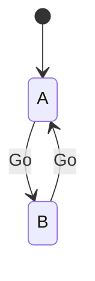

Every input is handled in every state, so there are no unexpected terminations
and no deadlock: `PASS (complete)`, 2 states, 2 transitions, max depth 1.

## 3. 03 - timeout and retry

[03_timeout_retry.rfs](../../examples/valid/03_timeout_retry.rfs): the canonical
timer pattern - a `bit<3>` countdown decremented on `Tick`, with two guarded
arms (retry while time remains, drop when exhausted).

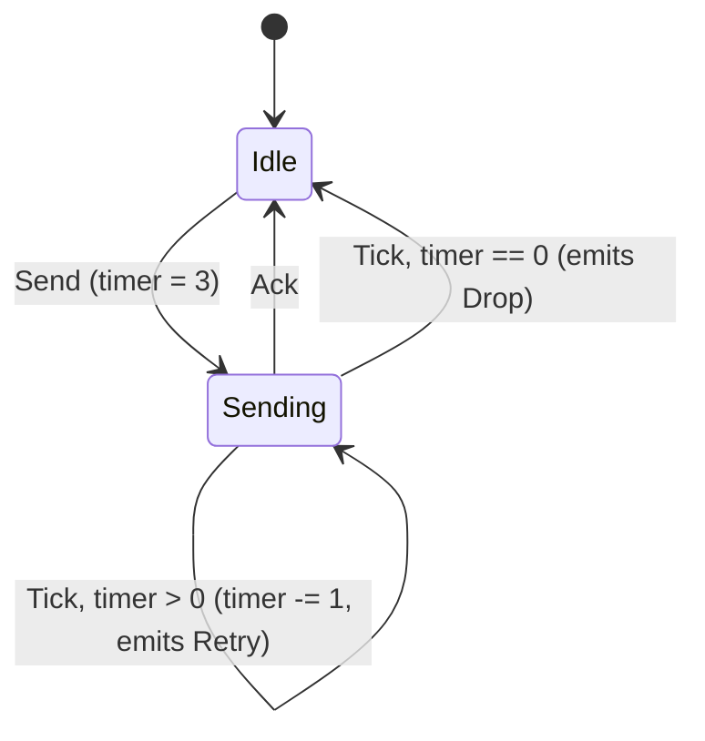

The two `Tick` arms share a pattern with different guards and NO priorities -
the validator would warn on such a pair; here the guards are disjoint
(`timer > 0` vs `timer == 0`) so first-match-in-source-order is safe. Result:
PASS, 8 states (2 states x timer values that matter).

## 4. 04 - TCP-handshake-like endpoint

[04_tcp_handshake_like.rfs](../../examples/valid/04_tcp_handshake_like.rfs):
payload events (`Recv(Ack(ack_seq: bit<4>))`), a guarded match against the
sequence number, and the three property forms in one spec:

```rfs
prop syn_ack : always (input_is(Recv(Syn)) -> output_has(Send(SynAck))) ;
prop timeout_progress : always (state == SynSent -> bounded_eventually[10] (state != SynSent)) ;
assume env_tick : always (bounded_eventually[5] (input_is(Tick))) ;
```

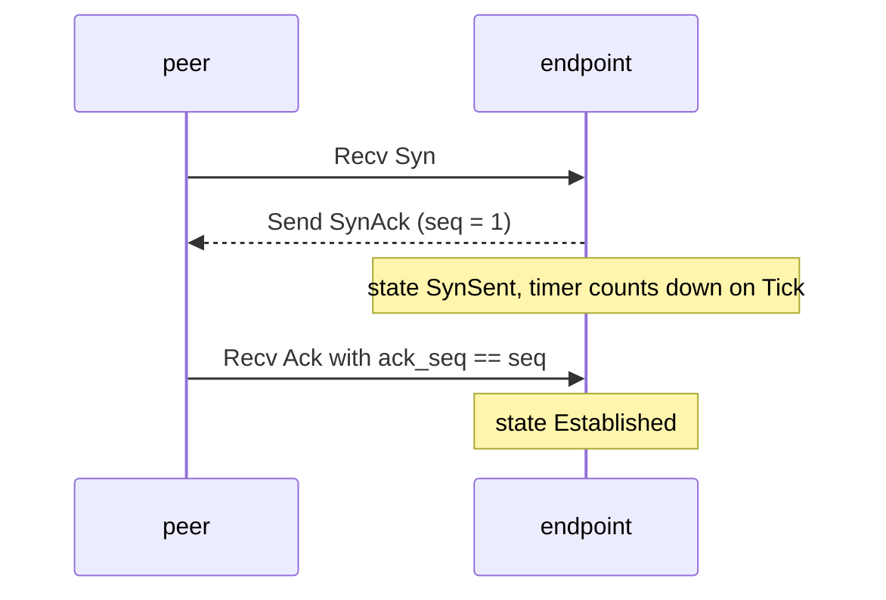

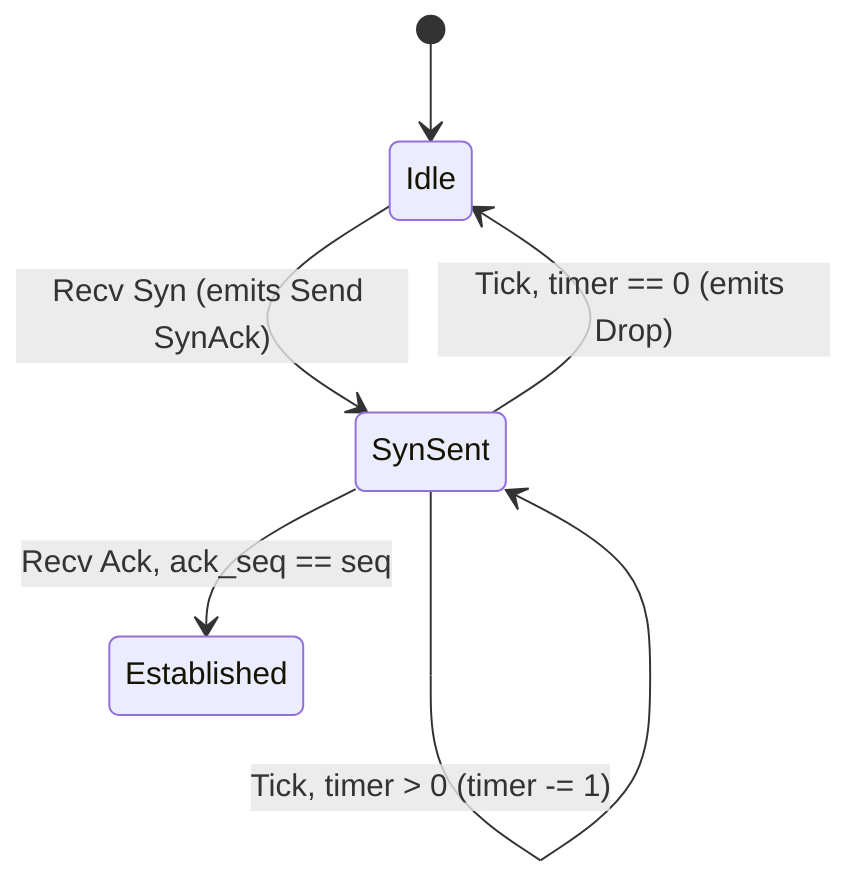

**Teaching case:** exact MC reports `FAIL ... reason=deadlock` at depth 2 -
`Established` has no outgoing transitions, so a configuration parked there has
no surviving successor for ANY input. The properties themselves hold; the model
is simply missing absorbing arms (or an `on_error`). This is the single most
common "my spec works but MC fails" situation - see
[FAQ.md](FAQ.md#why-does-my-working-spec-fail-mc-with-deadlock).

## 5. 43 - sliding-window ARQ (deep dive)

[43_sliding_window.rfs](../../examples/valid/43_sliding_window.rfs) is the
protocol behind the example crates (sync_handler / async_handler /
c_sync_handler all drive it end to end). A sender with a window of 4 over
sequence numbers 0..8; time is modeled by `Tick`; on each tick the sender
either sends the next frame (while there is room) or the receiver acknowledges
the oldest unacked frame.

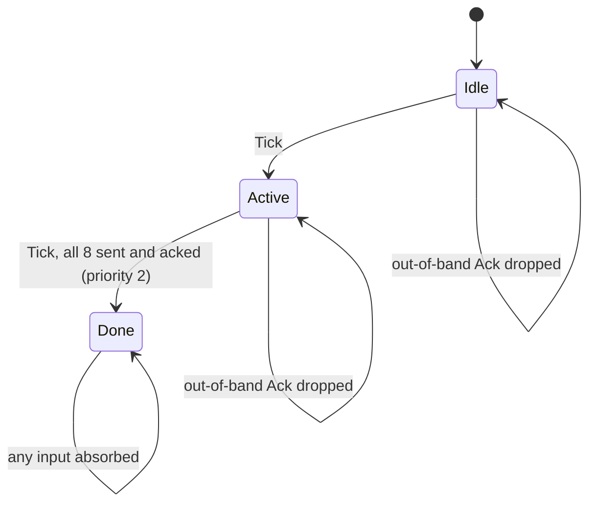

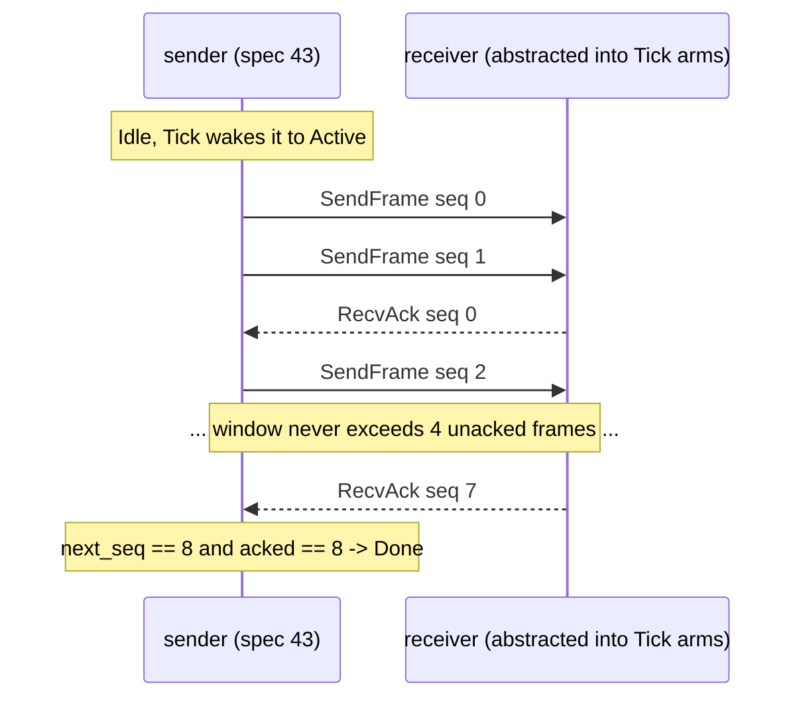

Key ideas to notice:

- **Priorities order overlapping guards:** the completion arm (priority 2)
  beats the send arm (priority 1) when both could fire on the same Tick.
- **Input abstraction in action:** `Ack(Seq(seq: bit<4>, checksum: bit<32>))`
  - neither field is referenced by any guard/emit/assignment, so the model
  checker collapses BOTH to single representative values. The state space is
  independent of the checksum's width (94 states, not 94 x 2^32).
- **Liveness under an assumption:** `prop terminates : eventually (state ==
  Done)` plus `assume env_tick` - completion is PROVEN only because the
  environment keeps ticking. Relax it (`--assumes none`) and the proof no
  longer applies.
- **Terminal state convention:** `Done` absorbs every input - without those
  self-loop arms exact MC would report a deadlock (see spec 04 above).

Result: `PASS (complete)`, 94 states / 188 transitions / max depth 22. Run the
real session (both exit 0 and print byte-identical data lines - 19 ticks,
frames/acks [0..8], 5 dropped out-of-band acks, max window 4):

```sh
cargo run -p sync_handler                       # Rust, over std mpsc channels
make -C crates/examples/c_sync_handler run RFS_BIN=$PWD/target/debug/rfs   # C mirror (bare `rfs` on PATH works too)
```

## 6. 44 - token ring

[44_token_ring.rfs](../../examples/valid/44_token_ring.rfs): a single state,
four ring positions in a `bit<2>` variable. The token passes one node per Tick
(`holder + 1` wraps 3 -> 0); a node with a pending request is granted when the
token arrives.

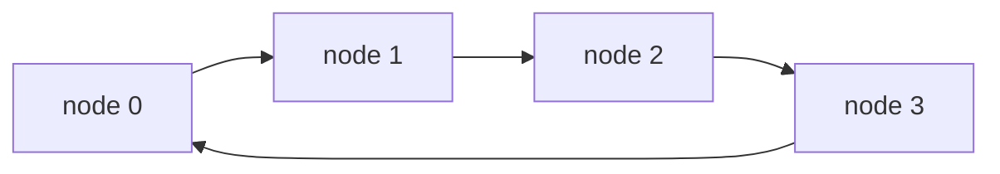

Properties: a safety invariant (`holder_no_request` - the current holder never
has a pending request), three unbounded liveness properties (each startup
request is eventually granted), and one BOUNDED per-instance property (node 1's
request is granted within 25 samples of being set).

**Abstraction stress, by design:** `Request` carries a `bit<16>` payload the
protocol never inspects - abstraction collapses it to one value. The token's
carried frame ID (`data: bit<8>`) IS concrete (updated every pass) and
multiplies the state space by 256 - the contrast is the point. Result:
`PASS (complete)`, 26113 states / 104452 transitions / max depth 268.

## 7. 45 - elevator

[45_elevator.rfs](../../examples/valid/45_elevator.rfs): four floors, up/down
call vectors as `bit<8>` masks, one floor moved per Tick, priorities 1-3
ordering serve/move/reverse arms in every state. Two calls wait at startup (up
at floor 2, down at floor 3).

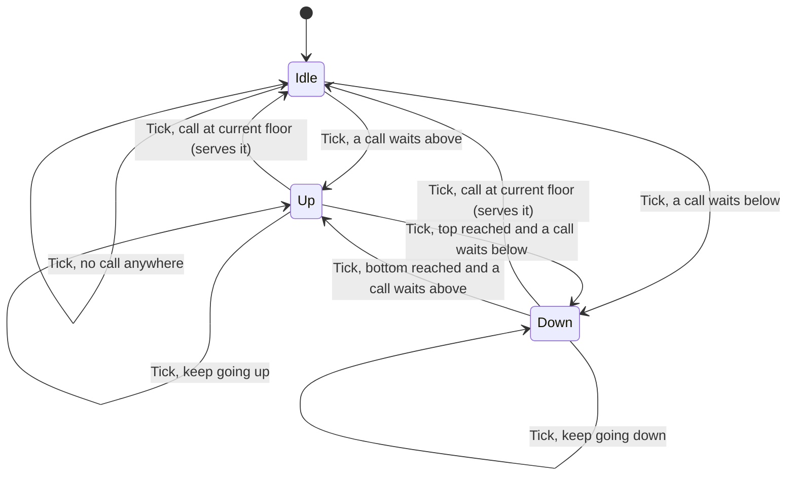

Properties: `idle_no_local_call` (safety - the elevator never idles while a
passenger waits at its floor) and two unbounded liveness properties for the
startup calls. Two deliberate design notes in the header comments:

- **Per-instance bounded liveness was kept OUT of this spec on purpose:** each
  `always (pending -> bounded_eventually[N] ...)` obligation adds about N
  countdown states to every configuration where the bit is set - two bound-80
  obligations blew this spec past the sizing target (1M+ states). The bounded
  form lives in spec 44 instead.
- **ONE environment assumption:** two independent bounded-eventually assumptions
  over disjoint event sets admit prefixes where both deadlines land on the same
  sample - no single input can satisfy both, so every successor is pruned and
  exact MC reports a SPURIOUS deadlock. A real modeling trap, documented in the
  spec.

Result: `PASS (complete)`, 8082 states under its own assumption; with
`--assumes none` it FAILs liveness (`up2_served`) - see
[MODEL_CHECKING.md section 6](MODEL_CHECKING.md#counterexamples).

## 8. 47 - HTTP/2-like stream state machine

[47_http2_stream.rfs](../../examples/valid/47_http2_stream.rfs): a single-
endpoint abstraction of one HTTP/2 stream. `send_window` (`bit<5>`, initial 16)
is the peer's flow-control grant; `SEND_DATA(w)` consumes w; `WINDOW_UPDATE(w)`
adds w, CAPPED at the representable maximum - the cap arm fires exactly when
the bit<5> sum would wrap (`send_window + w < send_window`, wrapping arithmetic
as a wrap detector). Closed is terminal and absorbs every input.

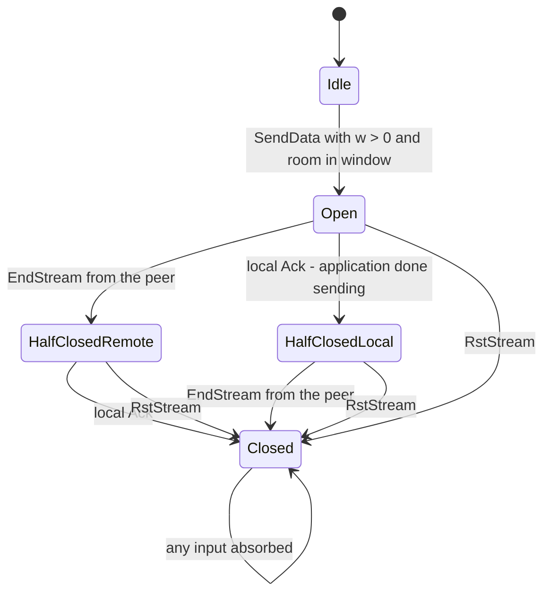

Properties: `closed_terminal` (a `next`-based invariant), `rst_goes_closed`,
`grant_only_when_alive`, and a bounded liveness property - after the local half
closes, the stream reaches Closed within 8 samples, supported by the
`peer_ends` assumption. Result: `PASS (complete)`, 434 states / 21857
transitions / max depth 7.

## 9. 48 - USB-like control transfer

[48_usb_control_transfer.rfs](../../examples/valid/48_usb_control_transfer.rfs):
device-side abstraction of one control transfer (fixed length-4 payload). SETUP
opens it; `DATA(n)` delivers n bytes - the packet carrying the LAST remaining
byte completes the data stage; NAK grows a retry counter and a NAK at the
`bit<2>` ceiling (3) aborts into Error.

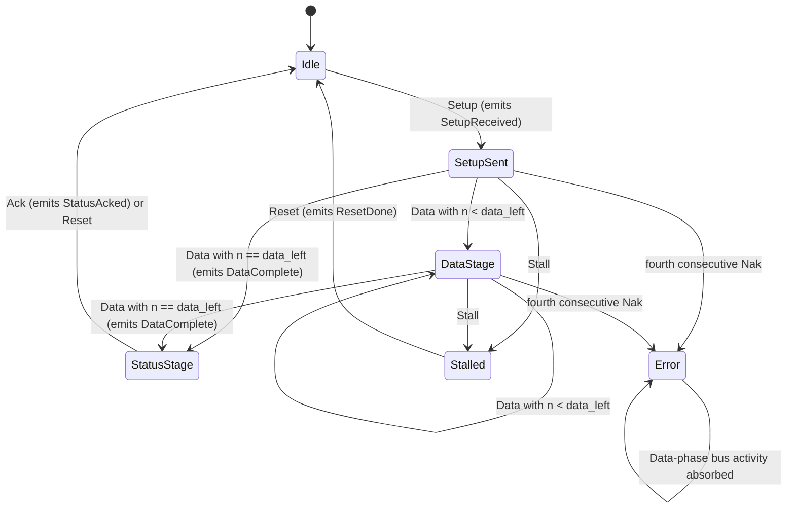

Properties: `no_double_setup`, `status_only_when_complete`, `error_terminal`
(all safety) and `completes_after_setup` - a started transfer reaches
StatusStage or Stalled within 16 samples, a TIGHT bound derived from the
`env_progress` assumption (worst case: four 1-byte packets each delayed to the
assumption deadline). The `Error` state is absorbing for DATA-phase activity on
purpose (host re-initialization out of scope) - and deliberately does NOT absorb
SETUP, which keeps `no_double_setup` provable when Error becomes reachable via
`--assumes none`. Result: `PASS (complete)`, 104 states / 340 transitions /
max depth 15.

## 10. 49 - CAN-like arbitration and error states

[49_can_arbitration.rfs](../../examples/valid/49_can_arbitration.rfs):
transmitter-node abstraction of a CAN frame cycle. TX_REQ starts a frame (the
arbitration ID is never inspected - abstraction collapses it); ARB_WIN/ARB_LOSE
resolve arbitration (a LOST arbitration is not an error, per CAN semantics);
ACK_OK completes the data phase; ACK_ERR grows the transmit error counter by 4
and promotes ON THE STEP the threshold is crossed.

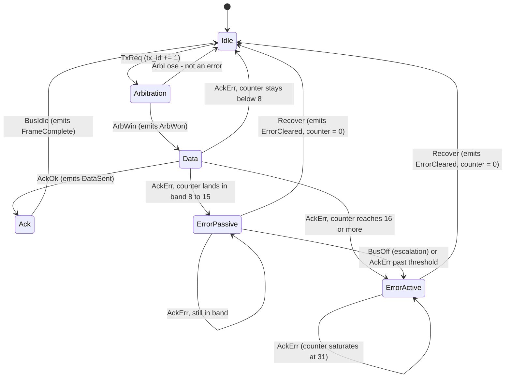

Properties: five safety invariants including the error bands (`ErrorActive` only
at/above 16; `ErrorPassive` exactly in [8, 16)) and one bounded liveness
property (`idle_after_ack`, supported by the `env_bus_idle` assumption). The
counter saturates at the bit<5> maximum 31 via the same wrap-detection guard
pattern as spec 47. Result: `PASS (complete)`, 240 states / 448 transitions /
max depth 41.

## 11. The TLA+ adaptations

[examples/valid/tla_adapted/](../../examples/valid/tla_adapted/) holds six specs
adapted from public TLA+ resources (tla-by-example and the TLA+ Examples repo):
31 traffic light, 32 TCP endpoint, 33 German transfer protocol, 34 single-lane
bridge, 35 bounded buffer, 36 echo node.

The adaptation strategy (see KB.md section 4.7 for the full table):

- model ONE endpoint/controller rather than the full distributed system;
- replace other processes with input events and assumptions;
- replace unbounded sequences/sets/functions with finite enums, booleans, small
  bitvectors, or explicit abstraction;
- make autonomous TLA+ steps input-driven (usually via `Tick`);
- translate `TypeOK` into static types plus RFS properties;
- document what was abstracted away - network queues, fairness, global
distributed invariants.
