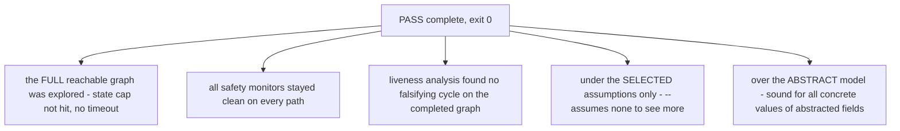

# FAQ - Abstraction, Assumptions, and Known Limitations

Frequently asked questions about what RFS model checking actually proves, how
abstraction and assumptions shape the results, and where the v1.0 surface has
edges. Semantics behind every answer: [docs/SEMANTICS.md](../SEMANTICS.md).

**Table of contents**

1. [What are representative inputs, and what do they make sound?](#1-what-are-representative-inputs-and-what-do-they-make-sound)
2. [Assumption policies and their effect on model checking](#2-assumption-policies-and-their-effect-on-model-checking)
3. [Nondeterministic MC vs deterministic production](#3-nondeterministic-mc-vs-deterministic-production)
4. [Why does my working spec fail MC with deadlock?](#4-why-does-my-working-spec-fail-mc-with-deadlock)
5. [When is a PASS trustworthy?](#5-when-is-a-pass-trustworthy)
6. [C backend bit-width limits](#6-c-backend-bit-width-limits)
7. [Version headers and migration](#7-version-headers-and-migration)
8. [Known limitations in v1.0](#8-known-limitations-in-v10)

## 1. What are representative inputs, and what do they make sound?

Exact model checking cannot enumerate every payload value of a wide field -
so it doesn't try. For each event variant, each payload field is either
**CONCRETE** or **ABSTRACTED**:

- A field is CONCRETE iff it is REFERENCED by at least one of:
  (a) a transition guard, emit argument, or assignment value - via a pattern
      binding whose bound name is actually USED in that expression (binding a
      field without using it does NOT reference it), or
  (b) an `input_is` pattern with CONSTRAINING field patterns (integer/boolean
      literals or enum-variant matches) anywhere in any property or assumption,
      including under temporal operators. Wildcards and binds constrain nothing.
- An ABSTRACTED field is collapsed to a single REPRESENTATIVE value:
  `bool` -> `false`, `bit<N>` -> `0`, enum -> the FIRST declared variant.

Concrete fields are enumerated over their FULL domain; abstracted fields take
only their representative. That is why spec 43's `checksum: bit<32>` costs zero
states while its `seq: bit<4>` (used in... nothing! - also abstracted) and the
window variables (concrete, they evolve) do.

**Why this is sound:** an abstracted field cannot influence which transitions
are enabled, what outputs are produced, how variables evolve, or the truth of
any property atom. Therefore every concrete run has an identical ABSTRACT
counterpart (same enabled transitions, same outputs, same variable evolution,
same per-sample property labels). Liveness results are sound in BOTH
directions: a violation found in the abstract model is witnessed by a real
path (lift the representative inputs to any concrete values), and a
pass-complete result on the abstract model holds for the concrete one.

Practical rule: document which wide fields you rely on abstraction for - the
benchmark specs' header comments (43/44/45/49) are the pattern.

## 2. Assumption policies and their effect on model checking

- **In exact MC:** an assumption violation on a SUCCESSOR prunes that successor
  - the input is removed from exploration from that configuration (other inputs
  from the same configuration are still explored). Pruning is checked BEFORE
  property violations: a successor violating both an active assumption and a
  property is PRUNED, not reported. `--assumes none` explores everything.
- **Selection:** `--assumes all|none|labels` (default `all`). Labels are
  comma-separated and filtered against the module's known assumption labels -
  UNKNOWN LABELS ARE SILENTLY DROPPED (no error; double-check typos).
- **Sample-0 rule:** if an active assumption is already violated at the initial
  configuration, the CONSTRUCTOR panics (production and MC binaries alike) -
  assumptions must hold initially by design.
- **In generated code:** a confirmed violation routes through the assumption
  handler - `Continue` (step proceeds), `Stop` (step returns an error, state
  unchanged), or `Panic` (abort). The plain `Fsm::step` entry point uses PANIC;
  `Fsm::step_with_handler` lets callers choose. Assumption monitors are ALWAYS
  active in generated code - never build-gated like property monitors.
- **Out-of-subset assumptions** (containing `eventually`/`until`, or breaking
  R1-R4) generate NO monitor and are skipped with a warning - they are NOT
  enforced anywhere, by production code or the model checker. They are
  ADVISORY documentation; express environment liveness guarantees in bounded
  form if you need them checked.
- **Modeling trap:** two independent bounded-eventually assumptions over
disjoint event sets can admit prefixes where both deadlines land on the same
sample - no single input satisfies both, every successor is pruned, and exact
MC reports a SPURIOUS deadlock. Spec 45's header documents keeping this out of
its benchmark spec on purpose.

## 3. Nondeterministic MC vs deterministic production

- **Deterministic mode (production code AND default MC):** for each input, at
  most one transition fires - the FIRST match in firing order (`priority N`
  descending, declaration order for ties). Generated production code is a
  match/if-chain in exactly this order, so what you ship is what the default MC
  checks.
- **`--nondet` mode (MC only):** every enabled transition is a separate
  successor (all matches, in firing order). Use it to check properties against
  ALL possible resolutions of overlapping guards - i.e. "is this property true
  no matter which scheduler/environment choice happens?" It also changes
  liveness counterexample validity: under `--nondet`, STRONG TRANSITION
  FAIRNESS applies (a bad cycle is a valid counterexample only if every
  transition enabled at some state of the cycle is taken on the cycle).
- In deterministic mode there is NO scheduler nondeterminism, so no fairness
  filter applies - every reachable cycle is a valid counterexample candidate.

## 4. Why does my working spec fail MC with deadlock?

A reachable configuration c is DEADLOCKED iff it has NO SUCCESSOR at all: for
EVERY input in the canonical enumeration, either no transition matches and there
is no `on_error` fallback, or every enabled successor is pruned by an active
assumption. Deadlock is a FAILURE (`reason=deadlock`, exit 1).

Key distinctions:

- An UNEXPECTED input (no match, no on_error) merely TERMINATES THAT PATH - it
  is counted in the `unexpected terminations` statistic and does NOT change the
  status. RFS treats unexpected events as a normal Result-based outcome of the
  production semantics, not as a model failure.
- A state MERELY MISSING one input (e.g. no Tick arm) does not deadlock: that
  input's path terminates while the other inputs still have successors.
  Deadlock requires that NO input at all has a surviving successor - e.g. a
  terminal state with no outgoing transitions.

This is why the benchmark specs absorb inputs in terminal states (43's `Done`,
47's `Closed`, 48's `Error`) and why educational specs like 04 (`Established`),
15 (`Complete`), 16 (`B`) and 42 (`Done`) FAIL exact MC with deadlock even
though their properties hold. Fixes, in order of preference: add absorbing
self-loop arms to the terminal state (the protocol convention - "inputs after
termination are ignored"), add an `on_error` fallback, or model the terminal
state's expected inputs explicitly.

## 5. When is a PASS trustworthy?

- `pass-complete` means EXACTLY that: proven on every path of the explored
  (complete) graph, under your assumptions, for the abstracted payload space.
- A TRUNCATED run (`unknown-state-limit`, exit 2) can never report
  pass-complete - if it found a counterexample inside the explored subgraph it
  reports `fail` (sound), otherwise it says unknown. Never read "it didn't fail
  yet" as "it passed".
- SMT bounded mode PASSes are ALWAYS labeled incomplete (`PASS WITHIN BOUND k`).
- `--fast` is sound (never a false pass) but run-dependent - use plain exact
  mode for results you cite.
- The same spec + flags give BYTE-IDENTICAL reports in both backends (exact
  mode has no randomness), so a result is reproducible and parity-checkable.

## 6. C backend bit-width limits

The C backend targets `bit<8>`, `bit<16>`, `bit<32>`, `bit<64>` only (decision
D8) - wider vectors are rejected by C codegen. Rust keeps u128 intermediates,
so wide specs are fine for the Rust backend. Since Phase 6 task 2a, generated C
is well-defined for ALL inputs: shifts render uint64-wide operands with a
runtime `amount >= width -> 0` guard (matching Rust's defined semantics) and
multiplication computes in a uint64_t-wide intermediate - previously latent
undefined behavior for wide variable shifts and overflowing multiplications is
gone, pinned by examples/valid/50_wide_ops.rfs.

## 7. Version headers and migration

- The optional module-level `version "X.Y"` / `version "X.Y.Z"` header is the
  v1.0 SYNTAX version mechanism (D-P6-1). When present it must match that form
  (validator); specs without a header are legacy v0.x and remain valid.
- The IR JSON carries `ir_version`; v1.0 writes 1 and still READS 0 - old
  documents keep loading (the read policy is `0..=IR_VERSION`).
- Every generated artifact's line 1 carries the toolchain version + spec hash
  (first 16 hex chars of SHA-256 over the canonical IR JSON) + module name -
  use it to detect drift in checked-in artifacts.
- The full compatibility policy, what is STABLE within a major version, and
  the v0 -> v1 migration record: [MIGRATION.md](MIGRATION.md).

## 8. Known limitations in v1.0

| Area | Limitation | Impact |
|---|---|---|
| Spans in semantic errors | Parse errors carry real 1-based line/col (surfaced by `rfs validate --json`); SEMANTIC and codegen errors still lack source locations (message + transition id only) | Diagnostics point at the construct, not always the line |
| Anonymous payloads | `event E(x: bit<8>)` is not supported - write `event E(E(x: bit<8>))` | Some natural syntax is rejected |
| Ambiguity analysis | Guard overlap is detected STRUCTURALLY only (identical guards, contradictory equalities); general overlapping guarded pairs yield a WARNING, not a proof | Truly conflicting guarded transitions can pass with a warning - pin intent with priorities |
| C backend widths | only bit<8/16/32/64> target C | wider vectors are Rust-only |
| Error recovery | the parser stops at the FIRST error per file | one typo hides later errors in the same file |
| Unbounded liveness assumptions | `eventually`/`until` assumptions are documented but NOT checked anywhere (no monitor, not MC-enforced) | express environment liveness guarantees in bounded form if they matter |
| Variable initializers | an `init` expression referencing another variable type-checks but has no defined evaluation order - the generated code will not compile | use constant initializers |

These are tracked in KB.md section 7; a full LSP remains an explicit non-goal.
