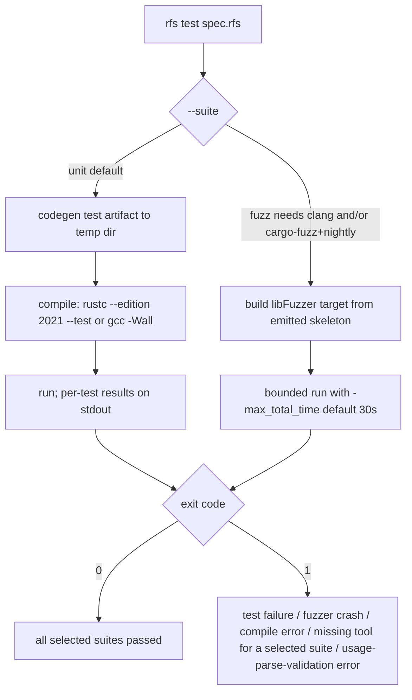

# Production Integration Guide

How to use generated RFS code in real projects: Rust via `build.rs`
(rfs-build) and the `ProtocolFsm` adapters, C via Makefile, no_std targets,
running generated tests in CI, external-tool parameterization, verifying
checked-in artifacts, and rapid-prototyping workflows. Language reference:
[LANGUAGE.md](LANGUAGE.md); model checking: [MODEL_CHECKING.md](MODEL_CHECKING.md).

**Table of contents**

1. [Rust integration via build.rs (rfs-build)](#1-rust-integration-via-buildrs-rfs-build)
2. [ProtocolFsm and the four adapters](#2-protocolfsm-and-the-four-adapters)
3. [no_std production codegen](#3-no_std-production-codegen)
4. [C projects (Makefile pattern)](#4-c-projects-makefile-pattern)
5. [Running generated tests in CI (rfs test)](#5-running-generated-tests-in-ci-rfs-test)
6. [External-tool parameterization and --print-script](#6-external-tool-parameterization-and---print-script)
7. [Verifying checked-in artifacts (spec hash + toolchain version)](#7-verifying-checked-in-artifacts-spec-hash--toolchain-version)
8. [Rapid prototyping: rfs gen-spec and rfs mc-ref](#8-rapid-prototyping-rfs-gen-spec-and-rfs-mc-ref)

## 1. Rust integration via build.rs (rfs-build)

The `rfs-build` crate invokes the RFS toolchain at BUILD TIME so your crate
always compiles against freshly generated code:

```mermaid
flowchart LR
    S[spec.rfs in your repo] --> B[build.rs calls rfs_build::RfsBuild]
    B --> T[rfs binary: RFS_BIN env var or PATH]
    T --> G[rfs codegen rust production --out OUT_DIR/artifact.rs]
    G --> I[your crate pulls the artifact in via include! or a #[path] module]
    I --> A[application drives Fsm::step...]
```

Minimal `build.rs` (the pattern from
crates/examples/sync_handler/build.rs):

```rust
fn main() {
    let spec = Path::new(env!("CARGO_MANIFEST_DIR")).join("../specs/my_protocol.rfs");
    rfs_build::RfsBuild::new(spec)
        .backend("rust")
        .compile()
        .expect("rfs codegen failed (is the rfs toolchain built? run `cargo build` or set RFS_BIN)");
}
```

Builder options:

| Option | Maps to | Purpose |
|---|---|---|
| `.backend("rust" \| "c")` | codegen backend | target language (default rust) |
| `.production()` | `production` command | production FSM (default) |
| `.test_command()` | `test` command | test artifact; the libFuzzer skeleton is written next to it as `fuzz_target.rs` / `fuzz_target.c` |
| `.with_property_monitors(bool)` | `--with-property-monitors` | property monitors in PRODUCTION builds (debug-gated; zero release cost) |
| `.no_std(bool)` | `--no-std` | no_std production codegen (core+alloc, identical public API) |
| `.with_protocol_fsm(bool)` | `--with-protocol-fsm` | generated `Fsm` implements `rfs_adapters::ProtocolFsm` (the one opt-in that links a generated artifact to an external crate) |

Toolchain resolution: the `RFS_BIN` environment variable wins; otherwise bare
`rfs` on PATH. A cold checkout must run `cargo build` at the RFS repository
root first (produces `target/debug/rfs`) or set `RFS_BIN`. The helper also
emits the correct cargo rerun directives, so spec edits trigger regeneration.

Pulling the artifact into your crate: either `include!` a body file (build.rs
must strip the leading inner attributes - `include!` rejects them - and mirror
the suppression list as an outer `#[allow]`) or declare a `#[path]` module at
the OUT_DIR path. Keep generated code OUT of your source tree (OUT_DIR) so
formatters never touch it.

## 2. ProtocolFsm and the four adapters

The `rfs-adapters` crate is the Rust-ecosystem integration layer: one small
trait plus four generic drivers around it. It NEVER depends on generated code;
the link happens only when you pass `--with-protocol-fsm`, which makes the
generated `Fsm` implement the trait.

```rust
pub trait ProtocolFsm {
    type Input;   // the generated Input enum
    type Output;  // the generated Output enum
    type Error;   // the generated StepError enum
    fn new() -> Self where Self: Sized;
    /// Apply one input; returns the outputs emitted by the taken transition.
    fn step(&mut self, input: Self::Input) -> Result<Vec<Self::Output>, Self::Error>;
}
```

| Adapter | Module | Drives the FSM |
|---|---|---|
| `ChannelFsm<F>` | `rfs_adapters::channel` | on its own thread over std mpsc channels: `ChannelFsm::<F>::spawn()`, `.send_input(x)`, `.recv_outcome()` |
| `AsyncFsm<F>` | `rfs_adapters::async_adapter` (feature `async`) | as a futures `Stream` of outcomes; feed inputs, await outputs |
| `drive(fsm, decide, max_steps)` | `rfs_adapters::callback` | synchronous callback loop: your closure picks the next input from the last outputs |
| `Minimal<F>` | `rfs_adapters::minimal` | no_std-minimal newtype wrapper forwarding `new`/`step` (for embedded targets) |

Minimal channel-driver sample (adapted from crates/examples/sync_handler):

```rust
use rfs_adapters::channel::ChannelFsm;

let fsm = ChannelFsm::<Fsm>::spawn();          // Fsm = your generated type
fsm.send_input(Input::Tick).unwrap();          // drive one input
match fsm.recv_outcome().unwrap() {            // observe the step's outputs
    ChannelOutcome::Outputs(outs) => { /* handle outs: Vec<Output> */ }
    ChannelOutcome::Error(e) => { /* StepError: unexpected event / property violation / assumption stop */ }
    ChannelOutcome::Closed => { /* FSM thread finished */ }
}
```

The full worked example - a sliding-window ARQ session over channels with the
window bound verified - is crates/examples/sync_handler (run it:
`cargo run -p sync_handler`, exit 0 on success);
the async mirror is crates/examples/async_handler (`cargo run -p async_handler`).

```mermaid
sequenceDiagram
    participant D as driver thread
    participant C as ChannelFsm handle
    participant F as FSM thread (generated Fsm)
    D->>C: send_input(Tick)
    C->>F: input over mpsc
    F->>F: step: match transition, emit outputs
    F-->>C: outputs over mpsc
    C-->>D: recv_outcome() -> Outputs([SendFrame...])
    Note over D,F: on StepError the outcome carries it; state is NOT updated by a failed step
```

## 3. no_std production codegen

`rfs codegen rust production spec.rfs --no-std` emits `#![no_std]` +
`extern crate alloc` with an IDENTICAL public API (the body is byte-identical
to the std output). For C, `--no-std` is a documented no-op (header comment).
The flag is accepted on the `production` command ONLY - `test`/`mc` reject it
with a pinned error. Verified in this repository:

```sh
cargo run -- codegen rust production examples/valid/46_version_header.rfs --no-std --out /tmp/nostd.rs
```

## 4. C projects (Makefile pattern)

C example projects are Makefile-driven by design (NOT cargo workspace members).
The pattern from crates/examples/c_sync_handler/Makefile:

```make
RFS ?= $(if $(RFS_BIN),$(RFS_BIN),rfs)        # same resolution as rfs-build
SPEC := ../../../examples/valid/43_sliding_window.rfs
BUILD_DIR := build
GEN_FSM := $(BUILD_DIR)/arq_fsm.c

$(GEN_FSM): $(SPEC)
	mkdir -p $(BUILD_DIR)
	$(RFS) codegen c production $(SPEC) --out $@

c_sync_handler: src/handler.c $(GEN_FSM)
	gcc -Wall -I$(BUILD_DIR) -o $@ src/handler.c
```

Generated C is rendered to be warning-free under `gcc -Wall` - that is part of
the v1.0 contract. The C public surface: per-module typedefs (`state_t`,
`input_kind_t`, the vars struct, `step_result_t`, ...) and the functions
`fsm_new` / `fsm_step` / `fsm_free` plus the assumption-hook types
(`rfs_policy_t`, `rfs_assumption_handler`). Note: the C fuzz pipeline compiles
ONLY the emitted `fuzz_target.c` (it `#include`s the production source -
passing both files to clang is a multiple-definition link error).

## 5. Running generated tests in CI (rfs test)

`rfs test` generates + compiles + RUNS the selected suites in one invocation -
the CI entry point for generated tests:

```sh
# unit suite (default): codegen the extended test artifact, compile it
# (rustc --edition 2021 --test / gcc -Wall), run it
 cargo run -- test examples/valid/46_version_header.rfs

# C backend
cargo run -- test --backend c examples/valid/46_version_header.rfs

# fuzz suite: build + bounded-run the libFuzzer target from the emitted skeleton
# (C: clang -O1 -fsanitize=fuzzer,address; Rust: temp cargo-fuzz project, nightly pinned)
cargo run -- test --suite fuzz --fuzz-max-total-time 30 examples/valid/46_version_header.rfs
```



Missing clang/cargo-fuzz is an error ONLY when the fuzz suite is selected. The
extended test artifact carries per-transition, invariant,
monitor-violating-trace and random-trace test classes (seeded LCG -
deterministic), plus the fuzz skeleton as a SEPARATE extra file so the main
artifact stays dependency-free.

## 6. External-tool parameterization and --print-script

Every tool-invoking command (`test`, `diagram --render`) resolves external
tools with unified precedence: **CLI flag > environment variable > bare name on
PATH**:

| Tool | Env PATH var | Env args var | CLI overrides |
|---|---|---|---|
| rustc / gcc (rfs test) | `RFS_RUSTC` / `RFS_GCC` | `RFS_RUSTC_ARGS` / `RFS_GCC_ARGS` | `--rustc PATH` / `--gcc PATH`, `--rustc-args` / `--gcc-args` |
| clang (fuzz) | `RFS_CLANG` | `RFS_CLANG_ARGS` | `--clang PATH`, `--clang-args` |
| cargo-fuzz (fuzz) | `RFS_CARGO_FUZZ` | `RFS_CARGO_FUZZ_ARGS` | `--cargo-fuzz PATH`, `--cargo-fuzz-args` |
| fuzzer runtime flags | `RFS_FUZZ_FLAGS` | - | `--fuzz-flags` (appended after the env value, after `-max_total_time`) |
| dot / plantuml / mmdc (diagram) | `RFS_DOT` / `RFS_PLANTUML` / `RFS_MERMAID` | `RFS_*_ARGS` | `--dot/--plantuml/--mermaid PATH`, `--*-args` |

Env args come first, CLI args appended. `--print-script` (on every
tool-invoking command) prints a SELF-CONTAINED POSIX sh script instead of
executing it - deterministic, with the toolchain version embedded in the header
- so CI can audit or cache the exact invocations:

```sh
cargo run -- test --backend rust --print-script examples/valid/16_next_property.rfs | head -4
# #!/bin/sh
# rfs 1.0.0 - generated by `rfs test --backend rust ...`
# tools: rustc=rustc
# set -e
```

## 7. Verifying checked-in artifacts (spec hash + toolchain version)

Every generated artifact (both backends, all commands, fuzz skeletons) starts
with a line-1 comment carrying three fields:

```text
// Generated by RFS v1.0.0 | spec sha256:7305bad4029a5d95 | module version_header
```

Real output from this repository (Rust and C artifacts for the same spec carry
the SAME hash):

- **Toolchain version** (`v1.0.0`): which rfs wrote the file. Regenerate with
  your current rfs; if only this field changed, the difference is toolchain
  drift.
- **Spec hash** (`spec sha256:...`): first 16 hex chars of SHA-256 over the
  CANONICAL IR JSON of the WHOLE input file (deterministic key order/format -
  stable across runs and platforms). Any change to any part of the spec file
  changes it. Multi-module files: one hash per artifact (the hash is a FILE
  fingerprint; codegen still targets the first module).
- **Module name**: which module was generated.

The STABLE contract (see [MIGRATION.md](MIGRATION.md#25-artifact-headers-stable-content-movable-text))
is that these three FIELDS are present and correct - pin the fields, not the
line's wording. To check drift:

```sh
cargo run -- codegen rust production my_spec.rfs --out /tmp/new.rs
diff /tmp/new.rs checked_in_artifact.rs   # line 1 may differ (version/hash); any body difference on unchanged spec+toolchain is a bug to report
```

## 8. Rapid prototyping: rfs gen-spec and rfs mc-ref

Two commands exist for shell/REPL work without hand-writing specs:

**`rfs gen-spec`** writes a generated spec (always parsed + validated before
writing; exit 1 with a diagnostic otherwise) in two modes:

```sh
# fully random from a seed (deterministic: same args => byte-identical file)
cargo run -- gen-spec --out /tmp/rand.rfs --seed 42 --size small

# incremental mutation of a known base shape - much better corner-case coverage
cargo run -- gen-spec --base examples/valid/03_timeout_retry.rfs --mutations 3 --seed 7 --out /tmp/mut.rfs
diff examples/valid/03_timeout_retry.rfs /tmp/mut.rfs   # added state, transition, property
```

Real output of the mutation mode above (abridged): a new state `S0` is added to
the enum, a new guarded transition and a new `prop` appear - validity is
preserved at every mutation step (invalid candidates are rolled back and
drawn again).

**`rfs mc-ref`** runs the reference model checker in-process (no compilation)
with unified reports - see [MODEL_CHECKING.md section 2](MODEL_CHECKING.md#2-rfs-mc-ref---in-process-reference-model-checker):

```sh
cargo run -- mc-ref /tmp/mut.rfs            # instant proof/counterexample on the mutated spec
```

Typical loop: mutate a known-good base with `gen-spec` until it misbehaves,
watch the counterexample from `mc-ref`, fix the base, repeat. For toolchain-
level fuzzing of parser/validator/IR/codegen itself (not generated code), see
the root `fuzz/` workspace - BUILD.md section 6.
