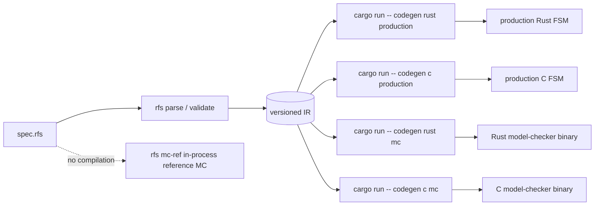
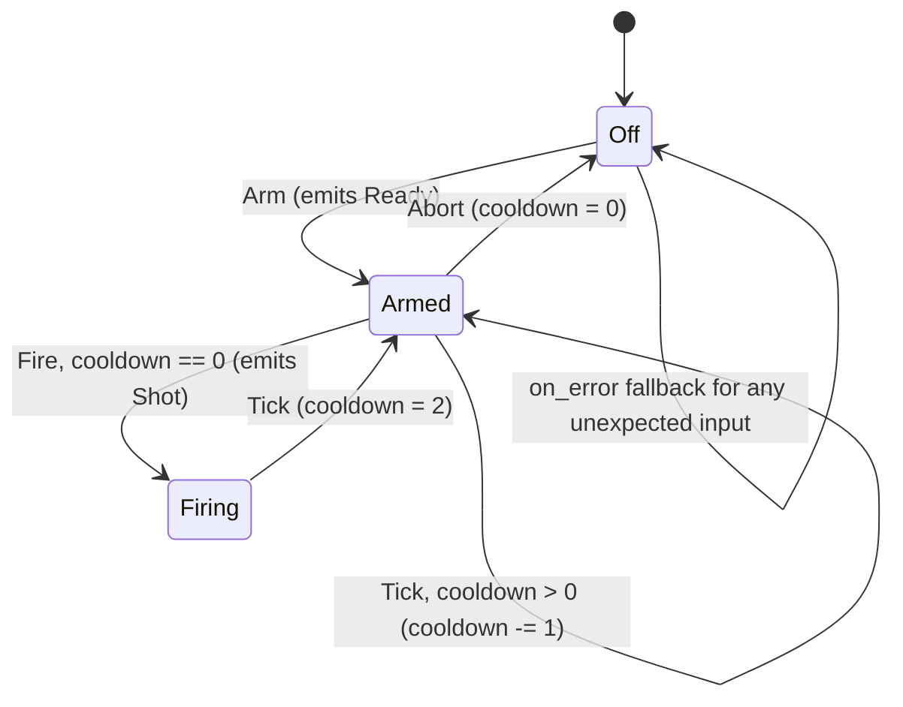

# RFS Language Reference

Self-contained reference for the RFS specification language (v1.0 surface). If
you are new to RFS, read [README.md](README.md) first; for the formal, normative
semantics behind every rule on this page, see
[docs/SEMANTICS.md](../SEMANTICS.md).

**Table of contents**

1. [What RFS is](#1-what-rfs-is)
2. [Quick start](#2-quick-start)
3. [Modules and the version header](#3-modules-and-the-version-header)
4. [States and the initial state](#4-states-and-the-initial-state)
5. [Events and outputs](#5-events-and-outputs)
6. [Variables](#6-variables)
7. [Transitions](#7-transitions)
8. [Tick and timers](#8-tick-and-timers)
9. [The expression language](#9-the-expression-language)
10. [A complete example, line by line](#10-a-complete-example-line-by-line)
11. [Where to go next](#11-where-to-go-next)

## 1. What RFS is

RFS is a finite-state protocol specification language. You describe ONE
endpoint of a protocol as a finite input/output machine: control states,
events it can receive, outputs it can emit, small finite variables, and guarded
transitions between states. The toolchain compiles that one description to:

- **production FSMs** in Rust or C (drop-in code your application drives),
- **unit/fuzz test suites** for the generated code,
- a **model-checking binary** that exhaustively verifies properties of the
  machine,
- plus static introspection (`rfs info`), state diagrams (`rfs diagram`), and
  spec generation (`rfs gen-spec`).

The language is deliberately finite: no unbounded integers, no floats, no
calls to arbitrary functions. Every value space is enumerable, so the model
checker can prove things about your protocol instead of guessing.



## 2. Quick start

All commands below are copy-paste runnable from the repository root (they use
`cargo run --`, which invokes the `rfs` binary built by cargo; an installed
binary is just `rfs`).

```sh
# 1. Validate a spec (parse + semantic checks):
cargo run -- validate examples/valid/01_trivial_two_state.rfs

# 2. Generate production Rust code for it:
cargo run -- codegen rust production examples/valid/01_trivial_two_state.rfs --out /tmp/trivial_fsm.rs

# 3. Model-check it without compiling anything (in-process reference MC):
cargo run -- mc-ref examples/valid/01_trivial_two_state.rfs
```

Expected output of step 3:

```text
PASS (complete)
model-check summary: status=pass-complete states=2 transitions=2 max_depth=1
...
```

(`PASS (complete)` means the FULL reachable state space was explored and every
property holds - see [MODEL_CHECKING.md](MODEL_CHECKING.md) for what each status
guarantees.)

## 3. Modules and the version header

A source file contains one or more **modules**. Every codegen command runs on
the FIRST module of the file (multi-module files are otherwise rejected when
items conflict across modules):

```rfs
module handshake {
  // items: enums, initial, events, outputs, vars, transitions, props, assumes
}
```

Items may appear in any order; declare types before first use for readability.

### The v1.0 version header

The module header may carry an optional syntax version:

```rfs
module handshake version "1.0" {
  ...
}
```

- Since v1.0 (decision D-P6-1) a PRESENT header must match `X.Y` or `X.Y.Z`
  (all-digit components); anything else is a validation error:
  `module '<name>' invalid version header '<v>' (expected X.Y or X.Y.Z)`.
- The parser still accepts any quoted string - a malformed header is a
  SEMANTIC error, consistent with the parse/validate split.
- Specs WITHOUT a header remain valid; they are treated as legacy v0.x syntax.
- The version is METADATA: it is stored in the IR, round-tripped by `rfs
  parse`, shown by `rfs info`, and emitted as `SPEC_VERSION` (Rust) /
  `#define RFS_SPEC_VERSION` (C). It changes no semantics.

See [MIGRATION.md](MIGRATION.md) for the versioning and compatibility policy.

## 4. States and the initial state

```rfs
enum State { Idle, Sending, Established }
initial Idle
```

- Control states are the variants of an enum; by convention it is named
  `State` (any other name works).
- `initial` names the starting variant.
- Other enums may be declared for variables and event payloads:

```rfs
enum Mode { Normal, Retransmit, Error }
```

## 5. Events and outputs

**Events** are inputs; **outputs** are actions the machine emits. Both use the
same grouped-constructor shape:

```rfs
# Unit event (no payload):
event Tick

# Grouped variants - every line adds a variant to the logical group Recv:
event Recv(Syn)
event Recv(Ack(ack_seq: bit<4>))

# Outputs, same shape:
output Send(SynAck)
output Reply(Ok(code: bit<8>))
output Reply(Err(msg: bit<8>))
```

Payload fields must be finite types (section 6). Groups are FLATTENED into one
variant list for codegen and model checking, in declaration order:

- a single-variant group whose variant name equals the group name keeps the
  bare name (`event Tick` -> input `Tick`);
- otherwise the base name is `group_variant` (`Recv(Ack(...))` ->
  `Recv_Ack`);
- colliding names get numeric suffixes (`Name`, `Name2`, ...).

**Limitation:** anonymous payload groups are not supported - the variant name
must be written:

```rfs
event E(Value(x: bit<8>))   # supported
event E(x: bit<8>)          # NOT supported (see FAQ.md)
```

## 6. Variables

```rfs
var seq: bit<4> init 0
var timer: bit<3> init 7
var mode: Mode init Mode::Normal
var enabled: bool init false
```

| Type | Values |
|---|---|
| `bool` | `false`, `true` (ordered `false < true`) |
| `bit<N>` | unsigned integers `0 ..= 2^N - 1`; all arithmetic wraps mod 2^N |
| `EnumName` | the enum's variants, in declaration order |

Rules:

- Every variable needs an initializer. Use CONSTANT initializers: an
  initializer that references another variable type-checks but has no defined
  evaluation order (the generated code will not compile) - see
  [SEMANTICS.md section 2.4](../SEMANTICS.md#24-variables-and-the-initial-configuration).
- **C backend width limit:** only `bit<8>`, `bit<16>`, `bit<32>`, `bit<64>`
  can target C; wider vectors are fine for Rust (u128 intermediates) but the
  C codegen rejects them.
- The trailing `;` on declarations is optional.

## 7. Transitions

The general form:

```rfs
transition <state> on <event_pattern> where <guard> {
  next <next_state>;      # required, exactly one
  emit <output_expr>;     # zero or more
  set <var> = <expr>;     # zero or more, each var at most once
  priority N;             # optional, orders overlapping transitions
}
```

### Event patterns

The pattern selects an event variant and constrains its payload fields:

```rfs
on Tick                      # unit input
on Recv(Syn)                 # specific variant, no payload
on Recv(Ack(ack_seq))        # bind the field to ack_seq (any value)
on Recv(Ack(_))              # wildcard: any value
on Cmd(Value(0))             # literal match
on Flag(Value(true))         # boolean literal match
on E(x: Mode::Normal)        # named pattern: bind AND constrain
```

| Field pattern | Meaning |
|---|---|
| `_` | wildcard (any value) |
| `name` | bind the field to `name` for use in guard/emit/set |
| `0`, `1`, `true`, `false` | literal match |
| `name: <pattern>` | named pattern match (bind + constrain) |

A BARE group pattern (`on Recv`) matches every variant of the group. Anonymous
enum-variant field patterns are NOT supported (`on E(Mode::Normal)` is
rejected; use `on E(x: Mode::Normal)`).

### Guards

`where <guard>` is an optional boolean expression over: the current state
(`state`), the OLD variable values, and the pattern bindings. Absent guard =
a transition that fires whenever its pattern matches.

### Simultaneous updates

All `set` right-hand sides are evaluated against the OLD variable valuation,
then applied together. There is no sequential dependency between assignments in
one transition:

```rfs
# both RHS read the OLD values of a and b:
set a = b;
set b = a;   # swap, not "a then a"
```

Assigning the same variable twice in one body is a parse error.

### Priorities and firing order

Within one state, transitions are ordered by EFFECTIVE priority: `priority N`
descending, default 0 for unmarked transitions; ties keep declaration order
(stable). The first matching transition in this order fires (deterministic
mode - production code and the default model checker).

Validator rules for overlapping transitions (same state, same pattern):

| Situation | Result |
|---|---|
| identical pattern + identical guard | ERROR: duplicate transition (the second is unreachable) |
| identical pattern + two different explicit priorities | allowed (deterministic order pinned) |
| identical pattern + duplicate explicit priority value | ERROR: duplicate priority |
| identical pattern, no priorities, guards differ or one missing | WARNING: "first match wins in source order" - pin intent with distinct `priority N;` |

Priorities need only be unique per (state, pattern); numbers may be reused
across different patterns in the same state.

### The `on_error` fallback

```rfs
on_error {
  next Safe;             # required
  emit Alert(Code(9));   # optional emits; NO bindings, NO variable assignments
}
```

At most one per module. When NO transition matches an input in the current
state, `on_error` executes INSTEAD of reporting an unexpected event: it moves
to its declared state and emits its outputs, from ANY state, with all variable
values carried over unchanged. Without `on_error`, an unmatched input fails the
step (`StepError::UnexpectedEvent` in Rust / `RFS_UNEXPECTED_EVENT` in C)
without updating state - see [FAQ.md](FAQ.md) for how model checking treats
these.

## 8. Tick and timers

There is NO special-casing of `Tick`: it is an ordinary unit event, enumerated
by the model checker like any other input. Timeouts are modeled with a timer
variable decremented on `Tick` transitions (the pattern from
[examples/valid/03_timeout_retry.rfs](../../examples/valid/03_timeout_retry.rfs)):

```rfs
event Tick
var timer: bit<3> init 3

transition Sending on Tick where timer > 0 {
  next Sending;
  set timer = timer - 1;
  emit Retry;
}
transition Sending on Tick where timer == 0 {
  next Idle;
  emit Drop;
}
```

"Time passing" in a model-checking run is exactly the sequence of `Tick`
inputs the environment chooses; an assumption like
`assume env_tick : always (bounded_eventually[5] (input_is(Tick))) ;` says "a
Tick arrives within every 6 samples" - see [PROPERTIES.md](PROPERTIES.md).

## 9. The expression language

Expressions are pure and total. Operators:

| Operator | Semantics |
|---|---|
| `+`, `-`, `*` | wrapping arithmetic mod 2^w (result width w) |
| `<<`, `>>` | logical shift; amount >= w gives 0; `>>` never sign-extends |
| `~`, unary `-` | bitwise complement / two's complement (`-x = 0 - x mod 2^w`) |
| `&`, `\|`, `^` | bitwise; on `bool` operands `&`/`\|` act as logical connectives |
| `==`, `!=` | equality (enums by variant identity) |
| `<`, `<=`, `>`, `>=` | unsigned comparison of the full values |
| `!` | boolean negation |
| `&&`, `\|\|` | boolean connectives (short-circuit in generated code) |

There is NO division.

Precedence, tightest first: unary (`!` `~` `-`) > `*` > `+` `-` > `<<` `>>`
> `&` > `^` > `|` > relational (`<` `<=` `>` `>=`) > equality (`==` `!=`) >
`&&` > `||`. (Relational binds TIGHTER than equality - a parser design detail;
parenthesize when mixing comparison and equality in nontrivial ways.)

Typing rules:

- arithmetic/bitwise: both operands the same bitvector width (an integer
  literal adapts to the other operand's width; two bare literals form `bit<8>`);
- comparisons: identical types, or a literal against a vector;
- shifts: bitvector left operand, bitvector-or-literal right operand (no width
  equality required);
- logical operators: boolean operands.

## 10. A complete example, line by line

A small "beacon" device: armed by `Arm`, fires on `Fire` only when its
countdown has expired, cools down two ticks after each shot, and aborts back
to `Off` on any unexpected input.

```rfs
module beacon version "1.0" {
  enum State { Off, Armed, Firing }
  initial Off

  event Arm
  event Fire
  event Tick
  event Abort

  output Ready
  output Shot

  var cooldown: bit<3> init 0

  transition Off on Arm {
    next Armed;
    emit Ready;
  }
  transition Armed on Fire where cooldown == 0 {
    priority 2;
    next Firing;
    emit Shot;
  }
  transition Armed on Tick where cooldown > 0 {
    next Armed;
    set cooldown = cooldown - 1;
  }
  transition Armed on Abort {
    priority 1;
    next Off;
    set cooldown = 0;
  }
  transition Firing on Tick {
    next Armed;
    set cooldown = 2;
  }
  on_error {
    next Off;
  }
}
```



Line by line:

| Line(s) | What it does |
|---|---|
| `module beacon version "1.0"` | module name + v1.0 syntax header (metadata; becomes `SPEC_VERSION`) |
| `enum State { ... }` / `initial Off` | three control states, starting in `Off` |
| `event Arm/Fire/Tick/Abort` | four unit inputs (flattened to themselves) |
| `output Ready/Shot` | two unit outputs the caller observes per step |
| `var cooldown: bit<3> init 0` | 3-bit countdown, starts expired |
| `transition Off on Arm { ... }` | arming: move + emit (no guard = always fires on the pattern) |
| `transition Armed on Fire where cooldown == 0 { priority 2; ... }` | guarded fire; priority 2 pins it above `Abort`'s priority 1 should patterns ever overlap in a future edit |
| `transition Armed on Tick where cooldown > 0 { ... }` | the countdown tick; `set` reads the OLD value (simultaneous update) |
| `transition Firing on Tick { ... }` | one-tick firing state, then re-arm with cooldown 2 |
| `on_error { next Off; }` | any input with no matching arm (e.g. `Fire` in `Off`) resets to `Off` instead of failing the step |

Verified in this repository (self-contained - copy the whole block):

```sh
cat > /tmp/beacon.rfs <<'EOF'
module beacon version "1.0" {
  enum State { Off, Armed, Firing }
  initial Off

  event Arm
  event Fire
  event Tick
  event Abort

  output Ready
  output Shot

  var cooldown: bit<3> init 0

  transition Off on Arm {
    next Armed;
    emit Ready;
  }
  transition Armed on Fire where cooldown == 0 {
    priority 2;
    next Firing;
    emit Shot;
  }
  transition Armed on Tick where cooldown > 0 {
    next Armed;
    set cooldown = cooldown - 1;
  }
  transition Armed on Abort {
    priority 1;
    next Off;
    set cooldown = 0;
  }
  transition Firing on Tick {
    next Armed;
    set cooldown = 2;
  }
  on_error {
    next Off;
  }
}
EOF
cargo run -- validate /tmp/beacon.rfs   # -> valid /tmp/beacon.rfs
cargo run -- mc-ref /tmp/beacon.rfs     # -> PASS (complete), states=7 transitions=28 max_depth=5
```

Add `prop`/`assume` lines to this module and re-run `mc-ref` to see model
checking in action - see [PROPERTIES.md](PROPERTIES.md).

## 11. Where to go next

- [PROPERTIES.md](PROPERTIES.md) - the property language: what you can assert
  about your machine and how assumptions constrain the environment.
- [MODEL_CHECKING.md](MODEL_CHECKING.md) - exact / fuzz / SMT modes, every flag,
  and how to read a report.
- [INTEGRATION.md](INTEGRATION.md) - build.rs, adapters, C projects, CI.
- [EXAMPLES.md](EXAMPLES.md) - curated walkthroughs of the example specs.
- [FAQ.md](FAQ.md) - abstraction, assumptions, deadlock, and known limitations.
- [docs/SEMANTICS.md](../SEMANTICS.md) - the normative formal semantics this
  reference summarizes.
