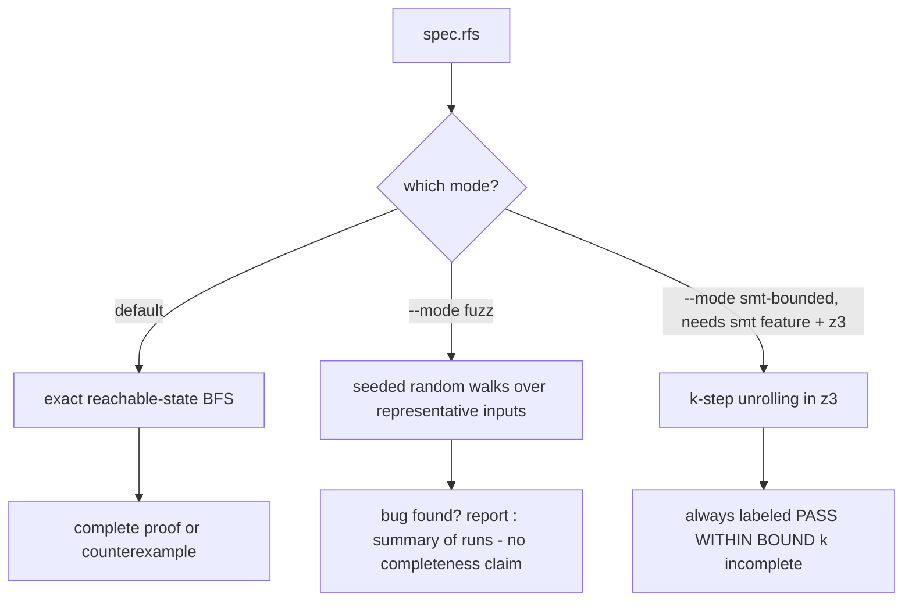
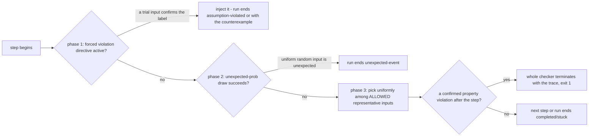
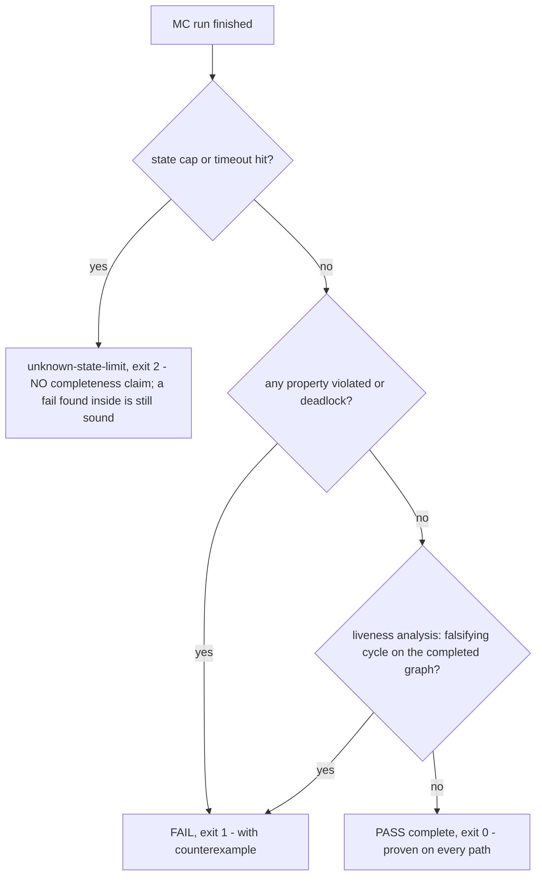

# Model-Checking Modes Reference

How to verify your RFS spec: the three model-checking modes, every flag of the
generated MC binary and of `rfs mc-ref`, the status taxonomy with its labeling
guarantees (when a PASS is trustworthy), and how to read a report. Normative
semantics: [docs/SEMANTICS.md section 9](../SEMANTICS.md#9-model-checking).
Property language: [PROPERTIES.md](PROPERTIES.md).

**Table of contents**

1. [The three modes](#1-the-three-modes)
2. [rfs mc-ref - in-process reference model checker](#2-rfs-mc-ref---in-process-reference-model-checker)
3. [Generated MC binary: exact-mode flags](#3-generated-mc-binary-exact-mode-flags)
4. [Generated MC binary: fuzz (bounded random) mode flags](#4-generated-mc-binary-fuzz-bounded-random-mode-flags)
5. [Status taxonomy and labeling guarantees](#5-status-taxonomy-and-labeling-guarantees)
6. [Counterexamples](#6-counterexamples)
7. [Forced violations (--violate)](#7-forced-violations---violate)
8. [Reading a report step by step](#8-reading-a-report-step-by-step)
9. [When do MC results transfer to the real system?](#9-when-do-mc-results-transfer-to-the-real-system)

## 1. The three modes

| Mode | Command | Completeness | Use it when |
|---|---|---|---|
| **Exact** (default) | `rfs codegen <backend> mc spec.rfs --out mc.rs` then run the binary, or `rfs mc-ref spec.rfs` | COMPLETE: explores the full reachable graph; PASS means proven on every path | small/medium specs (the benchmark set runs 94-104k states in seconds); you need a PROOF |
| **Fuzz** (bounded random) | same binary with `--mode fuzz` | INCOMPLETE: seeded random walks; finds bugs fast, proves nothing | large specs where exact search is too big; bug hunting; CI smoke checks |
| **SMT bounded** (feature-gated) | build rfs with `--features smt`, then `--mode smt-bounded --smt-bound N` | INCOMPLETE: k-step unrolling over z3; PASS is ALWAYS labeled incomplete | targeted deep-sequence bug hunting beyond the fuzz bound |

All three share the same report format (text or JSON) and exit codes:
**0 = pass-complete, 1 = fail, 2 = unknown-state-limit**. Exact mode contains
NO randomness: the same spec + flags give byte-identical reports in both
backends.



## 2. rfs mc-ref - in-process reference model checker

`rfs mc-ref` runs the toolchain's REFERENCE model checker (independent, brute-
force implementation of the same semantics) WITHOUT compiling any generated
code - rapid prototyping in a shell or REPL.

```sh
cargo run -- mc-ref examples/valid/46_version_header.rfs
# -> PASS (complete)
#    model-check summary: status=pass-complete states=17 transitions=33 max_depth=16
```

Flags (unified with the generated exact-mode binary where applicable):

| Flag | Meaning |
|---|---|
| `--max-states N` | state cap; hitting it yields `unknown-state-limit` (exit 2) instead of a completeness claim. Default 1000000 |
| `--timeout-sec N` | wall-clock timeout, default 0 = off. Never affects WHICH result a machine would otherwise report |
| `--assumes all\|none\|labels` | assumption selection (same wire format as the generated binary; unknown labels silently dropped) |
| `--counterexample-format json\|text` | report format, default text; SAME document model as the generated binaries |
| `--log-level off\|error\|warn\|info\|debug` | stderr progress filter |

NOT applicable to `rfs mc-ref` (documented in its usage text): `--seed`,
`--steps`, `--violate` (fuzz-mode concepts), `--threads`/`--fast` (ref_mc is
single-threaded), `--nondet` (the reference engine explores ALL enabled
transitions by construction). Exit codes mirror the generated binaries:
0 pass-complete / 1 fail / 2 unknown-state-limit.

**Parity:** because the report format is unified, `rfs mc-ref` output is
directly comparable - byte-for-byte where deterministic - with the generated
MC binaries' output. Verified in this repository on
[examples/valid/13_properties_safety.rfs](../../examples/valid/13_properties_safety.rfs):
the text reports of `rfs mc-ref`, the Rust MC binary, and the C MC binary are
IDENTICAL (the JSON documents differ only in the informational
`peak_rss_kb` field each generated binary self-reports; `mc-ref` reports 0,
it runs in-process).

Use `rfs mc-ref` for quick interactive checks; use a generated binary when you
need the production-identical engine, parallelism (`--threads`), or fuzz mode.

## 3. Generated MC binary: exact-mode flags

Generate and run (Rust backend shown; C is identical):

```sh
cargo run -- codegen rust mc examples/valid/46_version_header.rfs --out /tmp/mc.rs
rustc --edition 2021 -O /tmp/mc.rs -o /tmp/mc && /tmp/mc
```

| Flag | Default | Meaning |
|---|---|---|
| `--max-states N` | 1000000 | state cap. Hitting it stops the search with `unknown-state-limit` (exit 2) - NEVER a completeness claim |
| `--nondet` | off | nondeterministic mode: EVERY enabled transition is a successor (all matches in firing order) instead of first-match-wins; strong transition fairness applies to liveness counterexamples |
| `--timeout-sec N` | 0 (off) | wall-clock only, not parity-guaranteed |
| `--threads N` | 1 | parallel per-level expansion with a sequential canonical commit: results are BYTE-IDENTICAL to `--threads 1` for any N |
| `--fast` | off | runtime-only, NON-PARITY: workers stop scheduling once any finds a violation; sound (never a false pass) but run-dependent |
| `--counterexample-format json\|text` | text | report format (section 6) |
| `--assumes all\|none\|labels` | all | assumption selection; violations prune successors (checked before property violations) |

## 4. Generated MC binary: fuzz (bounded random) mode flags

```sh
/tmp/mc --mode fuzz --seed 12345 --bound 20 --runs 100
```

| Flag | Default | Meaning |
|---|---|---|
| `--mode fuzz` | exact | switch to the seeded random engine (drives the SAME production FSM core) |
| `--bound N` | 5 | steps per run |
| `--runs N` | 20 | number of runs |
| `--seed N` | 12345 | seed; deterministic LCG - SAME SEED + SAME CONFIGURATION => IDENTICAL RUN in both backends |
| `--assumes all\|none\|labels` | all | as in exact mode |
| `--violate label:prob:percent%` | none | forced-violation directives, repeatable/comma-separated; missing fields default to prob=1.0, percent=100.0 (section 7) |
| `--unexpected-prob P` | 0.0 | probability of injecting a UNIFORM random input (possibly unexpected) at a step |

At EVERY step the engine attempts phases in this order (first success wins):



"Allowed" = a trial step returns Ok OR confirms a property violation (inputs
that confirm violations are allowed ON PURPOSE - the checker wants to find
them). If no input is allowed the run ends `stuck`. The summary line:

```text
model-check summary: runs=R bound=B completed=C unexpected=U assumption_stops=A property_violations=P
```

(`property_violations` is always 0 - a violation exits immediately; the field
stays for format stability.)

Real example from this repository (spec 13, default seed):

```sh
$ /tmp/mc13 --mode fuzz --seed 12345
run 0 property violation: no_bad
  violation step: 2
  vars at violation step: Vars
counterexample trace:
  initial state=State::Good vars=Vars
  step 0 input=Input::Stay outputs=[] from=State::Good to=State::Good vars=Vars
  step 1 input=Input::ToBad outputs=[] from=State::Good to=State::Bad vars=Vars
# exit code 1
```

## 5. Status taxonomy and labeling guarantees

| status | human line | exit code | meaning |
|---|---|---|---|
| `pass-complete` | `PASS (complete)` | 0 | the FULL reachable graph was explored AND every property holds on it (safety via monitors, liveness via the cycle analysis) |
| `fail` | `FAIL` | 1 | a counterexample exists; `reason` is `property-violation`, `liveness-violation`, or `deadlock` |
| `unknown-state-limit` | `UNKNOWN (state limit reached)` | 2 | the search stopped at `--max-states`/timeout before completion; NO completeness claim |

**LABELING RULES - the "no false PASS" invariant:**

1. `pass-complete` is reported ONLY when the reachable graph was FULLY explored
   (state cap not hit, no timeout) and all safety monitors stayed clean AND the
   liveness analysis found no falsifying cycle on the completed graph.
2. `unknown-state-limit` is NEVER a completeness claim: a truncated run may
   still report `fail` (a counterexample inside the explored subgraph is sound
   - all its edges are real transitions), but it can NEVER report
   `pass-complete`.
3. `fail` always carries a concrete counterexample of the stated reason; the
   reported violation step/label is the FIRST confirmed one in canonical
   traversal order (deterministic, parity-pinned).
4. `--timeout-sec` never changes which result a machine would otherwise report.



## 6. Counterexamples

### Text report anatomy (real output, spec 13 property violation)

```text
FAIL
model-check summary: status=fail states=1 transitions=2 max_depth=0 reason=property-violation label=no_bad step=1
  unexpected terminations: 0
  monitor size: 1 bits
  memory estimate: 33 bytes
property violation: no_bad
  violation step: 1
  vars at violation step: Vars
counterexample trace:
  initial state=State::Good vars=Vars
  step 0 input=Input::ToBad outputs=[] from=State::Good to=State::Bad vars=Vars
```

Line by line: the summary line is machine-readable and parity-checked (exact
format); `states` counts enqueued configurations (including the initial one),
`transitions` the enabled effects processed, `max_depth` the greatest depth
reached; then the reason-specific block - property violation (trigger/
violation steps + vars + full I/O trace), deadlock (the terminal configuration),
or liveness (a LASSO: prefix path + cycle, printed with one cycle iteration).

### JSON format (real output, same run, `--counterexample-format json`)

```json
{"status":"fail","metrics":{"states":1,"transitions":2,"max_depth":0},"reason":"property-violation","label":"no_bad","step":1,"statistics":{"unexpected_terminations":0,"monitor_size_bits":1,"memory_estimate_bytes":33,"peak_rss_kb":0},"counterexample":{"kind":"trace","initial_state":"State::Good","initial_vars":{},"steps":[{"input":{"variant":"ToBad","fields":{}},"outputs":[],"from_state":"State::Good","to_state":"State::Bad","vars":{}}],"ce_steps":1}}
```

One compact document, fixed key order, byte-identical across backends EXCEPT
the informational `peak_rss_kb` (self-reported by each generated binary;
`rfs mc-ref` reports 0). Liveness counterexamples carry `prefix`/`cycle`/
`cycle_length` instead of a flat step list.

### Real liveness violation (lasso)

Spec [45_elevator.rfs](../../examples/valid/45_elevator.rfs) run with its
environment assumption RELAXED (`--assumes none`): the environment may now spam
a local call at floor 0 forever, so the startup up-call at floor 2 is never
served:

```text
FAIL
model-check summary: status=fail states=10000 transitions=90000 max_depth=22 reason=liveness-violation label=up2_served step=4
  unexpected terminations: 0
  monitor size: 4 bits
  memory estimate: 350000 bytes
liveness violation: up2_served
  formula: eventually (up_calls & 4 == 0)
  violation step: 4
  cycle length: 1
  note: eventually body never holds on the path
counterexample trace:
  initial state=State::Idle vars=Vars { pos: 0, up_calls: 4, down_calls: 8 }
  step 0 input=Input::CallUp_F { floor: 0, user_id: 0 } outputs=[Output::Serve_S { floor: 0 }] from=State::Idle to=State::Idle vars=Vars { pos: 0, up_calls: 4, down_calls: 8 }
  ...
```

Under the spec's own `env_tick` assumption this same spec PASSES complete -
assumptions change what is provable (section 9).

## 7. Forced violations (--violate)

`--violate label:prob:percent%` (fuzz mode) drives the engine to VIOLATE a
specific assumption or property on purpose - the standard way to test that your
error handling reacts correctly to broken environments.

- `label` - an assumption OR property label of the module;
- `prob` - per-run probability the directive is active (default 1.0);
- `percent%` - per-step probability the engine scans for a confirming input
  (default 100.0).

At each step, when the directive fires, the engine scans the representative
inputs in canonical order for one whose TRIAL STEP confirms a violation of that
label and injects it. A forced input that stops on an assumption violation ends
the run as `assumption-violated:<label>` (counted in `assumption_stops`); one
that confirms a property violation terminates the checker with the
counterexample trace (exit 1).

Real example from this repository - spec
[48_usb_control_transfer.rfs](../../examples/valid/48_usb_control_transfer.rfs)
forcing its `env_progress` assumption ("DATA or STALL within every 5 samples")
to break on every step of every run:

```sh
$ /tmp/mc48 --mode fuzz --seed 12345 --bound 20 --runs 200 --violate env_progress:1.0:100%
model-check summary: runs=200 bound=20 completed=39 unexpected=0 assumption_stops=161 property_violations=0
# exit code 0 - the checker COMPLETED; 161 of 200 runs were stopped by the forced violation
```

Note the mechanics: a bounded-eventual obligation only CONFIRMS at its
deadline, so the forced input appears several steps into a run (after enough
non-progress inputs accumulated), and it must be an input that is otherwise
allowed in the current state - which is why specs whose only allowed input is
the progress event (e.g. spec 04's `SynSent` state) never trigger.

## 8. Reading a report step by step

1. **Exit code first:** 0 pass-complete / 1 fail / 2 unknown-state-limit.
   Anything else means the binary itself misbehaved (a bug - report it).
2. **Summary line:** `status=... states=... transitions=... max_depth=...`
   plus, on failure, `reason=... label=... step=...`. The reason tells you
   WHICH kind of counterexample follows.
3. **Statistics block:** `unexpected terminations` (inputs that terminate
   paths - normal Result-based outcomes, not failures), `monitor size` (packed
   monitor bits per configuration), `memory estimate`.
4. **Counterexample:** replay it mentally against your spec - the trace lists
   every input, output, state change and variable valuation from the initial
   configuration to the violation/deadlock/lasso cycle.
5. **JSON consumers:** parse with any strict JSON parser; key order is fixed;
   normalize `peak_rss_kb` before byte-comparing across machines/backends.

## 9. When do MC results transfer to the real system?

Model checking proves things about the ABSTRACT model, not the physical
protocol. The main gaps:

- **Representative-input abstraction:** payload fields no guard/emit/assignment/
  property references are collapsed to one representative value (false / 0 /
  first variant). Sound by construction - every concrete run has an identical
  abstract counterpart - but it means the proof covers ALL values of those
  fields at once, not each individually. Details: [FAQ.md](FAQ.md#what-are-representative-inputs-and-what-do-they-make-sound).
- **Assumptions:** a `pass-complete` under assumptions holds for environments
  that keep them. Relax (`--assumes none`) to see what breaks without them -
  the elevator example in section 6 is exactly that.
- **Unbounded reality:** real networks have unbounded queues, reordering,
  and timing; RFS models finite abstractions of those. Document what you
  abstracted away (the benchmark specs' header comments are a good pattern).
- **Deadlock = failure:** a reachable configuration with no surviving successor
  for ANY input fails the check - terminal states need absorbing self-loops or
  an `on_error` block.

See [FAQ.md](FAQ.md) for the full Q&A on abstraction and assumptions.
