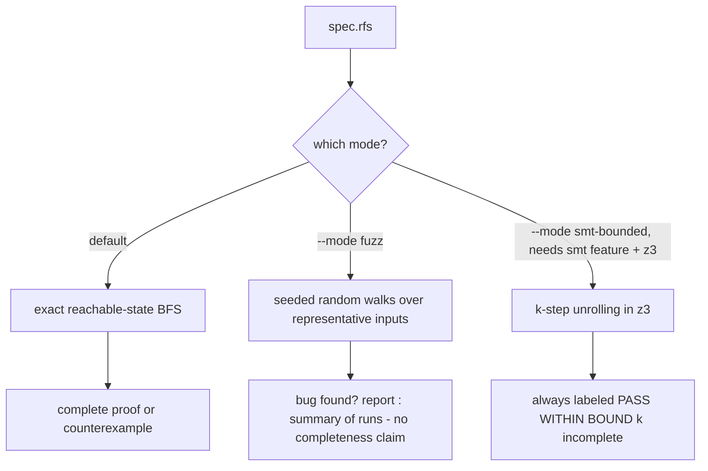
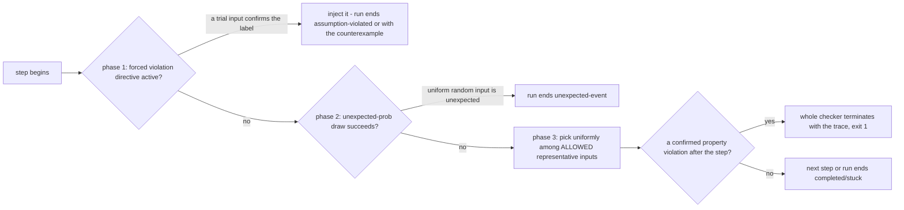
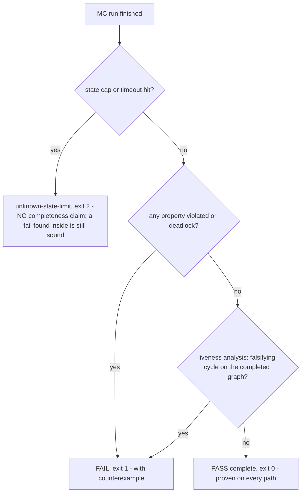

# Model-Checking Modes Reference

How to verify your RFS spec: the three model-checking modes, every flag of the
generated MC binary and of `rfs mc-ref`, the status taxonomy with its labeling
guarantees (when a PASS is trustworthy), and how to read a report. Normative
semantics: [docs/SEMANTICS.md section 9](../SEMANTICS.md#9-model-checking).
Property language: [PROPERTIES.md](PROPERTIES.md).

**Table of contents**

1. [The three modes](#1-the-three-modes)
2. [rfs mc-ref - in-process reference model checker](#2-rfs-mc-ref---in-process-reference-model-checker)
3. [Generated MC binary: exact-mode flags](#3-generated-mc-binary-exact-mode-flags)
4. [Generated MC binary: fuzz (bounded random) mode flags](#4-generated-mc-binary-fuzz-bounded-random-mode-flags)
5. [Status taxonomy and labeling guarantees](#5-status-taxonomy-and-labeling-guarantees)
6. [Counterexamples](#6-counterexamples)
7. [Forced violations (--violate)](#7-forced-violations---violate)
8. [Reading a report step by step](#8-reading-a-report-step-by-step)
9. [When do MC results transfer to the real system?](#9-when-do-mc-results-transfer-to-the-real-system)
10. [smt-bounded vs exact mode: residual differences](#10-smt-bounded-vs-exact-mode-residual-differences)

## 1. The three modes

| Mode | Command | Completeness | Use it when |
|---|---|---|---|
| **Exact** (default) | `rfs codegen <backend> mc spec.rfs --out mc.rs` then run the binary, or `rfs mc-ref spec.rfs` | COMPLETE: explores the full reachable graph; PASS means proven on every path | small/medium specs (the benchmark set runs 94-104k states in seconds); you need a PROOF |
| **Fuzz** (bounded random) | the binary with `--mode fuzz`, or `rfs mc-ref spec.rfs --mode fuzz` | INCOMPLETE: seeded random walks; finds bugs fast, proves nothing | large specs where exact search is too big; bug hunting; CI smoke checks |
| **SMT bounded** (feature-gated) | build rfs with `--features smt`, then the binary with `--mode smt-bounded --bound N` - or `rfs mc-ref spec.rfs --mode smt-bounded` (same feature requirement, no compilation) | INCOMPLETE: k-step unrolling over z3; PASS is ALWAYS labeled incomplete | targeted deep-sequence bug hunting beyond the fuzz bound |

All three share the same report format (text or JSON). Exit codes are per-mode:
**exact** 0 = pass-complete, 1 = fail, 2 = unknown-state-limit; **fuzz**
0 = no property violation (summary line printed), 1 = violation found (per-run
report, NO summary line); **smt-bounded** 0 = pass-within-bound, 1 = fail,
2 = unknown. Exact mode contains NO randomness: the same spec + flags give
byte-identical reports in both backends.



## 2. rfs mc-ref - in-process reference model checker

`rfs mc-ref` runs the toolchain's REFERENCE model checker (independent, brute-
force implementation of the same semantics) WITHOUT compiling any generated
code - rapid prototyping in a shell or REPL. It supports ALL THREE modes with
a unified CLI: `--mode exact|fuzz|smt-bounded` (default `exact`).

```sh
rfs mc-ref examples/valid/46_version_header.rfs
# -> PASS (complete)
#    model-check summary: status=pass-complete states=17 transitions=33 max_depth=16
```

### Exact mode (default)

| Flag | Meaning |
|---|---|
| `--max-states N` | state cap; hitting it yields `unknown-state-limit` (exit 2) instead of a completeness claim. Default 1000000 |
| `--timeout-sec N` | wall-clock timeout, default 0 = off. Never affects WHICH result a machine would otherwise report |
| `--nondet` | nondeterministic mode: EVERY enabled transition fires as its own successor instead of first-match-wins; liveness then requires strongly-fair bad cycles |
| `--counterexample-format json\|text` | report format, default text; SAME document model as the generated binaries |

Exit codes: 0 pass-complete / 1 fail / 2 unknown-state-limit.

### Fuzz mode (`--mode fuzz`)

Seeded random testing with the generated fuzz runtimes' EXACT draw sequence -
no compilation, same strategy, byte-identical reports.

| Flag | Meaning |
|---|---|
| `--bound N` | steps per run. Default 5 |
| `--runs N` | number of runs. Default 20 |
| `--seed N` | LCG seed. Default 12345 |
| `--violate label:prob:percent%,...` | forced-violation directives (see [section 7](#7-forced-violations---violate)) |
| `--unexpected-prob P` | unexpected-input injection probability. Default 0.0 |

Exit codes: 0 no property violation (summary line printed) / 1 violation found
(per-run report printed, NO summary line). Exact-only flags (`--max-states`,
`--timeout-sec`, `--counterexample-format`, `--nondet`) are a usage error under
`--mode fuzz`.

### SMT-bounded mode (`--mode smt-bounded`)

k-step SMT unrolling over z3, IN-PROCESS - the generated SMT binaries' mode
without the compilation cycle. Requires rfs built with `--features smt` (a
non-smt build exits with a clear diagnostic).

| Flag | Meaning |
|---|---|
| `--bound N` | unrolling depth. Default 10 |
| `--full-properties` | check the FULL property class (see below). Without it those properties are omitted with a per-property warning and a `properties_omitted=M` summary suffix |
| `--full-assumptions` | assert the FULL assumption class (see below). DISTINCT from `--full-properties`: expensive properties and cheap assumptions (or the reverse) can be combined. Without it, FULL assumptions are omitted with a per-assumption warning and an `assumptions_omitted=M` summary suffix |
| `--assumes all\|none\|labels` | select which assumptions are active (default `all`; same wire format as exact/fuzz, unknown labels silently dropped). `none` encodes zero assumptions - the assumption-free verdict |

Exit codes: 0 pass-within-bound / 1 fail / 2 unknown.

**What it checks.** The DEFAULT property class is checked unconditionally:
top-level `always`, `always[N]`, `eventually` and one-shot
`bounded_eventually[N]`, plus bare boolean top-level properties and top-level
`next (...)` - the latter two desugared to `always(...)` exactly as exact mode
anchors them (task 3G) - with bodies using boolean combinations of expressions
plus `input_is(...)`, `output_has(...)` and `next (...)` - the same matching
semantics as exact mode (wildcards/bindings constrain nothing, literal field
arguments compare). Variable initializers may be constant expressions
(`init 2 + 3`), folded to the same constant exact mode produces (tasks 3H/3L).
Section 10 lists what still differs from exact mode and how to close each gap. `next` anchors within one step of the horizon are dropped
(sound: they can only miss a violation, never create a false FAIL), and a
`next` obligation is weak when the path has died - if an unhandled input
freezes the configuration before the successor sample, the body is not
checked against that frozen artifact (matching exact mode's terminated-path
semantics). A top-level `bounded_eventually[N]` is likewise unconfirmable if
the path dies before its deadline. Renamed
event parameters (`Reply(R(rk))` for declared field `rkey`) work in patterns
and guards. Enum-typed variables and payload fields, enum paths in expressions
(`Color::Red`), enum-variant patterns in `input_is`/`output_has`, and bare
group patterns over multi-variant groups are all accepted (task 3D): an enum
value encodes as its variant's declaration-order index - the same encoding
exact mode uses - so verdicts agree with exact mode on every boolean fact,
and witness traces print the variant name, not the index.

The FULL class - `until`, `bounded_eventually[N]` under another temporal
operator, and temporals nested under temporals (incl. under `next`) - blows up
the formula at large bounds (O(k*N) growth), so it is opt-in via
`--full-properties`. Its expansions are horizon-truncated and sound (no false
FAILs; no completeness claim). Without the flag each FULL property is omitted
with a stderr warning naming it and the flag, and the summary line gains
`properties_omitted=M` (only when M > 0).

**Assumptions and on_error.** Assumptions are per-step input-space pruning:
each SELECTED assumption's formula is asserted at every sample it covers
(`always[N]` clips at N; `next`-bearing bodies drop their trailing anchors,
as properties do), alive-gated - a dead sample does not exist in exact mode,
so the obligation is weak there. Only inputs satisfying every active
assumption are allowed, exactly exact mode's successor pruning (SEMANTICS
7.5). The CHEAP class - `assume always (f)` / `always[N] (f)` with an
input-constraining body (`input_is(...)` patterns and boolean guards over
payload fields, no temporal nesting) - is asserted by default; the EXPENSIVE
class (top-level `eventually`/`bounded_eventually`/`until`, or a temporal
operator nested under another) only with `--full-assumptions`, otherwise
omitted with a per-assumption warning and `assumptions_omitted=M`. An
`on_error` block adds the catch-all fallback transition (SEMANTICS 3.6):
any input no transition matches takes it - next-state only, no variable
assignments - keeping the path alive where exact mode would terminate it.
The generated SMT binaries accept the same four flags (`--bound`,
`--full-properties`, `--full-assumptions`, `--assumes`).

### Shared flags and not-applicable flags

`--assumes all|none|labels` (shared by exact, fuzz and smt-bounded; same wire
format as the generated binaries, unknown labels silently dropped) and
`--log-level off|error|warn|info|debug` apply to every mode.

NOT applicable to `rfs mc-ref` (documented in its usage text): `--threads`/
`--fast` - generated-engine tuning; the reference engine is single-threaded.

**Parity:** because the report format is unified, `rfs mc-ref` output is
directly comparable - byte-for-byte where deterministic - with BOTH generated
backends' output in ALL THREE modes (the fuzz and smt-bounded parity suites pin
summary lines and witness traces against both backends). Verified in this
repository on
[examples/valid/13_properties_safety.rfs](../../examples/valid/13_properties_safety.rfs):
the text reports of `rfs mc-ref`, the Rust MC binary, and the C MC binary are
IDENTICAL (the JSON documents differ only in the informational
`peak_rss_kb` field each generated binary self-reports; `mc-ref` reports 0,
it runs in-process).

Use `rfs mc-ref` for quick interactive checks in any mode; use a generated
binary when you need the production-identical engine (MC = production core +
runtime, so checked behavior equals shipped behavior) or parallelism
(`--threads`, `--fast`).

## 3. Generated MC binary: exact-mode flags

Generate and run. `--out BASE` writes the fsm artifact + the mc artifact under
BASE-derived names (without `--out`, the spec file's stem is used and files
land in the CWD); an existing fsm artifact is taken as-is, a missing one is
emitted new (`--fsm-file NAME` names it):

```sh
# Rust backend: writes /tmp/mc-fsm.rs + /tmp/mc-mc.rs (the mc references the
# fsm via include! - compile the mc file; the include resolves relative to it)
rfs codegen rust mc examples/valid/46_version_header.rfs --out /tmp/mc
rustc --edition 2021 -O /tmp/mc-mc.rs -o /tmp/mc && /tmp/mc

# C backend: writes /tmp/mc-fsm.h + /tmp/mc-fsm.c + /tmp/mc-mc.h + /tmp/mc-mc.c;
# compile each source to an object and link (the mc source includes its own
# header and the fsm header - never a .c)
rfs codegen c mc examples/valid/46_version_header.rfs --out /tmp/mc
gcc -Wall -c /tmp/mc-fsm.c -o /tmp/mc-fsm.o
gcc -Wall -c /tmp/mc-mc.c -o /tmp/mc-mc.o
gcc -Wall -o /tmp/mc /tmp/mc-fsm.o /tmp/mc-mc.o && /tmp/mc
```

| Flag | Default | Meaning |
|---|---|---|
| `--max-states N` | 1000000 | state cap. Hitting it stops the search with `unknown-state-limit` (exit 2) - NEVER a completeness claim |
| `--nondet` | off | nondeterministic mode: EVERY enabled transition is a successor (all matches in firing order) instead of first-match-wins; strong transition fairness applies to liveness counterexamples |
| `--timeout-sec N` | 0 (off) | wall-clock only, not parity-guaranteed |
| `--threads N` | 1 | parallel per-level expansion with a sequential canonical commit: results are BYTE-IDENTICAL to `--threads 1` for any N |
| `--fast` | off | runtime-only, NON-PARITY: workers stop scheduling once any finds a violation; sound (never a false pass) but run-dependent |
| `--counterexample-format json\|text` | text | report format (section 6) |
| `--assumes all\|none\|labels` | all | assumption selection; violations prune successors (checked before property violations) |

## 4. Generated MC binary: fuzz (bounded random) mode flags

```sh
/tmp/mc --mode fuzz --seed 12345 --bound 20 --runs 100
```

| Flag | Default | Meaning |
|---|---|---|
| `--mode fuzz` | exact | switch to the seeded random engine (drives the SAME production FSM core) |
| `--bound N` | 5 | steps per run |
| `--runs N` | 20 | number of runs |
| `--seed N` | 12345 | seed; deterministic LCG - SAME SEED + SAME CONFIGURATION => IDENTICAL RUN in both backends |
| `--assumes all\|none\|labels` | all | as in exact mode |
| `--violate label:prob:percent%` | none | forced-violation directives, repeatable/comma-separated; missing fields default to prob=1.0, percent=100.0 (section 7) |
| `--unexpected-prob P` | 0.0 | probability of injecting a UNIFORM random input (possibly unexpected) at a step |

At EVERY step the engine attempts phases in this order (first success wins):



"Allowed" = a trial step returns Ok OR confirms a property violation (inputs
that confirm violations are allowed ON PURPOSE - the checker wants to find
them). If no input is allowed the run ends `stuck`. The summary line:

```text
model-check summary: runs=R bound=B completed=C unexpected=U assumption_stops=A property_violations=P
```

(`property_violations` is always 0 - a violation exits immediately; the field
stays for format stability.)

Real example from this repository (spec 13, default seed):

```sh
$ /tmp/mc13 --mode fuzz --seed 12345
run 0 property violation: no_bad
  violation step: 2
  vars at violation step: Vars
counterexample trace:
  initial state=State::Good vars=Vars
  step 0 input=Input::Stay outputs=[] from=State::Good to=State::Good vars=Vars
  step 1 input=Input::ToBad outputs=[] from=State::Good to=State::Bad vars=Vars
# exit code 1
```

## 5. Status taxonomy and labeling guarantees

| status | human line | exit code | meaning |
|---|---|---|---|
| `pass-complete` | `PASS (complete)` | 0 | the FULL reachable graph was explored AND every property holds on it (safety via monitors, liveness via the cycle analysis) |
| `fail` | `FAIL` | 1 | a counterexample exists; `reason` is `property-violation`, `liveness-violation`, or `deadlock` |
| `unknown-state-limit` | `UNKNOWN (state limit reached)` | 2 | the search stopped at `--max-states`/timeout before completion; NO completeness claim |

**LABELING RULES - the "no false PASS" invariant:**

1. `pass-complete` is reported ONLY when the reachable graph was FULLY explored
   (state cap not hit, no timeout) and all safety monitors stayed clean AND the
   liveness analysis found no falsifying cycle on the completed graph.
2. `unknown-state-limit` is NEVER a completeness claim: a truncated run may
   still report `fail` (a counterexample inside the explored subgraph is sound
   - all its edges are real transitions), but it can NEVER report
   `pass-complete`.
3. `fail` always carries a concrete counterexample of the stated reason; the
   reported violation step/label is the FIRST confirmed one in canonical
   traversal order (deterministic, parity-pinned).
4. `--timeout-sec` never changes which result a machine would otherwise report.



## 6. Counterexamples

### Text report anatomy (real output, spec 13 property violation)

```text
FAIL
model-check summary: status=fail states=1 transitions=2 max_depth=0 reason=property-violation label=no_bad step=1
  unexpected terminations: 0
  monitor size: 1 bits
  memory estimate: 33 bytes
property violation: no_bad
  violation step: 1
  vars at violation step: Vars
counterexample trace:
  initial state=State::Good vars=Vars
  step 0 input=Input::ToBad outputs=[] from=State::Good to=State::Bad vars=Vars
```

Line by line: the summary line is machine-readable and parity-checked (exact
format); `states` counts enqueued configurations (including the initial one),
`transitions` the enabled effects processed, `max_depth` the greatest depth
reached; then the reason-specific block - property violation (trigger/
violation steps + vars + full I/O trace), deadlock (the terminal configuration),
or liveness (a LASSO: prefix path + cycle, printed with one cycle iteration).

### JSON format (real output, same run, `--counterexample-format json`)

```json
{"status":"fail","metrics":{"states":1,"transitions":2,"max_depth":0},"reason":"property-violation","label":"no_bad","step":1,"statistics":{"unexpected_terminations":0,"monitor_size_bits":1,"memory_estimate_bytes":33,"peak_rss_kb":0},"counterexample":{"kind":"trace","initial_state":"State::Good","initial_vars":{},"steps":[{"input":{"variant":"ToBad","fields":{}},"outputs":[],"from_state":"State::Good","to_state":"State::Bad","vars":{}}],"ce_steps":1}}
```

One compact document, fixed key order, byte-identical across backends EXCEPT
the informational `peak_rss_kb` (self-reported by each generated binary;
`rfs mc-ref` reports 0). Liveness counterexamples carry `prefix`/`cycle`/
`cycle_length` instead of a flat step list.

### Real liveness violation (lasso)

Spec [45_elevator.rfs](../../examples/valid/45_elevator.rfs) run with its
environment assumption RELAXED (`--assumes none`): the environment may now spam
a local call at floor 0 forever, so the startup up-call at floor 2 is never
served:

```text
FAIL
model-check summary: status=fail states=10000 transitions=90000 max_depth=22 reason=liveness-violation label=up2_served step=4
  unexpected terminations: 0
  monitor size: 4 bits
  memory estimate: 350000 bytes
liveness violation: up2_served
  formula: eventually (up_calls & 4 == 0)
  violation step: 4
  cycle length: 1
  note: eventually body never holds on the path
counterexample trace:
  initial state=State::Idle vars=Vars { pos: 0, up_calls: 4, down_calls: 8 }
  step 0 input=Input::CallUp_F { floor: 0, user_id: 0 } outputs=[Output::Serve_S { floor: 0 }] from=State::Idle to=State::Idle vars=Vars { pos: 0, up_calls: 4, down_calls: 8 }
  ...
```

Under the spec's own `env_tick` assumption this same spec PASSES complete -
assumptions change what is provable (section 9).

## 7. Forced violations (--violate)

`--violate label:prob:percent%` (fuzz mode) drives the engine to VIOLATE a
specific assumption or property on purpose - the standard way to test that your
error handling reacts correctly to broken environments.

- `label` - an assumption OR property label of the module;
- `prob` - per-run probability the directive is active (default 1.0);
- `percent%` - per-step probability the engine scans for a confirming input
  (default 100.0).

At each step, when the directive fires, the engine scans the representative
inputs in canonical order for one whose TRIAL STEP confirms a violation of that
label and injects it. A forced input that stops on an assumption violation ends
the run as `assumption-violated:<label>` (counted in `assumption_stops`); one
that confirms a property violation terminates the checker with the
counterexample trace (exit 1).

Real example from this repository - spec
[48_usb_control_transfer.rfs](../../examples/valid/48_usb_control_transfer.rfs)
forcing its `env_progress` assumption ("DATA or STALL within every 5 samples")
to break on every step of every run:

```sh
$ /tmp/mc48 --mode fuzz --seed 12345 --bound 20 --runs 200 --violate env_progress:1.0:100%
model-check summary: runs=200 bound=20 completed=39 unexpected=0 assumption_stops=161 property_violations=0
# exit code 0 - the checker COMPLETED; 161 of 200 runs were stopped by the forced violation
```

Note the mechanics: a bounded-eventual obligation only CONFIRMS at its
deadline, so the forced input appears several steps into a run (after enough
non-progress inputs accumulated), and it must be an input that is otherwise
allowed in the current state - which is why specs whose only allowed input is
the progress event (e.g. spec 04's `SynSent` state) never trigger.

## 8. Reading a report step by step

1. **Exit code first:** 0 pass-complete / 1 fail / 2 unknown-state-limit.
   Anything else means the binary itself misbehaved (a bug - report it).
2. **Summary line:** `status=... states=... transitions=... max_depth=...`
   plus, on failure, `reason=... label=... step=...`. The reason tells you
   WHICH kind of counterexample follows.
3. **Statistics block:** `unexpected terminations` (inputs that terminate
   paths - normal Result-based outcomes, not failures), `monitor size` (packed
   monitor bits per configuration), `memory estimate`.
4. **Counterexample:** replay it mentally against your spec - the trace lists
   every input, output, state change and variable valuation from the initial
   configuration to the violation/deadlock/lasso cycle.
5. **JSON consumers:** parse with any strict JSON parser; key order is fixed;
   normalize `peak_rss_kb` before byte-comparing across machines/backends.

## 9. When do MC results transfer to the real system?

Model checking proves things about the ABSTRACT model, not the physical
protocol. The main gaps:

- **Representative-input abstraction:** payload fields no guard/emit/assignment/
  property references are collapsed to one representative value (false / 0 /
  first variant). Sound by construction - every concrete run has an identical
  abstract counterpart - but it means the proof covers ALL values of those
  fields at once, not each individually. Details: [FAQ.md](FAQ.md#what-are-representative-inputs-and-what-do-they-make-sound).
- **Assumptions:** a `pass-complete` under assumptions holds for environments
  that keep them. Relax (`--assumes none`) to see what breaks without them -
  the elevator example in section 6 is exactly that.
- **Unbounded reality:** real networks have unbounded queues, reordering,
  and timing; RFS models finite abstractions of those. Document what you
  abstracted away (the benchmark specs' header comments are a good pattern).
- **Deadlock = failure:** a reachable configuration with no surviving successor
  for ANY input fails the check - terminal states need absorbing self-loops or
  an `on_error` block.

See [FAQ.md](FAQ.md) for the full Q&A on abstraction and assumptions.

## 10. smt-bounded vs exact mode: residual differences

The Phase 18 unification arc made smt-bounded a near-drop-in analysis mode for
exact-mode specs. What it closed and lifted:

- **D1/D2 CLOSED (task 3A):** a `next`/shifted property body is weak at trace
  death - an unhandled input that freezes the successor configuration no longer
  false-fails it (SEMANTICS 8.3) - and a top-level `bounded_eventually[N]` is
  unconfirmable when the path dies before its deadline (SEMANTICS 5.5). The
  in-process engine and both generated SMT runtimes encode these identically.
- **D3 SUPPORTED (task 3C):** assumptions work - cheap input-guard forms by
  default, expensive temporal forms behind `--full-assumptions`, with
  `--assumes all|none|labels` selection on both smt surfaces.
- **D4 SUPPORTED (task 3C):** `on_error` blocks work - an unmatched input takes
  the catch-all fallback (SEMANTICS 3.6) instead of killing the path.
- **D8 SUPPORTED (task 3D):** enum-typed variables, enum payload fields,
  multi-variant wildcard transitions, enum paths in expressions, and
  enum-variant input/output patterns all encode as declaration-order indices -
  faithful to exact mode. Large-group wildcards are enabled by default
  (profiling found no formula blowup at the twins' bounds).
- **V17 LIFTED (task 3F):** named fields in formula `input_is` patterns are
  legal - a labeled wildcard that constrains nothing, mirroring
  `output_has`.
- **S4 LIFTED (task 3G):** bare boolean and top-level `next` property/assumption
  forms are accepted, desugared to `always(...)` - matching exact mode's
  anchoring of a bare signal at every sample.
- **E4/S1 LIFTED (task 3H):** constant-expression variable initializers
  (`init 5 + 1`) are accepted and folded to the same constant exact mode
  produces; an init referencing another var is rejected by BOTH modes with the
  identical message.
- **Sample-0 assumption divergence CLOSED (task 3M):** a selected assumption
  that is already violated at the initial configuration is rejected by ALL
  THREE smt-bounded engines with exact mode's byte-identical `assumption
  '<label>' violated at initial configuration (sample 0)` error (exit 1) -
  before any solver work - instead of reporting a vacuous PASS WITHIN BOUND.

What REMAINS are D5 (completeness of a passing verdict) and D6 (counterexample
form) - each inherent to k-step bounded unrolling, none removable without
changing what the mode is - plus the two declared omissions below, which are
deliberate performance gates with explicit flags. The closed/lifted items above
are NOT differences: for every construct they cover, a spec that validates and
checks under exact mode checks identically under smt-bounded.

### 10.1 D5 - Completeness of PASS

**The difference.** Exact mode's `PASS (complete)` is an exhaustive proof over
ALL reachable configurations; smt-bounded's `PASS WITHIN BOUND k (incomplete -
no completeness claim)` covers only paths of length <= k. A violation first
reachable at step k+1 or later is invisible to the bounded run - the verdict
can be a passing one that exact mode would refute.

**Exact-mode snippet.**

```rfs
module counter {
  enum State { Run }
  initial Run
  event Tick
  var n: bit<4> init 0 ;
  transition Run on Tick { next Run; set n = n + 1; }
  prop never_13 : always (n != 13) ;
}
```

**smt-bounded alternative.** `rfs mc-ref --mode smt-bounded --bound 10` reports
`PASS WITHIN BOUND 10 (incomplete - no completeness claim)` - the counter
reaches 13 at step 13, outside the unrolled window. At `--bound 14` the same
run FAILs with a witness reaching n = 13. The spec and the property are fully
supported; only the verdict's strength differs.

**Rationale.** k-step unrolling asserts the property over exactly k+1 samples;
no choice of k makes that exhaustive for a system with cycles (SEMANTICS 9.9:
PASS results are ALWAYS labeled INCOMPLETE). This is the fundamental difference
and the reason the mode exists - it analyzes specs whose state space exact mode
cannot explore.

**How to get closer.** Raise `--bound` until the verdict stabilizes across two
consecutive bound increases (a PASS at k that is still a PASS at k+m with no new
violation found in between is strong, though not complete, evidence), and run
`--mode fuzz` as a complement - random testing explores long paths bounded MC
cannot unroll. Never phrase the result as equivalent to exact mode's
completeness claim.

### 10.2 D6 - Counterexample form

**The difference.** Exact mode's counterexample is a REAL execution trace -
every step an enabled transition, inputs concrete (canonical traversal order).
smt-bounded's witness is a SOLVER MODEL: the state/variable sequence is a valid
unrolled path, but payload field values are solver-chosen free variables -
consistent with the fired transitions' guards, not "real" input data.

**Exact-mode snippet.**

```rfs
module m {
  enum State { A, B }
  initial A
  event Go(G(v: bit<8>))
  event Ping
  transition A on Go(G(v)) where v > 0 { next B; }
  transition B on Ping { next A; }
  prop never_b : always (state != B) ;
}
```

**smt-bounded alternative.** Both modes FAIL. Exact mode's trace shows the
concrete input `Go(G(1))` - canonical order picks the smallest value that
satisfies the guard. The smt-bounded witness shows the same state sequence with
a payload value the solver chose to satisfy the guard (in practice z3 returns
`event=Go_G(v=255)`): read it as "some consistent assignment", not measured
data. After tasks 3A/3C the violation-relevant PREFIX of the witness is
executable (every step an enabled transition, or the `on_error` fallback marked
`[on_error]` in the trace); steps past a path death in a spec WITHOUT an
`on_error` block are frozen and non-executable.

**Rationale.** The SMT encoding quantifies over payload values as free
variables constrained only by the fired transitions' guards (SEMANTICS 9.9);
z3 returns one satisfying assignment, not the canonical one exact mode's
traversal would pick.

**How to get closer.** Add an `on_error` block so every input takes a real
transition - the witness then stays executable end to end. To pin payload
values, constrain them in guards (a guard `where v == 0` forces the witness's
payload to 0) or mirror the check as a witness variable set by the transition
and asserted by a property. Note that payload fields no guard/emit/assignment/
property references are ABSTRACTED away entirely (representative-input
abstraction, FAQ section 1) - they do not appear in the witness at all.

### 10.3 Declared omission - FULL properties without `--full-properties`

**The difference.** The FULL property class - top-level `until`,
`bounded_eventually[N]` under another temporal operator, and any temporal
operator nested under another (including under `next`) - is OMITTED by default:
each omitted property raises a per-property stderr warning naming it and the
flag, and the summary line gains `properties_omitted=M` (only when M > 0). The
verdict then covers only the remaining properties.

**Exact-mode snippet.**

```rfs
module m {
  enum State { A, B }
  initial A
  event Tick
  transition A on Tick { next B; }
  transition B on Tick { next B; }
  prop reaches_b : (state == A) until (state == B) ;
}
```

Exact mode: `PASS (complete)` - the weak-until is satisfied at step 1.

**smt-bounded alternative.** Without the flag: the property is omitted with a
warning, and the run checks everything else. With `--full-properties`: checked
via a horizon-truncated quantifier-free expansion - sound (no false FAILs; no
completeness claim either way), at O(k*N) formula growth.

**Rationale.** The expansions blow up solver time/memory at large bounds
(SEMANTICS 9.9) - a deliberate performance gate, not a language limitation: the
construct is fully supported, opt-in.

**How to get closer.** Pass `--full-properties` (both surfaces: `rfs mc-ref
--mode smt-bounded --full-properties` and the generated SMT binaries). Check
the summary line for `properties_omitted=M` - a non-zero M means the verdict
does not cover M properties.

### 10.4 Declared omission - expensive assumptions without `--full-assumptions`

**The difference.** The EXPENSIVE assumption class - top-level
`eventually`/`bounded_eventually`/`until`, or a temporal operator nested under
another - is OMITTED by default, with a per-assumption warning and an
`assumptions_omitted=M` summary suffix. Cheap input-guard assumptions
(`assume always (input_is(...))`) are asserted by default. Large-group
wildcards are NOT gated - task 3D's profiling found no formula blowup, so they
are supported by default.

**Exact-mode snippet.**

```rfs
module m {
  enum State { A, B }
  initial A
  event Tick
  transition A on Tick { next B; }
  transition B on Tick { next B; }
  assume env_eventually_ticks : eventually (input_is(Tick)) ;
}
```

Exact mode: `PASS (complete)` - the environment liveness is enforced by
successor pruning.

**smt-bounded alternative.** Without the flag: the assumption is omitted with a
warning - the run explores inputs exact mode would prune. With
`--full-assumptions`: asserted as per-step base constraints, exactly exact
mode's successor pruning (SEMANTICS 7.5). The gate is DISTINCT from
`--full-properties`, so expensive properties and cheap assumptions (or the
reverse) can be combined.

**Rationale.** Same performance reasoning as the FULL property class - temporal
assumptions unroll to O(k*N) constraints.

**How to get closer.** Pass `--full-assumptions`; check the summary line for
`assumptions_omitted=M`.


### Summary - construct by construct

| Construct | Exact mode | smt-bounded | How to close the gap |
|---|---|---|---|
| Safety properties (default class) | PASS (complete) / FAIL with a concrete execution trace | PASS WITHIN BOUND k (incomplete) / FAIL with a solver-model witness | raise `--bound` until the verdict stabilizes + `--mode fuzz` complement; read witness payloads as consistent assignments |
| `next` / one-shot `bounded_eventually[N]` | checked, weak at trace death (SEMANTICS 8.3/5.5) | identical encoding (task 3A) | none - unified |
| `until` / nested temporals | checked | omitted without `--full-properties` (warning + `properties_omitted=M`) | pass `--full-properties` |
| Cheap input-guard assumptions | successor pruning (SEMANTICS 7.5) | per-step base constraints, identical (task 3C) | none - unified |
| Expensive temporal assumptions | successor pruning | omitted without `--full-assumptions` (warning + `assumptions_omitted=M`) | pass `--full-assumptions` |
| `on_error` fallback | SEMANTICS 3.6 catch-all | identical encoding, `[on_error]` trace markers (task 3C) | none - unified; adding one also makes D6 witnesses fully executable |
| Enums / wildcard groups / enum patterns | full support | declaration-order index encoding, faithful (task 3D); large groups default | none - unified |
| Named fields in formula `input_is` | legal, constrain nothing (task 3F) | identical | none - unified |
| Bare / top-level `next` property forms | anchored at every sample | desugared to `always(...)` (task 3G) | none - unified |
| Constant-expression var initializers | folded at init, rule-4 fit check (tasks 3H/3L) | identical fold + fit check | none - unified |
| Sample-0 input-constraining assumption | rejected, exit 1: "violated at initial configuration" (mc-ref) / constructor panic (generated) | identical pre-solve rejection, byte-identical line (task 3M) | none - unified (task 3M) |
| Completeness of a passing verdict | exhaustive over all reachable configurations | paths of length <= k only | inherent - no bound makes bounded MC complete; use fuzz as a complement |
