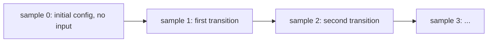
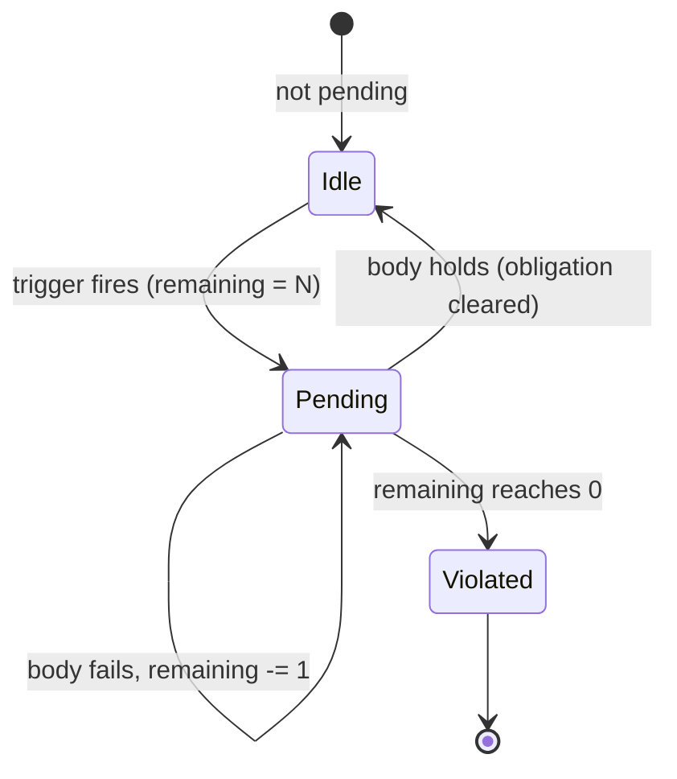
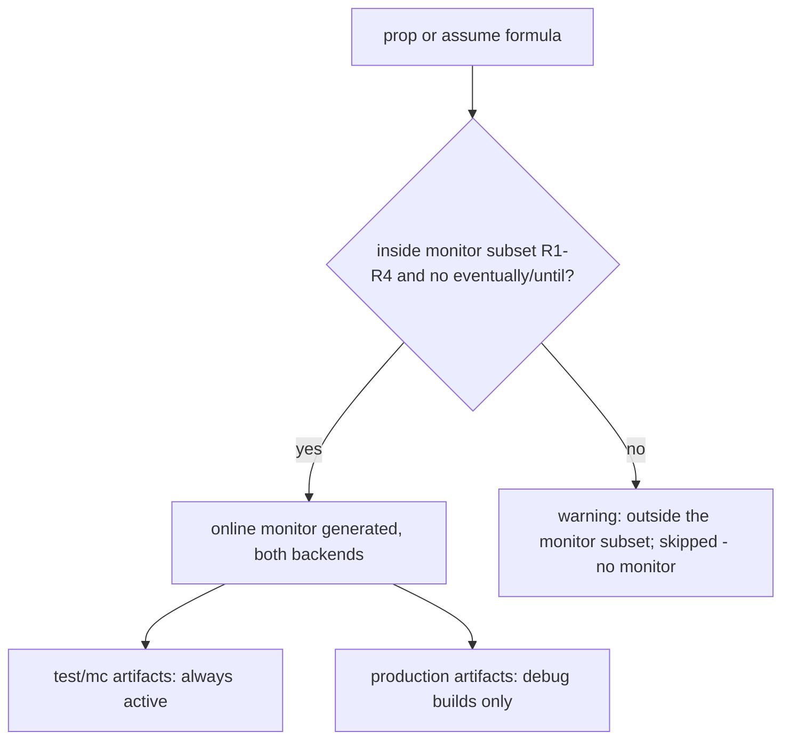

# RFS Property Language Reference

Reference for the PSL-like property language: what you can assert about your
machine (`prop`), what you can require of the environment (`assume`), and how
the toolchain enforces each kind. Normative semantics:
[docs/SEMANTICS.md sections 4-8](../SEMANTICS.md). Syntax primer:
[LANGUAGE.md](LANGUAGE.md).

**Table of contents**

1. [Properties vs assumptions](#1-properties-vs-assumptions)
2. [Sampling: what a property observes](#2-sampling-what-a-property-observes)
3. [Atoms](#3-atoms)
4. [Operators, one by one](#4-operators-one-by-one)
5. [Bounded eventually: the obligation model](#5-bounded-eventually-the-obligation-model)
6. [Liveness: eventually and until (MC-only)](#6-liveness-eventually-and-until-mc-only)
7. [The monitor subset and skip reasons](#7-the-monitor-subset-and-skip-reasons)
8. [Assumptions and handler policies](#8-assumptions-and-handler-policies)
9. [Strong vs weak liveness, and fairness](#9-strong-vs-weak-liveness-and-fairness)
10. [Worked examples: specs 13, 15, 16, 42](#10-worked-examples-specs-13-15-16-42)

## 1. Properties vs assumptions

```rfs
prop no_bad : always (state != Bad) ;
assume env_tick : always (bounded_eventually[5] (input_is(Tick))) ;
```

- A **property** is a SYSTEM obligation: the machine must keep it true on
  every run. A violated property fails the model check and (when monitors are
  enabled) fails the step in generated code.
- An **assumption** is an ENVIRONMENT guarantee: it constrains which input
  sequences are considered. In model checking, a successor that violates an
  active assumption is PRUNED from exploration; in generated code it is routed
  through the assumption handler (section 8). Both use the SAME language.

## 2. Sampling: what a property observes

A run is observed as a SEQUENCE OF SAMPLES:

```text
sample 0:  state = initial, vars = initial values, input = NONE, outputs = []
sample k:  the transition just taken (k >= 1):
           input consumed, outputs emitted, from_state, to_state,
           vars = POST-step valuation
```

Consequences every operator relies on:

- Expression atoms are evaluated at POST-STEP values: `state` is the TARGET
  state of the step, variables the NEW values (at sample 0: the initial
  configuration).
- `input_is(...)` / `output_has(...)` refer to the TRANSITION JUST TAKEN -
  both are FALSE at sample 0.
- Monitors are stepped at sample 0 (construction) and after every step, so a
  property can already be violated at sample 0 (an invariant on the initial
  state).



## 3. Atoms

| Atom | True at sample s iff |
|---|---|
| `<boolean expression>` | the expression is true on s's post-step values (`state`, variables) |
| `input_is(EventPattern)` | the input consumed at s matches the pattern (false at s=0). Same pattern forms as transition patterns - wildcards and binds constrain nothing |
| `output_has(OutputPattern)` | AT LEAST ONE output emitted at s matches (false at s=0) |

```rfs
prop syn_ack : always (input_is(Recv(Syn)) -> output_has(Send(SynAck))) ;
```

## 4. Operators, one by one

Boolean connectives `!`, `&&`, `||`, `->` are truth-functional per sample.
Precedence corner case (implemented): `a || b -> c` parses as `a || (b -> c)`
- parenthesize implications for clarity.

| Operator | Meaning (one line) | Tiny example |
|---|---|---|
| `next (f)` | `f` must hold one sample later; top-level `next` is vacuous at sample 0 | `always (input_is(Go) -> next (state == B))` - after every Go, the NEXT sample is in B |
| `always (f)` | `f` holds at EVERY sample from 0 on (unbounded safety) | `always (state != Bad)` |
| `always[N] (f)` | `f` holds at samples `0 ..= N-1`, then no more checks (`N >= 1`; `always[0]` is a validation error) | `always[4] (state != Error)` - the first 4 samples are safe |
| `bounded_eventually[N] (f)` | OBLIGATION: once triggered, `f` must hold within N samples (section 5) | `always (input_is(Start) -> bounded_eventually[3] (output_has(Finished)))` |
| `eventually (f)` | LIVENESS (MC-only): `f` holds at SOME position of the path | `eventually (state == Done)` |
| `p until q` | WEAK until (MC-only): `q` holds at some position with `p` holding before it - OR `q` never holds and `p` holds forever | `(window <= 4) until (state == Done)` |

Restrictions:

- `next` requires a temporal-operator-free body.
- `always[N]` is allowed only at top level or under boolean connectives -
  never under another temporal operator.
- `bounded_eventually[N]` bodies must be temporal-operator-free; the operator
  may not be negated and may not nest under another `bounded_eventually` or
  under `next` (restrictions R1-R4, section 7).

## 5. Bounded eventually: the obligation model

`bounded_eventually[N] (f)` is a countdown OBLIGATION:

- **Top level** (no enclosing temporal operator): pending from sample 0 - `f`
  must hold at some sample in `[0, N-1]`; if never, the violation is CONFIRMED
  at sample N-1. For N = 0 the body must hold at sample 0 itself.
- **As the consequent of `p -> bounded_eventually[N] (f)`**: for every anchor
  sample i where `p(i)` holds, `f` must hold within `[i, i+N-1]`; confirmed at
  i+N-1 if it never does. A re-trigger while pending is IGNORED (the pending
  obligation has the earliest deadline). At TOP LEVEL this implication is
  ONE-SHOT: only `p(0)` can start the countdown.
- **Inside `always`/`always[N]` bodies**: the reactive "whenever p, then f
  within N" form - anchors at every sample of that range.

The exact stepping algorithm (both backends render this):

```text
a = in_range(s) && eval(trigger at s)
b = eval(body at s)
if not pending and a:      pending = true; remaining = N; trigger_step = s
if pending:
    if b:                  pending = false
    else:                  remaining -= 1
                           if remaining == 0: VIOLATION confirmed at sample s
```

Worked countdown (N = 3, trigger at i, body never holds): remaining 3->2 at
s=i, 2->1 at s=i+1, 1->0 at s=i+2 - violation CONFIRMED at i+2.



## 6. Liveness: eventually and until (MC-only)

```rfs
prop terminates : eventually (state == Done) ;
prop bound_until_done : (next_seq - acked <= 4) until (state == Done) ;
```

- `eventually (p)` is STRONG liveness: p must hold at SOME position of EVERY
  infinite path from the initial configuration.
- RFS `until` IS **weak** until: `p until q` holds if q eventually holds with
  p before it, OR q never holds and p holds forever. Strong until is
  expressible as `p until q && eventually q`; there is no separate operator.
- Precedence: `!` binds tighter than `until`; `&&`/`||`/`->` bind looser -
  compound operands need parentheses: `(a && b) until c`.
- A top-level liveness property may combine obligations with boolean
  operators at the top level; obligation operands must be BOOLEAN formulas.
  Deeper nesting produces a codegen diagnostic (never a parse error) and the
  property is SKIPPED - the binary still compiles and runs without it.
- Liveness formulas are NOT monitorable: production/test codegen skips them
  with the identical warning in every backend; only the model checker checks
  them. A liveness violation is reported as a LASSO (prefix + cycle) - see
  [MODEL_CHECKING.md](MODEL_CHECKING.md#counterexamples).

## 7. The monitor subset and skip reasons

Every IN-SUBSET property/assumption compiles to an ONLINE MONITOR: a small
per-label state machine stepped once per sample, in BOTH backends.

- In `test` and `mc` artifacts monitors are ALWAYS active.
- In PRODUCTION artifacts they are gated on debug builds (`#[cfg(debug_assertions)]`
  in Rust, `-DRFS_PROPERTY_MONITORS` in C) - zero cost in release.

Formulas outside the subset still parse and validate, but codegen in EVERY
backend emits the identical warning and generates no monitor for that label:

```text
property '<name>' is outside the monitor subset; skipped
```

The restrictions (R1-R4):

- **R1:** no `bounded_eventually` under negation.
- **R2:** a `bounded_eventually[N] b` node requires `b` temporal-operator-free
  and may appear at top level or inside an `always`/`always[N]` body - except
  under another `bounded_eventually`, not under `next`. Its trigger is the
  implication antecedent when it is directly the consequent of `->`, else true.
- **R3:** `always[N]` only at top level or under boolean connectives.
- **R4:** `next` allowed anywhere safety is allowed, except inside a
  bounded-eventually body.

### What `rfs info` reports

`rfs info` shows each property/assumption with its monitor status. Real output
for [examples/valid/43_sliding_window.rfs](../../examples/valid/43_sliding_window.rfs):

```text
  properties:
    window_bound: always (((next_seq - acked) <= 4)) - monitored
    terminates: eventually ((state == Done)) - skipped: liveness operators (eventually/until) are outside the monitor subset
    bounded_until_done: ((next_seq - acked) <= 4) until (state == Done) - skipped: liveness operators (eventually/until) are outside the monitor subset
  assumptions:
    env_tick: always (bounded_eventually[5] (input_is(Tick))) - monitored
```



## 8. Assumptions and handler policies

Assumption monitors are ALWAYS ACTIVE in generated code (never build-gated,
unlike property monitors). A confirmed assumption violation at a step is routed
through the ASSUMPTION HANDLER, which returns a policy:

| Policy | Effect |
|---|---|
| `Continue` | the step proceeds as if nothing happened (violation recorded in statistics/traces) |
| `Stop` | the step returns an assumption-violation error (`StepError::AssumptionViolation { label }` / C `RFS_ASSUMPTION_VIOLATION`); state is NOT updated |
| `Panic` | the program panics/aborts with the label |

- The plain production entry point `Fsm::step(input)` uses the PANIC handler;
  `Fsm::step_with_handler(input, handler)` lets callers choose. The C backend
  mirrors this with a function-pointer handler (default aborts).
- **Sample-0 rule:** if an active assumption is already violated at the
  initial configuration, the CONSTRUCTOR panics (production and MC binaries
  alike) - assumptions must hold initially by design.
- **Selection:** `--assumes all|none|labels` (default `all`) picks which
  assumptions are active; unknown labels in the list are SILENTLY DROPPED. In
  exact MC, an assumption violation on a successor PRUNES that successor -
  checked BEFORE property violations (a successor violating both is pruned,
  not reported). `--assumes none` explores everything.
- **Out-of-subset assumptions** (containing `eventually`/`until`, or breaking
  R1-R4) generate NO monitor and are skipped with the identical warning -
  they are NOT enforced anywhere; express environment liveness guarantees in
  bounded form if you need them checked.

## 9. Strong vs weak liveness, and fairness

- **Strong liveness** (`eventually p`): p must occur on every infinite path - a
  scheduler that starves p forever is a counterexample.
- **Weak until** (`p until q`): the "q never holds but p holds forever"
  branch means weak until does NOT force progress toward q; combine with
  `eventually q` to require it.
- **Fairness:**
  - Deterministic mode (default): environment fairness by construction - every
    input is explored adversarially and there is no scheduler nondeterminism,
    so NO fairness filter applies; every reachable cycle is a valid
    counterexample candidate.
  - `--nondet` mode: STRONG TRANSITION FAIRNESS. A bad cycle is a valid
    counterexample only if EVERY transition enabled at some state of the cycle
    is taken on the cycle (each cycle state must have exactly one explored
    successor, fully expanded in truncated mode).
- `--nondet` itself: every enabled transition becomes a separate successor
  (all matches, in firing order) instead of first-match-wins - use it to check
  properties against ALL resolutions of overlapping guards. See
  [FAQ.md](FAQ.md#nondeterministic-mc-vs-deterministic-production).

## 10. Worked examples: specs 13, 15, 16, 42

All four are in `examples/valid/`; every result below is the ACTUAL output of
`cargo run -- mc-ref <spec>` (exact mode) in this repository.

### 13 - safety + next
[13_properties_safety.rfs](../../examples/valid/13_properties_safety.rfs):

```rfs
prop no_bad : always (state != Bad) ;
prop returns_good : always (input_is(ToGood) -> next (state == Good)) ;
```

`no_bad` is a plain invariant; `returns_good` says "the sample AFTER every
ToGood is in Good". Exact MC explores the input `ToBad` from the initial state
and reports the FIRST confirmed violation:

```text
FAIL
model-check summary: status=fail states=1 transitions=2 max_depth=0 reason=property-violation label=no_bad step=1
  unexpected terminations: 0
  monitor size: 1 bits
  memory estimate: 33 bytes
property violation: no_bad
  violation step: 1
  vars at violation step: Vars
counterexample trace:
  initial state=State::Good vars=Vars
  step 0 input=Input::ToBad outputs=[] from=State::Good to=State::Bad vars=Vars
```

(Exit code 1. The machine is genuinely bad - `ToBad` is a legal input with no
guard, so the invariant cannot hold; see [FAQ.md](FAQ.md) for how assumptions
and guards change this.)

### 15 - bounded eventually as an implication consequent
[15_bounded_eventually.rfs](../../examples/valid/15_bounded_eventually.rfs):

```rfs
prop start_finish : always (input_is(Start) -> bounded_eventually[3] (output_has(Finished))) ;
```

"Whenever Start is consumed, Finished is emitted within 3 samples." The
`always` makes this the REACTIVE form: every Start re-arms the obligation.
The property itself holds in this spec - but exact MC still FAILs it, because
the terminal state `Complete` has no outgoing transitions and is therefore a
DEADLOCK (a configuration with no surviving successor for ANY input):

```text
FAIL
model-check summary: status=fail states=3 transitions=2 max_depth=2 reason=deadlock label=- step=2
  unexpected terminations: 4
  monitor size: 3 bits
  memory estimate: 99 bytes
deadlock: configuration at depth 2 has no enabled transition
```

This is the most common "my spec works but MC fails" case - see
[FAQ.md](FAQ.md#why-does-my-working-spec-fail-mc-with-deadlock). The benchmark
specs (43/47/48/49) absorb inputs in terminal states for exactly this reason.

### 16 - next
[16_next_property.rfs](../../examples/valid/16_next_property.rfs):

```rfs
prop goes_to_b : always (input_is(Go) -> next (state == B)) ;
```

One-sample delay: after every Go, the next sample is in B. Holds here; exact
MC again reports the deadlock at state B (no outgoing transitions):

```text
FAIL
model-check summary: status=fail states=2 transitions=1 max_depth=1 reason=deadlock label=- step=1
  unexpected terminations: 1
  monitor size: 1 bits
  memory estimate: 66 bytes
deadlock: configuration at depth 1 has no enabled transition
```

### 42 - concurrent bounded obligations + assumption
[42_bounded_liveness_protocol.rfs](../../examples/valid/42_bounded_liveness_protocol.rfs)
is the Phase 3 showcase: a retry protocol with an environment assumption and
two obligations that can be PENDING AT THE SAME TIME:

```rfs
assume env_tick : always (bounded_eventually[4] (input_is(Tick))) ;
prop start_responds : always (input_is(Start) -> bounded_eventually[5] (output_has(Sent) || input_is(Ack))) ;
prop retry_responds : always (state == Sending && output_has(Sent) -> bounded_eventually[8] (output_has(Sent) || input_is(Ack))) ;
```

- `env_tick`: a Tick arrives within every 5 samples (the environment keeps
  time).
- `start_responds`: a Start is answered by the immediate Sent emission or an
  Ack within 5 samples.
- `retry_responds`: a retry (Sent while Sending) is followed by another Sent or
  an Ack within 8 samples - bounds chosen consistent with `env_tick` and the
  timer, so both obligations can be pending concurrently without spurious
  violations.

Exact MC on the unmodified spec:

```text
FAIL
model-check summary: status=fail states=6 transitions=5 max_depth=3 reason=deadlock label=- step=2
  unexpected terminations: 7
  monitor size: 13 bits
  memory estimate: 216 bytes
deadlock: configuration at depth 2 has no enabled transition
```

Again the terminal `Done` state (no self-loops) is the failure, not the
properties - the monitors themselves (13 bits of packed monitor state in the
configuration encoding) are exercised by the generated test/mc artifacts and
the differential suites. Add self-loop arms to `Done` and this spec passes
complete.
