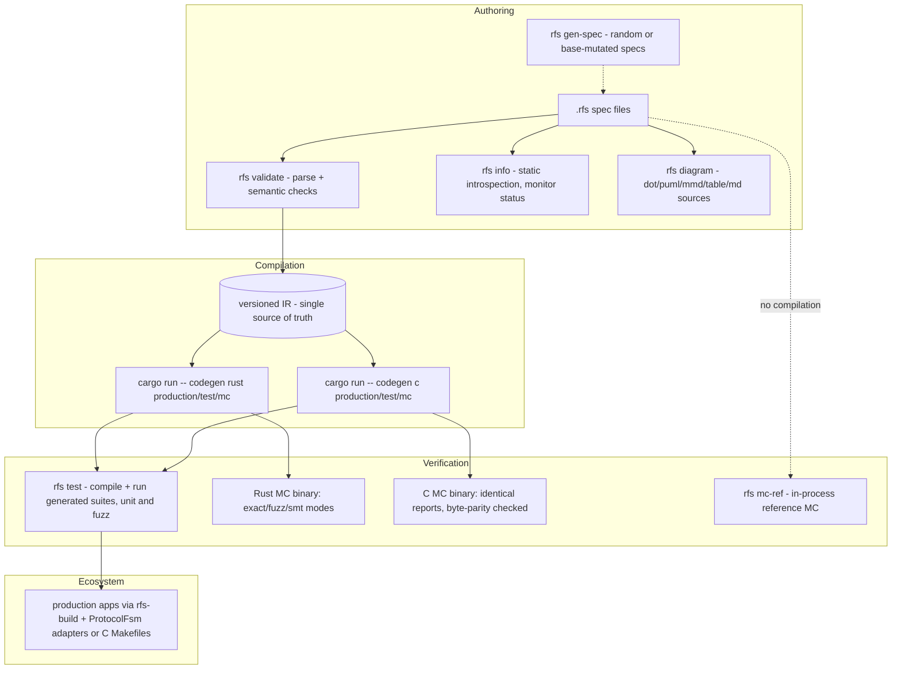

# RFS User Documentation

Welcome to the RFS user documentation - written for people who have never seen
this repository. RFS is a **finite-state protocol specification language**:
you describe one endpoint of a protocol as a finite input/output machine, and
the toolchain compiles that ONE description to production FSMs (Rust AND C),
generated test suites, model-checking binaries, diagrams, and static
introspection - all from the same versioned IR, with cross-backend parity
checked by differential tests.

The core principle: **one constrained specification -> one versioned IR ->
multiple targets.** The language stays finite (no unbounded data, no floats,
no arbitrary functions) so that model checking can PROVE properties instead of
sampling them.

## Which doc for which question?

| You want to... | Read |
|---|---|
| Write a spec: syntax, states, events, variables, transitions, expressions | [LANGUAGE.md](LANGUAGE.md) |
| Assert properties and environment assumptions; understand monitors and skip warnings | [PROPERTIES.md](PROPERTIES.md) |
| Model-check your spec: modes, every flag, statuses, reading reports | [MODEL_CHECKING.md](MODEL_CHECKING.md) |
| Integrate generated code: build.rs, adapters, C Makefiles, no_std, CI | [INTEGRATION.md](INTEGRATION.md) |
| Learn from concrete protocol examples (with state diagrams + real MC results) | [EXAMPLES.md](EXAMPLES.md) |
| Understand abstraction/assumptions, deadlock failures, limits, migration | [FAQ.md](FAQ.md) |
| Know what is stable across versions and how to migrate | [MIGRATION.md](MIGRATION.md) |
| Read the NORMATIVE formal semantics (what every rule above means precisely) | [docs/SEMANTICS.md](../SEMANTICS.md) |

## The toolchain at a glance



Eight stable commands (the v1.0 CLI surface): `parse`, `validate`, `info`,
`test`, `diagram`, `codegen`, `mc-ref`, `gen-spec`. Run any of them with no
arguments for its usage text:

```sh
cargo run --            # full usage, including per-command descriptions
```

## A two-minute tour

```sh
# validate the smallest example
cargo run -- validate examples/valid/01_trivial_two_state.rfs

# model-check a real protocol (in-process, no compilation)
cargo run -- mc-ref examples/valid/43_sliding_window.rfs
# -> PASS (complete) - 94 states explored, liveness proven under the env_tick assumption

# generate production Rust for it
cargo run -- codegen rust production examples/valid/43_sliding_window.rfs --out /tmp/arq.rs
head -1 /tmp/arq.rs
# -> // Generated by RFS v1.0.0 | spec sha256:... | module sliding_window
```

Then read [EXAMPLES.md](EXAMPLES.md) for the full walkthrough of that protocol,
and [INTEGRATION.md](INTEGRATION.md) to drive it from your own code.

## Where things live

| Path | What |
|---|---|
| [examples/valid/](../../examples/valid/) | 50 valid specs (file-driven suite: drop a file in, it is tested) |
| [examples/invalid/](../../examples/invalid/) | 13 specs that MUST be rejected |
| [docs/SEMANTICS.md](../SEMANTICS.md) | normative formal semantics |
| [ide/README.md](../../ide/README.md) | editor support: TextMate grammar + snippets for `.rfs` |
| BUILD.md / TOOLCHAIN.md (repo root) | how to build/test/run and where the toolchain lives (maintainer docs) |

## Conventions of this doc set

- Every command example is copy-paste runnable from the repository root (via
  `cargo run --`; an installed binary is just `rfs`).
- Diagrams are plain-text Mermaid blocks - versionable, diffable, and checked
  by the test suite (`tests/docs_md_test.rs` renders every one of them).
- Real outputs quoted in these pages were captured from this repository's
  toolchain (v1.0.0); where a value is machine-dependent (wall-clock times,
  `peak_rss_kb`) that is said explicitly.
